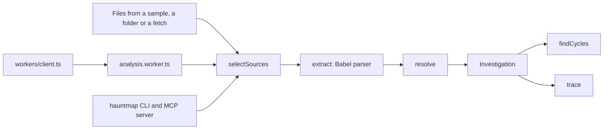

# Design Document

## Overview

The analysis core is plain TypeScript under `src/analysis` and `src/contracts`. It has no user interface code. The app calls it through a worker. The command line tool and the MCP server call it directly in Node. Both paths use the same functions, so both give the same bytes.

## Architecture



Files:

```
src/contracts/types.ts                the contracts below, copied from the plan
src/contracts/options.ts              DEFAULT_ANALYSIS_OPTIONS
src/analysis/parser/select.ts         selectSources
src/analysis/parser/paths.ts          normalizePath, case and duplicate checks
src/analysis/parser/extract.ts        extractImports for one file
src/analysis/parser/resolve.ts        resolveSpecifier
src/analysis/parser/analyze.ts        analyze
src/analysis/graph/presets.ts         which relations a preset includes
src/analysis/graph/ids.ts             occurrenceId, relationId
src/analysis/graph/cycles.ts          findCycles
src/analysis/graph/trace.ts           trace
src/analysis/index.ts                 the only export file
src/workers/analysis.worker.ts        the worker entry
src/workers/client.ts                 the worker handle with revision guard
public/demo/manor/before, after       the 40 module sample pair, expected.json, sources.json
public/demo/annex                     the legacy sample, expected.json, sources.json
tests/fixtures/                       unit fixtures, each with expected.json, and fixtures.test.ts, samples.test.ts
scripts/pack-samples.ts               writes sources.json beside each sample, with --check
scripts/check-expected.mjs            the plain text cross check
tests/analysis/                       unit tests of the analysis modules
tests/workers/client.test.ts
tests/analysis.properties.test.ts, tests/analysis.spec-properties.test.ts
tests/analysis-boundary.test.ts
```

`src/analysis/graph/compare.ts` belongs to `snapshot-comparison` and is not built here. The folders `tests/analysis/`, `tests/workers/` and the three `tests/analysis*.test.ts` files are not listed in `.kiro/steering/ownership.md`; no other spec uses them, and this spec creates them.

## Components and Interfaces

The contracts. Do not change them.

```ts
type SyntaxKind = "import" | "re-export" | "dynamic-literal";
type DependencyKind = "value" | "type" | "mixed";
type Preset = "static-value" | "type-inclusive" | "dynamic-inclusive";

interface SourceFile { path: string; text: string; bytes: number }
interface SourceSet { rootLabel: string; files: SourceFile[]; skipped: { path: string; reason: "excluded-dir" | "extension" | "oversized" | "secret-pattern" | "binary" }[] }

interface AnalysisOptions {
  preset: Preset;
  includeExtensions: string[];      // [".js", ".jsx", ".ts", ".tsx", ".mjs", ".mts"]
  excludeDirectories: string[];     // [".git", "node_modules", "dist", "build", "out", ".next", "coverage"]
  excludeFilePatterns: string[];    // [".env", ".env.*", "*.pem", "*.key", "id_rsa*"]
  maxFiles: number; maxFileBytes: number; maxTotalBytes: number;   // 1000 local or 400 GitHub; 1 MiB; 25 MiB
  jsToTsFallback: true;
}

interface ModuleRecord { id: string; sourceHash: string; language: "js" | "jsx" | "ts" | "tsx"; parseStatus: "ok" | "partial" | "failed" }

interface ImportRecord {
  occurrenceId: string;
  relationId: string;
  from: string; to: string | null; specifier: string;
  syntaxKind: SyntaxKind; dependencyKind: DependencyKind;
  resolution: "local" | "external" | "unresolved" | "unsupported";
  line: number; column: number;
  reason?: "absent-file" | "alias-not-configured" | "nonliteral-dynamic" | "unsupported-construct" | "ambiguous-candidate";
}

interface Diagnostic { code: "parse-failed" | "unresolved" | "unsupported" | "case-collision" | "duplicate-path" | "oversized" | "cap-reached"; module?: string; line?: number; column?: number; specifier?: string; message: string }

interface Investigation {
  schemaVersion: 1; resolverMode: "documented-source-subset";
  sourceLabel: string;
  modules: ModuleRecord[]; imports: ImportRecord[]; diagnostics: Diagnostic[]; options: AnalysisOptions;
}

interface TraceResult { origin: string; direction: "imports" | "imported-by"; preset: Preset; visited: string[]; direct: string[]; indirect: string[]; predecessor: Record<string, string>; distance: Record<string, number> }
interface CyclicComponent { members: string[]; witness: { modules: string[]; relationIds: string[] } }
interface CycleReport { preset: Preset; components: CyclicComponent[] }
interface RelationRef { relationId: string; from: string; to: string | null; specifier: string; syntaxKind: SyntaxKind; dependencyKind: DependencyKind; resolution: ImportRecord["resolution"] }
interface ComparisonResult {
  schemaVersion: 1; preset: "static-value";
  before: { label: string; moduleCount: number; relationCount: number }; after: { label: string; moduleCount: number; relationCount: number };
  addedModules: string[]; removedModules: string[]; changedModules: string[];
  addedRelations: RelationRef[]; removedRelations: RelationRef[];
  cyclicComponentsBefore: number; cyclicComponentsAfter: number;
}
```

`RelationRef` and `ComparisonResult` are types only, copied from the plan so that `src/contracts/types.ts` holds every contract. Their function, `compare`, belongs to `snapshot-comparison`.

The functions of this spec:

```ts
// src/contracts/options.ts, re-exported by src/analysis/index.ts
export const DEFAULT_ANALYSIS_OPTIONS: AnalysisOptions;   // preset "static-value", the six extensions, the seven directories, the five patterns, maxFiles 1000, maxFileBytes 1048576, maxTotalBytes 26214400, jsToTsFallback true

export function selectSources(files: SourceFile[], rootLabel: string, options: AnalysisOptions):
  { ok: true; sourceSet: SourceSet; diagnostics: Diagnostic[] } | { ok: false; diagnostics: Diagnostic[] };
export type HashFn = (text: string) => Promise<string>;   // SHA-256 hex. Web Crypto in the app, node:crypto in Node.
export function analyze(sourceSet: SourceSet, options: AnalysisOptions, hash: HashFn, onProgress?: (done: number, total: number) => void, selectionDiagnostics?: Diagnostic[]): Promise<Investigation>;
export function findCycles(investigation: Investigation, preset: Preset): CycleReport;
export function trace(investigation: Investigation, origin: string, direction: "imports" | "imported-by", preset: Preset): TraceResult;   // throws an Error naming the origin when it is not a module
```

`analyze` merges `selectionDiagnostics` (the `oversized`, `case-collision` and `duplicate-path` diagnostics that `selectSources` returned) into `Investigation.diagnostics`, because `SourceSet` has no field for them. `onProgress` is called once after each file with the number done and the total. The worker, the fixture test and every caller that goes through `selectSources` pass the diagnostics on.

Worker messages:

```ts
type WorkerRequest = { requestId: string; revision: number; kind: "analyze"; payload: { files: SourceFile[]; rootLabel: string; options: AnalysisOptions } };
type WorkerReply =
  | { requestId: string; revision: number; kind: "progress"; done: number; total: number }
  | { requestId: string; revision: number; kind: "result"; investigation: Investigation }
  | { requestId: string; revision: number; kind: "error"; diagnostics: Diagnostic[]; message: string };
```

The layout request kind belongs to the investigation-ui spec. It uses the same envelope.

The client in `src/workers/client.ts`:

```ts
interface WorkerLike { postMessage(message: WorkerRequest): void; terminate(): void; onmessage: ((event: { data: WorkerReply }) => void) | null; onerror: ((event: unknown) => void) | null }
export class AnalysisCancelled extends Error {}
export class AnalysisFailed extends Error { diagnostics: Diagnostic[] }
export interface AnalysisClient {
  analyze(request: { files: SourceFile[]; rootLabel: string; options: AnalysisOptions }, onProgress?: (done: number, total: number) => void): Promise<Investigation>;
  cancel(): void;
  readonly currentRevision: number;
  readonly lastInvestigation: Investigation | null;
}
export function createAnalysisClient(createWorker: () => WorkerLike): AnalysisClient;
```

Each `analyze` call increments `currentRevision`. If a request is running, the client calls `terminate()`, creates a new worker with `createWorker`, and rejects the running request with `AnalysisCancelled`. `cancel()` does the same without a new request. A reply with a revision below `currentRevision` is dropped. A `result` for the current revision sets `lastInvestigation` and resolves. An `error` reply or a worker `onerror` rejects with `AnalysisFailed` and leaves `lastInvestigation` as it was. The worker entry runs `selectSources`, then `analyze` with a Web Crypto hash and the selection diagnostics, and answers `error` with the `cap-reached` diagnostic when `selectSources` returns `ok: false`.

## Data Models

- Language by extension: `.js` and `.mjs` give `js`, `.jsx` gives `jsx`, `.ts` and `.mts` give `ts`, `.tsx` gives `tsx`.
- Parser mode by extension, always `sourceType: "module"` and without error recovery: `.ts` and `.mts` use the `typescript` plugin; `.tsx` uses `typescript` and `jsx`; `.js`, `.jsx` and `.mjs` use `jsx`. Because recovery is off, any syntax error gives `failed`.
- Sorting: every string comparison is by UTF-16 code unit (`a < b`), never `localeCompare`. `imports` sort by the `occurrenceId` string. Duplicated relations are collapsed to one relation by `relationId` before any graph algorithm; every occurrence stays in `imports`.
- Presets: `static-value` takes `import` and `re-export` syntax with `value` or `mixed` kind. `type-inclusive` takes those and every relation with `type` kind. `dynamic-inclusive` takes the `static-value` relations and `dynamic-literal` syntax. Only resolved local relations enter the graph.
- Cycles: Tarjan's algorithm, written without recursion, over module ids in sorted order, with each module's outgoing relations in sorted `relationId` order. The witness is found by a depth first walk inside the component from its smallest member, taking the smallest next member first (the smallest `relationId` when two relations reach the same member), with one visited set that is never unmarked, and stops at the first relation that returns to the start. The walk is the stack at that moment, so `modules` does not repeat the start and `relationIds` has one entry for each module.
- Trace: breadth first search over the preset's resolved local relations, forward for `imports` and backward for `imported-by`. Neighbours are visited in sorted order, so `predecessor` is the same on every run. `predecessor[m]` is the module from which `m` was first reached, one step closer to the origin. The origin is in `visited` with distance 0 and is never in `direct` or `indirect`.
- A `mixed` relation is one relation and is walked once.
- Resolution order: a path is matched in code unit case-sensitive form. When the step that finds a candidate matches two or more paths that differ only in case, the result is `ambiguous-candidate`, even if one of them has the exact case.
- `sources.json` beside a sample lists every file path and its text, packed by `scripts/pack-samples.ts` from the sample folder, so that the app can load a sample with one request.

## Error Handling

- A file that fails to parse gives one module with `parseStatus` `failed`, no imports and one diagnostic. It never stops the analysis.
- `parseStatus` `partial` stays in the contract. This spec does not write it, because Babel error recovery is off; no test depends on it.
- `selectSources` returns `ok: false` only for a cap. Every other problem is a skipped entry or a diagnostic.
- The worker turns any thrown error into an `error` reply. The client keeps the last good investigation.
- `require()`, tsconfig `paths` and the other out of scope constructs are not recognized and produce no record. The resolution `unsupported` with reason `unsupported-construct` stays in the contract and is not written by this spec.

## Testing Strategy

Tests are written first and seen to fail. Each unit fixture is a small folder under `tests/fixtures/<name>/` with an `expected.json` written by hand. `tests/fixtures/fixtures.test.ts` has one test for each fixture and each section of its `expected.json` (`modules`, `imports`, `diagnostics`, `cycles`, `trace`); the task that implements a section adds its tests, so that `pnpm verify` is green at the end of every task.

| Fixture | What it holds | Expected facts |
| --- | --- | --- |
| `kinds` | One file with a value import, a type import, a mixed import, a side effect import, `export { a } from`, `export type { T } from`, `export * from`, `export type * from`, each from a module that exists in the folder | 8 imports: `import`+`value`, `import`+`type`, `import`+`mixed`, `import`+`value`, `re-export`+`value`, `re-export`+`type`, `re-export`+`value`, `re-export`+`type`, each with its line and column |
| `resolve-order` | `a.ts` imports `./b`, and the folder holds `b.ts`, `b.js` and `b/index.ts` | `./b` resolves to `b.ts` |
| `js-to-ts` | `a.ts` imports `./b.js` (only `b.ts` exists), `./c.js` (only `c.tsx`), `./d.mjs` (only `d.mts`) and `./e.js` (both `e.js` and `e.ts` exist) | 4 local relations: `b.ts`, `c.tsx`, `d.mts`, `e.js` |
| `absent` | `a.ts` imports `./missing` | `unresolved`, reason `absent-file`, one diagnostic |
| `alias` | `a.ts` imports `@/lib/format` and `~/config/env` | two `unresolved` with reason `alias-not-configured`, two diagnostics |
| `external` | `a.ts` imports `react` and `@scope/pkg/sub` | two `external`, `to` null, no diagnostic |
| `self-loop` | `a.ts` imports `./a` | one cyclic component of size one, witness `modules` of length 1 |
| `two-cycles` | `a` and `b` import each other, `c` imports `d`, `d` imports `e`, `e` imports `c`, `f` imports `a` | two components, `[a.ts, b.ts]` and `[c.ts, d.ts, e.ts]`, witnesses start at `a.ts` and `c.ts` with 2 and 3 steps |
| `type-cycle` | `a.ts` has `export type { T } from "./b"` and `b.ts` imports a value from `./a` | no component under `static-value`, one (`a.ts`, `b.ts`) under `type-inclusive` |
| `parse-fail` | `good.ts` and `broken.ts` with a syntax error | `broken.ts` is `failed` with no imports, `good.ts` is `ok`, one `parse-failed` diagnostic with the error's line and column |
| `case` | `Util.ts`, `util.ts` and `a.ts`, which imports `./util` | three diagnostics: two `case-collision` (one for each path) and one `unresolved` for `./util` with reason `ambiguous-candidate`; all three files are modules |
| `dynamic` | `a.ts` has `import("./b")` and `import(name)`; `b.ts` has `import { x } from "./a"` | one `dynamic-literal` relation (`a.ts` to `b.ts`), one `unsupported` import with specifier `name` and reason `nonliteral-dynamic`, one `unsupported` diagnostic; no cycle under `static-value` and `type-inclusive`, one component (`a.ts`, `b.ts`) under `dynamic-inclusive` |
| `chain` | `a.ts` imports `./b`, `b.ts` imports `./c`, `d.ts` imports `./b`, `c.ts` imports nothing | trace facts below |
| `diamond` | `top.ts` imports `./left` and `./right`, each of them imports `./base`, `base.ts` imports nothing | trace facts below |
| `same-names` | `a/util.ts`, `b/util.ts`, `a/index.ts` importing `./util`, `b/index.ts` importing `./util` and `../a/util` | 5 modules with distinct ids, 3 local relations with distinct relation ids: `a/index.ts` to `a/util.ts`, `b/index.ts` to `b/util.ts`, `b/index.ts` to `a/util.ts` |

Trace facts, calculated by hand (`visited` includes the origin; `distance` of the origin is 0):

| Fixture | Call | `direct` | `indirect` | `predecessor` | `distance` |
| --- | --- | --- | --- | --- | --- |
| `chain` | `imports` from `a.ts` | `b.ts` | `c.ts` | `b.ts`: `a.ts`, `c.ts`: `b.ts` | `b.ts` 1, `c.ts` 2 |
| `chain` | `imported-by` from `c.ts` | `b.ts` | `a.ts`, `d.ts` | `b.ts`: `c.ts`, `a.ts`: `b.ts`, `d.ts`: `b.ts` | `b.ts` 1, `a.ts` 2, `d.ts` 2 |
| `diamond` | `imports` from `top.ts` | `left.ts`, `right.ts` | `base.ts` | `left.ts`: `top.ts`, `right.ts`: `top.ts`, `base.ts`: `left.ts` | `left.ts` 1, `right.ts` 1, `base.ts` 2 |
| `diamond` | `imported-by` from `base.ts` | `left.ts`, `right.ts` | `top.ts` | `left.ts`: `base.ts`, `right.ts`: `base.ts`, `top.ts`: `left.ts` | `left.ts` 1, `right.ts` 1, `top.ts` 2 |
| `two-cycles` | `imported-by` from `a.ts` | `b.ts`, `f.ts` | none | `b.ts`: `a.ts`, `f.ts`: `a.ts` | `b.ts` 1, `f.ts` 1 |
| `two-cycles` | `imports` from `a.ts` | `b.ts` | none | `b.ts`: `a.ts` | `b.ts` 1 |

In `diamond`, `base.ts` is visited once, so `visited` lists four modules. An origin that is not a module throws an error that names it.

More tests:

- The three samples (`manor/before`, `manor/after`, `annex`) match their `expected.json` exactly, in `tests/fixtures/samples.test.ts`. For the pair, the removed, added and changed facts of requirement 8.2 are checked against the two `expected.json` files, and `findCycles` gives one component before and none after.
- Determinism: analyze each sample twice with the file list shuffled, and once with a Web Crypto hash and once with a `node:crypto` hash, and compare the JSON text. Check that no source line of the fixtures appears in the JSON text.
- Never execute: a fixture file whose top level sets a global flag and throws leaves the flag unset after `analyze`.
- Worker tests with a fake worker: an older revision is discarded, a cancel during a run terminates the busy worker and creates a new one within 500 ms, a worker that never answers (a stand-in for synchronous parsing) is cancelled the same way, an error keeps the last investigation. These tests do not prove timing in a real browser worker; that is not claimed.
- `scripts/check-expected.mjs` passes for the three samples and fails when one import line is removed from a copy.
- `tests/analysis-boundary.test.ts` fails on an import from `src/scene`, `src/features`, `src/components`, a DOM API or a worker global in `src/analysis` or `src/contracts`, and on extraction, resolution, cycle or trace code outside those two folders.

## Correctness Properties

1. **Same input, same bytes.** For any source set, `JSON.stringify(await analyze(...))` is equal across runs and across file order. (Requirements 4.4, 9.2)
2. **Every import is accounted for.** For any generated set of small files with static imports only, the number of import records equals the number of import and export-from statements written into them. (2.2)
3. **A local edge has a real target.** Every import with resolution `local` has a `to` that is the id of a module in the investigation. (3.1)
4. **Witness is a real loop.** For every cyclic component, each step `i` of the witness is a relation of the investigation that the preset includes, from `modules[i]` to `modules[(i + 1) % n]`, and `modules[0]` is the smallest member. (5.3)
5. **Components do not overlap.** No module is a member of two components, and every member can reach every other member of its component. (5.1)
6. **Trace distances are shortest.** For any visited module, following `predecessor` reaches the origin in exactly `distance` steps, and for every relation the search follows from a visited module `u` to `v`, `distance[v] <= distance[u] + 1`. (6.2)
7. **Preset order.** The relations of `static-value` are a subset of `type-inclusive` and of `dynamic-inclusive`. (5.4)

## Decisions and Alternatives

- The Babel parser over the TypeScript compiler. Chosen in the plan because it runs in a worker with a small bundle and gives import kinds directly. Pin the version at scaffold time and read the import and export kind fields of that version.
- A documented subset over a full resolver. Chosen so that every edge on the map can be explained with one rule. An import outside the subset is shown as unresolved, never guessed.
- The hash function is passed in. Chosen because the browser and Node have different SHA-256 calls.
- `type-inclusive` and `dynamic-inclusive` are siblings of `static-value`, not a chain. The plan says each "adds" its relations and does not say whether `dynamic-inclusive` also includes type relations; the sibling reading keeps each preset's difference from the default to one named addition. Property 7 holds under either reading.
- The default options live in `src/contracts/options.ts` as `DEFAULT_ANALYSIS_OPTIONS`, because `kiro-integration` task 3 imports that name from `src/contracts` for the Node loader.

## Out of Scope

- tsconfig `paths` and `extends`, package `exports` conditions, CommonJS `require`, Vue and Svelte files, build plugin transforms.
- Layout, drawing, comparison of two investigations, and export. They belong to the other specs.
- Reading files from disk or the network. Callers pass files in.
- `src/contracts/validate.ts` (`validateInvestigation`, `validateComparison`). `kiro-integration` task 4a plans to add it, but `src/contracts/**` belongs to this spec. The owner must assign it before that task starts.
