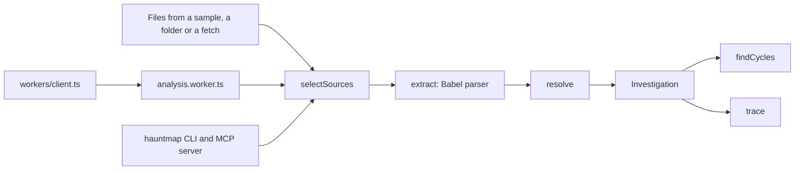

# Design Document

## Overview

The analysis core is plain TypeScript under `src/analysis` and `src/contracts`. It has no user interface code. The app calls it through a worker. The command line tool and the MCP server call it directly in Node. Both paths use the same functions, so both give the same bytes.

## Architecture



Files:

```
src/contracts/types.ts                the contracts below, copied from the plan
src/analysis/parser/select.ts         selectSources, DEFAULT_OPTIONS
src/analysis/parser/paths.ts          normalizePath, case and duplicate checks
src/analysis/parser/extract.ts        extractImports for one file
src/analysis/parser/resolve.ts        resolveSpecifier
src/analysis/parser/analyze.ts        analyze
src/analysis/graph/presets.ts         which relations a preset includes
src/analysis/graph/ids.ts             occurrenceId, relationId
src/analysis/graph/cycles.ts          findCycles
src/analysis/graph/trace.ts           trace
src/analysis/index.ts                 the only export file
src/workers/analysis.worker.ts        the worker entry
src/workers/client.ts                 the worker handle with revision guard
public/demo/manor/before, after       the 40 module sample pair, expected.json, sources.json
public/demo/annex                     the legacy sample, expected.json, sources.json
tests/fixtures/                       unit fixtures, each with expected.json
scripts/check-expected.mjs            the plain text cross check
tests/analysis-boundary.test.ts
```

## Components and Interfaces

The contracts. Do not change them.

```ts
type SyntaxKind = "import" | "re-export" | "dynamic-literal";
type DependencyKind = "value" | "type" | "mixed";
type Preset = "static-value" | "type-inclusive" | "dynamic-inclusive";

interface SourceFile { path: string; text: string; bytes: number }
interface SourceSet { rootLabel: string; files: SourceFile[]; skipped: { path: string; reason: "excluded-dir" | "extension" | "oversized" | "secret-pattern" | "binary" }[] }

interface AnalysisOptions {
  preset: Preset;
  includeExtensions: string[];      // [".js", ".jsx", ".ts", ".tsx", ".mjs", ".mts"]
  excludeDirectories: string[];     // [".git", "node_modules", "dist", "build", "out", ".next", "coverage"]
  excludeFilePatterns: string[];    // [".env", ".env.*", "*.pem", "*.key", "id_rsa*"]
  maxFiles: number; maxFileBytes: number; maxTotalBytes: number;   // 1000 local or 400 GitHub; 1 MiB; 25 MiB
  jsToTsFallback: true;
}

interface ModuleRecord { id: string; sourceHash: string; language: "js" | "jsx" | "ts" | "tsx"; parseStatus: "ok" | "partial" | "failed" }

interface ImportRecord {
  occurrenceId: string;
  relationId: string;
  from: string; to: string | null; specifier: string;
  syntaxKind: SyntaxKind; dependencyKind: DependencyKind;
  resolution: "local" | "external" | "unresolved" | "unsupported";
  line: number; column: number;
  reason?: "absent-file" | "alias-not-configured" | "nonliteral-dynamic" | "unsupported-construct" | "ambiguous-candidate";
}

interface Diagnostic { code: "parse-failed" | "unresolved" | "unsupported" | "case-collision" | "duplicate-path" | "oversized" | "cap-reached"; module?: string; line?: number; column?: number; specifier?: string; message: string }

interface Investigation {
  schemaVersion: 1; resolverMode: "documented-source-subset";
  sourceLabel: string;
  modules: ModuleRecord[]; imports: ImportRecord[]; diagnostics: Diagnostic[]; options: AnalysisOptions;
}

interface TraceResult { origin: string; direction: "imports" | "imported-by"; preset: Preset; visited: string[]; direct: string[]; indirect: string[]; predecessor: Record<string, string>; distance: Record<string, number> }
interface CyclicComponent { members: string[]; witness: { modules: string[]; relationIds: string[] } }
interface CycleReport { preset: Preset; components: CyclicComponent[] }
```

The functions of this spec:

```ts
export const DEFAULT_OPTIONS: AnalysisOptions;
export function selectSources(files: SourceFile[], rootLabel: string, options: AnalysisOptions):
  { ok: true; sourceSet: SourceSet; diagnostics: Diagnostic[] } | { ok: false; diagnostics: Diagnostic[] };
export type HashFn = (text: string) => Promise<string>;   // SHA-256 hex. Web Crypto in the app, node:crypto in Node.
export function analyze(sourceSet: SourceSet, options: AnalysisOptions, hash: HashFn, onProgress?: (done: number, total: number) => void): Promise<Investigation>;
export function findCycles(investigation: Investigation, preset: Preset): CycleReport;
export function trace(investigation: Investigation, origin: string, direction: "imports" | "imported-by", preset: Preset): TraceResult;
```

Worker messages:

```ts
type WorkerRequest = { requestId: string; revision: number; kind: "analyze"; payload: { files: SourceFile[]; rootLabel: string; options: AnalysisOptions } };
type WorkerReply =
  | { requestId: string; revision: number; kind: "progress"; done: number; total: number }
  | { requestId: string; revision: number; kind: "result"; investigation: Investigation }
  | { requestId: string; revision: number; kind: "error"; diagnostics: Diagnostic[]; message: string };
```

The layout request kind belongs to the investigation-ui spec. It uses the same envelope.

## Data Models

- Language by extension: `.js` and `.mjs` give `js`, `.jsx` gives `jsx`, `.ts` and `.mts` give `ts`, `.tsx` gives `tsx`.
- Cycles: Tarjan's algorithm over module ids in sorted order, with each module's outgoing relations in sorted `relationId` order. The witness is found by a depth first walk inside the component from its smallest member, taking the smallest next member first, until the walk returns to the start.
- Trace: breadth first search over the preset's resolved local relations, forward for `imports` and backward for `imported-by`. Neighbours are visited in sorted order, so `predecessor` is the same on every run.
- A `mixed` relation is one relation and is walked once.
- `sources.json` beside a sample lists every file path and its text, packed by `scripts/pack-samples.ts` from the sample folder, so that the app can load a sample with one request.

## Error Handling

- A file that fails to parse gives one module with `parseStatus` `failed` and one diagnostic. It never stops the analysis.
- A file where Babel recovers from an error gives `parseStatus` `partial` and keeps the imports it found.
- `selectSources` returns `ok: false` only for a cap. Every other problem is a skipped entry or a diagnostic.
- The worker turns any thrown error into an `error` reply. The client keeps the last good investigation.

## Testing Strategy

Tests are written first and seen to fail. Each unit fixture is a small folder under `tests/fixtures/<name>/` with an `expected.json` written by hand.

| Fixture | What it holds | Expected facts |
| --- | --- | --- |
| `kinds` | One file with a value import, a type import, a mixed import, a side effect import, `export { a } from`, `export type { T } from`, `export * from`, `export type * from` | 8 imports with the syntax and dependency kinds of requirement 2.3, each with its line and column |
| `resolve-order` | `a.ts` imports `./b`, and the folder holds `b.ts`, `b.js` and `b/index.ts` | `./b` resolves to `b.ts` |
| `js-to-ts` | `a.ts` imports `./b.js`, and only `b.ts` exists | resolves to `b.ts` |
| `absent` | `a.ts` imports `./missing` | `unresolved`, reason `absent-file`, one diagnostic |
| `alias` | `a.ts` imports `@/lib/format` and `~/config/env` | two `unresolved` with reason `alias-not-configured` |
| `external` | `a.ts` imports `react` and `@scope/pkg/sub` | two `external`, `to` null |
| `self-loop` | `a.ts` imports `./a` | one cyclic component of size one |
| `two-cycles` | `a` and `b` import each other, `c`, `d` and `e` form a ring, `f` imports `a` | two components, witnesses start at `a.ts` and `c.ts` |
| `type-cycle` | `a.ts` has `export type { T } from "./b"` and `b.ts` imports a value from `./a` | no component under `static-value`, one under `type-inclusive` |
| `parse-fail` | `good.ts` and `broken.ts` with a syntax error | `broken.ts` is `failed`, `good.ts` is `ok`, one `parse-failed` diagnostic |
| `case` | `Util.ts` and `util.ts` | two `case-collision` diagnostics |
| `dynamic` | `a.ts` has `import("./b")` and `import(name)` | one `dynamic-literal` relation, one `unsupported` with reason `nonliteral-dynamic` |

More tests:

- The three samples match their `expected.json` exactly.
- Trace on `two-cycles`: `imported-by` from `a.ts` gives `direct` of `b.ts` and `f.ts` and no `indirect`.
- Determinism: analyze each sample twice with the file list shuffled and compare the JSON text.
- Worker tests with a fake worker: an older revision is discarded, a cancel during a run creates a new worker, an error keeps the last investigation.
- `scripts/check-expected.mjs` passes for the three samples and fails when one import line is removed from a copy.

## Correctness Properties

1. **Same input, same bytes.** For any source set, `JSON.stringify(await analyze(...))` is equal across runs and across file order. (Requirements 4.4, 9.2)
2. **Every import is accounted for.** For any generated set of small files, the number of import records equals the number of import and export-from statements written into them. (2.2)
3. **A local edge has a real target.** Every import with resolution `local` has a `to` that is the id of a module in the investigation. (3.1)
4. **Witness is a real loop.** For every cyclic component, each step of the witness is a relation of the investigation that the preset includes, and the walk returns to its start. (5.3)
5. **Components do not overlap.** No module is a member of two components, and every member can reach every other member of its component. (5.1)
6. **Trace distances are shortest.** For any visited module, following `predecessor` reaches the origin in exactly `distance` steps. (6.2)
7. **Preset order.** The relations of `static-value` are a subset of `type-inclusive` and of `dynamic-inclusive`. (5.4)

## Decisions and Alternatives

- The Babel parser over the TypeScript compiler. Chosen in the plan because it runs in a worker with a small bundle and gives import kinds directly. Pin the version at scaffold time and read the import and export kind fields of that version.
- A documented subset over a full resolver. Chosen so that every edge on the map can be explained with one rule. An import outside the subset is shown as unresolved, never guessed.
- The hash function is passed in. Chosen because the browser and Node have different SHA-256 calls.

## Out of Scope

- tsconfig `paths` and `extends`, package `exports` conditions, CommonJS `require`, Vue and Svelte files, build plugin transforms.
- Layout, drawing, comparison of two investigations, and export. They belong to the other specs.
- Reading files from disk or the network. Callers pass files in.
