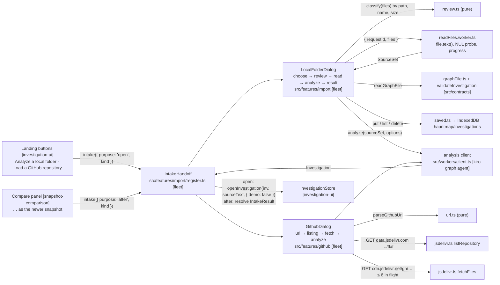

# Design Document

## Overview

This spec adds HauntMap's two non-sample intake routes on top of the `investigation-ui` screen and the `analysis-core` contracts. `src/features/import/` owns the local route: a `webkitdirectory` input, a pure classification of the chosen files by path, name and size (the same rules, in the same order, as the Node loader of `kiro-integration`), a review screen that shows counts and lists before any content is read, a read worker that decodes the included files with real progress and a terminate-and-recreate cancel, the analysis client call, a coverage summary, `Save investigation on this device` behind an injected IndexedDB adapter, and graph-file import of a bare `Investigation` or a `GraphExport` envelope. `src/features/github/` owns the GitHub route: a pure URL parser, the jsDelivr listing filtered by the same rules before any file request, the 400-file cap as an error, file fetches with at most six in flight under one `AbortController`, progress, cancel and the exact listing error. Both routes are reached through one `intake` handoff registered in the fleet registry, with a `kinds` list that tells the landing which buttons to enable, and both run in `open` mode (the result replaces the current investigation through `openInvestigation`) or in `after` mode (the result is resolved to `snapshot-comparison` without touching the store, request R3).

Owner: fleet, two writers in two worktrees (`../HauntMap-import` on `fleet/import` for `src/features/import/**` and the local half of `tests/intake/`; `../HauntMap-github` on `fleet/github` for `src/features/github/**` and the GitHub half), reviewed by Kiro per merged task from the 250-credit line shared with `investigation-ui`. Window November 10–18 (work packages H13 and H10, gate November 18), fixes to November 27. Figures in this document (3,000 ms, 10,000 ms, 100 ms, 6 in flight, 200 entries) are targets until a log row, a `docs/performance.md` line or an acceptance report records them with device, browser, commit and date.

Dependencies on `main` before task 2: `src/contracts/` with `SourceSet`, `AnalysisOptions`, `DEFAULT_ANALYSIS_OPTIONS` and `Investigation`; `src/workers/client.ts` with `analyze(sourceSet, options)` and `cancel()`; `src/features/investigation/{store,registry}.ts` with the `intake` overload (`investigation-ui` task 2b); `src/components/Landing.tsx` calling the handoff (`investigation-ui` task 6a); `src/contracts/validate.ts` (`kiro-integration` task 4a) before task 5. `tests/intake/` is this spec's test folder; `tests/ui/` and `tests/e2e/` belong to `investigation-ui`.

## Architecture



The local flow, `open` mode (Requirements 2–3):

```mermaid
sequenceDiagram
  participant U as user
  participant D as LocalFolderDialog
  participant R as review.ts
  participant W as read worker
  participant A as analysis client
  participant S as store
  U->>D: choose folder (input change)
  D->>R: classify(folder, candidates from webkitRelativePath/name/size, DEFAULT_ANALYSIS_OPTIONS)
  R-->>D: Review { included, skipped, counts, includedBytes }
  Note over D: review screen; Analyze disabled above 1,000 files, 25 MiB or at 0 files; nothing read yet
  U->>D: Analyze
  D->>S: setStatus("Reading 0 of <n> files")
  D->>W: { requestId, kind: "read", files, rootLabel }
  W-->>D: progress { done, total } (≤ every 100 ms)
  W-->>D: done { sourceSet } (binary files moved to skipped)
  D->>A: analyze(sourceSet, { ...defaults, preset })
  A-->>D: Investigation
  D->>S: openInvestigation(investigation, map(sourceSet.files), { demo: false }); setStatus(summary)
  D-->>U: result screen: Save investigation on this device · Include source text · Close
  Note over U,W: Cancel during reading → worker.terminate(), fresh worker; during analysis → client.cancel(); store untouched; "Analysis cancelled. <label> is still open."
```

The GitHub flow (Requirements 7–8):

```mermaid
sequenceDiagram
  participant U as user
  participant G as GithubDialog
  participant P as url.ts
  participant J as jsdelivr.ts
  participant A as analysis client
  participant S as store
  U->>G: paste URL, Load
  G->>P: parseGithubUrl(url)
  alt invalid
    G->>S: setStatus(URL_FORMAT or SUBFOLDER_REJECTED); no request
  else { owner, repo, ref }
    G->>J: listRepository(owner, repo, ref, fetch, signal)
    alt status ≠ 200 or rejection
      G->>S: setStatus("Could not list <owner>/<repo>@<ref>: <status>. Only public repositories are supported.")
    else entries
      G->>G: classify(entries by path and listed size) → included, skipped
      alt included > 400 or = 0
        G->>S: setStatus(cap or no-files message); no file request
      else
        G->>J: fetchFiles(…, ≤ 6 in flight, one AbortController, onProgress)
        J-->>G: files (NUL-probed), or { path, status } failure, or AbortError on Cancel
        G->>A: analyze(sourceSet, { ...defaults, preset, maxFiles: 400 })
        A-->>G: Investigation
        G->>S: openInvestigation(…, { demo: false }) [open mode]; setStatus("Loaded <owner>/<repo>@<ref>: …")
      end
    end
  end
```

### File layout for this spec

| Path | Role | Writer (worktree) |
| --- | --- | --- |
| `src/features/import/register.ts` | `registerIntake(deps)`: builds the `IntakeHandoff` with its `kinds`, registers it, installs `window.__hauntmap.intake` when the hook exists | fleet (`../HauntMap-import`) |
| `src/features/import/messages.ts` | every exact string of the local route (constants and template functions below) | fleet (import) |
| `src/features/import/review.ts` | `stripRoot`, `classify`, `capMessage`, `formatSize` (pure) | fleet (import) |
| `src/features/import/readFiles.worker.ts`, `readFiles.ts` | the read worker and its client (`createReadClient`: `read`, `cancel` by terminate-and-recreate, stale-result drop) | fleet (import) |
| `src/features/import/localIntake.ts` | `runLocalIntake(deps, mode)`: the dialog's state machine (`choose` → `review` → `reading` → `analyzing` → `result`) and the `open`/`after` behaviour | fleet (import) |
| `src/features/import/LocalFolderDialog.tsx` | the dialog component (screens, Tab orders of 10.1, `aria-busy`, lists capped at 200) | fleet (import) |
| `src/features/import/saved.ts` | `SavedStore`, `createSavedStore(idb)`, `createMemorySavedStore()` | fleet (import) |
| `src/features/import/graphFile.ts` | `readGraphFile(file, validate)` for bare investigations and `GraphExport` envelopes | fleet (import) |
| `src/features/github/messages.ts`, `url.ts`, `jsdelivr.ts`, `githubIntake.ts`, `GithubDialog.tsx`, `flags.ts` | the GitHub route: strings, `parseGithubUrl`, `listRepository` and `fetchFiles`, `runGithubIntake` and `githubOpener`, the dialog, `GITHUB_INTAKE_ENABLED` | fleet (`../HauntMap-github`) |
| `src/components/App.tsx` | calls `registerIntake({ …, github: githubOpener(deps) })` at start | integrator |
| `tests/intake/**` | unit, component and property tests, fixtures, generators, fakes, `e2e/local.spec.ts`, `e2e/github.spec.ts` | the route's writer (shared files `fixtures.test.ts`, `register.test.ts`, `after-mode.test.tsx` by the import writer) |
| `docs/limitations.md` (intake lines), `docs/performance.md` (`GitHub load` heading), `docs/kiro-log.md` rows | the recorded jsDelivr behaviours, the load figure, the task rows | fleet / builder per line |

## Components and Interfaces

### Consumed contracts (verbatim from the plan; defined in `src/contracts/`, never redefined here)

```ts
type Preset = "static-value" | "type-inclusive" | "dynamic-inclusive";
interface SourceFile { path: string; text: string; bytes: number }                 // path normalized, relative to root
interface SourceSet { rootLabel: string; files: SourceFile[]; skipped: { path: string; reason: "excluded-dir" | "extension" | "oversized" | "secret-pattern" | "binary" }[] }
interface AnalysisOptions {
  preset: Preset;
  includeExtensions: string[];      // [".js", ".jsx", ".ts", ".tsx", ".mjs", ".mts"]
  excludeDirectories: string[];     // [".git", "node_modules", "dist", "build", "out", ".next", "coverage"]
  excludeFilePatterns: string[];    // [".env", ".env.*", "*.pem", "*.key", "id_rsa*"]
  maxFiles: number; maxFileBytes: number; maxTotalBytes: number;   // 1000 local or 400 GitHub; 1 MiB; 25 MiB
  jsToTsFallback: true;
}
interface Investigation { schemaVersion: 1; resolverMode: "documented-source-subset"; sourceLabel: string; modules: ModuleRecord[]; imports: ImportRecord[]; diagnostics: Diagnostic[]; options: AnalysisOptions }
```

`DEFAULT_ANALYSIS_OPTIONS: Omit<AnalysisOptions, "preset">` is imported from `src/contracts/` (the name `kiro-integration` task 1a records, *verify* there, not here). Consumed from `investigation-ui`, unchanged: `InvestigationStore` (`openInvestigation`, `setStatus`, `getState`), `Registry` with `registerHandoff("intake", fn)` and the types `IntakeKind`, `IntakeArgs`, `IntakeResult`, `IntakeHandoff`; the analysis client as `analyze(sourceSet: SourceSet, options: AnalysisOptions): Promise<Investigation>` and `cancel(): void`; `validateInvestigation` from `src/contracts/validate.ts`; the `GraphExport` envelope shape of `snapshot-comparison` 9.1 (`investigation`, optional `source.files[<label>][<path>]`).

### Registration (`src/features/import/register.ts`)

```ts
export interface IntakeDeps {
  store: InvestigationStore;
  registry: Registry;
  analysisClient: { analyze(sourceSet: SourceSet, options: AnalysisOptions): Promise<Investigation>; cancel(): void };
  defaults: Omit<AnalysisOptions, "preset">;                 // DEFAULT_ANALYSIS_OPTIONS
  validate: typeof validateInvestigation;
  saved: SavedStore | null;                                   // createSavedStore(globalThis.indexedDB); null when unavailable
  createReadWorker: () => Worker;                             // new Worker(new URL("./readFiles.worker.ts", import.meta.url), { type: "module" }) (*verify* the worker form on the pinned Vite)
  github: GithubOpener | null;                                // githubOpener(deps) from src/features/github; null when not wired
  fetchImpl?: typeof fetch; now?: () => Date;
  document?: Document;                                        // for the webkitdirectory probe and focus handling; tests inject jsdom's
}
export type GithubOpener = (args: { purpose: "open" | "after" }) => Promise<IntakeResult>;
export function registerIntake(deps: IntakeDeps): void;
// const handoff: IntakeHandoff = Object.assign(async (args) => …, { kinds: deps.github ? ["local", "github"] : ["local"] });
// args.kind === "local" → runLocalIntake(deps, args.purpose); "github" → deps.github({ purpose }); a call while a dialog is open returns the pending promise;
// registry.registerHandoff("intake", handoff); if window.__hauntmap exists, window.__hauntmap.intake = { selectFiles, requests }
export function hasDirectoryInput(doc: Document): boolean;   // "webkitdirectory" in doc.createElement("input")
```

### Classification (`src/features/import/review.ts`, pure)

```ts
export type SkipReason = SourceSet["skipped"][number]["reason"];
export interface Candidate { path: string; size: number; file?: File }           // path relative to the root, forward slashes, no leading "./"
export interface Review {
  folder: string;                                                                 // the chosen folder's name (first path segment) or the repository label
  included: Candidate[];                                                          // sorted by path, code-unit order
  skipped: { path: string; reason: SkipReason }[];                                // sorted by path; one entry per excluded directory path ("<dir>/")
  counts: Record<"excluded-dir" | "secret-pattern" | "extension" | "oversized", number>;
  includedBytes: number;
}
export function stripRoot(webkitRelativePath: string): { folder: string; path: string };   // "sample-local/src/a.ts" → { folder: "sample-local", path: "src/a.ts" }; backslashes → "/"
export function classify(folder: string, candidates: Candidate[], options: Omit<AnalysisOptions, "preset">): Review;
// for each candidate, in this order (kiro-integration 2.2): a segment in excludeDirectories → skipped once per directory path (the first segment that matches, as "<a>/<b>/" up to and including it), the file not listed;
// basename matches an excludeFilePatterns glob (".env" exact, ".env.*", "*.pem", "*.key", "id_rsa*"; basename only, case-sensitive) → secret-pattern;
// extension (after the last "." of the basename; a basename starting with "." and without another "." has none) not in includeExtensions → extension;
// size > maxFileBytes → oversized; else included. No file is read.
export function capMessage(review: Review, maxFiles: number, maxTotalBytes: number): string | null;   // 2.5 texts, or null when Analyze may run
export function formatSize(bytes: number): string;   // "<n> KB" (1,024 bytes, rounded up) below 1,048,576; else "<n.n> MiB" with one decimal
```

### Read worker and client (`src/features/import/readFiles.worker.ts`, `readFiles.ts`)

```ts
type ReadRequest  = { requestId: string; kind: "read"; files: { path: string; file: File }[]; rootLabel: string; skipped: SourceSet["skipped"] };
type ReadProgress = { requestId: string; kind: "progress"; done: number; total: number };
type ReadDone     = { requestId: string; kind: "done"; sourceSet: SourceSet };
type ReadError    = { requestId: string; kind: "error"; message: string };
// worker: for each file in path order: head = await file.slice(0, 8192).arrayBuffer(); if head contains 0x00 → skipped.push({ path, reason: "binary" });
//   else text = await file.text() (UTF-8, BOM removed as Blob.text() does; no newline normalization), files.push({ path, text, bytes: file.size });
//   post progress when ≥ 100 ms since the last one or on the last file; finally post done with files sorted by path (code-unit order) and the merged skipped list.
export function createReadClient(createWorker: () => Worker): {
  read(req: Omit<ReadRequest, "requestId" | "kind">, onProgress: (p: { done: number; total: number }) => void): Promise<SourceSet>;
  cancel(): void;   // worker.terminate(); a fresh worker is created lazily; the pending promise rejects with { name: "AbortError" }; a message with an old requestId is dropped
};
```

### Local intake (`src/features/import/localIntake.ts`, `LocalFolderDialog.tsx`)

```ts
export type LocalScreen = "choose" | "review" | "reading" | "analyzing" | "result";
export interface LocalState { screen: LocalScreen; review: Review | null; progress: { done: number; total: number } | null; summary: string | null; error: string | null; saved: SavedRecord[] }
export function runLocalIntake(deps: IntakeDeps, purpose: "open" | "after"): Promise<IntakeResult>;
// opens LocalFolderDialog; resolves on close/cancel ({ ok:false, reason:"cancelled" }), on failure in after mode ({ ok:false, reason:"failed", message }), on success ({ ok:true, … });
// open mode: success → store.actions.openInvestigation(investigation, sourceText, { demo: false }); setStatus(summary); the dialog stays on the result screen until Close
// the before-state snapshot of ViewState (investigation, selection, routeFilter, camera, expandedWings, layout) is taken at Analyze and asserted unchanged on cancel or failure (3.3, P5)
export function summaryMessage(folder: string, inv: Investigation, review: Review, binarySkipped: number): string;   // 3.5
```

Dialog screens and controls (10.1): `choose` (the folder input or the no-directory text, the graph-file section, the saved list, `Close`); `review` (the lines and lists of 2.4, `Analyze`, `Back`, `Close`); `reading` and `analyzing` (the progress text, `Cancel`, `aria-busy="true"`); `result` (the summary, `Save investigation on this device`, `Include source text`, `Close`). In `after` mode the result screen shows only the summary and `Close`, and the save controls are absent (the newer snapshot of a comparison is never saved, `snapshot-comparison` Out of Scope).

### Saved investigations (`src/features/import/saved.ts`)

```ts
export interface SavedRecord { savedVersion: 1; label: string; savedAt: string; investigation: Investigation; sourceText: Record<string, string> | null }
export interface SavedStore {
  list(): Promise<SavedRecord[]>;          // sorted by savedAt descending
  put(record: SavedRecord): Promise<void>; // replaces a record with the same label
  delete(label: string): Promise<void>;
}
export function createSavedStore(idb: IDBFactory | undefined): SavedStore | null;   // database "hauntmap", version 1, object store "investigations" with keyPath "label"; null when idb is undefined or open() throws synchronously; an errored request rejects with the error's name
export function createMemorySavedStore(): SavedStore;                                // tests
export function recordSize(record: SavedRecord): number;                             // byte length of JSON.stringify(record), for the "<n> KB" of 5.2
```

### Graph-file import (`src/features/import/graphFile.ts`)

```ts
export async function readGraphFile(file: File, validate: typeof validateInvestigation, maxBytes = 26_214_400):
  Promise<{ ok: true; investigation: Investigation; sourceText: ReadonlyMap<string, string> | null; label: string } | { ok: false; message: string }>;
// size > maxBytes → GRAPH_TOO_LARGE (not read); JSON.parse failure → graphNotJson(message); value with an "investigation" key → envelope, else bare;
// validate(investigation) failure → graphInvalid(errors[0]); sourceText = new Map(Object.entries(envelope.source?.files?.[investigation.sourceLabel] ?? {})) or null when absent/empty
```

### GitHub route (`src/features/github/`)

```ts
// url.ts
export type ParsedUrl = { ok: true; owner: string; repo: string; ref: string | null } | { ok: false; message: string; showRefField: boolean };
export function parseGithubUrl(input: string): ParsedUrl;
// trims; requires the prefix "https://github.com/"; owner and repo = [A-Za-z0-9_.-]+ with an optional ".git" on repo and an optional trailing "/";
// "/tree/<ref>" with ref = [A-Za-z0-9_.-]+ → ref; "/tree/<ref>/<more>" or a ref containing "/" → SUBFOLDER_REJECTED with showRefField true; any other path → SUBFOLDER_REJECTED; anything else → URL_FORMAT

// jsdelivr.ts
export interface ListingEntry { path: string; size: number }                                  // field names on the live response *verify* November 14 (task 6)
export const listingUrl = (owner: string, repo: string, ref: string | null) =>
  ref ? `https://data.jsdelivr.com/v1/package/gh/${owner}/${repo}@${ref}/flat` : `https://data.jsdelivr.com/v1/package/gh/${owner}/${repo}/flat`;
export const fileUrl = (owner: string, repo: string, ref: string | null, path: string) =>
  ref ? `https://cdn.jsdelivr.net/gh/${owner}/${repo}@${ref}/${path}` : `https://cdn.jsdelivr.net/gh/${owner}/${repo}/${path}`;   // *verify* that the versionless form serves the default branch
export async function listRepository(owner: string, repo: string, ref: string | null, fetchImpl: typeof fetch, signal: AbortSignal):
  Promise<{ ok: true; entries: ListingEntry[]; resolvedRef: string | null; commit: string | null } | { ok: false; status: string }>;
// GET listingUrl with { credentials: "omit", signal }; status ≠ 200 → { ok:false, status: String(status) }; rejection → { ok:false, status: error.name };
// entries: each path with one leading "/" removed (*verify*); resolvedRef and commit from the response when it reports them (*verify*), else null
export async function fetchFiles(owner: string, repo: string, ref: string | null, included: Candidate[], fetchImpl: typeof fetch, signal: AbortSignal,
  onProgress: (done: number, total: number) => void, concurrency = 6):
  Promise<{ ok: true; files: SourceFile[]; binary: string[] } | { ok: false; path: string; status: string }>;
// a worker pool of `concurrency` over `included` in path order; each: GET fileUrl with { credentials: "omit", signal }; status ≠ 200 → abort the controller and return { ok:false, path, status };
// body bytes: NUL in the first 8,192 → binary; else text = new TextDecoder("utf-8").decode(bytes) (BOM removed), bytes = byteLength; AbortError propagates to the caller

// githubIntake.ts
export function runGithubIntake(deps: IntakeDeps, purpose: "open" | "after"): Promise<IntakeResult>;   // the state machine url → listing → fetching → analyzing → result with the messages of Requirements 7–8
export function githubOpener(deps: IntakeDeps): GithubOpener;
// flags.ts
export const GITHUB_INTAKE_ENABLED = true;   // 11.5
```

### Messages (`src/features/import/messages.ts`, `src/features/github/messages.ts`)

```ts
export const NO_DIRECTORY_INPUT = "Folder selection is not available in this browser. Import a graph file instead.";
export const REVIEW_SENTENCE = "Included files are read in this browser and kept in memory.";
export const tooManyFiles = (n: number) => `This folder has ${n} included files; the limit is 1,000. Choose a subfolder.`;
export const tooManyBytes = (size: string) => `This folder has ${size} of included text; the limit is 25 MiB. Choose a subfolder.`;
export const noFiles = (folder: string, k: number) => `No JavaScript or TypeScript files were found in ${folder} (${k} files skipped).`;
export const reading = (done: number, total: number) => `Reading ${done} of ${total} files`;
export const analyzing = (n: number) => `Analyzing ${n} files…`;
export const cancelled = (label: string | null) => label ? `Analysis cancelled. ${label} is still open.` : "Analysis cancelled.";
export const summary = (folder: string, m: number, r: number, d: number, k: number, b: number, f: number) =>
  `Analyzed ${folder}: ${m} modules, ${r} relations, ${d} diagnostics; ${k} files skipped before reading, ${b} binary files skipped, ${f} files failed to parse.`;
export const analyzeFailed = (message: string, preserved: boolean) => `The folder could not be analyzed (${message}).${preserved ? " The previous investigation is unchanged." : ""}`;
export const SAVE_SENTENCE = "Saved investigations stay in this browser's storage until you forget them.";
export const saved = (label: string, kb: number, included: boolean) => `Saved ${label} on this device (${kb} KB, source ${included ? "included" : "omitted"}).`;
export const SAVE_UNAVAILABLE = "Saving is not available in this browser.";
export const saveFailed = (name: string) => `The investigation could not be saved (${name}).`;
export const opened = (label: string) => `Opened ${label} from this device.`;
export const forgot = (label: string) => `Forgot ${label}.`;
export const savedInvalid = (label: string, err: string) => `The saved investigation ${label} is not valid (${err}) and was removed.`;
export const GRAPH_TOO_LARGE = "The graph file is larger than 25 MiB.";
export const graphNotJson = (message: string) => `The graph file is not JSON (${message}).`;
export const graphInvalid = (err: string) => `The graph file is not valid: ${err}.`;
export const imported = (label: string, m: number, r: number, included: boolean) => `Imported ${label}: ${m} modules, ${r} relations (source ${included ? "included" : "omitted"}).`;

export const PRIVACY_NOTE = "Repository name and file paths are requested from the jsDelivr CDN; local folder analysis still sends nothing.";
export const SUBFOLDER_REJECTED = "Subfolders are not supported yet; paste the repository root.";
export const URL_FORMAT = "Enter a URL of the form https://github.com/owner/repo or https://github.com/owner/repo/tree/branch.";
export const listFailed = (o: string, r: string, ref: string, status: string) => `Could not list ${o}/${r}@${ref}: ${status}. Only public repositories are supported.`;
export const cap = (o: string, r: string, ref: string, n: number, first: string) => `${o}/${r}@${ref} has ${n} included files; the limit is 400. First excluded: ${first}.`;
export const noFilesGh = (o: string, r: string, ref: string) => `No JavaScript or TypeScript files were found in ${o}/${r}@${ref}.`;
export const progress = (done: number, total: number) => `${done} of ${total} files`;
export const loadCancelled = (label: string | null) => label ? `Loading cancelled. ${label} is still open.` : "Loading cancelled.";
export const fetchFailed = (path: string, o: string, r: string, ref: string, status: string) => `Could not fetch ${path} from ${o}/${r}@${ref} (${status}). Nothing was loaded.`;
export const loaded = (o: string, r: string, ref: string, n: number, m: number, rel: number, d: number) => `Loaded ${o}/${r}@${ref}: ${n} files, ${m} modules, ${rel} relations, ${d} diagnostics.`;
export const GITHUB_DISABLED = "GitHub loading is not available in this build.";
```

`<ref>` in these messages is the ref as entered or typed, or `default` when none was given and the listing reports none (7.7).

### Development hook additions (`window.__hauntmap.intake`, development builds only)

```ts
interface DevHookIntake {
  selectFiles(files: { path: string; text: string }[], folder?: string): void;   // builds File objects (with webkitRelativePath defined through Object.defineProperty) and feeds them to the open local dialog's classification, for browsers and Playwright versions that cannot select a directory
  requests(): string[];                                                          // the URLs the GitHub route requested in this session (listing and files), in order
}
```

## Data Models

| Record | Where | Identity and version | Content and invariants |
| --- | --- | --- | --- |
| `Review` | local and GitHub dialogs (memory) | per selection | `included` ∪ `skipped` covers every candidate exactly once (an excluded directory covers its files, P1); `included` sorted; `includedBytes` = Σ included sizes; nothing read |
| `SourceSet` (local) | read worker output, in memory | `rootLabel: "local:<folder>"` | `files` sorted by path; every file passed the five inclusion conditions; `bytes` = `File.size`; `skipped` = the review's entries plus the `binary` ones |
| `SourceSet` (GitHub) | `fetchFiles` output, in memory | `rootLabel: "gh:<owner>/<repo>@<ref>"` | as above with `bytes` = body byte length; `files.length ≤ 400` |
| `Investigation` | produced by the analysis client, handed to the store or the caller | `sourceLabel` = the root label; `options.maxFiles` 1000 (local) or 400 (GitHub) | never mutated here; source text stays in the separate map |
| `SavedRecord` | IndexedDB `hauntmap` / `investigations`, key `label` | `savedVersion: 1`, `savedAt` ISO 8601 UTC | `investigation` validates; `sourceText` non-null only when the checkbox was checked; holds nothing about other investigations |
| `ParsedUrl` | GitHub dialog (memory) | — | `owner`, `repo`, `ref` match `[A-Za-z0-9_.-]+`; a rejection carries its message and whether the ref field is shown |
| `ListingEntry` | `listRepository` output | — | `path` without a leading `/`; `size` an integer; field names *verify* (task 6) |
| Batch controller | GitHub dialog (memory) | one per `Load` | at most 6 requests in flight (P4); `abort()` on Cancel or on a failed file; nothing retained after abort |
| `IntakeResult` | resolved to the caller | — | `ok: true` carries the investigation, the map (or `null`) and the label; `ok: false` carries `cancelled` or `failed` with the bare message |
| `docs/performance.md`, `GitHub load` heading | docs | date + device + repository | `| <YYYY-MM-DD> | <device> | <owner>/<repo>@<ref> | <included files> | <ms from Load to the map> |`, written by the builder from the real-network run |

Invariants (checked by the tests named in Testing Strategy):

- I1 Nothing is read before `Analyze`: no read method of any `File` is called during classification (2.2).
- I2 Classification parity: for the same tree, `classify` yields the same included paths and skip reasons as the Node loader of `kiro-integration`, except `binary`, which the browser decides at read time (2.3, P2).
- I3 Caps are errors: an analysis never runs on a subset of the included files; above a cap or at zero files no worker request and no file fetch happens (2.5, 7.5).
- I4 Preservation: on cancel or failure, and on every `after`-mode call, the six fleet fields of 3.3 are deep-equal before and after (3.3, 9.4, P5).
- I5 No network in the local flow; the GitHub flow requests only the listing URL and the file URLs of included entries, with `credentials: "omit"` and no custom header (4.1, 8.8, P7).
- I6 At most 6 file requests in flight; the number of file requests equals the included count unless cancelled or failed (8.1, P4).
- I7 Explicit persistence: IndexedDB is written only by `Save investigation on this device` (5.1, P8).
- I8 Every string on screen is a text node (1.6).

## Error Handling

Every failure is a typed value or a caught rejection; the dialogs never throw for a domain condition, never retry on their own, and never change the investigation on failure. Messages are written once through `store.actions.setStatus`; in `after` mode the bare message goes to the caller instead (9.2).

| Situation | Where | Exact user-visible text | Preserved | Focus / state |
| --- | --- | --- | --- | --- |
| `webkitdirectory` unsupported (2.1) | local dialog, first screen | `Folder selection is not available in this browser. Import a graph file instead.` | — | first control is `Choose a graph file` |
| Above 1,000 included files (2.5) | review | `This folder has <n> included files; the limit is 1,000. Choose a subfolder.` | nothing read | `Analyze` `aria-disabled` |
| Above 25 MiB of included text (2.5) | review | `This folder has <size> of included text; the limit is 25 MiB. Choose a subfolder.` | nothing read | same |
| No included files (2.5) | review | `No JavaScript or TypeScript files were found in <folder> (<k> files skipped).` | nothing read | same |
| Cancel during reading or analysis (3.3) | status region; review restored | `Analysis cancelled. <label> is still open.` / `Analysis cancelled.` | the six fleet fields | focus on `Analyze` |
| Read worker error or analysis rejection (3.6) | status region; review restored | `The folder could not be analyzed (<message>). The previous investigation is unchanged.` | same | same |
| IndexedDB unavailable (5.4) | result screen | `Saving is not available in this browser.` | — | save button `aria-disabled` |
| Save write fails (5.4) | status region; dialog open | `The investigation could not be saved (<error name>).` | investigation open | focus on the save button |
| Saved record invalid on open (5.3) | status region | `The saved investigation <label> is not valid (<first error>) and was removed.` | current investigation | focus on the next saved item or `Close` |
| Graph file over 25 MiB (6.2) | status region | `The graph file is larger than 25 MiB.` | everything; file not read | focus on `Choose a graph file` |
| Graph file not JSON (6.2) | status region | `The graph file is not JSON (<SyntaxError message>).` | everything | same |
| Graph file invalid (6.2) | status region | `The graph file is not valid: <first error>.` | everything | same |
| URL rejected (7.2) | status region; no request | `Subfolders are not supported yet; paste the repository root.` / `Enter a URL of the form https://github.com/owner/repo or https://github.com/owner/repo/tree/branch.` | everything | focus in `Repository URL`; `Branch or tag` shown when the ref was ambiguous |
| Listing not 200 or rejected (7.6) | status region | `Could not list <owner>/<repo>@<ref>: <status or error name>. Only public repositories are supported.` | everything | focus on `Load` |
| More than 400 included files (7.5) | status region; no file request | `<owner>/<repo>@<ref> has <n> included files; the limit is 400. First excluded: <path>.` | everything | same |
| No included files (7.5) | status region | `No JavaScript or TypeScript files were found in <owner>/<repo>@<ref>.` | everything | same |
| Cancel during fetching or analysis (8.3) | status region; URL screen | `Loading cancelled. <label> is still open.` / `Loading cancelled.` | the six fleet fields | focus on `Load` |
| A file not 200 or rejected (8.4) | status region | `Could not fetch <path> from <owner>/<repo>@<ref> (<status or error name>). Nothing was loaded.` | same | same |
| `GITHUB_INTAKE_ENABLED` false (11.5) | GitHub dialog | `GitHub loading is not available in this build.` | — | `Load` `aria-disabled` |
| Handoff called while a dialog is open (1.4) | — | nothing; the pending promise is returned | — | — |
| `after`-mode failure (9.2) | resolved to the caller | the failure sentence without the preservation sentence | the six fleet fields | the caller's |

What a user sees on the paths that matter most: a developer who picks a monorepo of 3,000 files sees the count and the limit before anything is read and picks a subfolder; a judge who pastes a private repository URL reads one sentence with the status jsDelivr returned; a judge whose browser cannot select folders imports a graph file instead; a cancel at 137 of 212 files leaves the manor exactly as it was.

## Testing Strategy

Commands. `pnpm verify` runs `tests/intake/**` (Vitest; `*.test.tsx` and `local-intake`/`github-intake` component tests in jsdom with React Testing Library, the rest in the node environment; the 90-second target and the `HAUNTMAP_FAST=1` rule of `investigation-ui` apply) with fast-check (200 runs per property, fixed seed printed on failure). `pnpm verify:e2e -- tests/intake/e2e/local.spec.ts tests/intake/e2e/github.spec.ts` runs both browser specs in the `dev` Playwright project of `investigation-ui` task 1c (Chromium, 1,280 × 720, one fresh context per test), using the fleet helpers (`openManor`, `tabTo`, `readStatus`, `assertFocusVisibleAndUnobscured`) and this spec's `tests/intake/e2e/helpers.ts` (`openLocalDialog`, `openGithubDialog`, `selectFixtureFolder` through `setInputFiles` with a directory, *verify* on the pinned Playwright, falling back to `window.__hauntmap.intake.selectFiles`, `routeJsdelivr(page, listing, files)`, `recordedRequests`).

Fixtures (`tests/intake/fixtures/`):

| Fixture | Content | Expected |
| --- | --- | --- |
| `folder/manifest.json`, materialized by `tests/intake/materialize.ts` into a temp directory named `sample-local` (and, for the browser, built into `File` objects by `selectFixtureFolder`) | `src/a.ts` = `import { b } from "./b";\nexport const a = b; // SENTINEL-LOCAL-4e2b17\n`; `src/b.ts` = `export const b = 1;\n`; `src/c.tsx` = `export const C = () => null;\n`; `bin.ts` = bytes `00 01 02` then `export {};\n`; `big.ts` = 1,048,577 bytes of `/`; `README.md` = `# fixture\n`; `.env` = `KEY=1\n`; `secret.pem` = `-----BEGIN-----\n`; `node_modules/pkg/index.js` = `module.exports = 1;\n`; `dist/out.js` = `export {};\n` | review per 2.6; after reading: `files` exactly `src/a.ts`, `src/b.ts`, `src/c.tsx`, `skipped` the six review entries plus `bin.ts · binary`; analysis: 3 modules, 1 relation (`src/a.ts → src/b.ts`), 0 diagnostics; the summary of 3.5; no request contains `sample-local`, a fixture path or the sentinel |
| `folder-exec/manifest.json` | `index.html` = `<script>document.cookie="marker=1"</script>\n` and `postinstall.js` = a script that would write `MARKER` if run; `src/a.ts` as above | review: `index.html` skipped `extension`, `postinstall.js` included; after analysis `document.cookie` lacks `marker` and no `MARKER` file exists (4.5) |
| generated 400-file folder (`tests/intake/generators.ts`: `folderOf(n)`) | `src/m<i>.ts` importing `./m<i+1>` | the cancel case of 3.3 at about half the files; the 200-file, 2 MiB variant (`folderOf(200, { bytesPerFile: 10_240 })`) for the 3.7 timing |
| `gh/listing-small.json` | the listing shape observed on November 14 (*verify*; entries with a path and a size): `/src/a.ts` 48, `/src/b.ts` 20, `/src/c.tsx` 30, `/README.md` 10, `/node_modules/pkg/index.js` 20, `/dist/out.js` 11, `/.env` 6, `/big.ts` 1048577; `gh/files/src/a.ts`, `src/b.ts`, `src/c.tsx` with the fixture texts above (no sentinel) | included `src/a.ts`, `src/b.ts`, `src/c.tsx`; three file requests; `Loaded <owner>/<repo>@main: 3 files, 3 modules, 1 relations, 0 diagnostics.` |
| generated `listing-over-cap` (`listingOf(401)`) | 401 entries `/src/m<i>.ts` of size 20 | the cap message with `src/m99.ts` (the 401st in code-unit order, derived by the test); zero file requests |
| generated `listing-200` (`listingOf(200)`) with bodies | 200 entries and bodies `export const m<i> = <i>;\n` | the progress sequence to `200 of 200 files`, the cancel case at 50, the 10-second target measured against routed responses (not a network figure) |
| `graph/export-sample.json`, `bare-investigation.json`, `export-with-source.json`, `malformed.json`, `not-json.txt` | the `triad`-shaped investigation (`src/a.ts`, `src/b.ts`, `src/c.ts`, `src/d.ts`; `a → b`, `b → c`, `d → b`; label `local:triad`) as a `GraphExport` envelope, bare, with `source.files["local:triad"]`, with `schemaVersion: 2`, and `{"schemaVersion": 1,` | the five outcomes of 6.4 |
| `decisions` none | — | — |

Unit, component and property test files (`pnpm verify`):

| File | Cases |
| --- | --- |
| `tests/intake/fixtures.test.ts` | the manifests materialize to the listed files; `listingOf(401)`'s 401st sorted name is `src/m99.ts`; the graph fixtures parse |
| `tests/intake/register.test.ts` | 1.1 `kinds` with and without `github`; 1.4 a second call while open returns the same promise; the dev hook installed only when `window.__hauntmap` exists |
| `tests/intake/review.test.ts` | 2.2 `stripRoot` cases (nested, backslashes, a root-level file); no read method called (throwing fakes); 2.3 the fixture review of 2.6 exactly; 2.5 the three cap messages and `null`; `formatSize` table (1 → `1 KB`, 1,024 → `1 KB`, 1,025 → `2 KB`, 1,048,576 → `1.0 MiB`) |
| `tests/intake/readFiles.test.ts` | 3.1 the worker's per-file logic as a pure function over `Blob`s: BOM removed, CRLF kept, NUL → `binary`, `bytes` = size, files sorted; the client drops a message with an old `requestId`; `cancel` terminates and rejects with `AbortError` |
| `tests/intake/local-intake.test.tsx` | 1.2 roles, heading, focus, trap, Escape, focus return; 1.3 `openInvestigation` arguments in `open` mode; 2.4 the review lines, the 200-entry cap of the lists; 3.2 progress text and `aria-busy`; 3.3 cancel in `reading` and in `analyzing` with the six fields deep-equal and the message; 3.5 the summary for the fixture; 3.6 the failure message and preservation; 4.3 no storage write without the save button; 4.4 console spy; 10.1 Tab order per screen |
| `tests/intake/saved.test.ts` | 5.2 `put` replaces by label, the record shape, `savedAt` UTC; 5.3 `list` order, `Open` validates and removes an invalid record with its message, `Forget`; 5.4 `createSavedStore(undefined)` → `null`, a throwing `open` → `null`, a rejecting `put` → the message; P8 against `createMemorySavedStore` |
| `tests/intake/graphFile.test.ts` | 6.2 the size, JSON and validation failures with exact messages; 6.3 envelope with and without source, bare investigation; 6.4 the five fixtures |
| `tests/intake/url.test.ts` | 7.2 accepted forms (trailing `/`, `.git`, `/tree/<ref>`), the subfolder and format rejections, the ambiguous `/tree/a/b` with `showRefField`; P3 |
| `tests/intake/jsdelivr.test.ts` | 7.4 listing URL with and without a ref, `credentials: "omit"`, no headers, leading `/` removed; 7.6 non-200 and rejection statuses; 8.1 the pool never exceeds 6 pending and requests exactly the included paths in path order; 8.3 abort propagates as `AbortError` and no request follows; 8.4 a 500 on one file aborts the rest with `{ path, status }`; the NUL probe; 8.8 every request inspected (P4, P7) |
| `tests/intake/github-intake.test.tsx` | 1.2 dialog roles and focus; 7.1 Tab order and the privacy note before any request; 7.3 the `Branch or tag` field cases (pre-filled `main` when the default-branch *verify* fails, by a flag the test sets); 7.5 cap and no-files with zero file requests; 7.6 the listing message; 7.7 the label and result line; 8.2 progress; 8.3 cancel preservation; 8.5 the loaded message and `maxFiles: 400` in the options passed to the client; 11.5 the disabled state |
| `tests/intake/after-mode.test.tsx` | 9.1–9.4 both dialogs in `after` mode: no `openInvestigation`, the resolved result, the bare failure message, cancel, the saved-record `Open`, the six fields deep-equal (P5) |
| `tests/intake/no-execution.test.ts` | 4.5 the `folder-exec` fixture through the local flow in jsdom: no cookie, no marker, no request |
| `tests/intake/no-html-injection.test.ts` | 1.6 source grep of both folders; the folder name `a&b` rendered verbatim |
| `tests/intake/properties.test.ts` | P1–P8 with fast-check |

Browser spec files (`pnpm verify:e2e`, `dev` project):

| File | Cases |
| --- | --- |
| `tests/intake/e2e/local.spec.ts` | 1.5 one status message at start and one at the end; 2.1 the dialog from `Analyze a local folder`; 2.6 the review of the fixture folder; 3.2–3.3 progress and a cancel at about 200 of 400 on the generated folder with the state deep-equal through the hook; 3.5 the summary and the map open with `local:sample-local` in the breadcrumb; 3.7 the 200-file, 2 MiB timing (the figure goes in the task 10 log row with the device); 4.1 every request recorded and checked (row 30, automated); 5.2–5.3 save, reload, `Open`, `Forget` through the browser adapter; 6.4 the five graph files; 10.3 the keyboard-only journey with `assertFocusVisibleAndUnobscured` after every Tab; 10.4 the 640 × 360 viewport |
| `tests/intake/e2e/github.spec.ts` | 7.1 the privacy note visible before `Load` and no request before it; 7.2 the two rejections with no request; 7.5 `listing-over-cap` → the cap message, zero file requests; 7.6 the listing routed to 404 and to 403 → the message with that status; 8.2 the progress sequence on `listing-200`; 8.3 cancel at 50 of 200 with no request afterwards and the state deep-equal; 8.7 `listing-small` → the loaded message, the map, `gh:<owner>/<repo>@main` in the breadcrumb; 8.8 every request's URL and headers; 10.3 the keyboard-only journey; the 10-second sequence against routed fixtures (timing recorded, not asserted) |

Human and reviewer checks (recorded, never assumed): the reviewer agent's network-panel run of 4.2 with its screenshot; the builder's real-network GitHub load of 8.6 on the named laptop with the figure, repository, ref and date under `GitHub load` in `docs/performance.md`; the reviewer's `docs/acceptance/2026-11-18-gate.md` rows for matrix rows 19, 21, 22 and 30; the three screenshots of 11.3.

## Correctness Properties

Generators (`tests/intake/generators.ts`): `arbTree` builds 1–80 candidates with names from `[A-Za-z0-9._-]` plus the literal names `node_modules`, `.git`, `dist`, `.env`, `x.pem`, `id_rsa`, depths 0–4, extensions from the six included ones plus `.md`, `.json`, `.png`, sizes 0–2,000,000 with a 2 % chance above 1,048,576; `arbUrl` builds strings around `https://github.com/` with random owners, repos, refs, subpaths, suffixes and junk; `arbListing` builds 0–450 entries; `arbRecord` builds valid `SavedRecord`s.

- P1 Classification partition (2.3): for any `arbTree`, every candidate is either in `included` or covered by exactly one `skipped` entry (its own, or its nearest excluded ancestor directory's `<dir>/` entry); every included candidate satisfies the four path and size conditions; `includedBytes` equals the sum of included sizes.
- P2 Loader parity (2.3, I2): for any `arbTree` materialized to a temp directory, the included path set and the skip reasons of `classify` equal those of `loadSourceSet` from `packages/hauntmap-mcp/src/loader.ts` on the same tree, except entries the loader marks `binary` (node environment; the loader is imported from the Kiro package's source, read-only).
- P3 URL parse (7.2): for any `arbUrl`, `parseGithubUrl` returns `ok: true` only for strings matching the grammar, and then `https://github.com/${owner}/${repo}` plus `/tree/${ref}` when `ref` is non-null round-trips to the same parse; an `ok: false` result carries one of the two messages.
- P4 Bounded concurrency (8.1): for any `arbListing` of included entries and any interleaving of response times, the fake `fetch` never has more than 6 pending file requests, and the number of file requests equals the included count when no abort or failure occurs.
- P5 Preservation (3.3, 9.4): for any dialog outcome other than `open`-mode success, the six fleet fields are deep-equal before and after.
- P6 Caps are errors (2.5, 7.5): for any tree or listing with more than the cap of included entries, no worker request and no file request is made and the message names the count and, for GitHub, the first excluded path in code-unit order.
- P7 Request discipline (4.1, 8.8): the local flow makes no request; the GitHub flow's requests are exactly the listing URL and the file URLs of the included entries, each with `credentials: "omit"` and no custom header.
- P8 Saved round trip (5.2, 5.3): for any `arbRecord`, `put` then `list` returns a deep-equal record sorted by `savedAt`, `delete` removes it, and a second `put` with the same label replaces it.

## Decisions and Alternatives

- **Classification before reading, by metadata only.** `webkitRelativePath`, `name` and `size` are enough for every rule but `binary`, so the review is exact and no content is touched until `Analyze`; the binary probe moves to the worker. Rejected: reading everything then filtering (reads secrets and binaries the user meant to exclude); asking the user to type include rules (the defaults are the plan's and the same as the CLI's).
- **One classification function for both routes.** The jsDelivr listing carries a path and a size, the same inputs, so the GitHub route reuses `classify` with the listed size; parity with the Node loader is a property test, not a promise. Rejected: a second rule set for GitHub.
- **A read worker owned by this spec.** The analysis worker's protocol is `analysis-core`'s and takes a `SourceSet`; reading `File` objects is intake work and gets its own worker with the same terminate-and-recreate cancel. Rejected: reading on the main thread (`file.text()` for hundreds of files blocks the dialog); extending the analysis worker (a cross-spec contract change for an intake need).
- **Caps as errors with a subfolder hint.** The plan's rule for roots and for the GitHub cap; a 3,000-file monorepo is told the limit before anything is read. Rejected: analyzing the first 1,000 (a silently partial graph).
- **`Save investigation on this device` in IndexedDB behind an adapter, source only by checkbox.** Preferences stay in `localStorage` (the fleet's), investigations go to IndexedDB (size), and the fleet's `Restart demo` assertion on `localStorage` stays true; the adapter lets the tests run without a fake-IndexedDB dependency. Rejected: `localStorage` (quota, and it would break `investigation-ui` 1.7); saving automatically after each analysis (the plan requires an explicit action); a dependency on a fake-IndexedDB package (pin-at-scaffold cost for one adapter).
- **Graph-file import reads the export envelope.** `snapshot-comparison` writes `investigation` as a plain `Investigation` and `source.files[<label>]` only when included, so import is validation plus a map, and the two features round-trip. Rejected: a separate import format.
- **One `intake` handoff with a `kinds` list and two modes.** The landing needs to know which buttons to enable, the comparison needs a snapshot without replacing the view, and both need the same dialogs; one function with `purpose` and `kinds` keeps the fleet shell free of intake imports. Rejected: two handoffs (two registry overloads for one concept); dialog components registered as controls (the landing would own their opening).
- **jsDelivr with the include rules applied to the listing and the cap enforced before any file request.** The plan's route; the listing is one request and tells sizes, so oversized files are never fetched and the cap costs nothing. Rejected: the GitHub API (rate limits and CORS for anonymous judges); fetching then filtering.
- **Six in flight under one `AbortController`.** The plan's number; one controller makes cancel a single call and lets a failed file abort the rest. Rejected: unbounded `Promise.all` (hundreds of parallel requests); per-request controllers.
- **Messages name what left the browser.** The privacy note before the first request and the `Loaded …` line name the repository, ref and counts; local messages name the folder; nothing claims "nothing is uploaded" until row 30 is recorded. Rejected: a generic "loading…".
- **The 10-second figure is recorded, not asserted.** The browser tests route jsDelivr and cannot measure the network; the builder's run on a named repository is the record. Rejected: a timing assertion in the e2e against routed responses (would measure the test machine, not broadband).
- **`GITHUB_INTAKE_ENABLED` flag for the November 18 scope decision.** The local route is Required and stays; the GitHub route can ship disabled with its reason on screen. Rejected: deleting the dialog at the gate.

## Out of Scope

- The analysis itself (parsing, resolution, presets, IDs): the dialogs hand a `SourceSet` to the analysis client and never inspect the result beyond counts.
- The landing buttons and their disabled state (`investigation-ui` 1.5), the registry API (`investigation-ui` 10.6), the comparison that uses an `after`-mode result (`snapshot-comparison`), the export envelope's format (`snapshot-comparison` 9.1).
- ZIP intake (the plan's optional later convenience); drag-and-drop of folders; the File System Access API; subfolders of a repository; private repositories; GitHub Enterprise hosts; tags or commits beyond what the jsDelivr `{ref}` form accepts; retries on network failure.
- Persisting anything but the explicit save; syncing saved investigations anywhere; exporting (`snapshot-comparison`).
- Resolving imports to files that were not chosen (the resolver stays within the root, `analysis-core`).
- Any claim that local analysis sends nothing until row 30 is recorded; any performance figure not recorded in a log row or `docs/performance.md`; any telemetry.
