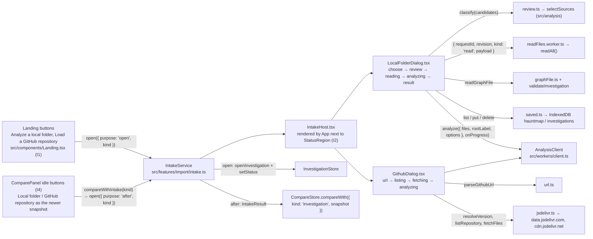

# Design Document

## Overview

This spec adds HauntMap's two intake routes on top of the code on `main`.

- `src/features/import/` owns the local route: a folder input; a classification of the chosen files by path, name and size through `selectSources` of the analysis, so the rules are the analysis's own; a review screen that shows counts and lists before any content is read; a read worker with real progress and a cancel that terminates the worker and creates a new one; the call to the analysis client; a coverage summary; `Save investigation on this device` behind an injected IndexedDB adapter; and import of a bare `Investigation` graph file. It also owns the intake service and the dialog host.
- `src/features/github/` owns the GitHub route: a pure URL parser; the jsDelivr listing, filtered by the same classification before any file request; the 400 file cap as an error; file fetches with at most six in flight under one `AbortController`; progress, cancel and the exact error messages.

Both routes are reached through one intake service, created in `App.tsx`. The landing screen calls it in `open` mode; the result replaces the current investigation through `openInvestigation`. The `Compare revisions` panel calls it in `after` mode; the result goes to the compare store as the newer snapshot without touching the investigation store.

Kiro does every task in this checkout. No worktree, integrator or reviewer agent is involved. Changes outside this spec's folders are limited to the gates I1 to I6 below, and each task that uses one names it in its log row.

Figures in this document (3,000 ms, 10,000 ms, 100 ms, 6 in flight, 200 entries) are targets until a test on this PC records them in a log row and in `docs/performance.md`.

### Gates: changes outside this spec's folders

`.kiro/steering/ownership.md` does not list `intake`. Task 1 adds it, with the folders `src/features/import/**`, `src/features/github/**`, `tests/intake/**` and `docs/acceptance/intake/**` and the exceptions below. Only the tasks named for a gate use it, and each such task names the gate in its log row.

| Gate | Files | Change | Task |
| --- | --- | --- | --- |
| I1 | `src/components/Landing.tsx`, `tests/ui/landing.test.tsx`, `tests/e2e/landing.spec.ts`, `.kiro/specs/investigation-ui/requirements.md` (1.5) | `Landing` gets the optional props `intakeKinds: readonly IntakeKind[]` and `onIntake(kind)` and renders `Analyze a local folder` and `Load a GitHub repository` after `Explore the annex` inside `.landing-actions`. The two tests' expected button list and Tab order gain the new names. Criterion 1.5 of `investigation-ui` says the buttons are now built by `intake`. | 6 (local button), 11 (GitHub button) |
| I2 | `src/components/App.tsx` | `createServices()` creates the intake service and installs its development hook. `App` renders `<IntakeHost>` next to `<StatusRegion>` and passes `intakeKinds` and `onIntake` to `Landing`. `createCompareServices` passes `intake` to `createCompareStore` (with I4). | 6, 7, 11, 12 |
| I3 | `playwright.config.ts` | The `dev` project's `testMatch` gains `"**/tests/intake/e2e/**/*.spec.ts"`. | 6 |
| I4 | `src/features/compare/host.ts`, `store.ts`, `ComparePanel.tsx`, new cases in `tests/compare/` and `tests/compare/e2e/compare.spec.ts`, `.kiro/specs/snapshot-comparison/requirements.md` (idle panel) | `HostIntake` type, optional `CompareDeps.intake`, action `compareWithIntake(kind)`, optional `CompareStore.intakeKinds`, the two buttons of 9.1 after the existing button, and the panel order line of the comparison spec. | 12 |
| I5 | `README.md`, `docs/limitations.md`, `docs/performance.md`, `docs/write-up.md`, and any test that pins the sentence `Comparison accepts the bundled manor pair and the live snapshot` | Replace that sentence with one that names intake, add `## Intake` to the limitations, add `## Intake` to the performance file, and correct `What it does not do` in the README. | 8, 9, 13 |
| I6 | `.kiro/steering/ownership.md` | The `intake` row and these gates. | 1 |

`tests/ui/registry.test.ts` keeps asserting that the registry has no `intake` handoff. The service is passed by `App.tsx` and never registered in the registry, so no registry type changes.

## Architecture



The local flow in `open` mode:

```mermaid
sequenceDiagram
  participant U as user
  participant D as LocalFolderDialog
  participant R as review.ts
  participant W as read worker
  participant A as analysis client
  participant S as store
  U->>D: choose folder (input change)
  D->>R: classify(folder, candidates from webkitRelativePath, name, size)
  R-->>D: Review { included, skipped, counts, includedBytes }
  Note over D: review screen; Analyze aria-disabled above 1,000 files, 25 MiB or at 0 files; nothing read yet
  U->>D: Analyze
  D->>S: setStatus("Reading <n> files from <folder>.")
  D->>W: { requestId, revision, kind: "read", payload: { files, delayMs } }
  W-->>D: progress { done, total } (at most every 100 ms)
  W-->>D: done { files, binary }
  D->>A: analyze({ files + oversized entries, rootLabel, options }, onProgress)
  A-->>D: Investigation
  D->>S: openInvestigation(inv, sourceText, { demo: false }); setStatus(summary)
  D-->>U: result screen: summary, Save investigation on this device, Include source text, Close
  Note over U,W: Cancel while reading → worker.terminate(), new worker next time; while analyzing → analysisClient.cancel(); store untouched
```

The GitHub flow:

```mermaid
sequenceDiagram
  participant U as user
  participant G as GithubDialog
  participant J as jsdelivr.ts
  participant A as analysis client
  participant S as store
  U->>G: paste URL, Load
  G->>G: parseGithubUrl(url); a rejection shows its message, no request
  opt no ref given
    G->>J: resolveVersion(owner, repo)
  end
  G->>J: listRepository(owner, repo, ref)
  alt status ≠ 200 or rejection
    G->>S: setStatus(listFailed)
  else entries
    G->>G: classify(entries by path and listed size)
    alt over 400 files, over 25 MiB or none
      G->>S: setStatus(cap or none message); no file request
    else
      G->>J: fetchFiles(at most 6 in flight, one AbortController, onProgress)
      J-->>G: files, or { path, status } failure, or AbortError on Cancel
      G->>A: analyze({ files, rootLabel, options with maxFiles 400 }, onProgress)
      A-->>G: Investigation
      G->>S: openInvestigation(…, { demo: false }) in open mode; setStatus(loaded)
    end
  end
```

### File layout

| Path | Role |
| --- | --- |
| `src/features/import/types.ts` | `IntakeKind`, `IntakeArgs`, `IntakeResult`, `IntakeStore`, `IntakeAnalysisClient`, `IntakeDeps` (structural; no import from `src/components` or `src/features/investigation`) |
| `src/features/import/intake.ts` | `createIntake(deps)`: the service with `kinds`, `open`, `getState`, `subscribe`, the pending promise rule and the before state snapshot |
| `src/features/import/IntakeHost.tsx` | renders the open dialog from the service state |
| `src/features/import/DialogFrame.tsx` | the shared dialog frame: `role="dialog"`, `aria-modal`, heading, Tab trap, Escape, `aria-busy`, focus on open and on close |
| `src/features/import/messages.ts` | every string of the local route and of the landing and comparison buttons |
| `src/features/import/review.ts` | `stripRoot`, `classify`, `capMessage`, `formatSize`, `reasonWords`, `plural` (pure) |
| `src/features/import/readFiles.ts`, `readFiles.worker.ts` | `readAll` (pure over `Blob`), `createReadClient`, the worker entry |
| `src/features/import/LocalFolderDialog.tsx` | the screens of the local route |
| `src/features/import/saved.ts` | `SavedStore`, `createSavedStore(idb)`, `createMemorySavedStore()`, `recordSize` |
| `src/features/import/graphFile.ts` | `readGraphFile(file, validate)` |
| `src/features/import/devHook.ts` | `installIntakeHook(service)` for development builds |
| `src/features/import/intake.css` | the dialog styles from the manor tokens |
| `src/features/github/messages.ts`, `url.ts`, `jsdelivr.ts`, `githubIntake.ts`, `GithubDialog.tsx` | the GitHub route |
| `tests/intake/**` | unit, component, property and browser tests, fixtures, generators, fakes, `README.md` |
| `docs/acceptance/intake/**`, `docs/acceptance/img/intake-*.png` | request lists and screenshots written by the Playwright tests |

## Components and Interfaces

### Consumed from `main` (never redefined here)

```ts
// src/contracts/types.ts
interface SourceFile { path: string; text: string; bytes: number }
interface SourceSet { rootLabel: string; files: SourceFile[]; skipped: { path: string; reason: "excluded-dir" | "extension" | "oversized" | "secret-pattern" | "binary" }[] }
interface AnalysisOptions { preset: Preset; includeExtensions: string[]; excludeDirectories: string[]; excludeFilePatterns: string[]; maxFiles: number; maxFileBytes: number; maxTotalBytes: number; jsToTsFallback: true }
// src/contracts/options.ts
const DEFAULT_ANALYSIS_OPTIONS: AnalysisOptions;            // preset "static-value", maxFiles 1000, maxFileBytes 1048576, maxTotalBytes 26214400
// src/contracts/validate.ts
type ValidationResult = { ok: true } | { ok: false; errors: string[] };
function validateInvestigation(value: unknown): ValidationResult;
// src/analysis/index.ts
function selectSources(files: SourceFile[], rootLabel: string, options: AnalysisOptions):
  { ok: true; sourceSet: SourceSet; diagnostics: Diagnostic[] } | { ok: false; diagnostics: Diagnostic[] };
// src/workers/client.ts
interface AnalysisClient {
  analyze(request: { files: SourceFile[]; rootLabel: string; options: AnalysisOptions }, onProgress?: (done: number, total: number) => void): Promise<Investigation>;
  cancel(): void;                                            // the pending promise rejects with an error named "AnalysisCancelled"
}                                                            // a worker failure rejects with an error named "AnalysisFailed"
// src/features/compare/store.ts
type AfterSource = { kind: "sample"; id: "manor/after" } | { kind: "investigation"; snapshot: { label: string; investigation: Investigation; sourceText: ReadonlyMap<string, string> | null } };
```

The analysis worker runs `selectSources` again on what it receives, so a cap or a skip reason is decided by the same function in both places.

### Types and the service (`src/features/import/types.ts`, `intake.ts`)

```ts
export type IntakeKind = "local" | "github";
export type IntakePurpose = "open" | "after";
export interface IntakeArgs { purpose: IntakePurpose; kind: IntakeKind }
export type IntakeResult =
  | { ok: true; investigation: Investigation; sourceText: ReadonlyMap<string, string> | null; label: string }
  | { ok: false; reason: "cancelled" }
  | { ok: false; reason: "failed"; message: string };

/** The parts of the investigation store intake uses; the real store satisfies it. */
export interface IntakeStore {
  getState(): { investigation: Investigation | null; preset: Preset };
  actions: {
    openInvestigation(inv: Investigation, source: ReadonlyMap<string, string> | null, opts: { demo: boolean }): void;
    setStatus(message: string): void;
  };
}
export interface IntakeAnalysisClient {
  analyze(request: { files: SourceFile[]; rootLabel: string; options: AnalysisOptions }, onProgress?: (done: number, total: number) => void): Promise<Investigation>;
  cancel(): void;
}
export interface IntakeDeps {
  store: IntakeStore;
  analysisClient: IntakeAnalysisClient;
  defaults: AnalysisOptions;                                   // DEFAULT_ANALYSIS_OPTIONS
  validate: (value: unknown) => ValidationResult;              // validateInvestigation
  saved: SavedStore | null;                                    // createSavedStore(globalThis.indexedDB)
  createReadWorker: () => ReadWorkerLike;                      // new Worker(new URL("../features/import/readFiles.worker.ts", import.meta.url), { type: "module" })
  github: { fetchImpl: typeof fetch } | null;                  // null until task 11
  now?: () => Date;
  doc?: Document;                                              // the folder input probe and focus handling; tests pass jsdom's
}

export interface IntakeService {
  readonly kinds: readonly IntakeKind[];                       // ["local"] or ["local", "github"]
  open(args: IntakeArgs): Promise<IntakeResult>;               // a call while a dialog is open returns the pending promise
  getState(): IntakeState;                                     // { dialog: null | { kind, purpose, opener: Element | null } , readDelayMs }
  subscribe(listener: () => void): () => void;
  close(result: IntakeResult): void;                           // used by the dialogs
}
export function createIntake(deps: IntakeDeps): IntakeService;
export function hasDirectoryInput(doc: Document): boolean;     // "webkitdirectory" in doc.createElement("input")
```

`App.tsx` (gate I2) holds the full `AnalysisClient` of `createServices()`, which has `cancel`. `AppServices.analysisClient` stays `Pick<AnalysisClient, "analyze">`, and the intake service is created from the local variable before it is narrowed. `AppServices` gains an optional `intake?: IntakeService`, so the tests that build `AppServices` without it keep working.

The before state snapshot of 3.3 is taken from the real store in tests. The service never reads the six fields; it simply calls no action other than `setStatus` on any path but `open` mode success, and P5 checks that.

### Dialog frame and host (`DialogFrame.tsx`, `IntakeHost.tsx`)

`IntakeHost` subscribes to the service and renders `<div className="intake-backdrop"><DialogFrame …>{screen}</DialogFrame></div>` when `dialog` is set. `DialogFrame` renders `<section role="dialog" aria-modal="true" aria-labelledby={headingId} aria-busy={busy} className="intake-dialog">` with an `h2` heading. It moves focus to the first focusable element on mount and on each screen change, unless the screen names its own first control (review: `Analyze`). It keeps Tab and Shift+Tab inside by wrapping at the first and last focusable elements. It handles Escape with `stopPropagation`, so that an open comparison popover under it does not also close. Escape is ignored while work runs; `Cancel` is the way out then. On close it restores focus per 1.3.

### Classification (`src/features/import/review.ts`, pure)

```ts
export type SkipReason = SourceSet["skipped"][number]["reason"];
export interface Candidate { path: string; size: number; file?: File }
export interface Review {
  folder: string;                                               // folder name, or "<owner>/<repo>@<ref>"
  included: Candidate[];                                        // sorted by path, code unit order
  skipped: { path: string; reason: Exclude<SkipReason, "binary"> }[];   // sorted by path; excluded directories grouped as "<dir>/"
  counts: Record<"excluded-dir" | "secret-pattern" | "extension" | "oversized", number>;
  includedBytes: number;
}
export function stripRoot(webkitRelativePath: string): { folder: string; path: string };
// "sample-local/src/a.ts" → { folder: "sample-local", path: "src/a.ts" }; backslashes become "/"
export function classify(folder: string, candidates: Candidate[], options: AnalysisOptions): Review;
// selectSources(candidates.map(c => ({ path: c.path, text: "", bytes: c.size })), "", { ...options, maxFiles: MAX, maxTotalBytes: MAX });
// every "excluded-dir" entry → "<segments up to and including the first excluded one>/", counted once per directory path;
// the other reasons are kept per file; files kept by selectSources are included. No file is read.
export function capMessage(review: Review, maxFiles: number, maxTotalBytes: number, route: "local" | "github"): string | null;
export function formatSize(bytes: number): string;              // "<n> KB" (ceil of bytes / 1024) below 1,048,576; else "<n.n> MiB"
export function reasonWords(reason: SkipReason): string;        // "excluded directory", "secret or environment file", "other file type", "over 1 MiB", "binary"
export function plural(n: number, noun: string): string;        // "1 relation", "2 relations"
```

### Read worker and client (`readFiles.ts`, `readFiles.worker.ts`)

The protocol follows the worker rule of `.kiro/steering/analysis.md`: every message carries `{ requestId, revision, kind, payload }`.

```ts
type ReadRequest = { requestId: string; revision: number; kind: "read"; payload: { files: { path: string; file: Blob }[]; delayMs: number } };
type ReadReply =
  | { requestId: string; revision: number; kind: "progress"; payload: { done: number; total: number } }
  | { requestId: string; revision: number; kind: "done"; payload: { files: SourceFile[]; binary: string[] } }
  | { requestId: string; revision: number; kind: "error"; payload: { message: string } };
export interface ReadWorkerLike { postMessage(message: ReadRequest): void; terminate(): void; onmessage: ((event: { data: ReadReply }) => void) | null; onerror: ((event: unknown) => void) | null }

export async function readAll(files: { path: string; file: Blob }[], opts: { delayMs: number; now: () => number; onProgress(done: number, total: number): void }):
  Promise<{ files: SourceFile[]; binary: string[] }>;
// for each file in path order: text = await file.text() (UTF-8, byte order mark removed, line ends kept);
// text.slice(0, 8192) contains "\u0000" → binary; else files.push({ path, text, bytes: file.size });
// onProgress when 100 ms have passed since the last call, and always for the last file; wait delayMs between files when it is above 0.
export function createReadClient(createWorker: () => ReadWorkerLike): {
  read(files: { path: string; file: Blob }[], onProgress: (done: number, total: number) => void, delayMs?: number): Promise<{ files: SourceFile[]; binary: string[] }>;
  cancel(): void;   // terminate the busy worker, drop it, reject the pending promise with an error named "AbortError"; a reply with an older revision is dropped
};
```

### Local intake (`LocalFolderDialog.tsx`)

The screens are `choose`, `review`, `reading`, `analyzing` and `result`.

- `choose`: the folder input, or the text of 2.1; the `Import a graph file` section; the `Saved on this device (<n>)` list; `Close`.
- `review`: the lines and lists of 2.4; `Analyze`, `Back`, `Close`.
- `reading` and `analyzing`: the progress text and `Cancel`, with `aria-busy="true"`.
- `result`: the summary; `Save investigation on this device`, `Include source text` and the sentence of 5.1; `Close`.

In `after` mode the result is resolved at once and the dialog closes, so there is no result screen and no save control.

```ts
export function summaryMessage(folder: string, inv: Investigation, review: Review, binary: number): string;   // 3.5
```

### Saved investigations (`saved.ts`)

```ts
export interface SavedRecord { savedVersion: 1; label: string; savedAt: string; investigation: Investigation; sourceText: Record<string, string> | null }
export interface SavedStore {
  list(): Promise<SavedRecord[]>;          // newest savedAt first; rejects with the error name when the database cannot be opened
  put(record: SavedRecord): Promise<void>; // replaces a record with the same label
  delete(label: string): Promise<void>;
}
export function createSavedStore(idb: IDBFactory | undefined): SavedStore | null;   // null when idb is undefined; database "hauntmap", version 1, store "investigations", keyPath "label"
export function createMemorySavedStore(): SavedStore;
export function recordSize(record: SavedRecord): number;                             // UTF-8 byte length of JSON.stringify(record)
```

The dialog treats saving as unavailable (5.4) when `saved` is `null` or when the first `list()` rejects.

### Graph file import (`graphFile.ts`)

```ts
export async function readGraphFile(file: Blob, validate: (value: unknown) => ValidationResult, maxBytes = 26_214_400):
  Promise<{ ok: true; investigation: Investigation; label: string } | { ok: false; message: string }>;
// size > maxBytes → GRAPH_TOO_LARGE, file not read; JSON.parse failure → graphNotJson(error.message);
// validate failure → graphInvalid(errors[0]); success → the value as the investigation, label = sourceLabel
```

### GitHub route (`src/features/github/`)

```ts
// url.ts
export type ParsedUrl = { ok: true; owner: string; repo: string; ref: string | null } | { ok: false; message: string; showRefField: boolean };
export function parseGithubUrl(input: string): ParsedUrl;
// trims; requires "https://github.com/"; owner and repo match [A-Za-z0-9_.-]+, with an optional ".git" on repo and an optional trailing "/";
// "/tree/<ref>" with ref matching [A-Za-z0-9_.-]+ gives ref; "/tree/<ref>/<more>" → SUBFOLDER_REJECTED with showRefField true;
// any other path after the repository → SUBFOLDER_REJECTED with showRefField false; anything else → URL_FORMAT

// jsdelivr.ts (endpoint forms are *verify* in task 9; the first form tried is jsDelivr's documented v1 API)
export const resolveUrl = (owner: string, repo: string) => `https://data.jsdelivr.com/v1/packages/gh/${owner}/${repo}/resolved`;
export const listingUrl = (owner: string, repo: string, ref: string) => `https://data.jsdelivr.com/v1/packages/gh/${owner}/${repo}@${ref}?structure=flat`;
export const fileUrl = (owner: string, repo: string, ref: string, path: string) =>
  `https://cdn.jsdelivr.net/gh/${owner}/${repo}@${ref}/${path.split("/").map(encodeURIComponent).join("/")}`;
export interface ListingEntry { path: string; size: number }
export async function resolveVersion(owner: string, repo: string, fetchImpl: typeof fetch, signal: AbortSignal):
  Promise<{ ok: true; version: string | null } | { ok: false; status: string }>;
export async function listRepository(owner: string, repo: string, ref: string, fetchImpl: typeof fetch, signal: AbortSignal):
  Promise<{ ok: true; entries: ListingEntry[] } | { ok: false; status: string }>;
// GET with { credentials: "omit", signal }; status ≠ 200 → { ok: false, status: String(status) }; rejection → { ok: false, status: error.name };
// entries: path with one leading "/" removed, size an integer; the field names are those observed in task 9
export async function fetchFiles(owner: string, repo: string, ref: string, included: Candidate[], fetchImpl: typeof fetch, signal: AbortSignal,
  onProgress: (done: number, total: number) => void, concurrency = 6):
  Promise<{ ok: true; files: SourceFile[]; binary: string[] } | { ok: false; path: string; status: string }>;
// a pool of `concurrency` over `included` in path order; each GET fileUrl with { credentials: "omit", signal };
// status ≠ 200 or a rejection other than AbortError → return { ok: false, path, status } (the caller aborts the controller);
// body: bytes = new Uint8Array(await response.arrayBuffer()); text = new TextDecoder("utf-8").decode(bytes);
// text.slice(0, 8192) contains "\u0000" → binary; else { path, text, bytes: bytes.byteLength }; AbortError propagates

// githubIntake.ts
export function runGithubIntake(deps: IntakeDeps & { github: { fetchImpl: typeof fetch } }, purpose: IntakePurpose, ui: GithubUi): Promise<IntakeResult>;
// the state machine url → resolving → listing → fetching → analyzing → done, with the messages of Requirements 7 and 8;
// GithubUi is the callback object GithubDialog passes (setScreen, setProgress, showRefField)
```

### Compare additions (gate I4, `src/features/compare/`)

```ts
// host.ts
export type HostIntakeKind = "local" | "github";
export interface HostIntake {
  readonly kinds: readonly HostIntakeKind[];
  open(args: { purpose: "after"; kind: HostIntakeKind }): Promise<
    { ok: true; investigation: Investigation; sourceText: ReadonlyMap<string, string> | null; label: string } | { ok: false; reason: "cancelled" } | { ok: false; reason: "failed"; message: string }>;
}
// store.ts
interface CompareDeps { /* existing fields */ intake?: HostIntake }
interface CompareStore { /* existing */ readonly intakeKinds?: readonly HostIntakeKind[] }
// actions.compareWithIntake(kind): Promise<void>; it never rejects
//   result ok → compareWith({ kind: "investigation", snapshot: { label, investigation, sourceText } }, host.getState().layout?.layoutKey ?? null), CompareFailure swallowed as in compareWithSample
//   failed → host.actions.setStatus(`${message} ${UNCHANGED}`); cancelled → nothing
```

`ComparePanel` renders the buttons of 9.1 in its idle body after the existing button, one for each kind in `cs.intakeKinds ?? []`, with the same `aria-disabled` busy rule. `IntakeService` satisfies `HostIntake` structurally; `src/features/compare` imports nothing from `src/features/import`.

### Messages

`src/features/import/messages.ts`:

```ts
export const LANDING_LOCAL = "Analyze a local folder";
export const LANDING_GITHUB = "Load a GitHub repository";
export const COMPARE_LOCAL = "Local folder as the newer snapshot";
export const COMPARE_GITHUB = "GitHub repository as the newer snapshot";
export const heading = (kind: IntakeKind, purpose: IntakePurpose) =>
  `${kind === "local" ? "Analyze a local folder" : "Load a GitHub repository"}${purpose === "after" ? " as the newer snapshot" : ""}`;
export const NO_DIRECTORY_INPUT = "Folder selection is not available in this browser. Import a graph file instead.";
export const REVIEW_SENTENCE = "Included files are read in this browser and kept in memory.";
export const tooManyFiles = (n: number) => `This folder has ${n.toLocaleString("en-US")} included files; the limit is 1,000. Choose a subfolder.`;
export const tooManyBytes = (size: string) => `This folder has ${size} of included text; the limit is 25 MiB. Choose a subfolder.`;
export const noFiles = (folder: string, k: number) => `No JavaScript or TypeScript files were found in ${folder} (${k} files skipped).`;
export const readingStarted = (n: number, folder: string) => `Reading ${n} files from ${folder}.`;
export const reading = (done: number, total: number) => `Reading ${done} of ${total} files`;
export const analyzing = (done: number, total: number) => `Analyzing ${done} of ${total} files`;
export const cancelled = (label: string | null) => (label ? `Analysis cancelled. ${label} is still open.` : "Analysis cancelled.");
export const summary = (folder: string, m: number, r: number, d: number, k: number, b: number, f: number) =>
  `Analyzed ${folder}: ${plural(m, "module")}, ${plural(r, "relation")}, ${plural(d, "diagnostic")}; ${plural(k, "file")} skipped before reading, ${plural(b, "binary file")} skipped, ${plural(f, "file")} failed to parse.`;
export const analyzeFailed = (message: string) => `The folder could not be analyzed (${message}).`;
export const PRESERVED = "The previous investigation is unchanged.";
export const SAVE_BUTTON = "Save investigation on this device";
export const SAVE_SENTENCE = "Saved investigations stay in this browser's storage until you forget them.";
export const savedMessage = (label: string, size: string, included: boolean) => `Saved ${label} on this device (${size}, source text ${included ? "included" : "left out"}).`;
export const SAVE_UNAVAILABLE = "Saving is not available in this browser.";
export const saveFailed = (name: string) => `The investigation could not be saved (${name}).`;
export const opened = (label: string) => `Opened ${label} from this device.`;
export const forgot = (label: string) => `Forgot ${label}.`;
export const savedInvalid = (label: string, err: string) => `The saved investigation ${label} is not valid (${err}) and was removed.`;
export const GRAPH_TOO_LARGE = "The graph file is larger than 25 MiB.";
export const graphNotJson = (message: string) => `The graph file is not JSON (${message}).`;
export const graphInvalid = (err: string) => `The graph file is not valid: ${err}.`;
export const imported = (label: string, m: number, r: number) => `Imported ${label}: ${plural(m, "module")}, ${plural(r, "relation")}. A graph file holds no source text.`;
```

`src/features/github/messages.ts`:

```ts
export const PRIVACY_NOTE = "The repository name and file paths are sent to the jsDelivr CDN to fetch the files. Local folder analysis sends nothing.";
export const SUBFOLDER_REJECTED = "Subfolders are not supported yet. Paste the address of the repository itself.";
export const URL_FORMAT = "Enter an address like https://github.com/owner/repo or https://github.com/owner/repo/tree/branch.";
export const TYPE_REF = "Type the branch or tag to load.";
export const listFailed = (o: string, r: string, ref: string, status: string) => `Could not list ${o}/${r}@${ref}: ${status}. Only public repositories are supported.`;
export const cap = (o: string, r: string, ref: string, n: number, first: string) => `${o}/${r}@${ref} has ${n} included files; the limit is 400. First excluded: ${first}.`;
export const capBytes = (o: string, r: string, ref: string, size: string) => `${o}/${r}@${ref} has ${size} of included text; the limit is 25 MiB.`;
export const noFilesGh = (o: string, r: string, ref: string) => `No JavaScript or TypeScript files were found in ${o}/${r}@${ref}.`;
export const loadingStarted = (o: string, r: string, ref: string, n: number) => `Fetching ${n} files from ${o}/${r}@${ref}.`;
export const progress = (done: number, total: number) => `Fetched ${done} of ${total} files`;
export const loadCancelled = (label: string | null) => (label ? `Loading cancelled. ${label} is still open.` : "Loading cancelled.");
export const fetchFailed = (path: string, o: string, r: string, ref: string, status: string) => `Could not fetch ${path} from ${o}/${r}@${ref} (${status}). Nothing was loaded.`;
export const loaded = (o: string, r: string, ref: string, n: number, m: number, rel: number, d: number) =>
  `Loaded ${o}/${r}@${ref}: ${plural(n, "file")}, ${plural(m, "module")}, ${plural(rel, "relation")}, ${plural(d, "diagnostic")}.`;
```

In `open` mode a failure message is followed by ` The previous investigation is unchanged.`, except for 7.2, where nothing was attempted. In `after` mode the bare message is resolved instead (9.2).

### Development hook (`src/features/import/devHook.ts`, development builds only)

`installIntakeHook(service)` is called by `App.tsx` inside `if (DEVHOOK_ENABLED)` (gate I2). It sets `intake` on the existing `window.__hauntmap` object through a structural cast, as `installCompareHook` does, and never imports `src/components/devHook.ts`.

```ts
interface DevHookIntake {
  service: IntakeService;
  setReadDelay(ms: number): void;                                // delay between files in the read worker, so a cancel can land mid read
  selectFiles(files: { path: string; text: string }[], folder: string): void;   // only if task 1 finds that setInputFiles cannot select a folder
}
```

## Data Models

| Record | Where | Identity and version | Content and invariants |
| --- | --- | --- | --- |
| `Review` | dialogs, memory | per selection | `included` and `skipped` cover every candidate exactly once (an excluded directory entry covers its files, P1); `included` sorted; `includedBytes` is the sum of included sizes; nothing read |
| Read result | read worker output, memory | per `requestId` and `revision` | `files` sorted by path; `bytes` is `File.size`; `binary` lists the files skipped for a NUL |
| Analysis request | to the analysis client | `rootLabel` `local:<folder>` or `gh:<owner>/<repo>@<ref>` | read or fetched files plus one empty text entry per file over 1 MiB; at most 1,000 (local) or 400 (GitHub) included files |
| `Investigation` | from the analysis client to the store or the comparison | `sourceLabel` is the root label; `options.maxFiles` 1000 (local) or 400 (GitHub) | never changed here; source text stays in the separate map |
| `SavedRecord` | IndexedDB `hauntmap` / `investigations`, key `label` | `savedVersion: 1`, `savedAt` ISO 8601 UTC | `investigation` validates; `sourceText` non-null only when the checkbox was checked |
| `ParsedUrl` | GitHub dialog, memory | none | `owner`, `repo`, `ref` match `[A-Za-z0-9_.-]+`; a rejection carries its message and whether the ref field is shown |
| `ListingEntry` | `listRepository` output | none | `path` without a leading `/`; `size` an integer |
| Batch controller | GitHub dialog, memory | one per `Load` | at most 6 requests in flight (P4); aborted on Cancel or on a failed file; nothing kept after an abort |
| `IntakeResult` | resolved to the caller | none | `ok: true` carries the investigation, the map (or `null`) and the label; `ok: false` carries `cancelled`, or `failed` with the bare message |
| `docs/performance.md`, `## Intake` | docs | date, check, figure | `\| <YYYY-MM-DD> \| <test name and filter> \| <figure> \| <target> \|`, written from a test run on this PC |

Invariants, each checked by a test named in Testing Strategy:

- I1 Nothing is read before `Analyze`: no read method of any `File` is called during classification (2.2).
- I2 Classification parity: for the same tree, `classify` yields the same included paths and skip reasons as `loadSourceSet`, except `binary`, which the browser decides at read time (2.3, P2). For the fixture folder, the investigation from the browser pipeline equals the one from `analyzeRoot` of the MCP package byte for byte, except `sourceLabel` (`parity.test.ts`).
- I3 Caps are errors: no analysis runs on a subset of the included files. Above a cap, or with no included file, no read request and no file fetch is made (2.5, 7.5, P6).
- I4 Preservation: on cancel or failure, and on every `after` mode call, the six store fields of 3.3 are deep equal before and after (3.3, 9.4, P5).
- I5 No network in the local flow. The GitHub flow requests only the resolve URL when no ref was given, the listing URL, and the file URLs of included entries, each with `credentials: "omit"` and no custom header (4.1, 8.8, P7).
- I6 At most 6 file requests in flight; the number of file requests equals the included count unless the batch was cancelled or failed (8.1, P4).
- I7 Explicit persistence: IndexedDB is written only by `Save investigation on this device` (5.1, P8).
- I8 Every string on screen is a text node (1.6), and no string of the two message files joins words with a dash (10.7).

## Error Handling

Every failure is a typed value or a caught rejection. The dialogs never throw for a domain condition, never retry on their own, and never change the investigation on failure. In `open` mode a message is written once through `setStatus`; in `after` mode the bare message goes to the caller instead (9.2).

| Situation | Where | Exact text a user sees | Preserved | Focus and state |
| --- | --- | --- | --- | --- |
| No folder input (2.1) | local dialog, first screen | `Folder selection is not available in this browser. Import a graph file instead.` | none | first control is `Choose a graph file` |
| Over 1,000 included files (2.5) | review | `This folder has <n> included files; the limit is 1,000. Choose a subfolder.` | nothing read | `Analyze` `aria-disabled` |
| Over 25 MiB of included text (2.5) | review | `This folder has <size> of included text; the limit is 25 MiB. Choose a subfolder.` | nothing read | same |
| No included files (2.5) | review | `No JavaScript or TypeScript files were found in <folder> (<k> files skipped).` | nothing read | same |
| Cancel while reading or analyzing (3.3) | status region; review shown again | `Analysis cancelled. <label> is still open.` or `Analysis cancelled.` | the six store fields | focus on `Analyze` |
| Read error or `AnalysisFailed` (3.6) | status region; review shown again | `The folder could not be analyzed (<message>). The previous investigation is unchanged.` | same | same |
| IndexedDB unavailable (5.4) | first and result screens | `Saving is not available in this browser.` | none | save button `aria-disabled`; no saved list |
| Save fails (5.4) | status region; dialog open | `The investigation could not be saved (<error name>).` | investigation open | focus stays on the save button |
| Saved record invalid (5.3) | status region | `The saved investigation <label> is not valid (<first error>) and was removed.` | current investigation | focus on the next saved item's `Open`, or `Close` |
| Graph file over 25 MiB (6.2) | status region | `The graph file is larger than 25 MiB.` | everything; file not read | focus on `Choose a graph file` |
| Graph file not JSON (6.2) | status region | `The graph file is not JSON (<SyntaxError message>).` | everything | same |
| Graph file invalid (6.2) | status region | `The graph file is not valid: <first error>.` | everything | same |
| URL rejected (7.2) | status region; no request | `Subfolders are not supported yet. Paste the address of the repository itself.` or `Enter an address like https://github.com/owner/repo or https://github.com/owner/repo/tree/branch.` | everything | focus in `Repository URL`, or in `Branch or tag` when it is shown |
| No version resolved (7.3) | GitHub dialog | `Type the branch or tag to load.` with `Branch or tag` filled with `main` | everything | focus in `Branch or tag` |
| Listing or resolve not 200, or rejected (7.6) | status region | `Could not list <owner>/<repo>@<ref>: <status or error name>. Only public repositories are supported.` | everything | focus on `Load` |
| Over 400 files or over 25 MiB listed (7.5) | status region; no file request | `<owner>/<repo>@<ref> has <n> included files; the limit is 400. First excluded: <path>.` or the 25 MiB form | everything | same |
| No included files listed (7.5) | status region | `No JavaScript or TypeScript files were found in <owner>/<repo>@<ref>.` | everything | same |
| Cancel while fetching or analyzing (8.3) | status region; URL screen | `Loading cancelled. <label> is still open.` or `Loading cancelled.` | the six store fields | focus on `Load` |
| A file not 200 or rejected (8.4) | status region | `Could not fetch <path> from <owner>/<repo>@<ref> (<status or error name>). Nothing was loaded.` | same | same |
| `open` called while a dialog is open (1.4) | none | nothing; the pending promise is returned | none | none |
| Failure in `after` mode (9.2) | resolved to the comparison | the failure sentence; the comparison appends `The current investigation is unchanged.` | the six store fields | the comparison's |

What a user sees on the paths that matter most:

- A developer who picks a monorepo of 3,000 files sees the count and the limit before anything is read, and picks a subfolder.
- A person who pastes a private repository URL reads one sentence with the status jsDelivr returned.
- A person whose browser cannot select folders imports a graph file instead.
- A cancel at 137 of 212 files leaves the manor exactly as it was.

## Testing Strategy

Commands:

- `pnpm verify` runs `tests/intake/**` in the existing Vitest projects: `node` for `*.test.ts`, `jsdom` for `*.test.tsx`. Property tests use fast-check 4.10.2 with 200 runs and a fixed seed, which is printed on failure.
- `pnpm verify:e2e` runs the browser specs in the `dev` Playwright project (headless Chromium 1.65.1, 1,280 × 720, the devhook build on port 4374, one fresh context per test) once gate I3 adds `tests/intake/e2e/**`. It forwards arguments, so `pnpm verify:e2e -- tests/intake/e2e/local.spec.ts` runs one file.
- The browser specs use `openManor`, `tabTo`, `readStatus`, `assertFocusVisibleAndUnobscured` and `shot` of `tests/e2e/helpers.ts`. `shot` writes only with `HAUNTMAP_SHOTS=1`. They also use this spec's `tests/intake/e2e/helpers.ts`, which provides `openLocalDialog`, `openGithubDialog`, `chooseFolder(page, dir)`, `routeJsdelivr(page, routes)` and `recordRequests(page)`. `chooseFolder` calls `setInputFiles` with a folder path, or falls back to the hook's `selectFiles` when task 1 records that the pinned Playwright cannot do it.

Fixtures in `tests/intake/fixtures/`. File contents that cannot live as source files (a binary, a 1 MiB file, `.env`, `secret.pem`, `node_modules`) are listed in manifests and written to a temporary folder by `tests/intake/materialize.ts`. No fixture source file is type checked or linted.

| Fixture | Content | Expected |
| --- | --- | --- |
| `folder/manifest.json`, written to a temporary folder named `sample-local` | `src/a.ts` = `import { b } from "./b";\nexport const a = b; // SENTINEL-LOCAL-4e2b17\n` (70 bytes); `src/b.ts` = `export const b = 1;\n` (20); `src/c.tsx` = `export const C = () => null;\n` (29); `bin.ts` = bytes `00 01 02` then `export {};\n` (14); `big.ts` = 1,048,577 bytes of `/`; `README.md` = `# fixture\n`; `.env` = `KEY=1\n`; `secret.pem` = `-----BEGIN-----\n`; `node_modules/pkg/index.js` = `module.exports = 1;\n`; `dist/out.js` = `export {};\n` | review per 2.6; after reading, `files` are exactly `src/a.ts`, `src/b.ts`, `src/c.tsx` and `binary` is `["bin.ts"]`; analysis: 3 modules, 1 relation (`src/a.ts` to `src/b.ts`), 1 diagnostic (`oversized`, `big.ts`); the summary of 3.5; no request carries `sample-local`, a fixture path or the sentinel |
| `folder-exec/manifest.json` | `index.html` = `<script>document.cookie="marker=1"</script>\n`; `postinstall.js` = `globalThis.__intakeMarker = 1;\n`; `src/a.ts` as above | review: `index.html` skipped as `other file type`, `postinstall.js` included; after analysis `document.cookie` lacks `marker`, `globalThis.__intakeMarker` is undefined and no request was made (4.5) |
| generated folders (`tests/intake/generators.ts`: `folderOf(n, opts)`) | `src/m<i>.ts` importing `./m<i+1>` | 400 files for the cancel case of 3.3 (with `setReadDelay(20)`); 200 files of 10,240 bytes each for the timing of 3.7; 1,001 files for the cap |
| `gh/listing-small.json` | the listing shape observed in task 9, with the entries `/src/a.ts` 70, `/src/b.ts` 20, `/src/c.tsx` 29, `/README.md` 10, `/node_modules/pkg/index.js` 20, `/dist/out.js` 11, `/.env` 6, `/big.ts` 1048577; `gh/files/src/a.ts`, `src/b.ts`, `src/c.tsx` hold the texts of the folder fixture without the sentinel line comment | included `src/a.ts`, `src/b.ts`, `src/c.tsx`; three file requests; `Loaded <owner>/<repo>@main: 3 files, 3 modules, 1 relation, 1 diagnostic.` |
| generated listings (`listingOf(n)`) | `n` entries `/src/m<i>.ts` of size 20, with bodies `export const m<i> = <i>;\n` | `listingOf(401)`: the cap message with `src/m99.ts` (derived by the test), zero file requests; `listingOf(200)`: progress up to `Fetched 200 of 200 files`, and the cancel case at 50 |
| `graph/malformed.json`, `graph/not-json.txt` | `{"schemaVersion": 2}` and `{"schemaVersion": 1,` | the messages of 6.4; the valid case reads `public/demo/live.json` without changing it |

Unit, component and property test files (`pnpm verify`):

| File | Cases |
| --- | --- |
| `tests/intake/fixtures.test.ts` | the manifests materialize to the listed files and sizes; `listingOf(401)` sorted gives `src/m99.ts` at index 400; the graph fixtures read |
| `tests/intake/fakes.test.ts` | the fake `fetch` counts pending requests and records URL, headers and `credentials`; the throwing `File` throws on each read method until `allowRead()` |
| `tests/intake/review.test.ts` | 2.2 `stripRoot` (nested, backslashes, a file at the root); no read method called; 2.3 the fixture review of 2.6 exactly, the `<dir>/` grouping for nested `a/node_modules/b/c.ts`; 2.5 the three cap messages and `null`; `formatSize` (1 → `1 KB`, 1,024 → `1 KB`, 1,025 → `2 KB`, 1,048,576 → `1.0 MiB`); `reasonWords`; `plural` |
| `tests/intake/readFiles.test.ts` | 3.1 `readAll` over `Blob`s: byte order mark removed, CRLF kept, NUL gives `binary`, `bytes` equal to size, files sorted, progress at most every 100 ms with a fake clock and always for the last; the client drops a reply with an older revision; `cancel` terminates and rejects with `AbortError`; the next `read` creates a new worker |
| `tests/intake/parity.test.ts` | I2: the folder fixture written to a temporary folder, taken through `classify`, `readAll` and `runRequest` of `src/workers/analysis.worker.ts`, gives the same JSON text as `analyzeRoot(createContext(<temporary folder>), ".", "static-value")` of `packages/hauntmap-mcp/src/tools.ts`, except `sourceLabel` (`local:sample-local` against `live:.`) |
| `tests/intake/intake.test.ts` | 1.1 `kinds` with and without `github`; 1.4 a second `open` returns the same promise; `hasDirectoryInput` |
| `tests/intake/local-intake.test.tsx` | 1.2 roles, heading, first focus, Tab trap, Escape, focus return; 1.3 `openInvestigation` arguments, then `setStatus`, focus to the map wrapper when the opener is gone; 2.4 review lines, the 200 entry cap of the lists and `… and <m> more`; 3.2 progress text and `aria-busy`; 3.3 cancel in `reading` and in `analyzing` with the six fields deep equal and the message; 3.5 the summary for the fixture; 3.6 the failure message and preservation; 4.3 no storage write without the save button; 4.4 the `console.error` spy; 10.2 Tab order per screen |
| `tests/intake/no-execution.test.tsx` | 4.5 the `folder-exec` fixture through the local flow in jsdom |
| `tests/intake/saved.test.ts` | 5.2 `put` replaces by label, record shape, `savedAt` in UTC; 5.3 `list` order, `Open` validates and removes an invalid record with its message, `Forget`; 5.4 `createSavedStore(undefined)` gives `null`, a failing open makes `list()` reject, a rejecting `put` gives the message |
| `tests/intake/graphFile.test.ts` | 6.2 size, JSON and validation failures with exact messages; 6.3 and 6.4 `public/demo/live.json` and the two fixtures |
| `tests/intake/url.test.ts` | 7.2 accepted forms (trailing `/`, `.git`, `/tree/<ref>`), the subfolder and format rejections, `/tree/a/b` with `showRefField` |
| `tests/intake/jsdelivr.test.ts` | 7.3 the resolve request only when no ref was given; 7.4 the listing URL, `credentials: "omit"`, no headers, the leading `/` removed; 7.6 non 200 and rejection statuses; 8.1 the pool never above 6 pending and requests exactly the included paths in path order; 8.3 an abort propagates as `AbortError` and no request follows; 8.4 a 500 on one file returns `{ path, status }`; the NUL check; the path segments encoded; 8.8 every request inspected |
| `tests/intake/github-machine.test.ts` | `runGithubIntake` with a fake `GithubUi`, a fake `fetch` and a fake analysis client: the state order url, resolving (only without a ref), listing, fetching, analyzing, done; cancel in each state; the bare failure message in `after` mode |
| `tests/intake/github-intake.test.tsx` | 1.2 dialog roles and focus; 7.1 Tab order and the privacy note before any request; 7.3 the `Branch or tag` field when no version resolves; 7.5 the caps and none with zero file requests; 7.6 the listing message; 7.7 the label; 8.2 progress; 8.3 cancel and preservation; 8.5 the loaded message and `maxFiles: 400` in the options given to the client |
| `tests/intake/after-mode.test.tsx` | 9.2 to 9.4 for both dialogs: no `openInvestigation`, the resolved result, the bare failure message with no status write, cancel, the saved record `Open`, the six fields deep equal |
| `tests/intake/boundary.test.ts` | 1.8 no file under `src/features/import` or `src/features/github` imports `src/components` or `src/features/investigation` (same detector as `tests/ui/feature-boundary.test.ts`, written again here, not imported from it) |
| `tests/intake/no-html-injection.test.ts` | 1.6 source scan of both folders; the folder name `a&b` rendered verbatim |
| `tests/intake/styles.test.ts` | 10.4 `intake.css`: no color literal (hex, `rgb(`, `hsl(` or a named color), every `font-size` 12 px or more, no outline removal, no `animation` or `transition` |
| `tests/intake/messages.test.ts` | 10.7 every exported string and template of both message files (templates called with sample values that contain no dash) has no dash or hyphen between two letters |
| `tests/intake/properties.test.ts` | P1 to P8 |

Changed outside `tests/intake` (gates): `tests/ui/landing.test.tsx` and `tests/e2e/landing.spec.ts` 1.1 (I1); new cases in `tests/compare/panel.test.tsx` (or the comparison test file that holds the idle panel cases) and `tests/compare/store.test.ts` for `compareWithIntake` (I4).

Browser spec files (`pnpm verify:e2e`, `dev` project):

| File | Cases |
| --- | --- |
| `tests/intake/e2e/local.spec.ts` | 1.5 one status message at the start and one at the end; 2.1 the dialog from `Analyze a local folder`; 2.6 the review of the fixture folder; 3.2 and 3.3 progress and a cancel near 100 of 400 with the six fields deep equal through `window.__hauntmap.store`; 3.5 the summary and the map open with `local:sample-local` in the breadcrumb; 3.7 the timing on this PC (printed and attached, not asserted); 4.1 and 4.2 every request recorded and checked, the request list and two screenshots written with `HAUNTMAP_SHOTS=1`; 5.2 and 5.3 save, reload, `Open`, `Forget` through the browser adapter; 6.4 graph files; 10.3 the keyboard only journey with `assertFocusVisibleAndUnobscured` after every Tab; 10.5 the four viewports with no horizontal scroll |
| `tests/intake/e2e/github.spec.ts` | 7.1 the privacy note before `Load` and no request before it; 7.2 the two rejections with no request; 7.5 `listingOf(401)`, zero file requests; 7.6 listing routed to 404 and 403; 8.2 the progress sequence on `listingOf(200)`; 8.3 cancel at 50 of 200, no request afterwards, state deep equal; 8.7 `listing-small` gives the loaded message, the map and `gh:<owner>/<repo>@main` in the breadcrumb; 8.8 every request's URL and headers; 10.3 the keyboard only journey |
| `tests/intake/e2e/github-live.spec.ts` | 8.6, skipped unless `HAUNTMAP_LIVE_NETWORK=1`: one real load, timing, request list, screenshot |
| `tests/compare/e2e/compare.spec.ts` (new case, I4) | `Local folder as the newer snapshot` with the fixture folder after `Explore the manor` gives `Comparison ready: …` and the earlier snapshot still `manor/before` |

Evidence made by Kiro on this PC, never by a person or another agent: the request list and screenshots of 4.2, the timing of 3.7, and the real network run of 8.6. Each is written by a Playwright test, cited in the task's log row, and described as a figure for this PC only.

## Correctness Properties

Generators in `tests/intake/generators.ts`:

- `arbTree`: 1 to 80 candidates. Names come from `[A-Za-z0-9._]` plus the literal names `node_modules`, `.git`, `dist`, `.env`, `x.pem` and `id_rsa`, at depths 0 to 4. Extensions are the six included ones plus `.md`, `.json` and `.png`. Sizes run from 0 to 2,000,000, with a 2 percent chance above 1,048,576.
- `arbUrl`: strings around `https://github.com/` with random owners, repos, refs, subpaths, suffixes and junk.
- `arbListing`: 0 to 450 entries.
- `arbRecord`: valid `SavedRecord`s.

Properties:

- P1 Classification partition (2.3): for any `arbTree`, every candidate is either in `included` or covered by exactly one `skipped` entry, which is its own or the `<dir>/` entry of its nearest excluded ancestor. Every included candidate passes the four path and size conditions, and `includedBytes` equals the sum of included sizes.
- P2 Loader parity (2.3, I2): for any `arbTree` written to a temporary folder (node environment), the included path set and the skip reasons of `classify` equal those of `loadSourceSet` from `packages/hauntmap-mcp/src/loader.ts` on the same folder, except entries the loader marks `binary`. The loader is imported read only.
- P3 URL parse (7.2): for any `arbUrl`, `parseGithubUrl` returns `ok: true` only for strings that match the grammar. For such a string, `https://github.com/${owner}/${repo}` plus `/tree/${ref}` (when `ref` is not null) parses to the same result. An `ok: false` result carries one of the two messages.
- P4 Bounded concurrency (8.1): for any `arbListing` of included entries and any order of response times, the fake `fetch` never has more than 6 pending file requests, and the number of file requests equals the included count when no abort or failure happens.
- P5 Preservation (3.3, 9.4): for any dialog outcome other than success in `open` mode, the six store fields are deep equal before and after.
- P6 Caps are errors (2.5, 7.5): for any tree or listing with more included entries than the cap, no read request and no file request is made. The message names the count and, for GitHub, the first excluded path in code unit order.
- P7 Request discipline (4.1, 8.8): the local flow makes no request. The GitHub flow's requests are exactly the resolve URL (only without a ref), the listing URL and the file URLs of the included entries, each with `credentials: "omit"` and no custom header.
- P8 Saved round trip (5.2, 5.3): for any `arbRecord`, `put` then `list` returns a deep equal record in `savedAt` order, `delete` removes it, and a second `put` with the same label replaces it.

## Decisions and Alternatives

- **Classify by metadata only, through `selectSources`.** Path, name and size are enough for every rule but `binary`, so the review is exact and no content is touched until `Analyze`. Calling the analysis's own function with empty texts and raised caps means the rules and their order cannot drift from the worker and the Node loader. Rejected: a copy of the rules in the browser (it could drift, and the analysis rule forbids copying the values); reading everything and then filtering (it would read secrets and binaries the user meant to leave out).
- **Pass files over 1 MiB as empty entries.** The Node loader hands them to `selectSources`, which adds an `oversized` diagnostic. Doing the same makes the browser investigation of a folder equal the CLI's, which `parity.test.ts` checks. Rejected: leaving them out (the same folder would give a different diagnostic count by route).
- **A service passed by `App.tsx`, not a registry handoff.** `main` decided that the registry has no `intake` handoff and tests it. The landing has no registry access, and the compare store gets its other dependencies from `createCompareServices`. A plain service object keeps both features free of each other's imports. Rejected: an `intake` overload in the registry (it would change `registry.ts`, `registryBridge.ts`, `handoffs.ts` and a test that states the opposite).
- **A read worker owned by this spec.** The analysis worker takes `SourceFile`s; reading `File` objects is intake work and gets its own worker, with the same message envelope and the same cancel that terminates the worker and creates a new one. Rejected: reading on the main thread (`file.text()` for hundreds of files blocks the dialog); extending the analysis worker (a change to another spec's protocol for an intake need).
- **Caps as errors with a hint to choose a subfolder.** A 3,000 file monorepo is told the limit before anything is read. Rejected: analyzing the first 1,000 (a graph that is silently partial).
- **`Save investigation on this device` in IndexedDB behind an adapter, source text only by checkbox.** Preferences stay in `localStorage`, investigations go to IndexedDB because of their size, and the `Restart demo` assertion on `localStorage` stays true. Rejected: `localStorage` (quota, and it would break `landing.spec.ts` 1.7); saving after each analysis (the plan requires an explicit action); a fake IndexedDB package (a dependency for one adapter).
- **Graph file import reads a bare investigation.** That is what the CLI and the live snapshot write. The export envelope belonged to the export feature, which is not built. Rejected: reading an envelope no code writes.
- **jsDelivr with a resolved version.** Without a ref, the versionless CDN form may serve the latest tag rather than the default branch, so the dialog first asks jsDelivr which version it resolves to and then uses that one version for the listing and every file. Rejected: the GitHub API (rate limits for anonymous users); versionless file URLs (the listing and the files could disagree).
- **Six in flight under one `AbortController`.** The plan's number. One controller makes cancel a single call and lets a failed file abort the rest. Rejected: an unbounded `Promise.all` (hundreds of parallel requests); one controller per request.
- **Evidence from headless tests on this PC.** A Playwright test records the request list, takes the screenshots and measures the times, so the evidence can be made again by anyone with the repository and says exactly what was measured where. The real network run is opt in, so `pnpm verify:e2e` stays offline. Rejected: a screenshot of a browser's network panel by a person; a figure from a named laptop that is not in this checkout.
- **Dialogs that do not animate.** The motion rules list what may move, and a dialog is not on that list. Progress is text.

## Out of Scope

- The analysis itself (parsing, resolution, presets, IDs). The dialogs hand files to the analysis client and look at the result only for counts.
- The registry API, the export feature and its envelope, and the comparison logic beyond the `after` mode buttons and `compareWithIntake` of gate I4.
- ZIP intake, drag and drop of folders, the File System Access API, subfolders of a repository, private repositories, GitHub Enterprise hosts, refs that jsDelivr does not serve, and retries on network failure.
- Persisting anything but the explicit save, and syncing saved investigations anywhere.
- Resolving imports to files that were not chosen (the resolver stays within the root).
- Any statement that local analysis sends nothing without the record of 4.2; any performance figure not recorded by a test in a log row and in `docs/performance.md`; any telemetry; any statement that the tool was tested with users unless such a session took place.
