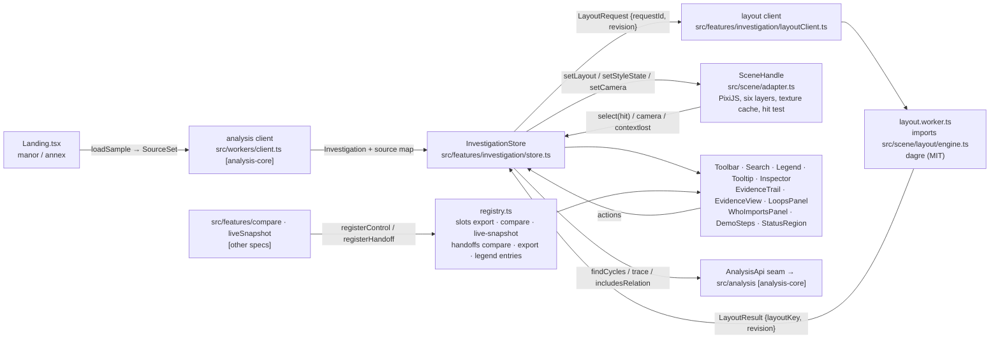

# Design Document

## Overview

This spec builds the investigation screen that judges see and developers use: the landing screen and sample loader, the PixiJS 2.5D cutaway scene behind an imperative `SceneHandle`, the dagre layout engine that runs inside `src/workers/layout.worker.ts`, and the React semantic interface (toolbar, search, legend, tooltips, inspector, evidence trail, Evidence view, loops and who-imports panels, steps panel, status region) that shares one `Selection` with the scene through a small external store. The scene never owns investigation state: it receives a `LayoutResult` and a style state and reports hits and camera changes; animation frames never pass through React. Every graph fact on screen comes from the `Investigation`, `CycleReport` and `TraceResult` contracts of `analysis-core`, called through one `AnalysisApi` seam; this spec reimplements no preset, cycle, trace or comparison rule.

Owner: Kiro, the one writer in the main checkout, under `.kiro/steering/revision-2026-11-16.md`: no worktrees, no integrator, no Crew agents, no outside reviewer, one log row per finished task. Tasks 1a to 13 and 15 are done; task 14 is reduced to the renderer fallback test; task 0 (the spike) is not done, and the layout engine is dagre with no ELK variant. The `intake` spec is not built and nothing here depends on it. Figures in this document (3,000 ms, 1,000 ms, 100 frames, 200 ms, 24 textures) are targets: measuring them needs a named laptop and a person, which is left for the owner, and no document may cite them as measured. The 80-room cap is a rule, not a measurement. Browser tests run headless only.

Facts on `main` that this design was checked against (2026-11-16): `src/contracts/types.ts` has the types below and `src/contracts/options.ts` has `DEFAULT_ANALYSIS_OPTIONS`; `src/analysis/index.ts` exports `findCycles(investigation, preset)`, `trace(investigation, origin, direction, preset)`, `relationId`, `occurrenceId`, `analyze`, `selectSources` and `DEFAULT_ANALYSIS_OPTIONS`; `src/analysis/graph/presets.ts` exports `includesRelation(preset, relation)` (true only for `resolution: "local"`; `presetRelations(investigation, preset)` returns one record per relation ID sorted by relation ID), which `index.ts` does not re-export, so `analysisApi.ts` imports it from `src/analysis/graph/presets` (a read-only import of the same function, no change to `analysis-core`'s folder); `src/workers/client.ts` has only the analysis client (`createAnalysisClient(createWorker)`, `analyze({ files, rootLabel, options }, onProgress?)`, `cancel()`, `currentRevision`, `lastInvestigation`, errors `AnalysisFailed` and `AnalysisCancelled`) and speaks only `kind: "analyze"`, so the layout client and the layout worker protocol are written by this spec in `src/features/investigation/layoutClient.ts` and `src/workers/layout.worker.ts` (the latter is in this spec's folders in `ownership.md`); `public/demo/{manor/before,manor/after,annex}/` hold `sources.json` as `{ files: [{ path, text }] }` written by `scripts/pack-samples.ts` (`analysis-core`'s, already registered in `pnpm verify`), and `manor/before/expected.json`; the repository has no React, PixiJS, dagre, Playwright, jsdom or Testing Library dependency, no `index.html`, no `vite.config.ts` and a `vitest.config.ts` that includes only `tests/**/*.test.ts` in the node environment; those root files belong to `analysis-core` in `ownership.md`, so task 1c stops until the owner adds an investigation-ui exception for them (see `tasks.md`). Every unit test in `tests/ui/` runs the real `findCycles`, `trace` and `includesRelation` over hand-authored fixtures whose expected values are written by hand in the test; the only fake `AnalysisApi` is a throwing one for the 7.8 cases.

## Architecture



Three interactions fix the order of events.

Selection round trip (Requirement 6):

```mermaid
sequenceDiagram
  participant U as user
  participant SC as SceneHandle
  participant ST as store
  participant IN as Inspector / EvidenceTrail
  U->>SC: click at (x, y)
  SC->>SC: hitTest(toScene(x, y)) → { kind: "door", id: relationId }
  SC->>ST: actions.select({ kind: "relation", relationId }, { from: "scene" })
  ST->>ST: state.selection = …; no layout request
  ST-->>SC: subscriber → setStyleState({ selection, routeFilter })
  ST-->>IN: subscriber → re-render heading "<from> imports <to>", aria-current step
  Note over SC,IN: from: "scene" keeps focus on the map wrapper; from: "dom" also calls scene.focusOn(id)
```

Layout request with the revision guard (Requirement 3):

```mermaid
sequenceDiagram
  participant ST as store
  participant LC as layout client
  participant LW as layout worker
  participant SC as SceneHandle
  ST->>ST: expandWing("src/orders") → layoutRevision = 7, layoutStatus = "pending"
  ST->>LC: request({ requestId: "l-7", revision: 7, kind: "layout", payload: LayoutRequest })
  LC->>LW: postMessage
  LW->>LW: engine.layout(payload) with dagre; layoutKey = sha256(...)
  LW-->>LC: { requestId: "l-7", revision: 7, result }
  LC-->>ST: actions.layoutResult(result, 7)
  ST->>ST: 7 === layoutRevision → state.layout = result (an older revision is dropped here)
  ST-->>SC: setLayout(result, reducedMotion ? "jump" : "animate"); camera center kept
```

Renderer fallback (Requirement 12):

```mermaid
sequenceDiagram
  participant MV as MapView
  participant AD as createScene
  participant ST as store
  MV->>AD: createScene({ container, reducedMotion, debug })
  alt PixiJS init resolves
    AD-->>MV: { ok: true, scene }
    MV->>ST: rendererStatus({ status: "ready" })
  else init rejects or no WebGL or ?renderer=off
    AD-->>MV: { ok: false, reason, message }
    MV->>ST: rendererStatus({ status: "unavailable", reason }); setView("evidence")
    Note over MV: banner with Retry map / Open Evidence view; investigation untouched
  end
  MV->>MV: canvas "webglcontextlost" → rendererStatus({ status: "context-lost" }); ticker stopped; 5,000 ms timer
  MV->>MV: "webglcontextrestored" → textures.rebuild(); scene.redraw(); status "ready"
```

### File layout for this spec

| Path | Role | Task |
| --- | --- | --- |
| `src/components/App.tsx`, `ErrorBoundary.tsx`, `main.tsx` | screen switch (`landing` / `investigation`), error boundary, providers, the entry that `index.html` loads | 6a |
| `src/components/Landing.tsx` | heading, sentence, the two sample buttons | 6a |
| `src/components/Toolbar.tsx`, `StatusRegion.tsx` | the toolbar written once in task 6a with every control of 10.1 (each control calls a store action or renders a registry slot; later tasks add no control), `Motion` toggle, the one `role="status"` | 6a |
| `src/components/MapView.tsx`, `Minimap.tsx`, `Breadcrumb.tsx` | map wrapper (`role="application"`), scene mount, banner, overlay anchors, the keyboard, wheel and drag handling of 4.5 and 11.2, the `Focus` status text, minimap, breadcrumb | 6b |
| `src/components/Search.tsx` | combobox search | 7 |
| `src/components/Legend.tsx`, `Tooltip.tsx` | legend panel and footer, tooltip anchored to screen rectangles | 8 |
| `src/components/Inspector.tsx`, `EvidenceTrail.tsx`, `EvidenceView.tsx`, `SourceExcerpt.tsx` | inspector, ordered evidence trail, complete semantic view, source excerpt | 9 |
| `src/components/LoopsPanel.tsx`, `WhoImportsPanel.tsx` | panels over `AnalysisApi` results | 10 |
| `src/components/DemoSteps.tsx` | the steps panel | 11 |
| `src/features/investigation/store.ts`, `selection.ts`, `handoffs.ts`, `analysisApi.ts`, `prefs.ts`, `layoutClient.ts`, `wings.ts` | store, selection and route-filter types, the `callCompareHandoff` helper (taking a structural `getHandoff` lookup so it needs no registry file), analysis seam, preferences, the layout worker client with its revision guard, wing derivation | 2a |
| `src/features/investigation/registry.ts`, `search.ts` | registry, search function | 2b |
| `src/scene/layout/types.ts` | layout request and result types (written in 2a because the store and the layout client import them; task 3 adds the rest of `src/scene/layout/`) | 2a |
| `src/features/samples/loadSample.ts` | fetches `demo/<sample>/sources.json` and builds the `SourceSet` | 6a |
| `src/features/demo/steps.ts` | step state machine and completion rules | 11 |
| `src/scene/adapter.ts`, `layers.ts`, `camera.ts`, `textures.ts`, `animation.ts`, `fallback.ts` | the scene: adapter, layers, texture cache, camera math, tweens, context loss | 4 |
| `src/scene/styles.ts`, `rooms.ts`, `doors.ts`, `corridors.ts`, `hitTest.ts` | tokens and states, drawing, hit targets | 5 |
| `src/scene/layout/engine.ts`, `dagre.ts`, `key.ts`, `doorsPlacement.ts` | layout engine, pure and worker-safe (no `elk.ts`) | 3 |
| `src/workers/layout.worker.ts` | the worker entry: receives `{ requestId, revision, kind: "layout", payload }`, calls `layoutInvestigation`, replies `{ requestId, revision, kind: "result" \| "error" }`; listed under `investigation-ui` in `ownership.md` | 3 |
| `src/styles/tokens.css` | DOM tokens (equal to `TOKENS`) and the focus ring | 5 |
| `src/styles/app.css` | reduced-motion block, layout at the three viewports | 6a |
| `tests/ui/**` | Vitest unit and component tests, fixtures, generators, property tests (listed under `investigation-ui` in `ownership.md`) | each task |
| `tests/e2e/**`, `playwright.config.ts` | Playwright journeys and helpers (no `perf/` folder and no `performance.spec.ts` under the revision) | each task |
| `index.html`, `vite.config.ts`, `.env.devhook`, root `package.json`, `tsconfig.json`, `vitest.config.ts`, `eslint.config.js`, `.gitignore` | new or edited root files; they belong to `analysis-core` in `ownership.md`, so task 1c needs the owner's exception first | 1c |

`scripts/pack-samples.ts` and every `public/demo/**/sources.json` belong to `analysis-core` and already exist; this spec reads them and never writes them.

Screens (`App.tsx`): `landing` is the default when no investigation is loaded; `investigation` holds the toolbar, the Map/Evidence tablist, the map wrapper or the Evidence view, the inspector, the evidence trail, the open panel and the steps panel. Switching to `landing` unmounts the investigation screen, which destroys the scene and clears in-memory state; preferences survive.

Thread model: the main thread renders React and the Pixi scene; `analysis.worker.ts` parses; `layout.worker.ts` lays out. The store talks to the analysis worker through the analysis client of `src/workers/client.ts` (its `currentRevision` guard and terminate-and-recreate cancellation are `analysis-core`'s) and to the layout worker through `src/features/investigation/layoutClient.ts`, which has the same guard and cancellation written for the `layout` kind; the store adds its own revision check so that a stale layout result is dropped even if a client forwards it.

## Components and Interfaces

### Consumed contracts (verbatim from the plan; defined in `src/contracts/`, never redefined here)

```ts
type SyntaxKind = "import" | "re-export" | "dynamic-literal";
type DependencyKind = "value" | "type" | "mixed";
type Preset = "static-value" | "type-inclusive" | "dynamic-inclusive";
interface SourceFile { path: string; text: string; bytes: number }
interface SourceSet { rootLabel: string; files: SourceFile[]; skipped: { path: string; reason: "excluded-dir" | "extension" | "oversized" | "secret-pattern" | "binary" }[] }
interface ModuleRecord { id: string; sourceHash: string; language: "js" | "jsx" | "ts" | "tsx"; parseStatus: "ok" | "partial" | "failed" }
interface ImportRecord {
  occurrenceId: string; relationId: string;            // JSON.stringify([from, line, column, specifier]) / JSON.stringify([from, targetKey, syntaxKind, dependencyKind])
  from: string; to: string | null; specifier: string;
  syntaxKind: SyntaxKind; dependencyKind: DependencyKind;
  resolution: "local" | "external" | "unresolved" | "unsupported";
  line: number; column: number;
  reason?: "absent-file" | "alias-not-configured" | "nonliteral-dynamic" | "unsupported-construct" | "ambiguous-candidate";
}
interface Diagnostic { code: "parse-failed" | "unresolved" | "unsupported" | "case-collision" | "duplicate-path" | "oversized" | "cap-reached"; module?: string; line?: number; column?: number; specifier?: string; message: string }
interface Investigation { schemaVersion: 1; resolverMode: "documented-source-subset"; sourceLabel: string; modules: ModuleRecord[]; imports: ImportRecord[]; diagnostics: Diagnostic[]; options: AnalysisOptions }
interface TraceResult { origin: string; direction: "imports" | "imported-by"; preset: Preset; visited: string[]; direct: string[]; indirect: string[]; predecessor: Record<string, string>; distance: Record<string, number> }
interface CyclicComponent { members: string[]; witness: { modules: string[]; relationIds: string[] } }
interface CycleReport { preset: Preset; components: CyclicComponent[] }
```

`targetKey` is `["local", to]` for a resolved local edge and `[resolution, specifier]` for a boundary. The UI treats relation IDs and occurrence IDs as opaque strings; it never parses them. `tests/ui/ids.ts` builds IDs for fixtures with `relationId(from, targetKey, syntaxKind, dependencyKind)` and `occurrenceId(from, line, column, specifier)` exported by `src/analysis/index.ts` (`targetKey` is a `[string, string]`: `["local", to]` or `[resolution, specifier]`); a wrapper `relationIdFor(from, to, syntaxKind, dependencyKind)` in `ids.ts` builds the local key.

### Analysis seam (`src/features/investigation/analysisApi.ts`)

```ts
export interface AnalysisApi {
  cycles(investigation: Investigation, preset: Preset): CycleReport;      // findCycles of src/analysis
  trace(investigation: Investigation, origin: string, direction: "imports" | "imported-by", preset: Preset): TraceResult;   // trace of src/analysis; throws an Error naming the origin when it is not a module
  inPreset(record: ImportRecord, preset: Preset): boolean;                // includesRelation(preset, { ...record, resolution: "local" }) of src/analysis/graph/presets: the shared rule judged on syntax and dependency kind, so external and unresolved records get an answer too
  presetMembership(record: ImportRecord): "static-value" | "type-inclusive" | "dynamic-inclusive";   // the first of static-value, type-inclusive, dynamic-inclusive for which inPreset is true (the larger presets are siblings: a type relation is "type-inclusive", a literal dynamic import is "dynamic-inclusive"); shown as "Preset:" in the inspector
}
export const analysisApi: AnalysisApi;   // thin wrappers over findCycles, trace and includesRelation; no rule of its own
```

Pure helpers owned here, all synchronous and side-effect free:

```ts
// src/features/investigation/wings.ts
export function wingOf(moduleId: string): string;                       // "src/orders/checkout.ts" → "src/orders"; "index.ts" → "(root)"
export function wingsOf(investigation: Investigation): { wing: string; moduleIds: string[] }[];   // sorted by wing, moduleIds sorted
export function drawnRelations(investigation: Investigation, preset: Preset, api: AnalysisApi): ImportRecord[];   // one record per relationId (the first occurrence by line, column), in preset, resolution "local", both ends present
export function boundaryRelations(investigation: Investigation, preset: Preset, api: AnalysisApi): ImportRecord[];   // one per relationId with resolution external | unresolved | unsupported that api.inPreset admits under the preset

// src/features/investigation/search.ts
export function searchModules(ids: readonly string[], query: string): { shown: string[]; total: number };   // case-insensitive substring, sorted, shown ≤ 20
```

### Store (`src/features/investigation/store.ts`)

```ts
type Selection =
  | { kind: "none" }
  | { kind: "module"; id: string }
  | { kind: "relation"; relationId: string; occurrenceId?: string }
  | { kind: "wing"; wing: string };

interface RouteFilter {
  kind: "witness" | "trace" | "focus";
  modules: string[];                 // witness/trace: ordered; focus: origin + direct importers + direct imports, sorted
  relationIds: string[];             // witness: n relations closing the walk; trace: d relations; focus: all direct relations, sorted
  label: string;                     // "Loop: src/notifications/receipt.ts → src/orders/checkout.ts → src/payments/charge.ts → src/notifications/receipt.ts"
  origin?: string; direction?: "imports" | "imported-by";
}

interface Camera { x: number; y: number; zoom: number }     // (x, y) = scene-unit point at the viewport center; zoom ∈ [0.25, 4]

type Panel =
  | { kind: "none" }
  | { kind: "loops"; report: CycleReport; chosen: number | null }
  | { kind: "whoImports"; origin: string; result: TraceResult; chosen: string | null };

interface RendererStatus { status: "starting" | "ready" | "unavailable" | "context-lost"; reason?: "init-failed" | "no-webgl" | "forced" | "context-lost"; message?: string }

interface ViewState {
  viewStateVersion: 1;
  screen: "landing" | "investigation";
  investigation: Investigation | null;
  sourceText: ReadonlyMap<string, string> | null;    // path → text; null for a live snapshot
  demo: boolean;                                      // true only for manor/before opened from the landing screen
  preset: Preset;
  selection: Selection;
  routeFilter: RouteFilter | null;
  expandedWings: string[];                            // sorted
  searchQuery: string;
  activeView: "map" | "evidence";
  evidenceWingFilter: string | null;                  // set by the grouped room of 3.5
  panel: Panel;
  steps: DemoStepState | null;
  layout: LayoutResult | null; layoutStatus: "idle" | "pending" | "failed"; layoutRevision: number; layoutError: string | null;
  camera: Camera;
  renderer: RendererStatus;
  status: string;                                     // the status region's text
  legendOpen: boolean; motion: "system" | "reduce" | "allow";
}

interface InvestigationStore {
  getState(): ViewState;
  subscribe(listener: () => void): () => void;         // used through React's useSyncExternalStore (React 18 or later, *verify* the pinned version)
  actions: {
    openInvestigation(inv: Investigation, source: ReadonlyMap<string, string> | null, opts: { expandWing?: string; demo: boolean }): void;
    restart(): void;
    select(sel: Selection, opts: { from: "scene" | "dom" }): void;
    clearSelection(): void;
    setPreset(preset: Preset): void;
    expandWing(wing: string, bring?: string): void;    // bring: module ID to swap into the 80 (3.5)
    collapseWing(wing: string): void;
    setSearch(query: string): void;
    setView(view: "map" | "evidence", wingFilter?: string | null): void;
    openLoops(): void; chooseLoop(index: number): void;
    openWhoImports(origin: string): void; chooseImporter(id: string): void;
    focusModule(id: string): void;                     // the "focus" route filter of 4.4
    setCamera(camera: Camera): void;
    setStatus(message: string): void;
    applyLayout(result: LayoutResult): void;           // external results (snapshot-comparison's union layout): sets layout, layoutStatus "idle", increments layoutRevision, keeps the camera center
    replaceInvestigation(inv: Investigation, sourceText: ReadonlyMap<string, string> | null, opts: { keepLayout: true }): void;   // snapshot-comparison's toggle (R1): the rule list below
    setLayoutRequestBuilder(builder: ((state: ViewState) => LayoutRequest | null) | null): void;   // snapshot-comparison's union builder (R2)
    layoutResult(result: LayoutResult, revision: number): void;
    layoutFailed(reason: string, revision: number): void;
    retryLayout(): void;
    rendererStatus(status: RendererStatus): void;
    closePanel(): void;
    stepAction(id: DemoStepId, action: "do" | "skip" | "done"): void; closeSteps(): void; openSteps(): void;
    setLegendOpen(open: boolean): void; setMotion(motion: ViewState["motion"]): void;
  };
}
export function createInvestigationStore(deps: { analysisApi: AnalysisApi; layoutClient: LayoutClient; prefs: PrefsStore; now?: () => number }): InvestigationStore;
```

Rules the store enforces (unit-tested in `tests/ui/store.test.ts`): a layout request is sent only from `openInvestigation`, `setPreset`, `expandWing`, `collapseWing` and `retryLayout`, each incrementing `layoutRevision`; `layoutResult` with `revision !== layoutRevision` is a no-op; `select` and `focusModule` never send a request; `chooseLoop` derives `routeFilter` from `report.components[i].witness`; `chooseImporter(id)` walks `result.predecessor` from `id` until `origin` (bounded by `visited.length` steps) and builds `relationIds` by looking up, for each consecutive pair `(a, b)`, the drawn relation with `from: a, to: b` under the preset (the first by relation ID when several kinds exist); `expandWing(wing, bring)` computes the shown set per 3.5; `restart` resets every field except `legendOpen` and `motion`; `applyLayout(result)` sets `layout` and `layoutStatus: "idle"`, increments `layoutRevision` (so a store request in flight is discarded) and keeps the camera center; `replaceInvestigation(inv, sourceText, { keepLayout: true })` sets `investigation` and `sourceText`, keeps `layout`, `layoutRevision`, `layoutStatus`, `camera`, `expandedWings`, `preset`, `activeView` and `selection`, sets `routeFilter` to `null` when any of its module or relation IDs is absent from `inv`, recomputes an open `loops` panel with the same index and an open `whoImports` panel with the same origin (closing it when the origin is absent), and sends no layout request; while a builder is set through `setLayoutRequestBuilder`, `openInvestigation`, `setPreset`, `expandWing`, `collapseWing` and `retryLayout` send the request the builder returns, and the store's own request when it returns `null` (3.9).

`src/features/investigation/handoffs.ts` exports `callCompareHandoff(store, registry, after: Investigation | { sample: "manor/after" }): Promise<"done" | "no-compare" | "failed">`: when no `compare` handoff is registered it calls `setStatus("Comparison is not available in this build.")` and returns `no-compare`; otherwise it calls the handoff with `{ before: state.investigation, after, layoutKey: state.layout?.layoutKey ?? null }`, never touches `camera`, `selection` or `expandedWings`, returns `done` on resolution and `failed` on rejection without writing a second status message (snapshot-comparison 10.6). The steps panel uses it; `kiro-integration` calls the registry directly with the same arguments.

`LayoutClient` is this spec's `src/features/investigation/layoutClient.ts` (`src/workers/client.ts` has no layout half): `createLayoutClient(createWorker: () => LayoutWorkerLike): LayoutClient` with `request(payload: LayoutRequest, revision: number): Promise<LayoutResult>` and `cancel()`, the same pattern as `createAnalysisClient` (a reply is used only from the current worker with the current revision and request ID; `cancel()` and a superseding request call `terminate()` and create a fresh worker; a worker error rejects with a `LayoutFailed` error and never changes the last good layout). Its messages are `{ requestId, revision, kind: "layout", payload: LayoutRequest }` and `{ requestId, revision, kind: "result", result: LayoutResult } | { requestId, revision, kind: "error", message }`. `AnalysisClient` is the landed analysis half: `analyze(request: { files: SourceFile[]; rootLabel: string; options: AnalysisOptions }, onProgress?): Promise<Investigation>`, `cancel()`, `currentRevision`, `lastInvestigation`; it rejects with `AnalysisFailed` or `AnalysisCancelled`, and the caller builds the source map from `request.files`. Consumers in other specs copy these two shapes. The store takes both clients as dependencies so that unit tests inject a layout fake that resolves out of order.

### Layout engine (`src/scene/layout/`)

```ts
// types.ts
interface LayoutRequest {
  layoutVersion: 1;
  engine: "dagre" | "elk";
  modules: { id: string; wing: string }[];
  relations: { relationId: string; from: string; to: string }[];     // drawn local relations under the preset (one per relationId)
  boundaries: { relationId: string; from: string }[];                  // sealed doorways: boundary relations the preset admits (boundaryRelations)
  expandedWings: { wing: string; shownIds: string[]; hiddenCount: number }[];
  preset: Preset;
  room: { w: 96; h: 64 };
}
interface Rect { x: number; y: number; w: number; h: number }
interface Point { x: number; y: number }
interface WingBox extends Rect { wing: string; moduleCount: number; expanded: boolean; rank: number; shownIds: string[]; hiddenCount: number }
interface RoomBox extends Rect { id: string; wing: string; label: string }          // label = file name clipped at 18 chars + "…"
interface GroupedRoomBox extends Rect { wing: string; hiddenCount: number; label: string }   // "+40 more modules"
interface DoorBox extends Rect { relationId: string; from: string; to: string; side: "n" | "e" | "s" | "w"; arrow: Point[]; hit: Rect }
interface SealedBox extends Rect { relationId: string; from: string; hit: Rect }
interface CorridorBox { fromWing: string; toWing: string; count: number; path: Point[] }
interface LayoutResult {
  layoutVersion: 1; layoutKey: string; revisionEcho?: number;
  engine: { name: "dagre" | "elk"; version: string };
  wings: WingBox[]; rooms: RoomBox[]; grouped: GroupedRoomBox[]; doors: DoorBox[]; sealed: SealedBox[]; corridors: CorridorBox[];
  bounds: Rect; stats: { ms: number; nodeCount: number; edgeCount: number };
}
interface LayoutEngine { readonly name: "dagre" | "elk"; readonly version: string; layout(req: LayoutRequest): Omit<LayoutResult, "layoutKey"> }   // pure, synchronous, runs in the worker; the key needs Web Crypto, which is asynchronous, so it is added by layoutInvestigation

// engine.ts
export async function layoutInvestigation(req: LayoutRequest, engine: LayoutEngine = dagreEngine): Promise<LayoutResult>;   // engine.layout(req) plus layoutKey(req, engine); stats.nodeCount = req.modules.length, stats.edgeCount = req.relations.length (the request's size, not the drawn count)
export function layoutKey(req: LayoutRequest, engine: { name: string; version: string }): Promise<string>;   // SHA-256 hex over the canonical JSON of {sorted module ids, sorted relation ids, sorted boundary relation ids, sorted expanded wings with their sorted shownIds, preset, engine}; Web Crypto in the worker and in Node 24
```

Algorithm (`engine.ts`, deterministic; `tests/ui/layout-engine.test.ts`):

1. Overview graph: one node per wing, in sorted wing order; node size `(cols × 96 + (cols − 1) × 16 + 48) × (rows × 64 + (rows − 1) × 16 + 56)` where `cols = ceil(sqrt(shown))`, `rows = ceil(shown / cols)` and `shown` is the wing's shown room count (`min(moduleCount, 80)` when expanded, else a fixed 1 × 1 cell for a collapsed wing); one edge per ordered wing pair with at least one drawn relation, inserted in sorted order and weighted by the count. The engine ranks the wing graph left to right (rank direction and separation options *verify* on the pinned dagre version; `nodesep` 48, `ranksep` 96 as targets). `WingBox.rank` is the engine's rank. Nodes are inserted in sorted order so the result is independent of input order.
2. Expanded wing interior: a second run of the engine over the wing's shown modules (sorted) and its intra-wing drawn relations, rank direction top to bottom, room size 96 × 64, separation 16; positions are translated into the wing box (padding 24 left and right, 32 top for the wing label, 24 bottom). A wing with no intra-wing relations falls back to the grid of step 1. The grouped room (3.5) is placed last in reading order.
3. Doors (`doorsPlacement.ts`): for each drawn relation `from → to` with both rooms drawn, the door sits on the side of `from` facing the center of `to` (`side` by the larger absolute component of the vector between centers), doors on one side spread evenly with at least 24 units between centers (a side that would need more than its length holds the first `floor(length / 24)` doors and pushes the rest to the adjacent side clockwise); `hit` is the door rect enlarged to at least 24 × 24 and clipped so sibling hits never overlap; `arrow` is the straight segment from the door center to the nearest point on `to`'s boundary (orthogonal routing only if ELK was chosen, *verify*). Sealed doorways take the room's north side after the doors.
4. Corridors: for each aggregated wing pair, a straight path between the nearest boundary points of the two wing boxes with the count.
5. `bounds` is the union of wing boxes with 32 units of padding; `stats.ms` is measured with `performance.now()` inside the worker.

Determinism: inputs are sorted before the engine sees them; the engine is run with fixed options; the test shuffles `modules` and `relations` and asserts deep-equal output and equal `layoutKey` (3.3, P1, P3).

### Scene adapter (`src/scene/adapter.ts`)

```ts
interface SceneOptions { container: HTMLElement; reducedMotion: boolean; debug: boolean; forceFailure?: boolean }
type SceneInit = { ok: true; scene: SceneHandle } | { ok: false; reason: "init-failed" | "no-webgl" | "forced"; message: string };
export function createScene(opts: SceneOptions): Promise<SceneInit>;   // PixiJS Application init with the WebGL preference (option name *verify* on the pinned 8.x release); rejects become { ok: false }

interface StyleState { selection: Selection; routeFilter: RouteFilter | null; comparison?: unknown }   // comparison styling is applied by snapshot-comparison's scene module through the same call
type HitTarget = { kind: "door" | "sealed" | "grouped" | "room" | "wing"; id: string; rect: Rect };
interface SceneDebug { textureCount: number; visibleRooms: number; tickerRunning: boolean; activeTweens: number; drawnDoors: number; particleCount: number; frames: number }

interface SceneHandle {
  setLayout(layout: LayoutResult, transition: "animate" | "jump"): void;
  setStyleState(state: StyleState): void;
  setCamera(camera: Camera, transition: "animate" | "jump"): void;
  getCamera(): Camera;
  fit(padding: number): Camera;
  focusOn(target: { kind: HitTarget["kind"]; id: string }, zoomFloor: number): Camera;   // centers; zoom = max(current, zoomFloor); a door that is not drawn (an end room is not drawn) falls back to the importer's room, then to its wing region
  screenRectOf(target: { kind: HitTarget["kind"]; id: string }): DOMRect | null;
  hitTest(clientX: number, clientY: number): HitTarget | null;
  on(event: "select", cb: (hit: HitTarget | null) => void): () => void;
  on(event: "camera", cb: (camera: Camera) => void): () => void;
  on(event: "contextlost" | "contextrestored", cb: () => void): () => void;
  setReducedMotion(reduced: boolean): void;
  resize(): void;
  debug(): SceneDebug;                // throws Error("Scene destroyed") after destroy()
  destroy(): void;
}
```

Internals: `layers.ts` exports `LAYER_ORDER = ["floor", "corridors", "rooms", "selected", "particles", "overlay"] as const` and builds one container per name in that order; `textures.ts` exports `createTextureCache(renderer)` with `get(kind, state)` keyed `<kind>:<state>` and `rebuild()` for context restore; `rooms.ts`, `doors.ts`, `corridors.ts` draw from `LayoutResult` using the cache; `camera.ts` holds the pure math (`toScene`, `toScreen`, `clampZoom`, `fitBounds`, `panBy`, `zoomAround`), unit-tested without Pixi; `hitTest.ts` exports `buildHitTargets(layout)` and `hitTest(targets, point)` (pure); `animation.ts` owns tweens and reports their count; `fallback.ts` listens for `webglcontextlost` / `webglcontextrestored` on the canvas (standard WebGL events) and runs the 5,000 ms timer. Culling sets the room container's visibility flag by viewport intersection with a 100 px margin on every camera change; the ticker is stopped on `visibilitychange` to hidden and on zero intersection (IntersectionObserver on the container) and started on return (ticker method names *verify* on the pinned release). `debug()` is live only when `opts.debug` is true (development builds); production builds return fixed zeros.

### Styles (`src/scene/styles.ts`, `src/styles/tokens.css`)

```ts
export const TOKENS = {
  floor: "#141019", wing: "#241d30", wingInk: "#d8cfe6",
  room: "#3a3150", roomInk: "#f3ecff", roomSubdued: "#211c2c", roomSubduedInk: "#d8cfe6",
  door: "#e9d8a6", corridor: "#8f6bff", sealed: "#b8b0c4", light: "#7df9ff",
  panel: "#1b1622", ink: "#f1ecf7", inkMuted: "#b9b0c7", focus: "#f5b700",
} as const;
type ElementKind = "room" | "wing" | "door" | "sealed" | "corridor" | "grouped";
type State = "default" | "selected" | "subdued" | "witness" | "trace" | "focusHalo" | "comparison-changed" | "comparison-removed" | "comparison-added";
export const STATE_STYLES: Record<State, { fill: string; outlineWidth: number; glyph: string | null; label: string | null }>;
```

`tests/ui/styles.test.ts` asserts: every non-default state differs from `default` in `outlineWidth`, `glyph` or `label` (2.6); the state list equals the plan's visual-language table (2.8); the contrast ratios of 11.7 (ink on panel 4.5:1, roomInk on room 4.5:1, roomSubduedInk on roomSubdued 4.5:1, door and corridor on floor 3:1, focus on panel 3:1) computed with the WCAG relative-luminance formula implemented in the test; `src/styles/tokens.css` carries the same hex values as `TOKENS` (the test parses both). The test records the computed values in its output and is the authority. A hand calculation with the WCAG formula on 2026-11-16 gave ink on panel 15.3, inkMuted on panel 8.5, roomInk on room 10.5, roomSubduedInk on roomSubdued 11.1, door on floor 13.3, corridor on floor 5.1 and focus on panel 9.8, all above their thresholds; these are a review aid, not a recorded check.

### Registry (`src/features/investigation/registry.ts`)

```ts
type Slot = "export" | "compare" | "live-snapshot";
interface LegendEntry { concept: string; costume: string }        // rendered as `${concept} — ${costume}`
type CompareArgs = { before: Investigation; after: Investigation | { sample: "manor/after" }; layoutKey: string | null };
interface Registry {
  registerControl(slot: Slot, component: React.ComponentType<{ store: InvestigationStore }>): void;
  registerHandoff(name: "compare", fn: (args: CompareArgs) => Promise<void>): void;
  registerHandoff(name: "export", fn: () => void): void;
  registerLegendEntries(provider: () => LegendEntry[]): void;      // called by snapshot-comparison; returns [] when no comparison is active
  getControl(slot: Slot): React.ComponentType<{ store: InvestigationStore }> | null;
  getHandoff(name: "compare" | "export"): ((...args: never[]) => unknown) | null;
  legendEntries(): LegendEntry[];
}
export const registry: Registry;   // one instance; tests create their own with createRegistry(); there is no `intake` handoff because the intake spec is not built
```

### Components

```ts
// Landing.tsx
export function Landing(props: { onSample(id: "manor/before" | "annex"): void }): JSX.Element;   // two buttons: Explore the manor, Explore the annex
export const LANDING_SENTENCE = "Find how the modules of a JavaScript or TypeScript project import each other: rooms are files, doors are imports, and a corridor that returns to its start is a dependency cycle.";

// MapView.tsx
export function MapView(props: { store: InvestigationStore; createScene: typeof createScene }): JSX.Element;   // mounts the scene, the banner of 12.1–12.3, Minimap, Breadcrumb, Tooltip anchors
export const MAP_HELP = "Arrow keys pan, plus and minus zoom, 0 fits the map, F focuses the selected room, I moves to the inspector, Escape clears the selection, Tab leaves the map.";

// Search.tsx — combobox; uses searchModules(); Enter/ArrowDown/ArrowUp/Escape per the combobox pattern
// Legend.tsx — LEGEND_ENTRIES: LegendEntry[] in the order of 5.1; footer LEGEND_FOOTER of 5.5; appends registry.legendEntries()
// Tooltip.tsx — export function tooltipLines(target: HitTarget, inv: Investigation, api: AnalysisApi): [string, string]  (first line = legend wording)
// Inspector.tsx — renders ModuleCard | RelationCard | WingCard from the selection; buttons Focus, Who imports this?, Expand wing / Collapse wing
// SourceExcerpt.tsx — export function excerpt(text: string, line: number): { line: number; text: string }[]  (two before, two after, one-based)
// EvidenceTrail.tsx — ordered list of routeFilter.relationIds with roving tabindex; aria-current="step"
// EvidenceView.tsx — Wings / Modules / Relations / Diagnostics lists; wing filter; heading `Evidence (<preset>)`
// LoopsPanel.tsx, WhoImportsPanel.tsx — render the Panel state; prose per 7.4 and 7.5
// DemoSteps.tsx — renders DemoStepState; Do it / Skip / Close / Show steps
// StatusRegion.tsx — <p role="status"> with the store's status; a segment wrapped in ` is rendered in <code>
// ErrorBoundary.tsx — message of 12.4, Reload view
```

### Preferences (`src/features/investigation/prefs.ts`)

```ts
interface Prefs { version: 1; motion: "system" | "reduce" | "allow"; legendOpen: boolean; preset: Preset }
export const PREFS_KEY = "hauntmap.prefs.v1";
export const DEFAULT_PREFS: Prefs = { version: 1, motion: "system", legendOpen: true, preset: "static-value" };
export function createPrefsStore(storage: Pick<Storage, "getItem" | "setItem"> | null): { read(): Prefs; write(p: Prefs): void };   // every call in try/catch; a throw or a parse failure returns DEFAULT_PREFS
export function effectiveReducedMotion(prefs: Prefs, mediaMatches: boolean): boolean;   // "reduce" → true; "allow" → false; "system" → mediaMatches
```

### Sample loader (`src/features/samples/loadSample.ts`)

```ts
type SampleId = "manor/before" | "manor/after" | "annex";
type SampleResult = { ok: true; sourceSet: SourceSet } | { ok: false; message: string };
export async function loadSample(id: SampleId, base: string, fetchImpl: typeof fetch = fetch): Promise<SampleResult>;
// GET `${base}demo/${id}/sources.json`, a body `{ files: [{ path, text }] }` as written by pnpm pack:samples; on success the loader returns the SourceSet { rootLabel: id, files: [{ path, text, bytes: UTF-8 length of text }], skipped: [] }
// status ≠ 200 → { ok:false, message:`The ${label} sample could not be loaded (${status}). Reload the page.` }; label is `manor` for manor/before and manor/after, `annex` for annex
// network error → same message with the error name; JSON parse failure or a body without a `files` array of { path: string, text: string } → same message with "invalid sources.json"
```

`scripts/pack-samples.ts` (`analysis-core`'s, already on `main` and run by `pnpm verify` as `pnpm pack:samples --check`) reads `public/demo/manor/before`, `public/demo/manor/after` and `public/demo/annex`, applies the included extensions and writes `sources.json` beside each as `{ files: [{ path, text }] }` sorted by path. It writes no `rootLabel`, `bytes` or `skipped`, so `loadSample` adds them. `tests/ui/sample-loader.test.ts` also loads the committed `public/demo/manor/before/sources.json` from disk through the loader with an injected `fetch` and asserts 40 files and `rootLabel: "manor/before"`; this spec does not repack and does not edit any `sources.json`.

### Development hook (`window.__hauntmap`, development builds only)

```ts
interface DevHook {
  store: InvestigationStore;
  registry: Registry;
  openInvestigation(inv: Investigation, source?: Record<string, string>): void;    // used by e2e to load tests/ui fixtures
  forceRendererFailure(on: boolean): void;                                         // next createScene returns { ok:false, reason:"forced" }
  loseContext(): void;                                                            // WEBGL_lose_context.loseContext() on the canvas, or the same `webglcontextlost` event dispatched on it when the extension is absent (*verify*)
  failAnalysis(kind: "cycles" | "trace" | null): void;                            // the next call of that AnalysisApi function throws Error("forced"); null clears it (7.8)
  crashNextRender(): void;                                                        // the next render of the investigation screen throws once (12.4)
  scene(): SceneHandle | null;
}
```

Installed by `App.tsx` when `import.meta.env.DEV` is true or `import.meta.env.VITE_HAUNTMAP_DEVHOOK === "1"` (*verify* both on the pinned Vite); the `dev` Playwright project targets the production build `pnpm build:devhook` (`vite build --mode devhook --outDir dist-devhook`, where the root file `.env.devhook` sets `VITE_HAUNTMAP_DEVHOOK=1`; a mode file avoids the POSIX-only `VAR=1 command` form on Windows) served by `pnpm preview --outDir dist-devhook` (*verify* the flag forwarding), which differs from the release build only by this object; absent from the release build, asserted by `tests/e2e/landing.spec.ts` in the `prod` project. Other specs extend the object (`compareStore` and `compareWith` from `snapshot-comparison`) only when it exists.

## Data Models

This spec persists one record (`Prefs`) and holds everything else in memory or derives it per render. `Investigation`, `CycleReport` and `TraceResult` are consumed, never stored or mutated; `sourceText` is a separate `ReadonlyMap` that never enters an `Investigation`, an export or a status message.

| Record | Where | Identity and version | Content |
| --- | --- | --- | --- |
| `Investigation` | store (memory), consumed | `schemaVersion: 1`, `sourceLabel` (`manor/before`, `annex`, `live:samples/manor`) | modules, imports, diagnostics, options; module IDs, relation IDs and occurrence IDs are opaque strings here |
| `ViewState` | store (memory) | `viewStateVersion: 1`; one instance per app | the fields listed in Components and Interfaces; reset by `restart()` except `legendOpen` and `motion` |
| `Selection` | `ViewState.selection` | by kind: module ID, relation ID (+ optional occurrence ID), wing path | the one value every surface renders |
| `RouteFilter` | `ViewState.routeFilter` | `kind` + ordered IDs | witness: `relationIds.length === modules.length` and the walk closes on `modules[0]`; trace: `relationIds.length === modules.length − 1`, last module is the origin; focus: sets, sorted |
| `LayoutRequest` / `LayoutResult` | worker message payloads, `ViewState.layout` | `layoutVersion: 1`; `layoutKey` = SHA-256 hex of the canonical request; `revision` on the envelope | boxes in scene units; derived, never stored; `stats.ms` is the only timing recorded from the worker |
| `Camera` | `ViewState.camera` | — | `{ x, y, zoom }`, zoom clamped to [0.25, 4]; survives filter, selection and panel changes |
| `Panel` | `ViewState.panel` | by kind; `loops` keeps the `CycleReport` and the chosen index; `whoImports` keeps the origin, the `TraceResult` and the chosen module | recomputed by `setPreset` with the same index or origin |
| `DemoStepState` | `ViewState.steps` | `version: 1`; step IDs `follow`, `loop`, `compare` | `{ version: 1, steps: [{ id, status: "todo" \| "done" \| "skipped" }], dismissed: boolean }`; `compare` is absent when no `compare` handoff is registered; reset by `restart()` |
| `Prefs` | `localStorage["hauntmap.prefs.v1"]` | `version: 1`; the only persisted record of this spec | `{ version, motion, legendOpen, preset }`; holds no path, label or source text; unreadable storage yields `DEFAULT_PREFS` |
| Texture cache | scene (memory) | key `<kind>:<state>` | at most 24 entries for the manor with one selection and one witness: room × {default, selected, subdued, comparison-changed, comparison-removed, comparison-added} = 6; door × {default, selected, witness, trace, comparison-removed, comparison-added} = 6; wing × {default, selected, subdued} = 3; sealed × {default, selected, subdued} = 3; corridor × {default, witness} = 2; grouped × {default} = 1; particle, focus halo, traveling light = 3 |
| Performance row | not built | left for the owner | the row format of requirement 12.5; no file is written by this spec |
| Kiro log row | `docs/kiro-log.md` | date + task | one row per finished task, written by Kiro the same day; no review rows |

Step completion rules (`src/features/demo/steps.ts`, pure): `follow` is done when `selection.kind === "relation"` and the relation's `from` is `src/orders/checkout.ts`; `loop` is done when `routeFilter?.kind === "witness"`; `compare` is done when the `compare` handoff's promise resolves; `Skip` sets `skipped` unless already `done`; `Do it` on a done step repeats the action. `stepsSummary(state)` returns `<done> of <n> steps`.

Invariants (checked by the tests named in Testing Strategy):

- I1 Every surface shows the same selection: the scene's last `setStyleState` argument, the inspector heading and the evidence trail's `aria-current` item derive from `ViewState.selection` (6.1).
- I2 A layout result is applied only when its revision equals `layoutRevision`; `select`, `focusModule`, `chooseLoop`, `chooseImporter`, `setStatus` and `setView` never change `layoutRevision` (3.2, 3.9).
- I3 For every wing, the number of drawn rooms is `min(moduleCount, 80)` when expanded and 0 when collapsed, and `shownIds.length + hiddenCount === moduleCount` (3.5).
- I4 Doors are drawn only for relation IDs that are in the active preset, local and have both rooms drawn; sealed doorways are drawn for every boundary relation the preset admits (`AnalysisApi.inPreset`) whose importer room is drawn; no room exists for a boundary target (2.2, 2.3).
- I5 Every state style differs from `default` by a non-color attribute; the state set equals the plan's visual-language list (2.6, 2.8).
- I6 Hit targets: each ≥ 24 × 24 scene units; no overlap among targets of one room; `hitTest(center(rect)) === target` (9.1).
- I7 Under reduced motion no tween is created; the particle container is empty (11.5).
- I8 `restart()` leaves `localStorage` untouched except `hauntmap.prefs.v1` and leaves no scene listeners (`debug()` throws afterwards) (1.7, 9.7).
- I9 Nothing outside `src/analysis/**` computes a cycle, trace or preset membership; the UI reaches them through `AnalysisApi` (7.1, 7.4; grep in `tests/ui/feature-boundary.test.ts`).
- I10 The status region is the only live region, and every feature writes it through `setStatus` (10.2).

## Error Handling

Every failure is a typed value or a caught promise rejection; components never throw for a domain condition, never retry on their own, and never change the investigation on failure. Messages are React text; a segment wrapped in backticks in a `setStatus` message is rendered as `<code>`.

| Situation | Where | Exact user-visible text | Preserved | Focus / live region |
| --- | --- | --- | --- | --- |
| Sample `sources.json` returns a status other than 200, a network error or invalid JSON (1.6) | status region, landing kept | `The manor sample could not be loaded (<status or error name>). Reload the page.` (`annex` likewise) | landing screen | focus stays on the activated button |
| Analysis worker rejects while opening a sample (1.10) | status region, landing kept | `The manor sample could not be analyzed (<message>). Reload the page.` | landing screen | same |
| Layout worker error or no answer within 10,000 ms (3.7) | status region; `Retry layout` beside the Map view | `The map layout did not finish (<reason>). The Evidence view has the full investigation.` | investigation, selection, panels, camera | view switches to Evidence; focus unchanged |
| Layout result with an old revision (3.2) | — | nothing | everything | — |
| Wing above 80 modules (3.5) | status region | `Showing 80 of <n> modules in <wing>. Search to bring another module into view, or use the Evidence view for the full list.` | — | — |
| No search match (4.3) | listbox area and status region | `No module matches "<query>".` | selection | focus stays in the field |
| `Focus` activated (4.4) | status region | `Focused on <id>: <a> importers, <b> imports.` | — | — |
| `analysisApi.cycles` or `trace` throws (7.8) | the panel | `Could not compute loops for this preset: <error message>.` / `Could not compute importers for this preset: <error message>.` | previous route filter and selection | focus stays on the panel heading; console gets the error name and stack only |
| `compare` handoff not registered (8.4, 10.4) | status region; step 3 absent | `Comparison is not available in this build.` | everything | — |
| A hosted control reports its own failure (10.5) | status region (its message) | the control's message verbatim | selection, camera, route filter, evidence trail | — |
| Scene init fails or `?renderer=off` (12.1) | banner in the Map view; Evidence view shown | `The illustrated map could not start in this browser. The Evidence view has every room, door and corridor as lists.`; buttons `Retry map`, `Open Evidence view` | investigation, selection, panels, steps | focus moves to `Retry map` |
| `Retry map` fails again (12.2) | banner stays | same text | same | focus stays on `Retry map` |
| `webglcontextlost` (12.3) | banner area | `The map lost its graphics context. Retrying…` | everything; ticker stopped | DOM stays interactive |
| No `webglcontextrestored` within 5,000 ms (12.3) | banner | the 12.1 text | everything | focus to `Retry map` |
| Render error in the investigation screen (12.4) | error boundary | `Something went wrong drawing the map. Your investigation is still loaded.`; button `Reload view` | the store (not unmounted) | focus to `Reload view`; console gets the error name and stack only |
| `localStorage` throws or holds garbage (5.6) | — | nothing; `DEFAULT_PREFS` used | — | — |
| Source text absent for an occurrence (6.3) | inspector | `Source not included in this snapshot; evidence is path, line and specifier.` | — | — |
| Occurrence line beyond the file's length (a stale snapshot) | inspector | `Line <line> is not in the current source text.` | — | — |
| Tooltip target has no screen rectangle (room culled or collapsed) | — | tooltip not shown; the inspector still shows the fact | — | — |

What the user sees on the paths that matter most: a judge whose browser blocks WebGL gets the full investigation as lists with the map one `Retry map` away; a developer who searches a name that is not there sees the exact query echoed and nothing else changes; an agent that registers a control gets one status line to write and can never erase the user's selection by failing.

## Testing Strategy

Commands. `pnpm verify` runs the typecheck, the Vitest suites under `tests/**` and `src/**/*.test.ts(x)` (Vitest 5.1.0 on `main`; `*.test.tsx` files and the `tests/ui` files that touch the DOM run in a jsdom project and every other file in the node project, defined in task 1c as two Vitest projects, *verify* the syntax on 5.1.0) and `pnpm pack:samples --check` and `pnpm check:expected` (both already in the script); 90 seconds is a target, recorded as the elapsed time of `pnpm verify` in the log row of task 15 (`Measure-Command { pnpm verify }` in PowerShell); if `.kiro/hooks/README.md` exists and names a `HAUNTMAP_FAST` rule, property tests follow it (50 cases under the hook, 200 otherwise). `pnpm verify:e2e` runs Playwright (Apache-2.0, pinned at scaffold time) in two projects defined by task 1c: `prod`, against `pnpm preview` of the release build (`tests/e2e/landing.spec.ts`, `keyboard-journey.spec.ts`, `reduced-motion.spec.ts`; the landing spec asserts that `window.__hauntmap` is absent), and `dev`, against the production build `pnpm build:devhook` into `dist-devhook/`, served by `pnpm preview --outDir dist-devhook` (*verify* the flag forwarding), where `window.__hauntmap` exists (every other spec file of this spec; `tests/compare/e2e/**` and `tests/kiro/e2e/live-snapshot.spec.ts` of the other specs when they exist); one fresh browser context per test, Chromium, viewport 1,280 × 720 unless a spec sets 1,024 × 640 or 640 × 360; reduced-motion emulation and keyboard input use Playwright's own APIs (method names *verify* on the pinned version). Browser tests run headless only. The Playwright launch arguments request software WebGL (`--use-angle=swiftshader` with `--enable-unsafe-swiftshader`, *verify* on the pinned Chromium). If headless Chromium still has no WebGL, the cases that need a live scene are skipped with the printed reason `no WebGL in headless Chromium`, the skip is named in the task's log row, and nothing is run headed; the banner and Evidence-view cases still run through `forceRendererFailure`. `pnpm verify:e2e -- <file>` runs one spec in its project (*verify* that the script forwards the argument; otherwise call the Playwright binary with the file path and `--project`). Component tests render with React Testing Library (MIT, *verify*; pinned at scaffold time) and a fake `SceneHandle` from `tests/ui/fakeScene.ts` that records every call. Property-based tests use fast-check (MIT, *verify*; pinned at scaffold time) with 200 runs per property and a fixed seed printed on failure.

Browser helpers (`tests/e2e/helpers.ts`, written in task 1b): `openManor(page)` activates `Explore the manor` and waits for `performance.mark("hauntmap:usable")`; `openFixture(page, name)` loads `tests/ui/fixtures/<name>.json` through `window.__hauntmap.openInvestigation` (development build only); `tabTo(page, accessibleName)` presses Tab until the focused element has that name (fails after 200 presses); `assertFocusVisibleAndUnobscured(page)` checks `outlineStyle !== "none"` and `document.elementFromPoint` membership; `readStatus(page)` returns the status region text; `inspectorHeading(page)`; `sceneDebug(page)` returns `window.__hauntmap.scene().debug()`; `expected()` loads `public/demo/manor/before/expected.json` and maps its `wings` keys to wing paths (`orders` → `src/orders`); `clickDoor(page, relationId)` clicks the center of `screenRectOf({ kind: "door", id })`.

Fixtures and expected results (`tests/ui/fixtures/`, hand-authored `Investigation` JSON with `schemaVersion: 1`, `resolverMode: "documented-source-subset"`, IDs built by `tests/ui/ids.ts`):

| Fixture | Content | Expected |
| --- | --- | --- |
| `triad.json` | `src/a.ts`, `src/b.ts`, `src/c.ts`, `src/d.ts` (ts, `parseStatus: "ok"`); imports `a → b` (`./b`, line 1, column 1), `b → c` (`./c`), `d → b` (`./b`), all `import` / `value` / `local`; the real `trace(…, "src/c.ts", "imported-by", "static-value")` result, which the test compares with these hand-written values: `visited: ["src/a.ts","src/b.ts","src/c.ts","src/d.ts"]`, `direct: ["src/b.ts"]`, `indirect: ["src/a.ts", "src/d.ts"]`, `predecessor: { "src/b.ts": "src/c.ts", "src/a.ts": "src/b.ts", "src/d.ts": "src/b.ts" }`, `distance: { "src/c.ts": 0, "src/b.ts": 1, "src/a.ts": 2, "src/d.ts": 2 }` | one wing `src` (4 modules); 3 doors; `Who imports src/c.ts (static-value)`: `Direct importers (1)`, `Indirect (2)`; choosing `src/a.ts` yields the route `[src/a.ts, src/b.ts, src/c.ts]`, two relation IDs, and the prose `src/a.ts reaches src/c.ts in 2 steps: src/a.ts imports src/b.ts, src/b.ts imports src/c.ts.` |
| `escaped.json` | module `src/a&b.ts`; one import from it with `specifier: "./"`, `to: null`, `resolution: "unresolved"`, `reason: "absent-file"`, line 1, column 1 | inspector heading `src/a&b.ts`; relation card heading `src/a&b.ts → "./"`; `document.querySelector("img") === null`; no dialog; tooltip second line `src/a&b.ts → "./" · unresolved · absent-file` |
| `boundary.json` | `src/app.ts` importing `zod` (`external`), `./ghosts/missing` (`unresolved`, `absent-file`), `@/lib/format` (`unresolved`, `alias-not-configured`), all `import` / `value`, lines 1–3, column 1 | 1 room, 0 doors, 3 sealed doorways; the Evidence view's `Relations (3)` renders exactly these three items (6.5): `src/app.ts imports "zod" · import · value · external · in preset`, `src/app.ts imports "./ghosts/missing" · import · value · unresolved · in preset`, `src/app.ts imports "@/lib/format" · import · value · unresolved · in preset` (boundaries keep their syntax and dependency kinds; `inPreset` is true for all three by the shared rule applied to their kinds); room count 1 (2.3) |
| `cycle.json` | `src/x.ts` ↔ `src/y.ts` (`./y`, `./x`), `src/z.ts` importing `./z`; the real `findCycles` report under `static-value`, which the test compares with these hand-written values: components `[{ members: ["src/x.ts","src/y.ts"], witness: { modules: ["src/x.ts","src/y.ts"], relationIds: [x→y, y→x] } }, { members: ["src/z.ts"], witness: { modules: ["src/z.ts"], relationIds: [z→z] } }]` | `Dependency loops (static-value)`, `2 loops`, buttons `2 modules: src/x.ts, src/y.ts` and `Self-import: src/z.ts`; choosing the first builds a witness filter with 2 relations closing on `src/x.ts`; evidence trail `Step 1: src/x.ts imports src/y.ts (line 1)`, `Step 2: src/y.ts imports src/x.ts (line 1)` |
| `two-wings.json` | `src/orders/{a,b,c}.ts`, `src/payments/{p,q}.ts`; `a → p`, `b → p`, `q → c` | overview: wings `src/orders · 3 modules`, `src/payments · 2 modules`; corridors `src/orders → src/payments: 2 imports`, `src/payments → src/orders: 1 import`; expanding `src/orders` alone draws 3 rooms and no door (`a → p` and `b → p` have an undrawn end room, so they stay in the corridor count); expanding both wings draws 5 rooms and 3 doors, the doors of `a` and `b` on the side facing `src/payments` and the door of `q` on the side facing `src/orders` |
| `mixed-presets.json` | `src/t.ts` with `export type { Foo } from "./x"` (`re-export`, `type`), `import { f, type T } from "./m"` (`import`, `mixed`), `import("./d")` (`dynamic-literal`, `value`), all local, with modules `src/x.ts`, `src/m.ts` and `src/d.ts` and no other imports; the real preset rule admits the type-only re-export only under `type-inclusive` and the literal dynamic import only under `dynamic-inclusive` (the two larger presets are siblings) | under `static-value`: 1 door (`mixed`), `Relations (3)` showing `in preset` once and `not in preset` twice; under `type-inclusive`: 2 doors (`mixed`, type re-export); under `dynamic-inclusive`: 2 doors (`mixed`, dynamic); never 3 in any preset; inspector `Preset:` line reads `type-inclusive only` for the type re-export and `dynamic-inclusive only` for the dynamic import |
| `tests/ui/generators.ts` | `makeInvestigation({ wings, relationsPerModule, seed })` with a mulberry32 PRNG (deterministic); module IDs are `<wing>/m<NNN>.ts` with a zero-padded three-digit index (`m000` … `m119`) so that lexical order equals numeric order; each module imports `relationsPerModule` distinct other modules, so the relation count is exact; `wide = { "src/big": 120, "src/small": 5 }`, 2 relations per module; `perf200` = 200 modules in 8 wings, 600 relations (3 per module); `perf1000` = 1,000 modules in 40 wings, 3,000 relations | `wide`: expanding `src/big` draws the 80 lexically smallest (`m000` … `m079`), grouped room `+40 more modules`, status text of 3.5; `expandWing("src/big", "src/big/m119.ts")` shows `m119` in the last (80th) slot, `m079` leaves, and `shownIds.length + hiddenCount === 120`; `perf200` and `perf1000` feed `layout-engine.test.ts` (shape only: `stats.nodeCount` 200 and 1,000, every module in a wing box) |
| `long-name.json` | module `src/long/aVeryLongModuleName.ts` (22-character file name), no imports | the room label is `aVeryLongModuleNam…` (the first 18 characters, then `…`); the tooltip, the inspector and the Evidence view show the full ID (2.9) |
| `public/demo/manor/before` via `sources.json` (e2e only) | the 40-module sample of `analysis-core` | `Modules (40)`; wings `catalog 8, config 4, notifications 5, orders 9, payments 7, shared 7` from `expected.json`; one loop with the three members of 1.4; the `src/orders` wing has 11 doors (4 from `checkout`, 2 from `order`, 1 from `orderRepo`, 2 from `summary`, 2 from `totals`, hand-counted from `expected.json`; the e2e derives the number from the file, not from this line); sealed doorways are on `src/catalog/search.ts` (`./synonyms`, `absent-file`) and `src/shared/ids.ts` (`nanoid`, `external`), none in `src/orders`; `receipt.ts → checkout.ts` is at line 3 of `receipt.ts`; `Who imports src/orders/checkout.ts`: `Direct importers (1)` `src/notifications/receipt.ts` at 1 step, `Indirect (1)` `src/payments/charge.ts` at 2 steps, prose `src/payments/charge.ts reaches src/orders/checkout.ts in 2 steps: src/payments/charge.ts imports src/notifications/receipt.ts, src/notifications/receipt.ts imports src/orders/checkout.ts.` |

Unit and component test files (`pnpm verify`):

| File | Cases |
| --- | --- |
| `tests/ui/store.test.ts` | 3.2 two layout results delivered out of order (revision 2 then 1) leave revision 2 applied; `select`/`focusModule`/`chooseLoop`/`setStatus` send no request; `setPreset`, `expandWing`, `collapseWing`, `retryLayout` send exactly one each; 3.9 `applyLayout` accepts an external result, increments `layoutRevision` and keeps the camera center; `replaceInvestigation` keeps the listed fields, drops a route filter with an absent ID, recomputes the open panel and sends no request; a builder set through `setLayoutRequestBuilder` is used by the five requesting actions and ignored when it returns `null`; a comparison-side toggle sends nothing; `callCompareHandoff` passes `layoutKey`, returns `no-compare` with the status text when nothing is registered and `failed` without a second status on rejection; 1.7 `restart()` resets every field except `legendOpen` and `motion`; 4.6 camera unchanged across 50 random select/focus/panel actions; 7.2 `chooseLoop` builds the witness filter from `cycle.json`; 7.5 `chooseImporter("src/a.ts")` on `triad.json` builds the 2-step route and prose; 3.7 a layout request with no answer in 10,000 ms (fake timers) or a rejection sets `layoutStatus: "failed"`, writes the 3.7 status text, switches `activeView` to `evidence`, keeps selection and panels, and `retryLayout` then sends exactly one request; 4.4 `focusModule("src/b.ts")` on `triad.json` sets the `focus` filter with modules `[src/a.ts, src/b.ts, src/c.ts, src/d.ts]`, relation IDs `[a→b, b→c, d→b]` sorted by relation ID, and the status `Focused on src/b.ts: 2 importers, 1 imports.`; 7.8 a throwing `AnalysisApi` fake leaves the previous filter and selection; I2, I3 |
| `tests/ui/selection-roundtrip.test.tsx` | 6.1 each selecting action (fake scene click, search choice, Evidence-view item, trail step, inspector link, loops item, who-imports item, step 1 `Do it`) updates the fake scene's `setStyleState`, the inspector heading and the trail's `aria-current`; 6.7 `from: "scene"` keeps focus on the wrapper, `from: "dom"` calls `focusOn`; 6.8 the same cases with `createScene` resolving `{ ok: false }` |
| `tests/ui/layout-engine.test.ts` | 2.1 uniform 96 × 64 rooms; 2.3 `boundary.json` → 1 room, 3 sealed; 2.9 `long-name.json` label `aVeryLongModuleNam…`; 3.4 corridors and counts on `two-wings.json`; 3.6 the `rank` map deep-equal before and after expanding and collapsing `src/orders`, every wing box inside `bounds`, no two wing boxes intersecting; door sides on `two-wings.json` with both wings expanded; `perf200` and `perf1000` shapes (every module in a wing box, rooms inside their wing, no room overlap within a wing, `stats.nodeCount` 200 and 1,000); I3, I4 |
| `tests/ui/layout-cap.test.ts` | 3.5 on `wide`: 80 rooms (`m000` … `m079`), `+40 more modules`, the swap-in of `m119` into slot 80 with `m079` hidden, `shownIds.length + hiddenCount === 120`, status text |
| `tests/ui/layout-key.test.ts` | 3.3 shuffled `modules` and `imports` → deep-equal result and equal `layoutKey`; a different preset, engine version, boundary set or shown-module set changes the key |
| `tests/ui/hit-test.test.ts` | 9.1 on the manor-shaped `two-wings.json` layout and 50 generated layouts: every door and sealed hit ≥ 24 × 24, no overlap per room, `hitTest(center)` returns the target, priority door > sealed > grouped > room > wing, outside bounds → null (P4) |
| `tests/ui/camera.test.ts` | 4.5 `clampZoom` to [0.25, 4], `panBy` 80/320, `zoomAround` keeps the pointer's scene point fixed, `fitBounds` with 32 px padding |
| `tests/ui/layers.test.ts` | 2.7 `LAYER_ORDER` names and order |
| `tests/ui/styles.test.ts` | 2.6 every non-default state differs by outline, glyph or label; 2.8 state set equals the plan's list; 11.7 contrast ratios from `TOKENS` and `tokens.css` (ink/panel, inkMuted/panel, roomInk/room, roomSubduedInk/roomSubdued ≥ 4.5; door/floor, corridor/floor, focus/panel ≥ 3); 11.3 no `outline: none` / `outline: 0` / `outline-style: none` in `src/**/*.css`; 11.5 the reduced-motion block exists with `transition: none` and `animation: none` |
| `tests/ui/search.test.ts` | 4.1 `searchModules` cases: substring, case-insensitive, sorted, 20 shown with total, empty query → none (P6) |
| `tests/ui/inspector.test.tsx` | 6.2 module card lines, lists sorted by relation ID, buttons; 6.3 relation card lines, `Preset:` from the stub, occurrences, `excerpt` two lines before and after with one-based numbers, the no-source message; 6.6 `escaped.json` verbatim, no `img`; 5.2 `tooltipLines` for room, door, sealed doorway and wing (P8) |
| `tests/ui/evidence-view.test.tsx` | 6.5 complete module and relation ID sets on `triad.json`, `boundary.json`, `mixed-presets.json` and 20 generated investigations (P12); wing filter from the grouped room; `in preset` / `not in preset` on `mixed-presets.json`; 6.4 trail text, `aria-current`, roving tabindex, empty-state sentence |
| `tests/ui/loops-panel.test.tsx`, `tests/ui/who-imports-panel.test.tsx` | 7.1 labels and count on `cycle.json`; 7.3 the preset sentences; 7.4 lists, distances and the limits sentence on `triad.json`; 7.5 prose; 7.8 the thrown-error message with the previous filter kept |
| `tests/ui/demo-steps.test.ts` | 8.1 titles and instructions; 8.2–8.3 completion rules from store state; 8.4 `compare` step absent without a handoff and `<done> of 2 steps` (unit level; the running app has the handoff and shows `<done> of 3 steps`); 8.5 any order, `Skip`, summary text; 8.6 `demo: false` → no steps |
| `tests/ui/registry.test.ts` | 10.1 slot rendering and absence; 10.4 `compare` handoff receives `layoutKey`; 10.6 API shape; 5.1 legend entries appended only when the provider returns them |
| `tests/ui/status-region.test.tsx` | 10.2 single live region (DOM query over the rendered app), replacement semantics; 10.3 the backtick segment becomes `<code>` with the live-snapshot message of the plan rendered verbatim |
| `tests/ui/prefs.test.ts` | 5.6 default on throw or garbage; round trip; `effectiveReducedMotion` truth table (P14) |
| `tests/ui/sample-loader.test.ts` | 1.3 URL built from the base, and the `SourceSet` built from `{ files }` (`rootLabel` from the ID, `bytes` as the UTF-8 length, `skipped: []`); 1.6 the three failure messages with an injected `fetch`; 1.10 the analysis-rejection message with an injected rejecting `analysisClient` and the landing kept; the committed `public/demo/manor/before/sources.json` read from disk through the loader gives 40 files and `rootLabel: "manor/before"` || `tests/ui/no-html-injection.test.ts` | 5.3 none of `dangerouslySetInnerHTML`, `innerHTML`, `insertAdjacentHTML` in `src/components/**`, `src/features/**`, `src/scene/**` |
| `tests/ui/vocabulary.test.ts` | 2.5 and 7.7 forbidden words absent from the named files and folders |
| `tests/ui/feature-boundary.test.ts` | 10.6 no import from `src/components/**` or `src/features/investigation/**` into `src/features/liveSnapshot` or `compare`; I9 no identifier named `cycles`, `trace`, `inPreset` defined outside `src/analysis/**` and `analysisApi.ts` |
| `tests/ui/textures.test.ts` | 9.3 cache key format, `get` returns the same object for the same key, `rebuild` clears and recreates, 24-entry bound for the manor state set (with a fake renderer) |
| `tests/ui/animation.test.ts` | 11.5 with reduced motion no tween is created for `setLayout`, `setStyleState`, `setCamera`; 9.5 tween count returns to 0 after completion (P9) |
| `tests/ui/properties.test.ts` | fast-check runs of P1–P14 on generated investigations (2–300 modules, 0–4 relations per module, random wings, random strings with `<>&"'` for IDs and specifiers) |

Browser spec files (`pnpm verify:e2e`):

| File | Cases |
| --- | --- |
| `tests/e2e/landing.spec.ts` (`prod` project) | 1.1 heading, sentence, two buttons in order, first Tab lands on `Explore the manor`; 1.2 no modal, buttons enabled on first paint; 1.3 one request to `demo/manor/before/sources.json`, `src/orders` expanded, camera fitted (the steps-panel assertion is added by task 11); annex opens without steps; 1.4 `Modules (40)` and the loop members (added by task 10, which supplies the loops panel); 1.6 the sample failure message with a routed 500; 1.7 `Restart demo` returns to the landing with only `hauntmap.prefs.v1` left in `localStorage`; 1.8 the same path in one fresh context with empty storage (not the hosted-build check); `window.__hauntmap` absent from the release build |
| `tests/e2e/map-scene.spec.ts` | 2.2 door count of `src/orders` equals the in-preset local relations between `src/orders` modules computed from `expected.json` (11 by hand); 2.3 sealed doorway on `src/catalog/search.ts` (absent file) and on `src/shared/ids.ts` (external) with their wings expanded; 2.9 the `long-name.json` label through the development hook; 3.4 overview corridors with counts; 3.5 `wide` through the development hook: 80 rooms and the status text; 3.6 expanding and collapsing keeps the camera center; 9.2 `clickDoor` on every door of `src/orders`; 9.3 `textureCount ≤ 24` and unchanged after three loads; 9.4 `visibleRooms` after panning the wing off screen, `tickerRunning` false after `page.evaluate` hides the document (*verify* a visibility override in Playwright) and after scrolling the container out of view; 9.5 `activeTweens === 0` one second after `Clear selection`; 9.7 `debug()` throws after `Restart demo`; the screenshot `docs/acceptance/img/orders-wing.png` of the expanded `src/orders` wing |
| `tests/e2e/search-camera.spec.ts` | 4.1 combobox roles, `receipt` → `1 matches`; 4.2 choosing centers the room and focuses the inspector heading; 4.3 the no-match message; 4.4 `Focus` status text and subdued rooms, `Clear selection` restores them; 4.5 arrow-key pan by 80 and 320 px, `+`/`-`, `0`, toolbar zoom buttons, zoom clamped; 4.6 camera unchanged across selection and panel changes; 4.7 minimap click moves the camera |
| `tests/e2e/legend-tooltips.spec.ts` | 5.1 entries in order, comparison entries absent without a comparison; 5.2 tooltip lines for a hovered room, door, sealed doorway and wing, dismissal on Escape; 2.5 subdued rooms report `Not in this traversal` in tooltips (after `Focus`); 5.4 preset beside headings and the preset change re-requests layout once (the open-panel recompute is asserted in `loops-trace.spec.ts`); 5.5 footer text; 5.6 legend state persists across reload |
| `tests/e2e/inspector-evidence.spec.ts` | 6.2–6.4 cards and the trail on the manor; 6.3 source excerpt for the `receipt.ts → checkout.ts` occurrence; 6.5 Evidence view counts equal `expected.json`; 6.6 `escaped.json` through the hook; 6.7 `I` moves focus to the inspector |
| `tests/e2e/loops-trace.spec.ts` | 7.1 the manor loop label; 7.2 witness filter, corridor, trail, first relation selected; 7.3 preset sentences; 7.4–7.6 `Who imports src/orders/checkout.ts` lists, distances and prose against a breadth-first search the spec writes over the `imports` list of `expected.json` (and the hand values of the manor row); 2.4 after choosing the loop the corridor step numbers `1`, `2`, `3` are drawn; 5.4 changing the preset with the loops panel open recomputes it with the same index (`type-inclusive` lists 2 loops on the manor: `2 modules: src/catalog/price.ts, src/catalog/product.ts` and the 3-module loop, from `expected.json`); 7.8 a thrown stub error through the hook keeps the filter |
| `tests/e2e/demo-steps.spec.ts` | 8.1 panel text and buttons; 8.2 step 1 `Do it` and completion by selecting a door; 8.3 step 2; 8.4 step 3 absent when the hook unregisters `compare`, present and completing with a stub handoff; 8.5 `Skip`, summary; 8.6 absent for the annex; 8.7 `Show steps` reopens with state |
| `tests/e2e/hosted-controls.spec.ts` | 10.1 toolbar order and slot presence by registration; 10.2 one live region in the DOM; 10.3 a stub control's backtick message rendered with `<code>`; 10.4 a stub `compare` receives `layoutKey` and the camera, selection and wings are unchanged; 10.5 a stub failure leaves state deep-equal; 10.7 the export button focuses a stub dialog headed `Export investigation` |
| `tests/e2e/keyboard-journey.spec.ts` | 11.1 the full journey with inspector headings after every step; 11.2 wrapper roles and the help text; 11.3 `assertFocusVisibleAndUnobscured` after every Tab; 11.4 names and patterns (`Legend` `aria-expanded`, `Motion` `aria-pressed`); 11.6 no horizontal scroll at 1,024 × 640 and 1,280 × 720, stacked inspector at 640 × 360; the screenshot `docs/acceptance/img/keyboard-journey.png` after the last step |
| `tests/e2e/reduced-motion.spec.ts` | 11.5 the journey with reduced motion emulated: `activeTweens === 0` sampled every 250 ms, static light markers, no particles, `transitionDuration` `0s` on `.panel`; the same with the `Motion` toggle set to `Reduce` and the media query unset |
| `tests/e2e/renderer-fallback.spec.ts` | 12.1 banner, Evidence view, state kept with `forceRendererFailure(true)` and with `?renderer=off`; 12.2 `Retry map` success and failure with deep-equal state; 12.3 `loseContext()` (or, when headless Chromium lacks the extension, the same `webglcontextlost` event dispatched on the canvas) → the retrying text, ticker stopped, restore within 1,000 ms, and the 5,000 ms fallback with the restore suppressed (*verify* `WEBGL_lose_context` in headless Chromium); 12.4 a thrown render error through the hook shows the boundary text and `Reload view` restores the screen with the same selection; the screenshot `docs/acceptance/img/renderer-banner.png` of the banner |

Human and owner checks (left for the owner, never assumed): hosted-build checks in two fresh browsers (1.8), the named-laptop figures of 1.9, 3.8, 4.8 and 9.6, and any session with a developer. Under the revision no reviewer agent exists; the keyboard journey and the renderer fallback are run by the Playwright specs above, headless, and their screenshots (`docs/acceptance/img/orders-wing.png`, `keyboard-journey.png`, `renderer-banner.png`) are files those specs write, not a person's observation. The evidence for this spec is the test names and one `docs/kiro-log.md` row per finished task.

## Correctness Properties

Each property is stated so the deterministic tests check it on the fixtures and `tests/ui/properties.test.ts` checks it on generated inputs (generator: `makeInvestigation` with 2–300 modules over 1–12 wings, 0–4 relations per module, 10 % boundaries, and arbitrary strings containing `<`, `>`, `&`, `"` and `'` for IDs and specifiers; 200 runs, fixed seed on failure).

- P1 Layout totality and determinism (2.1, 2.2, 2.3, 3.3, 3.6): for every `LayoutRequest`, every shown module has exactly one `RoomBox` of 96 × 64 inside its `WingBox`, every wing box lies inside `bounds` and no two wing boxes intersect, every drawn relation with both rooms drawn has exactly one `DoorBox`, every boundary the preset admits whose importer is drawn has exactly one `SealedBox`, no boundary has a room, two runs on deep-equal requests give deep-equal results and equal `layoutKey`s, and expanding or collapsing any wing leaves the `rank` map deep-equal.
- P2 Cap (3.5): for every wing, drawn rooms ≤ 80, `shownIds.length + hiddenCount === moduleCount`, and a `bring` module is always among `shownIds`.
- P3 Order independence (3.3): permuting `modules`, `imports`, `relations` or `boundaries` leaves the `LayoutResult` deep-equal.
- P4 Hit targets (9.1, 9.2): every door and sealed hit rectangle is at least 24 × 24, hit rectangles of one room are pairwise disjoint, `hitTest(center(rect))` returns that target, and a point outside `bounds` returns null.
- P5 Selection agreement (6.1, 6.7): after any sequence of `select` actions from either origin, the fake scene's last style state, the inspector heading and the trail's current step all derive from the same `Selection`.
- P6 Search (4.1, 4.3): `searchModules(ids, q).shown` equals the sorted IDs containing `q` case-insensitively, truncated to 20, `total` equals the untruncated count, and an empty query yields none.
- P7 Text safety (5.3, 6.6): for any ID or specifier string, every rendered surface's `textContent` contains the string verbatim and the rendered tree contains no element created from it.
- P8 Tooltip wording (5.2): `tooltipLines(target)[0]` is one of the seven legend concepts (or a registered comparison entry) and `[1]` contains the target's ID or relation facts.
- P9 Reduced motion (11.5, 9.5): with reduced motion on, no sequence of `setLayout`, `setStyleState`, `setCamera` creates a tween; with it off, every tween completes and `activeTweens` returns to 0.
- P10 Camera invariance (4.6): `select`, `focusModule`, `chooseLoop`, `chooseImporter`, `setView`, `openLoops`, `setStatus` never change `camera`; only `setCamera` and `fit` do.
- P11 Stale rejection (3.2): for any interleaving of `layoutResult(r, v)` calls, the applied layout is the last one whose `v` equals the current `layoutRevision`, and no result with `v < layoutRevision` is ever applied.
- P12 Evidence completeness (6.5): the sets of module IDs and relation IDs rendered in the Evidence view equal those of the investigation, for every preset.
- P13 Route-filter shape (7.2, 7.5): a witness filter has as many relations as modules and each relation joins consecutive modules with the last joining back to the first; a trace filter has one fewer relation than modules, each joining consecutive modules, and ends at the origin.
- P14 Preferences robustness (5.6): for any string in storage, `read()` returns a `Prefs` that validates, and `write(p)` followed by `read()` returns `p`.

## Decisions and Alternatives

- **One external store with `useSyncExternalStore`, no state library.** The scene subscribes without React and React components read slices; the store is 300 lines and fully unit-testable. Rejected: Redux or Zustand (a dependency for one store); React context holding the investigation (re-renders the whole tree on every selection; the scene would need React to pass frames).
- **Imperative `SceneHandle`; frames never cross into React.** Pixi draws from `LayoutResult` and a style state; React mounts the container once. Rejected: a React renderer for Pixi (ties the frame loop to reconciliation; the plan excludes it).
- **Two-level layout: the wing graph, then each expanded wing's interior.** One engine run over 1,000 modules would move every room on each expansion and exceed the budget; the wing graph has at most 40 nodes in the perf fixture and its ranks do not change with box sizes. Rejected: one global run per change; a hand-written grid (no edge-aware ordering).
- **dagre, behind the `LayoutEngine` interface.** dagre is MIT and sufficient for ranked wings and small interiors; the revision of 16 November 2026 fixes it and drops the spike, and the engine name stays part of `layoutKey` so a later switch never mixes positions. Rejected: building an ELK variant now (EPL-2.0 workstream, larger bundle, no spike to justify it).
- **Doors placed by this spec from room geometry, arrows as straight segments.** Deterministic, independent of the engine's edge routing API (*verify*), and legible at 80 rooms. Rejected: relying on the engine's edge points (ties the scene to an engine-specific field).
- **80-room cap by lexical order with a swap-in slot.** Deterministic, explainable in one status line, and search always reaches the rest. Rejected: "most connected first" (changes with the preset and is harder to explain); paging (a second navigation model).
- **One `role="status"` region written only through the store.** Features cannot compete for announcements and tests can read one element. Rejected: per-feature live regions (duplicate announcements, the rule in 10.2 would be unenforceable).
- **Registry slots and typed handoffs for export, compare and live snapshot.** Keeps the `kiro-integration` folder `src/features/liveSnapshot` and this spec's components decoupled, lets each feature land in any order, and makes absence explicit (`Comparison is not available in this build.`). Rejected: direct imports (the boundary test would fail and one spec's folder would couple to another's components); a plugin system (more than three slots need).
- **Samples shipped as one `sources.json` per sample and re-analyzed by the real worker.** One request, the analysis is real ("recomputed from source"), and the file is produced from the fixture folders by `pnpm pack:samples` (`analysis-core`'s script, with the app's include rules, already on `main`) and read here, never written. Rejected: a precomputed `Investigation` (not re-analysis); fetching 40 files (slower, 40 requests); bundling the sample into the JavaScript (bloats the app).
- **Texture cache keyed by element kind and state, bounded at 24.** Rooms are uniform, so one texture per state suffices; `rebuild()` handles context restore. Rejected: a texture per room (memory grows with the project; no benefit for uniform rooms).
- **Culling by viewport intersection plus ticker pause on hidden or off-screen.** Cheap and observable through `debug()`. Rejected: spatial index (unnecessary at ≤ 80 drawn rooms plus wing boxes).
- **Canvas wrapper as `role="application"` with shortcuts only while focused; no tab stops inside the canvas.** Every action is reachable through the DOM (search, Evidence view, inspector, trail), and the wrapper is one Tab stop with documented keys. Rejected: focusable Pixi objects (no accessibility tree); `aria-activedescendant` over a virtual list of rooms (duplicates the Evidence view).
- **Hit targets as axis-aligned rectangles from layout geometry.** Testable without Pixi and independent of door art. Rejected: pixel-perfect art hit areas (untestable, change with the art kit).
- **Tooltips name the concept before the costume word; the legend footer states the limits.** This is the plan's rule and the category argument. Rejected: themed names first.
- **Labels from plan revision 2, kept in revision 3** (`Explore the manor`, `Explore the annex`); `Explore the demo` from the October plan is superseded. The two intake labels (`Analyze a local folder`, `Load a GitHub repository`) are not shown while the `intake` spec is not built.
- **Reduced motion from both the media query and an explicit `Motion` toggle.** Judges on machines without the OS setting can still see the static version; the toggle persists in prefs. Rejected: media query only.
- **No performance recording in this build.** A figure needs a named machine and a person to name it, which is the claims policy; the targets stay targets and the owner records them later. Rejected: recording from the development machine under a made-up device name.
- **Error boundary without telemetry.** Repository names and paths never leave the browser; the boundary logs name and stack only. Rejected: any error reporting service.
- **Vocabulary and injection tests as source greps.** They enforce the plan's wording rules (`Not in this traversal`, never `dead code`) and the text-only rendering at zero runtime cost. Rejected: relying on review alone.
- **`tests/ui/` and `tests/e2e/` belong to this spec.** `tests/fixtures/` belongs to `analysis-core` and `tests/compare/` to `snapshot-comparison`, so the UI's unit tests and fixtures live in `tests/ui/` (already listed under `investigation-ui` in `.kiro/steering/ownership.md`).
- **One task writes each of `Toolbar.tsx`, `MapView.tsx` and `App.tsx`.** The toolbar is written once (task 6a) with every control of 10.1 wired to store actions and registry slots, the map view in task 6b, and later tasks add components that `App.tsx` renders with a small edit to `App.tsx` in the same task. Rejected: each panel task adding its own toolbar button (the two most-edited files would change in every task).
- **Two Playwright projects, `prod` and `dev`.** The release build must have no development hook, and most browser cases need one to load fixtures and read state; a second production build in Vite mode `devhook` (`.env.devhook` sets `VITE_HAUNTMAP_DEVHOOK=1`) keeps both true, and the landing spec proves the release build is clean. Rejected: one project against the preview (the hook-based cases could not run); running everything against `pnpm dev` (not the production bundle the judge gets); an inline `VAR=1 command` (does not run in PowerShell).

## Out of Scope

- The analysis module, the preset rule, the cycle and trace algorithms and their fixtures (`analysis-core`); this spec only calls them through `AnalysisApi`.
- Comparison logic, the union-layout request, the comparison state styling (amber lamp, ghost outline, green doorway), the closing-corridor transition and the comparison panel (`snapshot-comparison`); this spec provides the `compare` slot, handoff, `applyLayout` and legend provider.
- The `Open live snapshot` loader, its fetch, validation and messages, the hooks, the MCP server and the CLI (`kiro-integration`); this spec provides the `live-snapshot` slot and the status region.
- Local folder intake, GitHub-by-URL intake and graph-file import, matrix rows 21, 22 and 30 (the `intake` spec, not built under the revision); this spec has no landing button, handoff or registry entry for them.
- The export dialog, the HTML or Markdown report, the preview and the source-inclusive checkbox, matrix row 25: not built by any spec under the revision; this spec provides the `export` slot, which renders nothing until a control is registered (a test registers a stub).
- Art kit integration from the art brief (H6), fonts and the asset license list; this spec draws the code-drawn kit with the tokens above.
- The Playwright video-capture script of the storyboard (H8, `tests/e2e/capture/`).
- The H1 spike, an ELK layout engine, `pnpm perf:record`, `tests/e2e/performance.spec.ts` and every `docs/performance.md` row (left for the owner).
- ZIP intake; touch gestures (pinch zoom, two-finger pan); a `Next witness` control; rename inference; sound; viewports narrower than 640 CSS px; WebGPU; any accessibility conformance claim; any telemetry.
