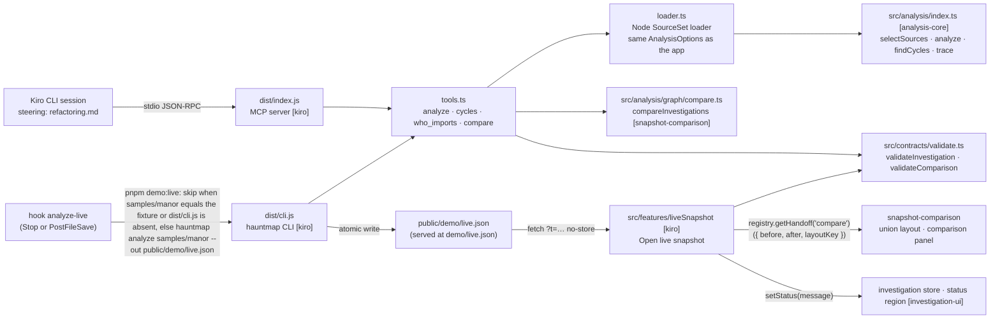

# Design Document

## Overview

This spec turns HauntMap's analysis module into something Kiro can call and something the judge can see Kiro having called. One package, `packages/hauntmap-mcp`, builds two self-contained Node bundles from the same `src/analysis` and `src/contracts` code the app runs in its worker: `dist/index.js`, a stdio MCP server with the tools `analyze`, `cycles`, `who_imports` and `compare`, and `dist/cli.js`, the `hauntmap` CLI with `analyze` and `compare`. A Node source loader walks a directory and hands its files to the same `selectSources` the analysis worker runs, so module IDs, source hashes and relation IDs agree across the two paths (matrix row 26). The repository's `.kiro/` registers the server (`settings/mcp.json`), instructs Kiro to call `cycles` before an import change and `compare` after it (`steering/refactoring.md`), and runs `pnpm verify` and `pnpm demo:live` (which runs `pnpm hauntmap analyze samples/manor --out public/demo/live.json` only when `samples/manor` differs from the fixture it copies) as command hooks whose trigger names are observed before they are cited. In the app, `src/features/liveSnapshot` registers the **Open live snapshot** toolbar control, which fetches `demo/live.json`, validates it and hands it to `snapshot-comparison` as the newer snapshot, so the corridor Kiro broke closes on screen with every other room in place (matrix row 28). The recorded session is the H9 acceptance: the transcript of a headless Kiro CLI session, both tool results, the hook-written `live.json`, the app's comparison result and a Playwright video of the app are committed under `docs/acceptance/h9-session/` and `tests/mcp-agreement.test.ts` asserts they agree (matrix row 27). The Crew is not used (`.kiro/steering/revision-2026-11-16.md`); this spec writes no Crew definition and no `docs/crew.md`.

Owner: Kiro, in the main checkout, on its own branch, one task at a time; there is no integrator, and every step this document gives to an integrator is Kiro's. Folders written: `packages/hauntmap-mcp`, `.kiro/settings`, `.kiro/hooks`, `.kiro/steering/refactoring.md`, `src/features/liveSnapshot`, `samples`, `scripts/sampleTree.ts`, `scripts/demo-reset.ts`, `scripts/demo-live.ts`, `public/demo/live.json`, `tests/kiro` (including `tests/kiro/e2e/` and `tests/kiro/h9/`), `tests/mcp-agreement.test.ts`, `docs/demo/h9-session-script.md`, `docs/acceptance/h9-session/`. Files of other owners that this spec changes by one line each, only after `.kiro/steering/ownership.md` lists the change as an exception for `kiro-integration` (requirements, "Files of other owners"): the root `package.json` scripts, `pnpm-workspace.yaml` (`packages: ["packages/*"]`), `vitest.config.ts` (the `.tsx` include, the jsdom environment for `tests/kiro/live-snapshot.test.tsx`, the global setup that builds `dist/`), `eslint.config.js` (ignore `packages/*/dist/**` and `samples/**`; the current `dist/**` pattern matches only the root `dist/`), the Playwright configuration of `investigation-ui` (the `dev` project also matches `tests/kiro/e2e/**`), and `src/components/App.tsx` (the `registerLiveSnapshot(...)` call). `src/contracts/validate.ts` is already an exception. `.gitignore` needs no change: it already ignores `.hauntmap/` and `dist/`. Figures in this document (2,000 ms, 90 s, 120 s) are targets until a `docs/performance.md` or `docs/kiro-log.md` row records them.

Dependencies on `main`, read on 2026-11-16: `src/analysis/index.ts` exports `DEFAULT_ANALYSIS_OPTIONS` (an `AnalysisOptions` with `preset: "static-value"`), `selectSources`, `analyze`, `findCycles`, `trace`, `occurrenceId`, `relationId` and the types `HashFn` and `SelectResult` (and nothing else: `tests/analysis-boundary.test.ts` asserts that exact key list, so this spec imports `compareInvestigations` from `src/analysis/graph/compare.ts` directly rather than asking for a new export); `src/contracts/types.ts` holds the contracts; `src/workers/client.ts` exports `createAnalysisClient` with `analyze({ files, rootLabel, options }, onProgress?)`; `public/demo/manor/before/` holds the 40 modules, `expected.json` and `sources.json`; `scripts/pack-samples.ts` (`analysis-core`) writes `sources.json` and is a command-line script, not a module (it calls `process.exit` at load), so tests read the `sources.json` it wrote. Still to come: `src/analysis/graph/compare.ts` with `compareInvestigations` (`snapshot-comparison`, needed by task 9 only); `src/features/samples/loadSample.ts`, the registry (`src/features/investigation/registry.ts`) with the `live-snapshot` slot and the store (`investigation-ui`); the `compare` handoff (`snapshot-comparison`). Until `compare.ts` lands, the `compare` tool is registered with a handler that returns `analysis-failed` with `compare is not available until snapshot-comparison lands` and the agreement test's row-27 cases are the failing tests of task 1c.

## Architecture



The recorded session, in order (Requirement 9):

```mermaid
sequenceDiagram
  participant B as outer Kiro session (PowerShell)
  participant K as headless Kiro CLI session
  participant S as hauntmap MCP server
  participant F as samples/manor
  participant HK as analyze-live hook
  participant APP as app (manor/before open)
  B->>K: prompt of docs/demo/h9-session-script.md
  K->>S: cycles({ root: "samples/manor", preset: "static-value" })
  S-->>K: CycleReport: 1 component [receipt, checkout, charge]
  K->>F: edit src/notifications/receipt.ts (delete the import of ../orders/checkout and its one use)
  K->>S: compare({ rootBefore: "public/demo/manor/before", rootAfter: "samples/manor" })
  S-->>K: ComparisonResult: removedRelations [demo relation], addedRelations []
  K-->>B: final message with the removed relationId, labels and cycle counts 1 → 0
  K->>HK: agent stop
  HK->>HK: pnpm demo:live → samples/manor differs from the fixture → hauntmap analyze samples/manor --out public/demo/live.json → "analyze: 40 modules, …"
  Note over APP: served by `pnpm dev` (reads public/demo/live.json from disk), or rebuilt with `pnpm build && pnpm preview`; driven by tests/kiro/h9/h9-app.spec.ts with video on, loop selected first
  B->>APP: Playwright: Open live snapshot (keyboard)
  APP->>APP: fetch demo/live.json → validate → compare handoff (before = manor/before, after = live:samples/manor)
  APP-->>B: comparison panel: 1 removed relation; rooms unchanged; corridor closes
```

Open live snapshot, with every outcome (Requirement 8):

```mermaid
sequenceDiagram
  participant U as user
  participant LC as LiveSnapshotControl
  participant O as openLiveSnapshot()
  participant N as fetch
  participant R as registry
  participant ST as store
  U->>LC: activate (click / Enter / Space)
  LC->>O: run({ store, registry, fetchImpl, base, now })
  O->>ST: pending = true (button aria-disabled)
  O->>N: GET base + "demo/live.json?t=" + now(), cache "no-store"
  alt status 404, or 200 non-JSON without a json content-type
    O->>ST: setStatus(MISSING)
  else fetch rejects or other status
    O->>ST: setStatus(FETCH_FAILED(reason))
  else 200 JSON
    O->>O: parse → validateInvestigation
    alt invalid
      O->>ST: setStatus(MALFORMED(firstError))
    else valid
      alt no investigation open
        O->>ST: loadSample("manor/before") → analysisClient.analyze({ files, rootLabel, options }) → openInvestigation(inv, map from sourceSet.files, { demo: false })
        Note over O: load failure → setStatus(investigation-ui 1.6 text); analysis rejection → setStatus(SAMPLE_ANALYZE_FAILED(message)); both return "sample-failed"
      end
      alt no compare handoff
        O->>ST: setStatus("Comparison is not available in this build.")
      else
        O->>R: getHandoff("compare")({ before, after: live, layoutKey })
        alt resolves
          O->>ST: setStatus(LOADED(after.sourceLabel, n, before.sourceLabel))
        else rejects (the handoff already wrote its message)
          O->>O: return "compare-failed", no status write
        end
      end
    end
  end
  O->>ST: pending = false
```

### File layout for this spec

| Path | Role | Writer |
| --- | --- | --- |
| `packages/hauntmap-mcp/package.json`, `tsconfig.json`, `build.config.*` | package `hauntmap-mcp` (private), scripts `build`, `test`; bundler configuration producing `dist/index.js` and `dist/cli.js` with every dependency inlined | kiro |
| `packages/hauntmap-mcp/bin/hauntmap.js` | 20-line launcher: checks `dist/cli.js` exists, else prints the not-built message and exits 3; otherwise imports it | kiro |
| `packages/hauntmap-mcp/src/index.ts` | MCP server entry: transport, tool registration, stderr logging | kiro |
| `packages/hauntmap-mcp/src/cli.ts` | argument parsing, exit codes, atomic write | kiro |
| `packages/hauntmap-mcp/src/tools.ts` | the four tool handlers as pure async functions over a `ToolContext`; shared by server and CLI | kiro |
| `packages/hauntmap-mcp/src/loader.ts` | `resolveRoot`, `loadSourceSet`, `sourceLabelFor`, hashing | kiro |
| `packages/hauntmap-mcp/src/errors.ts` | `ToolError` codes and messages | kiro |
| `packages/hauntmap-mcp/README.md` | pinned versions and licenses, build and run instructions, the *verify* ledger of this package | kiro |
| `src/contracts/validate.ts` | `validateInvestigation`, `validateComparison` (`analysis-core` provides no validator on 2026-11-16; this file is the ownership exception for `kiro-integration`; shared by app, CLI and server) | kiro |
| `src/features/liveSnapshot/index.ts`, `openLiveSnapshot.ts`, `LiveSnapshotControl.tsx`, `messages.ts`, `fetchLive.ts` | registration, the orchestration function, the button, the exact strings, the fetch and classification | kiro |
| `samples/manor/**` | committed working copy of `public/demo/manor/before` (included extensions only) | kiro (copied; the fixture's content belongs to `analysis-core`) |
| `scripts/demo-reset.ts`, `scripts/sampleTree.ts` | `pnpm demo:reset`; the shared walker (`listIncluded(root)`, `treesEqual(a, b)`) used by `demo-reset.ts`, `demo-live.ts` and `tests/kiro/sample-copy.test.ts` | kiro |
| `scripts/demo-live.ts` | `pnpm demo:live`: the idempotent wrapper the `analyze-live` hook runs (skip when the sample equals the fixture or `dist/cli.js` is absent, else run the CLI) | kiro |
| `public/demo/live.json` | the committed live snapshot (pre-edit from task 7, the session's post-edit file from task 12) | kiro (written by the CLI, never by hand) |
| `.kiro/settings/mcp.json`, `.kiro/hooks/verify-on-stop.json`, `.kiro/hooks/analyze-live.json`, `.kiro/hooks/README.md`, `.kiro/steering/refactoring.md` | registration, hooks, the hooks' *verify* ledger and observation procedure, steering; all five already exist on 2026-11-16 with the contents of this document (the steering file with the three logging bullets added), so the tasks check them rather than write them | kiro |
| `tests/kiro/**`, `tests/mcp-agreement.test.ts` | this spec's tests and fixtures (`tests/kiro/fixtures/`), the browser journey `tests/kiro/e2e/live-snapshot.spec.ts` (kept out of `tests/e2e/**`, which belongs to `investigation-ui`) and the H9 app script `tests/kiro/h9/` | kiro |
| `docs/demo/h9-session-script.md`, `docs/acceptance/h9-session/**`, `docs/write-up.md` (section `How Kiro was used`), `docs/kiro-log.md` rows | the session, the write-up input | kiro |

Process model: the MCP server is one Node process per Kiro session, started by Kiro from the workspace root with `node packages/hauntmap-mcp/dist/index.js` (*verify* that the installed Kiro starts MCP servers with the workspace as the current directory; if it does not, the relative path in `args` fails to start and the fix is an absolute path or a `cwd` field, *verify*, recorded in the log). Every tool call loads and analyzes its root from scratch; nothing is cached between calls, so an edit is always visible to the next call. The CLI is one process per hook run. The app side runs on the main thread except the analysis of `manor/before` in 8.8, which goes through the analysis worker like any sample. On Windows the hook command and the MCP server command are started by the Kiro CLI; which shell runs a hook command (PowerShell or `cmd.exe`) is *verify* at task 2, and every hook command is a plain `pnpm <script>` so that it runs in either.

## Components and Interfaces

### Consumed contracts (verbatim from the plan; defined in `src/contracts/`, never redefined here)

```ts
type SyntaxKind = "import" | "re-export" | "dynamic-literal";
type DependencyKind = "value" | "type" | "mixed";
type Preset = "static-value" | "type-inclusive" | "dynamic-inclusive";
interface SourceFile { path: string; text: string; bytes: number }
interface SourceSet { rootLabel: string; files: SourceFile[]; skipped: { path: string; reason: "excluded-dir" | "extension" | "oversized" | "secret-pattern" | "binary" }[] }
interface AnalysisOptions {
  preset: Preset;
  includeExtensions: string[]; excludeDirectories: string[]; excludeFilePatterns: string[];
  maxFiles: number; maxFileBytes: number; maxTotalBytes: number;
  jsToTsFallback: true;
}
interface ModuleRecord { id: string; sourceHash: string; language: "js" | "jsx" | "ts" | "tsx"; parseStatus: "ok" | "partial" | "failed" }
interface ImportRecord {
  occurrenceId: string; relationId: string;
  from: string; to: string | null; specifier: string;
  syntaxKind: SyntaxKind; dependencyKind: DependencyKind;
  resolution: "local" | "external" | "unresolved" | "unsupported";
  line: number; column: number;
  reason?: "absent-file" | "alias-not-configured" | "nonliteral-dynamic" | "unsupported-construct" | "ambiguous-candidate";
}
interface Diagnostic { code: "parse-failed" | "unresolved" | "unsupported" | "case-collision" | "duplicate-path" | "oversized" | "cap-reached"; module?: string; line?: number; column?: number; specifier?: string; message: string }
interface Investigation { schemaVersion: 1; resolverMode: "documented-source-subset"; sourceLabel: string; modules: ModuleRecord[]; imports: ImportRecord[]; diagnostics: Diagnostic[]; options: AnalysisOptions }
interface TraceResult { origin: string; direction: "imports" | "imported-by"; preset: Preset; visited: string[]; direct: string[]; indirect: string[]; predecessor: Record<string, string>; distance: Record<string, number> }
interface CyclicComponent { members: string[]; witness: { modules: string[]; relationIds: string[] } }
interface CycleReport { preset: Preset; components: CyclicComponent[] }
interface RelationRef { relationId: string; from: string; to: string | null; specifier: string; syntaxKind: SyntaxKind; dependencyKind: DependencyKind; resolution: ImportRecord["resolution"] }
interface ComparisonResult {
  schemaVersion: 1; preset: "static-value";
  before: { label: string; moduleCount: number; relationCount: number }; after: { label: string; moduleCount: number; relationCount: number };
  addedModules: string[]; removedModules: string[]; changedModules: string[];
  addedRelations: RelationRef[]; removedRelations: RelationRef[];
  cyclicComponentsBefore: number; cyclicComponentsAfter: number;
}
```

Analysis entry points consumed (read from `main` on 2026-11-16; task 1a copies this list into `packages/hauntmap-mcp/README.md`), all from `src/analysis/index.ts`: `selectSources(files: SourceFile[], rootLabel: string, options: AnalysisOptions): SelectResult` (`{ ok: true; sourceSet; diagnostics } | { ok: false; diagnostics }`, `ok: false` only for a cap); `analyze(sourceSet: SourceSet, options: AnalysisOptions, hash: HashFn, onProgress?, selectionDiagnostics?: Diagnostic[]): Promise<Investigation>` with `HashFn = (text: string) => Promise<string>`; `findCycles(investigation, preset): CycleReport`; `trace(investigation, origin, direction, preset): TraceResult` (throws an `Error` naming the origin when it is not a module, so the tool checks first); `DEFAULT_ANALYSIS_OPTIONS: AnalysisOptions` (with `preset: "static-value"`). From `src/analysis/graph/compare.ts` (`snapshot-comparison` design): `compareInvestigations(before, after): { ok: true; result: ComparisonResult; detail: ComparisonDetail } | { ok: false; error: { code: "incompatible-schema" | "incompatible-resolver"; message: string } }` (*verify* when it lands). `analyze` is asynchronous only because of the hash; parsing is synchronous and CPU-bound (Babel), which is acceptable for the 40-module sample and the 1,000-file cap.

### Loader (`packages/hauntmap-mcp/src/loader.ts`)

```ts
export type RootError =
  | { code: "root-outside-workspace"; message: string }
  | { code: "root-not-found"; message: string }
  | { code: "cap-reached"; message: string };

export interface ResolvedRoot { given: string; absolute: string; label: string }   // label = sourceLabelFor(given)

export function sourceLabelFor(root: string): string;
// "live:" + root with "\\" → "/", one leading "./" removed, trailing "/" removed; "samples/manor" → "live:samples/manor"

export async function resolveRoot(workspaceRoot: string, root: string, fs?: FsLike): Promise<{ ok: true; root: ResolvedRoot } | { ok: false; error: RootError }>;
// workspaceRoot is itself a realpath (ToolContext); abs = path.resolve(workspaceRoot, root);
// realpath(abs) succeeds → ok only if real === workspaceRoot or real.startsWith(workspaceRoot + path.sep) (path.sep is "\\" on Windows; both sides come from fs.realpath, so drive-letter case and 8.3 short names agree), else root-outside-workspace; then stat: not a directory → root-not-found;
// realpath(abs) fails with ENOENT → abs (unresolved) outside the workspace by the same prefix rule → root-outside-workspace, else root-not-found (nothing outside the workspace is read either way)

export async function loadSourceSet(root: ResolvedRoot, options: AnalysisOptions, fs?: FsLike): Promise<{ ok: true; sourceSet: SourceSet; diagnostics: Diagnostic[] } | { ok: false; error: RootError }>;
// walk(root.absolute): readdir with withFileTypes, entries sorted by name with (a < b ? -1 : a > b ? 1 : 0) (code-point order), directories and files interleaved in that order, depth-first;
// directory whose name is in options.excludeDirectories → skipped { path: rel + "/", reason: "excluded-dir" }, not entered (its files never reach selectSources);
// every other file becomes a SourceFile { path: rel, bytes: stat.size, text } where text is
//       "" (not read) when the basename matches an excludeFilePatterns pattern, the extension is not included, or stat.size > options.maxFileBytes
//          (the pattern and extension tests are the loader's own pre-filter for reading only; selectSources makes the decision and gives the reason);
//       else new TextDecoder("utf-8").decode(bytes) (BOM removed; no newline normalization);
// then selectSources(candidates, root.label, options): the reasons "secret-pattern", "extension", "oversized" (with its diagnostic) and "binary" (U+0000 in the first 8,192 code units of text),
//       the case-collision and duplicate-path diagnostics, and the caps (files first, then bytes) all come from it, so the Node route and the app route classify alike;
// selectSources ok: false → cap-reached with the files message or the bytes message (see below), first excluded = that diagnostic's module;
// ok: true → sourceSet with skipped = the loader's "<dir>/" entries plus selectSources's entries, sorted by path; diagnostics passed on to analyze as selectionDiagnostics;
// symlinks and junctions: readdir entries that are links are resolved with realpath; one that resolves outside the workspace is skipped and recorded in a stderr log line (never followed);
// result: files sorted by path (code-point order, as selectSources returns them), rootLabel = root.label

export const sha256Hex: HashFn = async (text) => createHash("sha256").update(text, "utf8").digest("hex");   // node:crypto; the HashFn passed to analyze
```

`analyze` hashes every module through the `HashFn` it is given (read from `src/analysis/parser/analyze.ts` on 2026-11-16), so the loader computes no hash; the app passes a Web Crypto `HashFn`, the server and the CLI pass `sha256Hex`. On both paths the input to the hash is the decoded text re-encoded as UTF-8. The loader tells the two caps apart by the message of the `cap-reached` diagnostic (`<n> files were found …` or `<n> bytes were found …`, the two messages of `src/analysis/parser/select.ts`); `tests/kiro/loader.test.ts` covers both caps, so a change of those messages in `analysis-core` fails this spec's test instead of passing silently.

`FsLike` is the subset of `node:fs/promises` used (`readdir`, `stat`, `lstat`, `realpath`, `readFile`), injected so `tests/kiro/loader.test.ts` and the property tests run on temp directories and on an in-memory fake with symlink entries.

### Tools (`packages/hauntmap-mcp/src/tools.ts`)

```ts
export interface ToolContext {
  workspaceRoot: string;                 // fs.realpath(process.cwd()) at startup
  fs?: FsLike;
  analysis: {                            // injected so tests can stub; production passes the functions of src/analysis/index.ts by reference: { selectSources, analyze, findCycles, trace, compareInvestigations }
    selectSources: typeof selectSources;
    analyze: typeof analyze;             // (sourceSet, options, hash, onProgress?, selectionDiagnostics?) => Promise<Investigation>
    findCycles: typeof findCycles;
    trace: typeof trace;
    compareInvestigations?: (before: Investigation, after: Investigation) => CompareOutcome;   // absent until snapshot-comparison lands
  };
  // never write these as methods or arrow functions named findCycles or trace inside packages/hauntmap-mcp/src: check 2 of tests/analysis-boundary.test.ts fails on such declarations outside src/analysis
  hash: HashFn;                          // sha256Hex
  validate: { investigation(value: unknown): ValidationResult; comparison(value: unknown): ValidationResult };
  defaults: AnalysisOptions;             // DEFAULT_ANALYSIS_OPTIONS; the tools spread it and set preset
  log(line: string): void;              // stderr
}

export type ToolErrorCode = "invalid-arguments" | "invalid-preset" | "root-outside-workspace" | "root-not-found" | "cap-reached" | "module-not-found" | "analysis-failed";
export interface ToolError { error: { code: ToolErrorCode; message: string } }
export type ToolResult<T> = { ok: true; value: T } | { ok: false; error: ToolError["error"] };

export const PRESETS: readonly Preset[] = ["static-value", "type-inclusive", "dynamic-inclusive"];

export async function analyzeTool(ctx: ToolContext, args: unknown): Promise<ToolResult<Investigation>>;
export async function cyclesTool(ctx: ToolContext, args: unknown): Promise<ToolResult<CycleReport>>;
export async function whoImportsTool(ctx: ToolContext, args: unknown): Promise<ToolResult<TraceResult>>;
export async function compareTool(ctx: ToolContext, args: unknown): Promise<ToolResult<ComparisonResult>>;

// shared steps, in this order:
// 1. parseArgs: args must be an object; each required field a non-empty string → else invalid-arguments `Argument "<name>" must be a string.`;
//    preset absent → "static-value"; present but not in PRESETS → invalid-preset;
// 2. resolveRoot (root-outside-workspace / root-not-found);
// 3. loadSourceSet (cap-reached), which runs selectSources;
// 4. ctx.analysis.analyze(sourceSet, { ...ctx.defaults, preset }, ctx.hash, undefined, selectionDiagnostics) inside try/catch → a throw becomes analysis-failed `Analysis of "<root>" failed: <error message>.` (never a stack, never a path outside the root);
// 5. the tool-specific step: cycles → ctx.analysis.findCycles(inv, preset); who_imports → module must be in inv.modules (module-not-found) then ctx.analysis.trace(inv, module, "imported-by", preset);
//    compare → both roots through steps 2–4 under "static-value" with messages prefixed "rootBefore: " / "rootAfter: ", then ctx.analysis.compareInvestigations
//    (absent → analysis-failed `compare is not available until snapshot-comparison lands`; { ok: false, error } → analysis-failed `The snapshots cannot be compared: <error.message>.`; { ok: true } → its result, detail dropped);
// 6. validation of the produced value with ctx.validate (a failure is analysis-failed `internal error, output failed validation: <first error>` and is logged to stderr).
```

Tool input schemas, as listed by `tools/list` (JSON Schema objects returned verbatim; the SDK's high-level `registerTool` takes schemas of its own schema library and converts them, so the server answers `tools/list` and `tools/call` through the SDK's lower-level request handlers if that is what keeps these objects unchanged, *verify* on the pinned SDK and record the choice in `README.md`):

| Tool | Input schema | Description string |
| --- | --- | --- |
| `analyze` | `{ type: "object", required: ["root"], properties: { root: { type: "string", description: "Directory relative to the workspace root, e.g. samples/manor" }, preset: { type: "string", enum: ["static-value", "type-inclusive", "dynamic-inclusive"], default: "static-value" } }, additionalProperties: false }` | `Analyze the JavaScript/TypeScript import graph of a directory inside this workspace and return HauntMap's versioned investigation JSON (source text omitted).` |
| `cycles` | same as `analyze` | `Return the dependency cycles (strongly connected components with one witness each) of a directory under a preset.` |
| `who_imports` | `analyze`'s schema plus `module: { type: "string", description: "Module ID relative to the root, e.g. src/orders/checkout.ts" }`, `required: ["root", "module"]` | `Return the direct and indirect importers of a module, with a shortest path for each.` |
| `compare` | `{ type: "object", required: ["rootBefore", "rootAfter"], properties: { rootBefore: { type: "string" }, rootAfter: { type: "string" } }, additionalProperties: false }` | `Compare two directories' import graphs by structural relation ID and return the removed and added relations, changed modules and cycle counts.` |

Output: `{ content: [{ type: "text", text: JSON.stringify(value) }], structuredContent: value }` on success (`structuredContent` only if the pinned SDK supports it, *verify*; otherwise the text item alone); `{ content: [{ type: "text", text: JSON.stringify(toolError) }], isError: true }` on failure (*verify* the flag's name on the pinned SDK). The text is not indented (one line), so a transcript shows it compactly; the CLI writes indented files.

### Server (`packages/hauntmap-mcp/src/index.ts`)

```ts
// startup: workspaceRoot = await fs.realpath(process.cwd()); ctx = createContext(workspaceRoot);
// server = the SDK server named "hauntmap" with <package version>; the class (high-level McpServer or low-level Server) and the request-handler names are *verify* on the pinned SDK, chosen so that tools/list returns the schemas above verbatim
// register the four tools with the schemas above; each handler: const r = await <tool>(ctx, args); return r.ok ? success(r.value) : failure(r.error);
// transport: stdio; process.stdout is reserved for the transport; all diagnostics go through ctx.log → process.stderr with the prefix "hauntmap-mcp: ";
// on SIGINT/SIGTERM: close the transport and exit 0; an unhandled rejection logs one line to stderr and exits 1 (never prints to stdout)
```

### CLI (`packages/hauntmap-mcp/src/cli.ts`, launched by `bin/hauntmap.js`)

```ts
export const USAGE = [
  "Usage: hauntmap analyze <root> --out <file> [--preset static-value|type-inclusive|dynamic-inclusive]",
  "       hauntmap compare <before> <after> --out <file>",
].join("\n");

export type ExitCode = 0 | 2 | 3 | 4 | 5 | 6;
export async function main(argv: string[], io: { cwd: string; stdout(s: string): void; stderr(s: string): void; fs?: FsLike }): Promise<ExitCode>;
// 1. cwd must contain package.json with name "hauntmap" (the root package name on 2026-11-16) → else stderr `hauntmap: run from the HauntMap repository root (no package.json named hauntmap in <cwd>).`, exit 4
// 2. parse: subcommand analyze|compare; positional roots; --out <file> required; --preset optional (analyze only); anything else → USAGE, exit 2; invalid preset → `hauntmap: Preset "<p>" is not one of static-value, type-inclusive, dynamic-inclusive.`, exit 2
// 3. run the tool with ctx.workspaceRoot = realpath(cwd); error codes map: root-outside-workspace | root-not-found | cap-reached → exit 4; analysis-failed from validation → exit 5; other analysis-failed → exit 4; message printed as `hauntmap: <message>`
// 4. write: JSON.stringify(value, null, 2) + "\n" to path.resolve(cwd, out) + ".tmp" then fs.rename over out (on EPERM or EBUSY, which Windows returns while another process holds out open, retry up to 5 times 100 ms apart); any remaining fs error → `hauntmap: cannot write <file> (<err.code>).`, exit 6, and the .tmp is removed if it exists
// 5. stdout: `analyze: <modules> modules, <relations> relations, <diagnostics> diagnostics → <out>` (relations = distinct relationId count) or `compare: <removed> removed, <added> added, <changed> changed modules → <out>`; exit 0
```

`bin/hauntmap.js`: resolves `../dist/cli.js` relative to its own location; if absent, prints `hauntmap: the CLI is not built. Run pnpm build:mcp first.` to stderr and exits 3; otherwise loads it with `import(pathToFileURL(cliPath).href)` (a bare Windows path such as `D:\…` is rejected by `import()`) and calls `main(process.argv.slice(2), { cwd: process.cwd(), … })`, exiting with the returned code.

Root `package.json` scripts, added by Kiro once the ownership exception exists: `"build:mcp": "pnpm --filter hauntmap-mcp build"` (*verify* the filter syntax on pnpm 12.3.4; the package name in `packages/hauntmap-mcp/package.json` is `hauntmap-mcp`), `"hauntmap": "node packages/hauntmap-mcp/bin/hauntmap.js"`, `"demo:reset": "tsx scripts/demo-reset.ts"` and `"demo:live": "tsx scripts/demo-live.ts"` (the runner `tsx` 4.23.15, as `"pack:samples": "tsx scripts/pack-samples.ts"` uses it), and, only if the `verify:fast` rule of `.kiro/hooks/README.md` is triggered, `"verify:fast"` (a script that sets `HAUNTMAP_FAST=1` for the child `pnpm verify` in Node, since a `VAR=1 cmd` prefix does not run in PowerShell or `cmd.exe`). `pnpm-workspace.yaml` gains `packages: ["packages/*"]` (it has no `packages` key on 2026-11-16). The Vitest `include` (`tests/**/*.test.ts`) already collects `tests/kiro/*.test.ts` and `tests/mcp-agreement.test.ts`; it gains `tests/kiro/**/*.test.tsx` with the jsdom environment for that file, and the global setup that builds `dist/` when it is older than `src/`. The `dev` Playwright project of `investigation-ui` gains `tests/kiro/e2e/**`.

### Validators (`src/contracts/validate.ts`)

```ts
export type ValidationResult = { ok: true } | { ok: false; errors: string[] };   // errors in document order; the first is shown to users
export function validateInvestigation(value: unknown): ValidationResult;
export function validateComparison(value: unknown): ValidationResult;
```

Checks and their exact error strings (the first failing check wins for the user-visible message; all are collected for tests):

| Check | Error string |
| --- | --- |
| value is a plain object | `document must be a JSON object` |
| `schemaVersion === 1` | `schemaVersion must be 1 (found <JSON of value or "missing">)` |
| `resolverMode === "documented-source-subset"` | `resolverMode must be "documented-source-subset" (found <…>)` |
| `sourceLabel` is a string | `sourceLabel must be a string` |
| `modules`, `imports`, `diagnostics` are arrays | `<field> must be an array` |
| each module: `id` string, `sourceHash` 64 lowercase hex, `language` in the four values, `parseStatus` in the three values | `modules[<i>].<field> must be <expectation>` |
| module IDs unique | `modules[<i>].id duplicates modules[<j>].id` |
| each import: `occurrenceId` and `relationId` strings that parse as JSON arrays of 4 elements whose first element equals `from`; `from` is a module ID; `to` is null or a module ID; `specifier` string; `syntaxKind`, `dependencyKind`, `resolution` in their enums; `line` and `column` integers ≥ 1; `reason` absent or in its enum; `resolution: "local"` ⇔ `to !== null` | `imports[<i>].<field> must be <expectation>` |
| `options` object with `preset` in the enum, the three array fields and the three numeric fields present, and `jsToTsFallback === true` | `options.<field> must be <expectation>` |
| no element anywhere has a `text` property | `imports[<i>] must not carry source text` / `modules[<i>] must not carry source text` |
| comparison: `schemaVersion === 1`, `preset === "static-value"`, `before`/`after` with string label and non-negative integer counts, the five arrays, relation refs with the enum fields, `cyclicComponentsBefore/After` non-negative integers, the three module lists sorted, the two relation lists sorted by `relationId` | `<field> must be <expectation>` |

JSON parse failures are reported by the caller as `file is not JSON (<SyntaxError message>)`; the validator receives parsed values only. The validator uses no schema library (plain TypeScript; no new dependency), so the app bundle and the Node bundles share one 200-line file.

### Live snapshot feature (`src/features/liveSnapshot/`)

```ts
// messages.ts
export const LIVE_PATH = "demo/live.json";
export const MSG_MISSING = "No live snapshot yet. Run `pnpm hauntmap analyze samples/manor --out public/demo/live.json`, or let the Kiro hook write it.";
export const msgMalformed = (firstError: string) => `The live snapshot at demo/live.json is not valid: ${firstError}. The current view is unchanged.`;
export const msgFetchFailed = (reason: string) => `The live snapshot could not be fetched (${reason}). The current view is unchanged.`;
export const MSG_NO_COMPARE = "Comparison is not available in this build.";
export const msgLoaded = (afterLabel: string, modules: number, beforeLabel: string) =>
  `Live snapshot loaded: ${afterLabel} (${modules} modules) is the newer snapshot; ${beforeLabel} is the older one.`;

// fetchLive.ts
export type LiveFetch =
  | { kind: "missing" }                                   // 404; or 200 with non-JSON body and a content-type without "json"
  | { kind: "fetch-failed"; reason: string }              // rejection → error.name; other status → String(status)
  | { kind: "malformed"; firstError: string }             // JSON parse failure with a json content-type or a body starting with "{" → "file is not JSON (<message>)"; or validator errors[0]
  | { kind: "valid"; investigation: Investigation };
export async function fetchLive(base: string, fetchImpl: typeof fetch, now: () => number, validate: (v: unknown) => ValidationResult): Promise<LiveFetch>;
// GET `${base}${LIVE_PATH}?t=${now()}` with { cache: "no-store" }; no headers, no credentials ("same-origin" default is fine; credentials: "omit" set explicitly)

// openLiveSnapshot.ts
export interface LiveDeps {
  store: InvestigationStore;                              // investigation-ui's store
  registry: Registry;                                     // investigation-ui's registry
  base: string;                                           // import.meta.env.BASE_URL (verify on the pinned Vite)
  fetchImpl?: typeof fetch; now?: () => number;
  loadSample: typeof loadSample;                          // src/features/samples/loadSample.ts
  analysisClient: Pick<AnalysisClient, "analyze">;       // src/workers/client.ts on main: analyze({ files, rootLabel, options }, onProgress?) → Promise<Investigation>; the source map is built here from sourceSet.files
  defaults: AnalysisOptions;                              // DEFAULT_ANALYSIS_OPTIONS from src/analysis/index.ts (includes preset "static-value")
  validate: typeof validateInvestigation;
}
export const msgSampleAnalyzeFailed = (message: string) => `The manor sample could not be analyzed (${message}). Reload the page or analyze a local folder.`;
export type LiveOutcome = "missing" | "fetch-failed" | "malformed" | "no-compare" | "sample-failed" | "compare-failed" | "loaded";
export async function openLiveSnapshot(deps: LiveDeps): Promise<LiveOutcome>;
// 1. if a run is pending → return the pending promise (no second fetch);
// 2. result = await fetchLive(...); on missing / fetch-failed / malformed → setStatus(message); return;
// 3. if store.getState().investigation === null → s = await loadSample("manor/before", base); !s.ok → setStatus(s.message), return "sample-failed";
//    try { investigation = await analysisClient.analyze({ files: s.sourceSet.files, rootLabel: s.sourceSet.rootLabel, options: { ...defaults, preset: "static-value" } }) } catch (e) { setStatus(msgSampleAnalyzeFailed(e.message)); return "sample-failed" }
//    sourceText = new Map(s.sourceSet.files.map(f => [f.path, f.text])); store.actions.openInvestigation(investigation, sourceText, { demo: false });
// 4. handoff = registry.getHandoff("compare"); null → setStatus(MSG_NO_COMPARE), return "no-compare";
// 5. try { await handoff({ before: store.getState().investigation, after: result.investigation, layoutKey: store.getState().layout?.layoutKey ?? null }) }
//    catch { return "compare-failed" }   // the handoff wrote its own message (snapshot-comparison 1.4, 10.6); no second status write; the view stays as the handoff left it
//    setStatus(msgLoaded(after.sourceLabel, after.modules.length, before.sourceLabel)); return "loaded"
// the function never touches selection, camera, routeFilter, expandedWings or panel (the handoff may drop the route filter, snapshot-comparison 6.1 and 6.3); the handoff owns the comparison state; nothing escapes as an unhandled rejection

// LiveSnapshotControl.tsx
export function LiveSnapshotControl(props: { store: InvestigationStore }): JSX.Element;
// <button type="button" aria-disabled={pending} onClick={run}>Open live snapshot</button>; Enter and Space are the button's native activation;
// run() ignores activation while pending; deps are taken from a module-level `configure(deps)` called by index.ts at app start (tests call configure with fakes)

// index.ts
export function registerLiveSnapshot(deps: LiveDeps): void;   // configure(deps); registry.registerControl("live-snapshot", LiveSnapshotControl); called once from src/components/App.tsx (investigation-ui's file: the one-line call needs the ownership exception)
```

The live investigation enters the app only through the compare handoff: `snapshot-comparison` computes the `ComparisonResult`, requests the union layout with the given `layoutKey` so common rooms keep their coordinates, applies the comparison styling and opens its panel. This spec reads nothing from that result; the loaded message uses the two `sourceLabel`s and the module count, which it has before the handoff.

### Hooks (`.kiro/hooks/`)

`verify-on-stop.json`:

```json
{
  "version": "v1",
  "hooks": [
    {
      "name": "verify-on-stop",
      "trigger": "Stop",
      "action": { "type": "command", "command": "pnpm verify" },
      "timeout": 600
    }
  ]
}
```

`analyze-live.json` at scaffold (two entries; the unobserved one is deleted by task 7):

```json
{
  "version": "v1",
  "hooks": [
    {
      "name": "analyze-live",
      "trigger": "Stop",
      "action": { "type": "command", "command": "pnpm demo:live" },
      "timeout": 120
    },
    {
      "name": "analyze-live-on-save",
      "trigger": "PostFileSave",
      "matcher": "^samples/manor/.*\\.(js|jsx|ts|tsx|mjs|mts)$",
      "action": { "type": "command", "command": "pnpm demo:live" },
      "timeout": 120
    }
  ]
}
```

`scripts/demo-live.ts` (`pnpm demo:live`, root script `"demo:live": "tsx scripts/demo-live.ts"`, the same runner as `demo:reset` and `pack:samples`):

```ts
// 1. if packages/hauntmap-mcp/dist/cli.js is absent → stdout "demo:live: skipped (dist/cli.js absent; run pnpm build:mcp)", exit 0
// 2. if treesEqual("samples/manor", "public/demo/manor/before") (scripts/sampleTree.ts: every file with an included extension present in both trees with byte-equal content, the comparison of 1.4)
//    → stdout "demo:live: skipped (samples/manor is identical to public/demo/manor/before)", exit 0, nothing written
// 3. else spawn process.execPath with packages/hauntmap-mcp/bin/hauntmap.js analyze samples/manor --out public/demo/live.json (no shell, so it runs the same under PowerShell and cmd.exe), inherited stdio, and exit with its code
// the runner (step 3) is injected so tests/kiro/demo-live.test.ts covers the three branches without building the CLI
```

The wrapper exists so that the hook is idempotent: after task 12 commits the post-edit `live.json` and resets the sample, every later Kiro turn in any checkout skips, the committed file stays byte-identical to the session copy (9.5) and a checkout without `dist/` never fails on stop (6.8).

Both hook files are already in `.kiro/hooks/` on 2026-11-16, and `analyze-live.json` runs `pnpm demo:live`, a script that does not exist until task 1a. Kiro CLI 3.3.0 does run that hook: on 2026-11-16 the agent stop of the spec-review session printed `ERR_PNPM_RECURSIVE_EXEC_FIRST_FAIL` / `Command "demo:live" not found` (logged as a defect row). Every agent stop fails this way until task 1a adds the script, so task 1a is the first task of this spec. The hook stays enabled and unchanged (6.6).

Settled by `.kiro/steering/revision-2026-11-16.md`: the trigger values `Stop` and `PostFileSave` and the standalone file shape. Still *verify* on Kiro CLI 3.3.0 at tasks 2 and 7, recorded in `.kiro/hooks/README.md` and the log: `version: "v1"`; whether `matcher` is a regular expression or a glob (glob form `samples/manor/**/*.{js,jsx,ts,tsx,mjs,mts}`) and whether it sees forward slashes on Windows; the `timeout` field and its unit (seconds assumed); that `action.command` runs from the workspace root and in which shell on Windows; whether a headless session (`kiro-cli chat` with a prompt argument, flags read from `--help`) runs hooks at all and prints their output. The analysis-core log row `Setup: hook observation typecheck-on-save` of 2026-11-16 saw no hook output in a headless session, so "not observed" is a likely outcome and must be recorded as such. `.kiro/hooks/README.md` keeps its structure (table of files, the *verify* ledger, the observation procedure, the rules); task 2 updates it for this revision: no Crew, no worktrees, no integrator, no IDE 1.4.62 retry, transcript excerpts instead of screenshots, `pnpm verify:fast` instead of the `HAUNTMAP_FAST=1` prefix.

Observation procedure (tasks 2 and 7), run by Kiro from PowerShell without a person: `pnpm verify` passes from a terminal first; start a headless Kiro CLI 3.3.0 session in the repository root with a one-line prompt (stop trigger), or with a prompt that makes a whitespace-only change to `samples/manor/src/notifications/receipt.ts` (save trigger, which a headless session may not raise at all: an agent write is not an editor save, *verify*), and redirect its stdout and stderr to `.hauntmap/hook-<name>.txt`; record whether each hook fired (its output in that file, or, for `analyze-live`, `public/demo/live.json` rewritten during the session), the first and last output lines, the duration, the transcript excerpt saved as `docs/acceptance/hook-<name>.md`, and the log row; revert the whitespace change (`pnpm demo:reset`) and `git checkout public/demo/live.json`. An observation in the Kiro IDE **needs a person**; it is optional and logged separately if a person makes it.

### MCP registration (`.kiro/settings/mcp.json`)

```json
{
  "mcpServers": {
    "hauntmap": {
      "command": "node",
      "args": ["packages/hauntmap-mcp/dist/index.js"],
      "env": {},
      "disabled": false,
      "autoApprove": ["cycles", "who_imports"]
    }
  }
}
```

`analyze` and `compare` are not auto-approved: they read two roots or write nothing, but a per-call approval keeps an interactive session showing Kiro's intent for the `compare` call. A headless session cannot answer an approval prompt, so the headless sessions of tasks 6, 8 and 12 trust the `hauntmap` tools through the CLI's trust flag (*verify* its name on 3.3.0) and say so in the transcript file; the observation that `compare` prompts while `cycles` does not **needs a person** in an interactive session and is otherwise recorded as not observed. *verify* at task 6: that the installed Kiro CLI reads `.kiro/settings/mcp.json` from the workspace (not only the user-level file), the `autoApprove` key, and that the server starts with the workspace as the current directory (see Process model). The file exists on 2026-11-16 with the content above. `pnpm build:mcp` must have run; `README.md` and `docs/demo/h9-session-script.md` say so.

### Steering (`.kiro/steering/refactoring.md`, under 60 lines)

```markdown
---
inclusion: always
---
# Refactoring with HauntMap

HauntMap's own analysis is available to you as the MCP server `hauntmap` (tools `analyze`, `cycles`, `who_imports`, `compare`). Roots are directories relative to the repository root, such as `samples/manor`.

## Before changing imports
- Before you add, remove, change or move any import, re-export or module file in an analyzed root, call `cycles(root, "static-value")` and keep the component list in your notes.
- If you need to know who depends on a module you are about to change, call `who_imports(root, module, "static-value")` and read `direct` and `indirect`.

## After changing imports
- Call `compare(rootBefore, rootAfter)` with the untouched copy as `rootBefore`. For `samples/manor`, `rootBefore` is `public/demo/manor/before`. For any other root, copy it to `.hauntmap/before/<name>` before your first edit (the folder is git-ignored) and use that copy.
- End your final message with: every `relationId` in `removedRelations` under the heading `Removed relations`, every `relationId` in `addedRelations` under `Added relations`, the two labels, and `cyclicComponentsBefore → cyclicComponentsAfter`, copied from the tool result. If you did not run `compare`, write `compare was not run`.

## What you may edit
- `public/demo/manor/before`, `public/demo/manor/after` and `public/demo/annex` are fixtures owned by `analysis-core`. Never edit them.
- Live edits for a demonstration go to `samples/manor`; `pnpm demo:reset` restores it from `public/demo/manor/before`.
- Do not run `hauntmap` tools on directories outside this repository.

## What the result means
- A removed or added relation is a structural fact about static imports under the named preset. It is not a correctness, safety or performance claim; say so if you summarize it.
- Report only what the tools returned. The claims policy applies.
```

The committed `.kiro/steering/refactoring.md` (2026-11-16) is this text plus a fourth section, `## Logging and the recorded session`, with three bullets: the CLI fallback when the `hauntmap` server is not listed (never described as an MCP call), the stop-and-revert rule for an unintended relation, and the same-day log row. It has 28 lines and contains none of the strings that 7.4 forbids.

### Sample working copy and reset (`samples/manor`, `scripts/demo-reset.ts`)

`samples/manor/` holds every file of `public/demo/manor/before/` whose extension is one of the six included ones, at the same relative path (40 files, all `.ts`); `expected.json`, `sources.json` and any other file are not copied. `scripts/demo-reset.ts`: delete `samples/manor` (`fs.rm` with `recursive: true`), walk `public/demo/manor/before` with the same extension filter (`listIncluded` of `scripts/sampleTree.ts`), copy, print `demo:reset: samples/manor restored from public/demo/manor/before (<n> files)`, exit 0; any fs error prints `demo:reset: <message>` and exits 1. `scripts/demo-live.ts` (above) reuses `treesEqual` from the same helper, so the hook's notion of "unchanged" is the test's (1.4). The sample already has the shape the session needs (read on 2026-11-16): `src/notifications/receipt.ts` imports exactly one binding, `describeOrder`, from `../orders/checkout` at line 3, and uses it in exactly one statement, `console.info(describeOrder(input.orderId));`, at line 13; `expected.json` records both in `receiptToCheckout: { specifier, importLine, useLine }`. Deleting the two lines removes the demo relation and nothing else. `.gitattributes` sets `* text=auto eol=lf`, so the working-tree files are LF on Windows and their hashes equal those of the LF texts in `sources.json`.

### Crew agent definitions

Not built. `.kiro/steering/revision-2026-11-16.md` removes the Crew and tasks 13a and 13b; no definition, no `docs/decisions.md` lines, no `tests/kiro/crew-config.test.ts`, no `tests/kiro/fixtures/decisions-sample.md` and no `docs/crew.md` are created.

## Data Models

| Record | Where | Identity and version | Content and invariants |
| --- | --- | --- | --- |
| `Investigation` (live) | `public/demo/live.json`; MCP `analyze` result | `schemaVersion: 1`, `resolverMode: "documented-source-subset"`, `sourceLabel: "live:<root>"` | modules, imports, diagnostics, options; no `text` property anywhere; `options.preset` is the requested preset; module IDs unique; produced by `src/analysis` from the loader's `SourceSet`; byte-identical for byte-identical roots (P1) |
| `SourceSet` (Node) | loader output, in memory | `rootLabel` = `live:<root>` | `files` sorted by path; every file has an included extension, no excluded segment, size ≤ 1,048,576, no U+0000 in its first 8,192 code units (the `selectSources` rules); `skipped` carries one `<dir>/` entry per excluded directory and one entry per skipped file; `files.length ≤ 1000`; `Σ bytes ≤ 26,214,400` |
| `CycleReport`, `TraceResult` | MCP results | by request (`root`, `preset`, `module`) | as produced by `src/analysis/graph`; never altered by the tool layer |
| `ComparisonResult` | MCP `compare` result; `hauntmap compare --out`; `docs/acceptance/h9-session/mcp-compare.json` | `schemaVersion: 1`, `preset: "static-value"`, `before.label` / `after.label` = the two source labels | the `result` of `compareInvestigations`; relation lists sorted by `relationId`; module lists sorted; for the H9 pair: `removedRelations = [demo relation]`, `addedRelations = []`, `changedModules = ["src/notifications/receipt.ts"]`, module counts 40 and 40, relation counts 72 and 71, cycle counts `1 → 0` |
| `ToolError` | MCP error results; CLI stderr | `code` ∈ the seven codes | `{ error: { code, message } }`; message never contains a path outside the workspace, a stack or source text |
| `ToolContext` | server and CLI process memory | one per process | `workspaceRoot` is a realpath; `analysis` and `validate` are the injected modules; nothing cached across calls |
| Hook file | `.kiro/hooks/*.json` | `version: "v1"` (*verify*), `hooks[].name` unique per file | `trigger` is an observed name or the file is not cited; `action.type` is always `command`; commands `pnpm verify` (or `pnpm verify:fast`) and `pnpm demo:live`; `timeout` 600 (`verify-on-stop`) or 120 (`analyze-live`) |
| `demo:live` outcome | stdout of `scripts/demo-live.ts` | — | `demo:live: skipped (dist/cli.js absent; run pnpm build:mcp)`, `demo:live: skipped (samples/manor is identical to public/demo/manor/before)`, or the CLI's own `analyze:` line; exit 0 in the first two cases, the CLI's code in the third |
| MCP registration | `.kiro/settings/mcp.json` | server key `hauntmap` | `command: "node"`, `args: ["packages/hauntmap-mcp/dist/index.js"]`, `autoApprove: ["cycles", "who_imports"]`, `disabled: false` |
| `LiveFetch` | `fetchLive` result, in memory | by `kind` | `missing`, `fetch-failed(reason)`, `malformed(firstError)`, `valid(investigation)`; exactly one per activation |
| Live-snapshot pending flag | `src/features/liveSnapshot` module state | one per app | `pending: Promise<LiveOutcome> \| null`; a second activation while pending returns the same promise; cleared in `finally` |
| Session artifacts | `docs/acceptance/h9-session/` | fixed folder name; the date is in `recording.md` | `transcript.md`, `mcp-cycles.json`, `mcp-compare.json`, `live.json`, `app-comparison.json`, `app-before.png`, `app-after.png`, `app-recording.webm`, `recording.md`, `credits.md`; `live.json` equals the committed `public/demo/live.json` byte for byte; `mcp-compare.json` and `app-comparison.json` have deep-equal `removedRelations` and `addedRelations` |
| Kiro log row | `docs/kiro-log.md` | date + task | seven cells under the header already in the file; task cell `kiro-integration, task <n>` or `kiro-integration, task <n> (<label>)` with the label `Setup: hook observation verify-on-stop` (2), `Setup: MCP registration` (6), `Setup: hook observation analyze-live` (7) or `H9 session` (12); one row per done task part; other `kiro-integration, …` rows (the spec review) allowed; no `EXAMPLE` date, no `0000000` commit; every Credits cell empty or a non-negative number |
| `samples/manor` | repository | mirror of `public/demo/manor/before` (included extensions) | byte-identical to the fixture in the committed state; the only root a demo session edits; restored by `pnpm demo:reset` |

Invariants checked by the named tests:

- I1 Path agreement (2.4): for the manor, the loader's sorted file paths on `samples/manor` equal the sorted paths of `public/demo/manor/before/sources.json`, and every included path is relative, forward-slashed and without `./`.
- I2 Hash agreement (2.3): for every included file, `await sha256Hex(text)` equals the Web Crypto digest of `new TextEncoder().encode(await new Blob([bytes]).text())`.
- I3 Error totality (3.6): every tool call returns either a validated value or a `ToolError` with a listed code; it never throws, writes or returns both.
- I4 Containment (2.6): no tool reads a path whose realpath is outside `workspaceRoot`; the injected `FsLike` records every path touched and the test asserts the prefix.
- I5 Atomic output (5.2, 5.4): after any CLI run, `<out>` is either untouched or a complete, validated JSON document, and `<out>.tmp` does not exist.
- I6 View preservation (8.3–8.5): on any outcome other than `loaded`, `store.getState()` is deep-equal before and after `openLiveSnapshot`, except `status`.
- I7 Camera and selection preservation (8.6): on `loaded`, `camera`, `selection` and `expandedWings` are deep-equal before and after; `openLiveSnapshot` writes no `routeFilter`, but the handoff may drop it (`snapshot-comparison` 6.1, 6.3) and may change `layout`, `panel` and comparison state. With the fake handoff of `live-snapshot.test.tsx`, `routeFilter` is deep-equal too.
- I8 Live file provenance (6.7, 9.5): the committed `public/demo/live.json` has `sourceLabel: "live:samples/manor"` and equals the session copy once the session folder exists.
- I9 Observation before citation (6.5): no citation of a hook name outside `.kiro/hooks/` and the log without an observation row.
- I10 Log format (10.4): every row has seven cells and every Credits cell is empty or a non-negative number.
- I11 Hook idempotence (6.8, 9.5): running `pnpm demo:live` on a `samples/manor` that equals the fixture changes no file; running it twice on an edited sample yields byte-identical `live.json` files.

## Error Handling

Every failure is a typed value (`ToolResult`, `LiveFetch`, `LiveOutcome`, an exit code) and never an uncaught exception at a process or UI boundary. Messages name the root, file or field involved and nothing else: no stack traces, no absolute paths outside the workspace, no source text. On every failure the previous state is preserved: the CLI leaves `<out>` untouched, the server returns no partial value, the app leaves the investigation and view unchanged.

| Situation | Where | Exact user-visible text | Code / exit | Preserved |
| --- | --- | --- | --- | --- |
| Tool argument missing or not a string (3.5) | MCP error result | `Argument "<name>" must be a string.` | `invalid-arguments` | — |
| Unknown preset (3.5, 5.4) | MCP error; CLI stderr `hauntmap: ` prefix | `Preset "<value>" is not one of static-value, type-inclusive, dynamic-inclusive.` | `invalid-preset` / exit 2 | `<out>` |
| Root outside the workspace, including a symlink escape (2.6) | MCP error; CLI | `Root "<root>" resolves outside the working directory "<workspaceRoot>".` | `root-outside-workspace` / exit 4 | nothing read |
| Root missing or not a directory (2.7) | MCP error; CLI | `Root "<root>" does not exist or is not a directory.` | `root-not-found` / exit 4 | — |
| More than 1000 included files (2.5) | MCP error; CLI | `Root "<root>" has more than 1000 included files; first excluded: <path>.` | `cap-reached` / exit 4 | no `Investigation` |
| Included text over 25 MiB (2.5) | MCP error; CLI | `Root "<root>" exceeds 25 MiB of included text; first excluded: <path>.` | `cap-reached` / exit 4 | no `Investigation` |
| `who_imports` with an unknown module (3.5) | MCP error | `Module "<module>" is not in the analysis of "<root>"; module IDs are paths relative to the root, such as src/orders/checkout.ts.` | `module-not-found` | — |
| `compare` root failure (4.5) | MCP error; CLI | `rootBefore: <message>` or `rootAfter: <message>` | the root's code / exit 4 | no comparison |
| `compare.ts` not yet on `main` (precondition) | MCP error | `compare is not available until snapshot-comparison lands` | `analysis-failed` | — |
| `compareInvestigations` returns `{ ok: false }` (4.1) | MCP error; CLI | `The snapshots cannot be compared: <error.message>.` | `analysis-failed` / exit 4 | no comparison |
| `src/analysis` throws (3.6) | MCP error; CLI | `Analysis of "<root>" failed: <error message>.` | `analysis-failed` / exit 4 | — |
| Produced value fails the validator (3.2, 4.6, 5.4) | MCP error; CLI | `internal error, output failed validation: <first error>` (CLI prefix `hauntmap: `) | `analysis-failed` / exit 5 | `<out>`; stderr log line |
| CLI usage error (5.1) | stderr | the two `USAGE` lines | exit 2 | — |
| CLI run outside the repository root (5.5) | stderr | `hauntmap: run from the HauntMap repository root (no package.json named hauntmap in <cwd>).` | exit 4 | — |
| CLI cannot write (5.4) | stderr | `hauntmap: cannot write <file> (<error code>).` | exit 6 | `<out>` untouched; `.tmp` removed |
| CLI not built (1.3) | launcher stderr | `hauntmap: the CLI is not built. Run pnpm build:mcp first.` | exit 3 | — |
| `demo:reset` fs error (1.5) | stderr | `demo:reset: <message>` | exit 1 | `samples/manor` may be partially restored; rerun |
| MCP server unhandled rejection | stderr `hauntmap-mcp: ` line | the error name and message | process exit 1 | stdout untouched |
| Live snapshot missing or hosting fallback (8.3) | status region | `No live snapshot yet. Run \`pnpm hauntmap analyze samples/manor --out public/demo/live.json\`, or let the Kiro hook write it.` | `missing` | whole view |
| Live snapshot not JSON or invalid (8.4) | status region | `The live snapshot at demo/live.json is not valid: <first error>. The current view is unchanged.` | `malformed` | whole view |
| Live snapshot fetch rejected or other status (8.5) | status region | `The live snapshot could not be fetched (<error name or status>). The current view is unchanged.` | `fetch-failed` | whole view |
| No `compare` handoff (8.5) | status region | `Comparison is not available in this build.` | `no-compare` | whole view |
| Sample load fails in the no-investigation path (8.8) | status region | `investigation-ui` 1.6 text | `sample-failed` | landing screen |
| Analysis of `manor/before` rejects in the no-investigation path (8.11) | status region | `The manor sample could not be analyzed (<message>). Reload the page or analyze a local folder.` | `sample-failed` | landing screen |
| Compare handoff rejects (8.11) | nothing from this spec (the handoff wrote its message) | — | `compare-failed` | whatever the handoff preserved (snapshot-comparison 10.1–10.4: the earlier investigation) |
| `demo:live` finds `dist/cli.js` absent or the sample unchanged (6.8) | hook output | `demo:live: skipped (<reason>)` | exit 0 | `public/demo/live.json` untouched |
| Activation while pending (8.2) | — | nothing; button `aria-disabled="true"` | — | — |
| Hook run fails or times out (6.6) | hook output; `docs/kiro-log.md` defect row | the command's own output | — | the hook stays enabled; the defect is fixed |
| Session result differs from 9.2 (9.2) | `docs/acceptance/h9-session/` not written | — | — | re-run after the fix; after two failed repair passes Kiro stops, logs the reproducer and leaves the decision to the owner |

What a user sees on the paths that matter: Kiro that names a root outside the repository gets one sentence and no data; a judge who presses **Open live snapshot** on a host that serves a fallback page for missing files gets the "No live snapshot yet" sentence with the exact command, not a JSON error; a hook that fails leaves the previous `live.json` intact because the write is atomic.

## Testing Strategy

Commands. `pnpm verify` runs `tests/kiro/**` (Vitest, node environment, except `live-snapshot.test.tsx` in jsdom with React Testing Library; jsdom and React Testing Library are not installed on 2026-11-16 and come with `investigation-ui`), `tests/mcp-agreement.test.ts` and the rest of the repository's unit suite; it must stay under 90 seconds (a target), so the tests that spawn the built server (`server.test.ts`, `dist-standalone.test.ts`, `cli.test.ts`) run `pnpm build:mcp` once in a global setup when `dist/` is older than `src/` and otherwise reuse it. `pnpm verify:e2e -- tests/kiro/e2e/live-snapshot.spec.ts` runs the browser journey in the `dev` Playwright project that `investigation-ui` task 1c defines (a production build made with `VITE_HAUNTMAP_DEVHOOK=1`, served by `pnpm preview`, where `window.__hauntmap` exists; Chromium, 1,280 × 720, one fresh context per test); every case of the spec file, including 8.10, runs there, since the devhook build serves the same committed `public/demo/live.json`. `pnpm build:mcp; pnpm hauntmap analyze samples/manor --out .hauntmap/live.json` is the manual smoke check (PowerShell 5 has no `&&`; use `;` and check `$LASTEXITCODE`, or PowerShell 7). Property-based tests use fast-check 4.10.2 (MIT, pinned at the root by `analysis-core`), 200 runs per property, fixed seed printed on failure.

Fixtures (`tests/kiro/fixtures/`):

| Fixture | Content | Expected |
| --- | --- | --- |
| `loader-root.json` | a manifest `{ files: Record<path, string \| { base64: string } \| { bytes: number, fill: string }> }` materialized into a temp directory by `tests/kiro/materialize.ts`: `src/a.ts` (`import { b } from "./b";\nexport const a = b;\n`), `src/b.ts` (`export const b = 1;\n`), `src/util/index.ts`, `src/Util.ts`, `legacy.mjs`, `types.mts`, `bom.ts` (`export const x = 1;\n` as bytes `EF BB BF …`), `crlf.ts` (`export const y = 2;\r\n`), `bin.ts` (`00 01 02` then text), `big.ts` (1,048,577 bytes of `/`), `Readme.md`, `.env`, `.env.local`, `secret.pem`, `server.key`, `id_rsa`, `id_rsa.pub`, `node_modules/pkg/index.js`, `dist/out.js`, `build/x.js`, `out/y.js`, `.next/z.js`, `coverage/c.js`, `.git/HEAD`, `postinstall.js` (writes `MARKER` to the temp dir if executed) | `files` paths exactly `["bom.ts", "crlf.ts", "legacy.mjs", "postinstall.js", "src/Util.ts", "src/a.ts", "src/b.ts", "src/util/index.ts", "types.mts"]` in that order; `bom.ts` text starts with `e` (BOM removed) and its hash equals the Web Crypto hash of the same bytes through `Blob.text()`; `crlf.ts` text contains `\r\n`; `skipped` has `.git/`, `node_modules/`, `dist/`, `build/`, `out/`, `.next/`, `coverage/` as `excluded-dir`, `.env`, `.env.local`, `secret.pem`, `server.key`, `id_rsa`, `id_rsa.pub` as `secret-pattern`, `Readme.md` as `extension`, `big.ts` as `oversized`, `bin.ts` as `binary`; the `MARKER` file is absent after analysis |
| `cap-files` (generated) | 1,001 files `m<i>.ts` (`i` = 0…1000) of one line each | `cap-reached` with `first excluded: <the last name in code-point order>` (`m999.ts` for this generator: `m1000.ts` sorts fifth, after `m100.ts` and before `m101.ts`); the test derives the name from the sorted list rather than hardcoding it |
| `cap-bytes` (generated) | 26 files of 1,048,576 bytes | `cap-reached` with the bytes message and `first excluded` equal to the 26th sorted name |
| `escape-link` (generated) | temp workspace `w/` with `w/link → ../outside/` (a symbolic link on Linux and macOS; a directory junction, `fs.symlink(target, path, "junction")`, on Windows, where a symbolic link needs Developer Mode or administrator rights) and `w/outside-abs` as an absolute path argument | both `root-outside-workspace`; the fake fs records no read under `../outside` |
| `samples/manor` (repository) | the 40-module copy | `analyze` → 40 modules, 72 distinct relation IDs, 1 diagnostic (`unresolved` `./synonyms` in `src/catalog/search.ts`), `sourceLabel: "live:samples/manor"`; `cycles` under `static-value` → one component with the three members of `expected.json`; `who_imports` of `src/orders/checkout.ts` → `direct` equals `["src/notifications/receipt.ts"]` (all counts read from `expected.json` by the tests) |
| `manor-after-removal` (generated) | temp copy of `samples/manor` with lines 3 (`import { describeOrder } from "../orders/checkout";`) and 13 (`console.info(describeOrder(input.orderId));`) of `src/notifications/receipt.ts` deleted, the line numbers read from `receiptToCheckout.importLine` and `receiptToCheckout.useLine` of `public/demo/manor/before/expected.json` | `compareInvestigations(public/demo/manor/before, <copy>)` → `removedRelations` `[demo relation]`, `addedRelations` `[]`, `changedModules` `["src/notifications/receipt.ts"]`, `before.relationCount` 72, `after.relationCount` 71, `cyclicComponentsBefore` 1, `cyclicComponentsAfter` 0 |
| `live/valid-live.json` | the CLI's `analyze` output of `manor-after-removal` (an input fixture; the facts asserted about it are hand-authored: 40 modules, the demo relation absent, `sourceLabel` `live:samples/manor`) | `Open live snapshot` → `loaded`; comparison panel shows one removed relation; 40 room rectangles unchanged |
| `live/malformed-live.json` | `{ "schemaVersion": 2, "resolverMode": "documented-source-subset", "sourceLabel": "live:samples/manor", "modules": [], "imports": [], "diagnostics": [], "options": {} }` | `The live snapshot at demo/live.json is not valid: schemaVersion must be 1 (found 2). The current view is unchanged.` |
| `live/not-json-live.txt` | `{"schemaVersion": 1,` served with `content-type: application/json` | `… is not valid: file is not JSON (<SyntaxError message>). …` (the test matches the prefix `file is not JSON (`) |
| `live/fallback.html` | `<!doctype html><title>HauntMap</title>` served with status 200 and `content-type: text/html` | the `No live snapshot yet.` message |
| `docs/acceptance/h9-session/*` (from task 12) | the session artifacts | `mcp-compare.json.removedRelations` equals `app-comparison.json.comparison.result.removedRelations` (same for `addedRelations`); `live.json` equals `public/demo/live.json` |
| `tests/kiro/fixtures/demo-live/` (generated) | a temp workspace with `public/demo/manor/before` (three `.ts` files and an `expected.json`), `samples/manor` as its copy, and an optional `packages/hauntmap-mcp/dist/cli.js` marker | `demo:live` skips with the `dist/cli.js absent` line, skips with the `identical` line, and invokes the injected runner with `analyze samples/manor --out public/demo/live.json` after one byte of `samples/manor/src/a.ts` changes |

Unit and integration test files (`pnpm verify`):

| File | Cases |
| --- | --- |
| `tests/kiro/loader.test.ts` | 2.1 options deep-equal the imported defaults; 2.2 the `loader-root.json` expectations (order, reasons, not entering excluded dirs: the fake fs records no `readdir` under `node_modules`); 2.3 BOM and CRLF hashes against Web Crypto; 2.5 `cap-files` and `cap-bytes`; 2.6 `escape-link` and an absolute path outside; 2.7 missing root and a file given as root; 2.8 `sourceLabelFor` table (`samples/manor`, `./samples/manor/`, `samples\\manor`, `.`) |
| `tests/kiro/tools.test.ts` | 3.2–3.5 on `samples/manor` with the real `src/analysis`: `analyze` validates and has no `text`; `cycles` members from `expected.json`; `who_imports` direct importer; `module-not-found`, `invalid-preset`, `invalid-arguments` messages; 3.6 a throwing stub `analyze` → `analysis-failed` without a stack; `validate` failure → `internal error` message |
| `tests/kiro/compare-tool.test.ts` | 4.1 labels; 4.1 an `{ ok: false }` outcome of a stub → the `The snapshots cannot be compared:` message; 4.2 the `manor-after-removal` expectations; 4.5 prefixed root errors; 4.6 deep-equal to a direct `compareInvestigations` call; absence of `compare.ts` → the precondition message |
| `tests/kiro/server.test.ts` | 3.1 spawn `dist/index.js`, `tools/list` names and schemas (deep-equal to the table), descriptions non-empty; a `cycles` call round-trips JSON; an error result carries the error flag and the JSON error; nothing but protocol frames on stdout (the test captures stdout and parses every line); 3.8 response time of `analyze` on `samples/manor` recorded to the test output (target 2,000 ms) |
| `tests/kiro/dist-standalone.test.ts` | 1.2 copy `dist/` to a temp dir with no `node_modules`, spawn `node index.js`, `tools/list` succeeds |
| `tests/kiro/cli.test.ts` | 5.1 usage lines and exit 2 for six bad invocations; 5.2 `analyze` output file (indent 2, trailing newline), stdout line, no `.tmp`; 5.3 `compare` line; 5.4 every exit code with `<out>` untouched (pre-create `<out>` with `old` and assert it still reads `old`); 5.5 run from a temp dir without the root `package.json`; 5.6 `samples/manor` → 40 modules, label, no `text`, no `\nimport ` substring, the stdout line `analyze: 40 modules, 72 relations, 1 diagnostics → <out>`; 1.3 the launcher without `dist/cli.js` |
| `tests/kiro/package-boundary.test.ts` | 1.1 no import from `src/scene`, `src/features`, `src/components` or a deep path under `src/analysis` other than `graph/compare`, no `window`/`document`/`fetch`; 3.7 no `child_process`, `vm`, `eval(`, `new Function(` in `packages/hauntmap-mcp/src/**` |
| `tests/kiro/no-execution.test.ts` | 3.7 `postinstall.js` marker absent after `analyze` through the server boundary |
| `tests/kiro/sample-copy.test.ts` | 1.4 every included file of `public/demo/manor/before` exists byte-identical in `samples/manor` and vice versa (through `treesEqual`); 1.5 `demo:reset` on a modified copy restores it and prints the line with the count; a second run leaves `git status --porcelain samples/` empty |
| `tests/kiro/demo-live.test.ts` | 6.8 the three branches on the generated `demo-live` workspace with an injected runner: skip lines and exit 0 with nothing written; the runner called once with exactly `analyze samples/manor --out public/demo/live.json` when one byte differs; the script names no other root or output (source grep) |
| `tests/kiro/hooks.test.ts` | 6.1 both files parse, names, commands verbatim (`pnpm verify` or `pnpm verify:fast`; `pnpm demo:live`), timeouts, every `action.type` is `command`; 6.2 at most the two scaffold entries in `analyze-live.json`; 6.5 citation guard against `README.md` and `docs/write-up.md` versus rows whose task cell contains `hook observation <name>`; 6.7 `scripts/demo-live.ts` contains `analyze samples/manor --out public/demo/live.json` once and no other `--out` |
| `tests/kiro/live-json.test.ts` | 6.7 committed `public/demo/live.json` validates, `sourceLabel: "live:samples/manor"`, every module ID `src/<wing>/<file>` with `<wing>` a key of `wings` in `expected.json`; 9.5 byte equality with the session copy when the folder exists; 9.5b (after task 12) `compareInvestigations` of the analysis of `public/demo/manor/before` (through the loader) against the committed file yields `removedRelations` of length 1 with the demo relation ID and `addedRelations` empty |
| `tests/kiro/validate.test.ts` | every row of the validator table produces its exact string; a valid `analyze` output passes; a `ComparisonResult` from `compareInvestigations` passes (after task 9; a hand-built one before); unsorted relation lists fail |
| `tests/kiro/live-snapshot.test.tsx` | 8.1 the control's name and `aria-disabled` while pending; 8.2 URL `demo/live.json?t=<now>` with `cache: "no-store"` and `credentials: "omit"`, one fetch per activation, a second activation while pending makes no second fetch; 8.3–8.5 each `LiveFetch` kind → the exact message and I6; 8.6 the handoff receives `{ before, after, layoutKey }` and the loaded message follows; 8.8 the no-investigation path with a stub `loadSample` and a stub `analysisClient.analyze`: `openInvestigation` receives the investigation, the map built from the sample's files and `{ demo: false }`; the load-failure message; 8.9 the handoff's `after` is the live investigation and `openInvestigation` is never called for it; 8.11 a rejecting `analysisClient.analyze` → `msgSampleAnalyzeFailed` and `sample-failed`; a rejecting handoff → `compare-failed`, no `setStatus` call after the handoff, no unhandled rejection |
| `tests/kiro/steering.test.ts` | 7.1 front matter, line count < 60, the names present; 7.4 none of `receipt.ts`, `checkout.ts`, `charge.ts`, `exactly one removed`, `1 → 0` in the file |
| `tests/kiro/kiro-log.test.ts` | 10.4 table parses, seven cells per row, no `EXAMPLE` date cell, no `0000000` commit cell, the task-cell format and labels of 10.4 for every row whose task cell starts with `kiro-integration, task` (other rows such as `kiro-integration, spec review (prompt B)` pass), every Credits cell empty or a non-negative number, one row per done task part (1a, 1b, 1c, 2, 3, 4a, 4b, 4c, 5–12, 14, 15) after task 15 |
| `tests/kiro/repo-hygiene.test.ts` | 10.6 `.gitignore` does not match `.kiro` or `public/demo/live.json`; `.hauntmap/` is ignored |
| `tests/kiro/properties.test.ts` | fast-check runs of P1–P8 |
| `tests/mcp-agreement.test.ts` | 2.4 `row 26`: CLI `analyze` of `samples/manor` versus the app path on `public/demo/manor/before/sources.json` (`selectSources` → `analyze` with a Web Crypto hash): sorted module IDs, per-module hashes, sorted relation IDs; 4.3 `row 27 programmatic`: MCP `compare` through the server boundary versus the app path (`sources.json` for the earlier side, the files of `manor-after-removal` for the newer, then `compareInvestigations`), deep-equal relation arrays with order; 4.4 `row 27 recorded`: `mcp-compare.json.removedRelations` versus `app-comparison.json.comparison.result.removedRelations` and the same for `addedRelations` (added by task 12) |

Browser spec (`pnpm verify:e2e`):

| File | Cases |
| --- | --- |
| `tests/kiro/e2e/live-snapshot.spec.ts` | 8.1 Tab reaches `Open live snapshot` after the `compare` slot; 8.3 with `page.route("**/demo/live.json*")` answering 404, and answering `fallback.html` with 200 `text/html`, the status region shows the missing message and `store.getState()` (through the development hook) is deep-equal except `status`; 8.4 `malformed-live.json` and `not-json-live.txt` → their messages, view unchanged; 8.5 the route aborting → the fetch-failed message with the error name; 8.6–8.7 `valid-live.json` with `manor/before` open: the loaded message, the comparison panel's `Removed relations (1)` list holds one item whose label begins with `src/notifications/receipt.ts imports src/orders/checkout.ts`, `Added relations (0)` shows `None.`, 40 modules in the Evidence view, and in two cases (every wing expanded through the hook first; only `src/orders` expanded) every drawn room's and every wing's `screenRectOf` rectangle deep-equal before and after with `null` failing the test, the camera deep-equal, the demo relation's door in the `comparison-removed` state; 8.10 the committed `public/demo/live.json` served by `pnpm preview` of the devhook build without routing loads and shows the removed relation (after task 12) |

Human and reviewer checks. Kiro does every check itself and records it; none is assumed. Kiro does: the hook observations (tasks 2 and 7) and the MCP first use (task 6) through headless sessions; the recorded session (task 12) through a headless session plus the Playwright app script; the reviewer rows for Requirements 8 and 9 in `docs/acceptance/2026-11-24-gate.md` from a fresh Playwright browser context; the fresh-clone build of task 14 in a folder under the system temp directory. **Needs a person**: an interactive session showing the approval prompt for `compare` (task 6), a side-by-side screen recording of terminal and app for the video (task 12, optional), the deployment and its URL for 8.10 and task 14 (unless another spec deploys), and any IDE observation. Where no person does these, the log and `docs/limitations.md` say they were not done.

## Correctness Properties

Generators (`tests/kiro/generators.ts`): `arbTree` builds a directory manifest with 1–60 entries, names from `[A-Za-z0-9._-]` plus the literal names `node_modules`, `.git`, `dist`, `.env`, `x.pem`, unique without regard to case and never ending in `.` (Windows file systems fold case and drop a trailing dot, and the tests run on Windows), never a reserved device name (`CON`, `PRN`, `AUX`, `NUL`, `COM1`–`COM9`, `LPT1`–`LPT9`, with or without an extension), depths 0–4, extensions drawn from the six included ones plus `.md`, `.json`, `.png`, contents as random strings (including ``, `\r\n`, non-ASCII, and a 1 % chance of a NUL byte) and a 2 % chance of a size over 1,048,576; `arbArgs` builds arbitrary JSON values for tool arguments; `arbInvestigation` builds valid investigations with 1–50 modules; `arbMutation` deletes, retypes or duplicates one required field of an investigation; `arbPath` builds root strings with `..`, absolute prefixes, backslashes and symlink names.

- P1 Loader determinism and order independence (2.2, Investigation invariants): for any `arbTree`, materializing its entries in two different creation orders and loading both gives deep-equal `SourceSet`s, and `analyze` on them gives deep-equal `Investigation`s.
- P2 Loader classification totality (2.2, 2.5): for any `arbTree`, every file is either in `files` or covered by exactly one `skipped` entry (its own or its nearest excluded ancestor directory), every included file satisfies the five inclusion conditions, and `files.length ≤ 1000` and `Σ bytes ≤ 26,214,400` or the result is `cap-reached`.
- P3 Hash agreement (2.3): for any byte sequence that is valid UTF-8, `await sha256Hex(new TextDecoder("utf-8").decode(bytes))` equals the hex of `crypto.subtle.digest("SHA-256", new TextEncoder().encode(await new Blob([bytes]).text()))`.
- P4 Root containment (2.6, 2.7): for any `arbPath` and any temp workspace with one symlink pointing outside, `resolveRoot` returns `ok` only when the realpath is the workspace or below it, and the fake fs records no read outside the workspace for any rejected path.
- P5 Tool error totality (3.6, 4.5): for any `arbArgs` and any of the four tools, the result is either `ok` with a value that passes the validator or an error with one of the seven codes and a non-empty message; the handler never throws and the fake fs records no write.
- P6 JSON round trip (3.2, 4.3): for any `arbInvestigation` or any `ComparisonResult` produced from two of them, `JSON.parse(JSON.stringify(value))` is deep-equal to `value` and still passes the validator (so the text item and the file carry the whole result).
- P7 Validator soundness (8.4, validator table): for any `arbInvestigation`, `validateInvestigation` returns `ok`; for any `arbMutation` of it, it returns an error whose first string starts with the mutated field's path (`modules[<i>].`, `imports[<i>].`, `options.` or the top-level field name).
- P8 View preservation (8.3–8.6, 8.11): for any `LiveFetch` kind other than `valid`, and for `valid` with no handoff registered, `openLiveSnapshot` leaves `store.getState()` deep-equal except `status`; for `valid` with a handoff, `camera`, `selection`, `routeFilter` and `expandedWings` are deep-equal before and after, and the handoff was called exactly once with the current investigation as `before`; for a rejecting `analysisClient.analyze` on the no-investigation path the store stays on the landing with only `status` changed and the outcome is `sample-failed`; for a rejecting handoff the outcome is `compare-failed`, no `setStatus` call follows the handoff, and the returned promise resolves (never rejects).

## Decisions and Alternatives

- **One package, two bundles, one analysis module.** The server and the CLI share `tools.ts` and `loader.ts` and import `src/analysis/index.ts`, `src/analysis/graph/compare.ts` and `src/contracts` directly; the loader hands every file it reads to `selectSources`, so the Node route classifies files exactly as the worker does; the bundler inlines them so `node dist/index.js` needs no workspace resolution (1.2). Rejected: a second analysis implementation for Node (would diverge; matrix row 26 exists to prevent this, and check 2 of `tests/analysis-boundary.test.ts` fails on it); a loader that reimplements the skip rules (the first draft of this design did, and its NUL rule counted bytes where `selectSources` counts code units); publishing the analysis as a separate workspace package (adds a package boundary the plan does not ask for).
- **`compare` without a preset argument.** Relation sets are compared over all relations because the relation ID carries the kinds, and `ComparisonResult.preset` is fixed to `static-value` for the cycle counts; a preset argument would change only the counts and complicate the steering file. The plan's open-decisions table (revision 3) records this. Rejected: an optional `preset` defaulting to `static-value`.
- **Errors as JSON in the error result, one code list for server and CLI.** Kiro reads a structured code; the CLI prints the same message with a prefix and maps codes to exit codes, so a hook log and a transcript say the same thing. Rejected: free-text errors; throwing across the transport (the SDK would wrap it and the message would carry a stack).
- **Containment by realpath prefix, checked before anything is read.** A symlink inside the workspace that points outside is the obvious escape; `realpath` catches it. Rejected: string-prefix checks on the unresolved path.
- **Caps are errors, not partial results.** The plan's rule for roots outside the workspace ("an error, not a partial result") and for the GitHub cap ("stop with the count and the first excluded path") are applied to the CLI and the server alike, so `live.json` can never be a silently truncated graph. Rejected: a partial investigation with a `cap-reached` diagnostic (left to the app's intake spec for its own flows).
- **Atomic `--out` writes.** A hook interrupted mid-write would otherwise leave a truncated `live.json` that the app reports as malformed. Rejected: direct writes.
- **`live.json` carries `sourceLabel: "live:<root>"`.** The label tells the comparison panel and the status message where the newer snapshot came from and lets `tests/kiro/live-json.test.ts` reject a file produced from any root but `samples/manor`. Rejected: reusing `manor/before`-style labels.
- **A committed working copy (`samples/manor`) instead of editing the fixture.** The `public/demo/manor/{before,after}` fixtures and their `expected.json` are evidence for `analysis-core`; a demo must never change them. `pnpm demo:reset` makes the copy disposable. Rejected: a temp copy created by the session script (judges reading the repository would not find the root Kiro analyzed).
- **The session's `live.json` is committed; the sample is reset; the hook is idempotent.** The hosted build must show the removed relation without any tool, so the "after" file ships while the repository's `samples/manor` stays in the "before" state that `cycles` reports a loop for, so the session can be re-recorded from a clean checkout; the equality test with the session copy keeps the two from drifting. Because the hook fires on every Kiro turn, it runs through `scripts/demo-live.ts`, which regenerates the file only when the sample differs from the fixture and skips when `dist/cli.js` is absent (6.8): a later Kiro session (tasks 14 and 15, and the work of later specs) leaves the committed snapshot untouched and never fails on stop. Rejected: committing the edited sample (1.4's byte identity and the re-recordable session would be lost, and `samples/manor` would no longer be the root the steering file describes); removing the `Stop` entry from `analyze-live.json` after the recording (the hook would be cited in the write-up while absent from the repository); an unconditional hook command (every later turn rewrites `live.json` to the pre-edit state, the byte-equality test fails and a commit of that file would blank the judge's demonstration).
- **Two hook entries, one kept by observation.** The revision of 2026-11-16 fixes the trigger names; shipping both entries and deleting the one not observed keeps the rule "no hook is cited until observed" mechanical (6.2, 6.5). The `Stop` entry is the expected survivor, since every session of this repository runs in the Kiro CLI. Rejected: deleting the save entry now (it is unobserved, not disproved).
- **Command hooks only.** Agent hooks cost credits and inject prompts; verification and snapshot generation need neither. Rejected: an agent hook that asks Kiro to run `compare` on stop.
- **`autoApprove` only for `cycles` and `who_imports`.** Read-only single-root tools run unprompted; in an interactive session `compare` stays visible as an approved call. Headless sessions trust the four tools by flag and say so. Rejected: auto-approving everything (less legible transcript); nothing (two extra prompts per session).
- **Steering under 60 lines, imperative, with the `.hauntmap/before/` rule.** `compare` takes roots, so a general refactor needs an untouched copy; one ignored folder is the smallest honest answer. Rejected: a `snapshot` tool that stores investigations server-side (state between calls, nothing in the plan).
- **The live control only fetches, validates and hands off.** Comparison semantics, union layout and styling stay in `snapshot-comparison`; the control cannot disagree with the panel because it computes nothing. Rejected: computing the comparison in the control to show counts in the status message.
- **Hosting fallback detection (200 + non-JSON + no json content-type ⇒ missing).** Static hosts often answer a missing file with the SPA's `index.html` and 200; reporting that as "malformed" would send a judge chasing a JSON error. Rejected: trusting the status code alone.
- **Agreement tested at three levels.** Row 26 (same folder, two loaders), row 27 programmatic (two paths through the server boundary) and row 27 recorded (the artifacts the judge sees). Rejected: a single in-process comparison (would not exercise the transport or the hook-written file).
- **No Crew.** The revision of 2026-11-16 removes it; the attribution in the write-up comes from the log rows, which name Kiro CLI 3.3.0 for every task so far.
- **The steering file carries no expected result.** `refactoring.md` instructs the calls and the final-message shape; the members, the relation and the counts of the H9 session live only in `docs/demo/h9-session-script.md`, which the headless session is not pointed at, so the transcript shows tool results rather than a restatement of a script (7.4). The outer Kiro session that writes the script and starts the headless session does know the expected result; the separation holds only for the headless session, and `docs/limitations.md` says so. Rejected: a steering bullet listing the expected sequence (invites the model to report the expected result instead of the tool result, which `tests/mcp-agreement.test.ts` cannot detect).
- **The app in the recording is served by the Vite dev server and driven by Playwright.** `pnpm preview` serves the output directory, into which `public/` was copied at build time, so a `live.json` written after the build is invisible to it; the dev server reads `public/` from disk. No person is at the keyboard, so a Playwright script with video recording takes the app steps and produces the footage. Rejected: preview with an unrecorded rebuild (a gap would hide a step); faking the activation.
- **`tests/kiro/` as this spec's test folder, including its browser specs.** `tests/fixtures/` belongs to `analysis-core` and `tests/e2e/` and `tests/ui/` to `investigation-ui`, so the live-snapshot journey lives at `tests/kiro/e2e/live-snapshot.spec.ts` and the H9 app script at `tests/kiro/h9/`; the plan names only `tests/mcp-agreement.test.ts`, which stays at that path (no row of `.kiro/steering/ownership.md` lists it yet).

## Out of Scope

- Any change to analysis semantics (parser, resolver, presets, IDs, cycles, trace) or to comparison semantics; those go through `analysis-core` and `snapshot-comparison`. This spec calls them.
- The comparison panel, the union layout, the comparison styling and the closing-corridor transition (`snapshot-comparison`); the toolbar, the status region and the registry (`investigation-ui`); the export feature of `snapshot-comparison` (not built, revision of 2026-11-16; no file of this spec imports from `src/features/export`, and the session artifact `app-comparison.json` is read through the development hook instead).
- The GitHub-by-URL and local folder intake flows and their loaders (the `intake` spec, not built); the agreement test uses `public/demo/manor/before/sources.json`, the file the app loads for the manor, as the app-side input.
- A `preset` argument for `compare`; a `snapshot` or `diff` tool over stored investigations; caching between tool calls; watching the file system; an HTTP or SSE transport; authentication; running the server outside the repository.
- MCP resources or prompts (tools only); progress notifications; cancellation of a running tool call.
- Analyzing `node_modules`, `tsconfig` paths, CommonJS `require` or anything the plan defers for the parser.
- Hook forms other than command hooks; manual hooks; spec lifecycle triggers; the `typecheck-on-save` hook (it belongs to no spec task).
- The Crew, its agent definitions and `docs/crew.md` (removed by the revision of 2026-11-16).
- The video edit, the voiceover, the blog post text and the submission form (assembled from the log by a person).
- Any claim that a removed relation implies runtime correctness, and any performance figure not recorded in `docs/performance.md` or the log.
