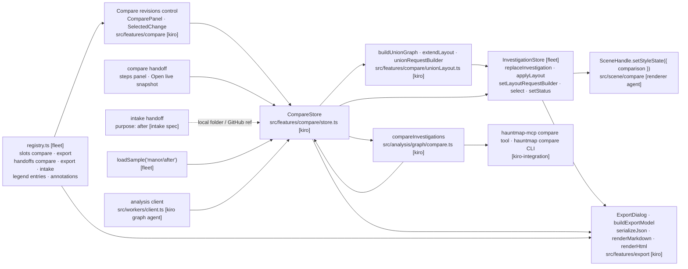

# Design Document

## Overview

This spec adds the comparison and export features to HauntMap on top of the `analysis-core` contracts and the `investigation-ui` screen: `src/analysis/graph/compare.ts` turns two `Investigation`s into the plan's `ComparisonResult` (relation-ID set differences, module additions and removals, changed source hashes, cycle counts under `static-value`) plus a `ComparisonDetail` used only by the UI; `src/features/compare/` acquires the newer snapshot (bundled `manor/after`, the live snapshot through the `compare` handoff, or a second local folder or GitHub ref through the intake feature), builds the union graph, extends the current layout so common rooms keep their coordinates, drives the fleet store through `replaceInvestigation` and `applyLayout`, and renders the Comparison panel; `src/scene/compare/` draws the three comparison states and the closing-corridor transition; `src/features/export/` builds one `ExportModel` that both the preview and the three serializers (HTML, Markdown, JSON) read, with source text omitted unless the checkbox is checked.

Owner: kiro, on one worktree per writer; the scene tasks (`tasks.md` 9 and 11) belong to the Crew renderer agent from November 18, when `src/scene/**` passes to it. Window November 11–24 (work package H5, gate November 24). Credit cap 500 for this spec plus the renderer agent's 200 for its two tasks. Figures in this document (600 ms, 100 ms, 500 ms, 200 ms, 200 entries) are targets until a test run, a `docs/performance.md` row or an acceptance report records them with device, browser, commit and date.

Folders of this spec (plan revision 3, "Fleet execution"): `src/analysis/graph/compare.ts`, `src/features/compare/`, `src/features/export/` (the export dialog and formats, matrix row 25 and the export portion of row 11) and `tests/compare/` (unit tests, fixtures and browser specs; the Crew fixtures agent owns `tests/fixtures/`, the fleet owns `tests/e2e/`); `src/scene/compare/` is the renderer agent's. `.kiro/steering/ownership.md` lists them.

Preconditions on `main` before task 2 starts: `src/contracts/` with the plan's types and the ID helpers; `src/analysis/graph` with the cycle function and the preset rule; `src/workers/client.ts` with the analysis and layout clients; `src/features/investigation/{store,registry,analysisApi}.ts`; `src/scene/layout/{types,engine,doorsPlacement,key}.ts`; `public/demo/manor/{before,after}/` with `expected.json`; `docs/decisions.md` with the layout engine. The five fleet-side requests R1–R5 below must be merged by November 17 for tasks 7, 8 and 10. Downstream: `kiro-integration` task 11 (the live-snapshot browser journey) starts only after this spec's task 10 has `registerCompare` on `main` (November 19–21); its task 10 builds the live control against the registry alone and does not wait.

## Architecture



Comparison start from the panel (Requirements 1, 3, 4, 6):

```mermaid
sequenceDiagram
  participant P as ComparePanel
  participant C as CompareStore
  participant L as loadSample + analysis client
  participant K as compare.ts
  participant S as InvestigationStore
  participant SC as SceneHandle
  P->>C: compareWithSample("manor/after")
  C->>S: setStatus("Comparing manor/before with manor/after…")
  C->>L: loadSample("manor/after", base) → SourceSet; analysisClient.analyze(sourceSet, options)
  L-->>C: Investigation (newer); source map built from sourceSet.files
  C->>K: compareInvestigations(before, after)
  K-->>C: { ok: true, result, detail }
  C->>C: union = buildUnionGraph(before, after, preset, analysisApi)
  alt S.layout exists, layoutStatus idle, layoutKey matches
    C->>C: extendLayout(S.layout, union, request, place, key) → rooms unchanged
  else
    C->>L: layoutClient.request(unionRequest, S.layoutRevision + 1) → LayoutResult (fresh run)
    C->>S: setStatus("The map was laid out again for the comparison; rooms may have moved.")
  end
  C->>S: setLayoutRequestBuilder(unionBuilder); applyLayout(layout)
  C->>S: replaceInvestigation(after.investigation, after.sourceText, { keepLayout: true })
  S-->>SC: setStyleState({ selection, routeFilter: null, comparison: style })
  Note over SC: closing-corridor transition when the dropped witness held a removed relation
  C->>S: setStatus("Comparison ready: 1 removed, 1 added, 2 changed modules; loops 1 → 0. Showing the newer snapshot.")
```

Export (Requirements 8, 9):

```mermaid
sequenceDiagram
  participant B as Export investigation (toolbar)
  participant D as ExportDialog
  participant M as buildExportModel
  participant Z as serializeJson | renderMarkdown | renderHtml
  B->>D: open; focus "HTML report"
  D->>M: buildExportModel({ shown, before?, comparison?, preset, routeFilter, cycles, sourceIncluded: false, now, commit })
  M-->>D: ExportModel (paths, specifiers, counts, size)
  D->>D: preview lines and lists from the model
  D->>M: checkbox checked → rebuild with sourceIncluded: true
  D->>Z: Download → serialize the same model
  Z-->>D: string → Blob → downloadBlob(filename)
  D->>B: close; focus returns; status "Exported hauntmap-manor-before-vs-manor-after-20261123-1412.json (31 KB)."
```

### File layout for this spec

| Path | Role | Writer |
| --- | --- | --- |
| `src/analysis/graph/compare.ts` | `compareInvestigations`, `relationIndex`, `distinctRelationCount`, `codeUnitCompare`, `ComparisonDetail` | kiro |
| `src/features/compare/store.ts` | `createCompareStore`: state machine, acquisition, comparison, layout path, toggle, end, reset | kiro |
| `src/features/compare/sources.ts` | `acquireSnapshot` for sample, investigation and intake sources | kiro |
| `src/features/compare/unionLayout.ts` | `buildUnionGraph`, `buildUnionRequest`, `extendLayout`, `unionLayoutKey`, `unionRequestBuilder` | kiro |
| `src/features/compare/placement.ts` | `DoorPlacement` adapter over `src/scene/layout/doorsPlacement.ts` (*verify* export name) | kiro |
| `src/features/compare/annotations.ts` | `annotationFor(state, target)`: the text equivalents of 5.5 | kiro |
| `src/features/compare/register.ts` | registers the `compare` control, the `compare` handoff, the legend provider and the annotation provider | kiro |
| `src/features/compare/flags.ts` | `COMPARE_INTAKE_ENABLED` | kiro |
| `src/features/compare/CompareControl.tsx`, `ComparePanel.tsx`, `SelectedChange.tsx`, `Notes.tsx` | the toolbar control and the panel | kiro |
| `src/scene/compare/index.ts`, `states.ts`, `transition.ts` | `ComparisonStyle`, `comparisonStateOf`, `applyComparison`, `CLOSING_MS` | renderer agent (kiro) from November 18 |
| `src/scene/styles.ts` (three states and three tokens), `src/styles/tokens.css` (three tokens) | comparison states and tokens | renderer agent; the CSS tokens through the integrator (R5) |
| `src/features/export/model.ts`, `json.ts`, `markdown.ts`, `html.ts`, `filename.ts`, `download.ts`, `version.ts`, `register.ts`, `ExportDialog.tsx` | export model, serializers, dialog, registration | kiro |
| `src/features/investigation/store.ts`, `registry.ts`, `Inspector.tsx`, `Tooltip.tsx` | R1–R4 below | fleet, on request logged by task 1c |
| `src/components/App.tsx` | calls `registerCompare` and `registerExport` at start | integrator |
| `tests/compare/**` | unit, property and fixture tests, generators, helpers, `e2e/compare.spec.ts`, `e2e/export.spec.ts` | kiro (renderer agent for the scene cases of `e2e/compare.spec.ts`) |
| `tests/compare/fixtures/<name>/{before,after}.json`, `expected.json`, `src/**` | hand-authored `Investigation` pairs, expected results, source folders | kiro |
| `docs/kiro-log.md`, `docs/acceptance/2026-11-24-gate.md`, `docs/limitations.md` | rows, gate evidence, reduced scope | kiro / reviewer agent |

### Requests to other owners (filed by task 1c in `docs/kiro-log.md`, one line each)

| Id | Owner | Change | Fallback if not merged by November 17 |
| --- | --- | --- | --- |
| R1 | fleet store writer | `store.actions.replaceInvestigation(inv, sourceText, { keepLayout: true })`: sets `investigation` and `sourceText`; keeps `layout`, `layoutRevision`, `layoutStatus`, `camera`, `expandedWings`, `preset`, `activeView`, `selection`; sets `routeFilter` to `null` when any of its module or relation IDs is absent from `inv`; recomputes an open `loops` panel with the same index and an open `whoImports` panel with the same origin (closes it when the origin is absent); sends no layout request | none: the toggle cannot be built without it; the builder escalates on November 17 |
| R2 | fleet store writer | `store.actions.setLayoutRequestBuilder(builder: ((state: ViewState) => LayoutRequest \| null) \| null)`: while set, `openInvestigation`, `setPreset`, `expandWing`, `collapseWing` and `retryLayout` send the request the builder returns (a `null` return falls back to the store's own request); `applyLayout(result)` sets `layout`, `layoutStatus: "idle"`, increments `layoutRevision` (so an in-flight store request is discarded) and keeps the camera center; both are part of the `investigation-ui` store contract (its design, "Rules the store enforces", and its task 2a), so this request confirms rather than introduces them | the compare store re-requests the union layout after every store-originated request and applies it with `applyLayout`; the brief jump is logged as a defect |
| R3 | fleet registry writer (`investigation-ui` task 2b: the `intake` overload and the `IntakeHandoff`, `IntakeArgs`, `IntakeResult` types in `registry.ts`) and the `intake` spec (the function, its Requirement 9) | `registerHandoff("intake", fn: IntakeHandoff)` with `IntakeArgs = { purpose: "open" \| "after"; kind: "local" \| "github" }` and `IntakeResult = { ok: true; investigation: Investigation; sourceText: ReadonlyMap<string, string> \| null; label: string } \| { ok: false; reason: "cancelled" \| "failed"; message?: string }`; with `purpose: "after"` the intake dialogs resolve the snapshot without replacing the current investigation | the two intake buttons stay `aria-disabled` (`Not available in this build`); the bundled pair and the live snapshot still work |
| R4 | fleet legend/inspector writer | `registry.registerAnnotations(provider: (target: { kind: "room" \| "door" \| "sealed" \| "wing"; id: string }) => { concept: string; costume: string; fact: string } \| null)`; `tooltipLines` prepends `${concept} — ${costume}` and appends `fact`; the inspector adds the line `Comparison: <fact>`; for a selection whose ID is absent from `investigation` the inspector renders the heading `<id>` and the line `Not in the shown snapshot. See the Comparison panel.` without throwing | tooltips and the inspector show only the fleet's lines; the Comparison panel is the text equivalent; `tests/compare/ghost-selection.test.tsx` asserts the inspector does not throw |
| R5 | integrator (fleet shell) | the tokens `--changed: #f0b429`, `--removed: #9a93a8`, `--added: #5ad48a` in `src/styles/tokens.css` | `tests/compare/styles.test.ts` reads `TOKENS` only and the CSS assertion is marked pending in the gate report |

## Components and Interfaces

### Consumed contracts (verbatim from the plan; defined in `src/contracts/`, never redefined here)

```ts
type SyntaxKind = "import" | "re-export" | "dynamic-literal";
type DependencyKind = "value" | "type" | "mixed";
type Preset = "static-value" | "type-inclusive" | "dynamic-inclusive";
interface SourceFile { path: string; text: string; bytes: number }
interface SourceSet { rootLabel: string; files: SourceFile[]; skipped: { path: string; reason: "excluded-dir" | "extension" | "oversized" | "secret-pattern" | "binary" }[] }
interface AnalysisOptions { preset: Preset; includeExtensions: string[]; excludeDirectories: string[]; excludeFilePatterns: string[]; maxFiles: number; maxFileBytes: number; maxTotalBytes: number; jsToTsFallback: true }
interface ModuleRecord { id: string; sourceHash: string; language: "js" | "jsx" | "ts" | "tsx"; parseStatus: "ok" | "partial" | "failed" }
interface ImportRecord {
  occurrenceId: string; relationId: string;            // JSON.stringify([from, line, column, specifier]) / JSON.stringify([from, targetKey, syntaxKind, dependencyKind])
  from: string; to: string | null; specifier: string;
  syntaxKind: SyntaxKind; dependencyKind: DependencyKind;
  resolution: "local" | "external" | "unresolved" | "unsupported";
  line: number; column: number;
  reason?: "absent-file" | "alias-not-configured" | "nonliteral-dynamic" | "unsupported-construct" | "ambiguous-candidate";
}
interface Diagnostic { code: "parse-failed" | "unresolved" | "unsupported" | "case-collision" | "duplicate-path" | "oversized" | "cap-reached"; module?: string; line?: number; column?: number; specifier?: string; message: string }
interface Investigation { schemaVersion: 1; resolverMode: "documented-source-subset"; sourceLabel: string; modules: ModuleRecord[]; imports: ImportRecord[]; diagnostics: Diagnostic[]; options: AnalysisOptions }
interface CyclicComponent { members: string[]; witness: { modules: string[]; relationIds: string[] } }
interface CycleReport { preset: Preset; components: CyclicComponent[] }
interface RelationRef { relationId: string; from: string; to: string | null; specifier: string; syntaxKind: SyntaxKind; dependencyKind: DependencyKind; resolution: ImportRecord["resolution"] }
interface ComparisonResult {
  schemaVersion: 1; preset: "static-value";
  before: { label: string; moduleCount: number; relationCount: number }; after: { label: string; moduleCount: number; relationCount: number };
  addedModules: string[]; removedModules: string[]; changedModules: string[];    // sorted
  addedRelations: RelationRef[]; removedRelations: RelationRef[];              // sorted by relationId
  cyclicComponentsBefore: number; cyclicComponentsAfter: number;
}
```

`targetKey` is `["local", to]` for a resolved local edge and `[resolution, specifier]` for a boundary. `ComparisonResult.preset` stays the literal `"static-value"`: the plan's open-decisions table (revision 3) records that the MCP `compare` tool takes no preset argument.

Consumed from the `investigation-ui` design, unchanged: `LayoutRequest`, `LayoutResult`, `WingBox`, `RoomBox`, `GroupedRoomBox`, `DoorBox`, `SealedBox`, `CorridorBox`, `Rect`, `Point` (`src/scene/layout/types.ts`); `ViewState`, `Selection`, `RouteFilter`, `InvestigationStore` (`src/features/investigation/store.ts`); `Registry`, `LegendEntry`, `CompareArgs = { before: Investigation; after: Investigation | { sample: "manor/after" }; layoutKey: string | null }` (`registry.ts`); `AnalysisApi` with `cycles`, `inPreset` (`analysisApi.ts`); `SceneHandle.setStyleState(state: StyleState)` where `StyleState.comparison?: unknown` is filled with this spec's `ComparisonStyle`; `STATE_STYLES` and `TOKENS` (`src/scene/styles.ts`); `loadSample(id, base)` (`src/features/samples/loadSample.ts`); the development hook `window.__hauntmap`. The analysis client of `src/workers/client.ts` is used as `analysisClient.analyze(sourceSet: SourceSet, options: AnalysisOptions): Promise<Investigation>` (the shape `investigation-ui` task 1a settles and records; the source map is built here from `sourceSet.files`, never taken from the client); the layout client as `layoutClient.request(payload: LayoutRequest, revision: number): Promise<LayoutResult>` (the same source; the fresh path passes `store.getState().layoutRevision + 1`, the value `applyLayout` then sets). The cycle function of `src/analysis/graph` is imported directly by `compare.ts` as a sibling (*verify* its export name; expected `cycles(investigation, preset): CycleReport`).

### `src/analysis/graph/compare.ts`

```ts
export interface ComparisonDetail {
  detailVersion: 1;
  common: string[];                                                       // sorted IDs present in both snapshots
  occurrenceCounts: Record<string, { before: number; after: number }>;   // one entry per module in changedModules: its ImportRecord count on each side
  relationChangesByModule: Record<string, { removed: number; added: number }>;   // keyed by `from`; only entries with a non-zero count
  optionsDiffer: (keyof AnalysisOptions)[];                               // fields whose JSON differs, in key order of AnalysisOptions
  parseFailed: { id: string; side: "before" | "after" }[];                // modules in both with parseStatus "failed" on exactly that side
  identical: boolean;                                                     // every list empty
}
export type CompareError = { code: "incompatible-schema" | "incompatible-resolver"; message: string };
export type CompareOutcome =
  | { ok: true; result: ComparisonResult; detail: ComparisonDetail }
  | { ok: false; error: CompareError };

export const codeUnitCompare = (a: string, b: string): number => (a < b ? -1 : a > b ? 1 : 0);
export function relationIndex(inv: Investigation): Map<string, ImportRecord[]>;   // relationId → occurrences sorted by (line, column); insertion order = sorted relationId
export function distinctRelationCount(inv: Investigation): number;
export function compareInvestigations(before: Investigation, after: Investigation): CompareOutcome;
```

Algorithm of `compareInvestigations` (pure, no I/O, no hashing):

1. Validate `schemaVersion === 1` on both (else `incompatible-schema` with `schema version <v> is not 1`, the earlier snapshot checked first) and `resolverMode === "documented-source-subset"` (else `incompatible-resolver`).
2. Build `Map<id, ModuleRecord>` for both; `addedModules`, `removedModules`, `common` by set difference and intersection; `changedModules` = `common` filtered by `before.sourceHash !== after.sourceHash`; sort all four with `codeUnitCompare`.
3. Build `relationIndex` for both; `removedRelations` = keys only in the earlier index, `addedRelations` = keys only in the newer, each mapped to a `RelationRef` copied from `occurrences[0]` (the lowest line, then column); sort by `relationId` with `codeUnitCompare`.
4. `relationCount` = index size; `moduleCount` = `modules.length`; `label` = `sourceLabel`.
5. `cyclicComponentsBefore/After` = `cycles(inv, "static-value").components.length`.
6. `detail.occurrenceCounts[id]` for each changed module = the number of `ImportRecord`s with `from === id` on each side; `relationChangesByModule[from]` from the two ref lists; `optionsDiffer` by comparing `JSON.stringify(before.options[k])` with the newer value for each key of `AnalysisOptions` in declaration order; `parseFailed` from the two module maps; `identical` = all five lists empty.

Complexity O(m + r) with maps; the 1,000-module, 3,000-relation pair runs in under 500 ms (3.9). The function never reads `occurrenceId` for matching and never touches source text (2.1, 2.6). The MCP `compare` tool and the CLI call this function and map `{ ok: false }` to a tool error (kiro-integration).

### `src/features/compare/unionLayout.ts`

```ts
export type Membership = "both" | "before" | "after";
export interface UnionGraph {
  modules: { id: string; wing: string; membership: Membership }[];                       // sorted by id
  drawn: { relationId: string; from: string; to: string; membership: Membership }[];     // local, in the preset on the side(s) where it exists; sorted by relationId
  boundaries: { relationId: string; from: string; membership: Membership }[];            // external | unresolved | unsupported; sorted
}
export function buildUnionGraph(before: Investigation, after: Investigation, preset: Preset, api: Pick<AnalysisApi, "inPreset">): UnionGraph;
export function buildUnionRequest(union: UnionGraph, expandedWings: string[], preset: Preset, engine: "dagre" | "elk", bring?: string): LayoutRequest;
  // modules/relations/boundaries from the union; expandedWings with shownIds per the fleet's 80 rule (80 lexically smallest, `bring` swapped into the last slot) and hiddenCount

export interface DoorPlacement {   // adapter in placement.ts over src/scene/layout/doorsPlacement.ts (*verify* its export name and signature)
  (rooms: RoomBox[], relations: { relationId: string; from: string; to: string }[], boundaries: { relationId: string; from: string }[]): { doors: DoorBox[]; sealed: SealedBox[] };
}
export interface ExtendOutcome { layout: LayoutResult; addedRoomIds: string[]; droppedRoomIds: string[]; movedRoomIds: string[] }
export function extendLayout(current: LayoutResult, union: UnionGraph, request: LayoutRequest, place: DoorPlacement, layoutKey: string): ExtendOutcome;
export function unionLayoutKey(base: string | null, request: LayoutRequest, engine: { name: string; version: string }, sha256Hex: (s: string) => Promise<string>): Promise<string>;
  // SHA-256 hex of JSON.stringify({ base, modules: sorted ids, relations: sorted relationIds, expandedWings: sorted, preset, engine })
export function unionRequestBuilder(read: () => { union: UnionGraph; engine: "dagre" | "elk" } | null): (state: ViewState) => LayoutRequest | null;
  // returns null when no comparison is active (the store then builds its own request)
```

`extendLayout` (pure, synchronous, deterministic; `tests/compare/union-layout.test.ts`):

1. Copy `wings`, `rooms`, `grouped` from `current`; drop rooms whose module is in no snapshot (`droppedRoomIds`); never change `x`, `y`, `w`, `h` of a kept box.
2. For each union module with `membership: "after"` that has no room, in sorted ID order: wing expanded and `rooms in wing < 80` → append a room at the next slot of the rows below the wing's lowest room (`x = wing.x + 24 + k × 112`, `y = lowestBottom + 16`, next row when `x + 96 > wing.x + wing.w − 24`), `label` = file name clipped at 18 characters with `…`, grow `wing.h` so that `wing.y + wing.h ≥ newRowBottom + 24` (80 units per new row); wing expanded with 80 rooms → `hiddenCount + 1`, grouped label `+<n> more modules`; wing collapsed → `moduleCount + 1`; wing absent → new `WingBox { w: 144, h: 120, x: bounds.x + bounds.w + 48, y: bounds.y + 32 + 168 × j, rank: maxRank + 1 + j, expanded: false, shownIds: [], hiddenCount: 0, moduleCount: 1 }` for the j-th new wing.
3. Resolve overlaps caused by growth in one deterministic pass: for each grown wing in ascending `rank` order (ties by wing name in code-unit order), every wing whose `y ≥ grownWing.originalBottom` and whose `[x, x + w)` overlaps the grown wing's `[x, x + w)` is translated down by that wing's growth amount together with its rooms and grouped room; a wing hit by several grown wings accumulates the translations and may therefore move more than once; after the pass, `tests/compare/union-layout.test.ts` asserts that no two wing boxes intersect (a remaining intersection is a defect in the placement of step 2, not a reason for a second pass); the moved rooms are `movedRoomIds`.
4. Doors and sealed doorways: `place(rooms, drawnWithBothRoomsDrawn, boundariesWithImporterDrawn)`; only room geometry enters, so a room's doors are re-spread when a door is added or removed (4.8 allows door movement on `src/notifications/receipt.ts` only).
5. Corridors: one per ordered wing pair with at least one union drawn relation between different wings, `count` = distinct relation IDs, `path` between the nearest boundary points of the two wing boxes (the fleet's rule).
6. `bounds` = union of wing boxes with 32 padding; `layoutKey` = the given key; `engine` = `current.engine`; `revisionEcho` omitted; `stats = { ms: performance.now() delta, nodeCount: rooms.length + wings.length, edgeCount: doors.length }`.

### `src/features/compare/store.ts`

```ts
export interface Snapshot { label: string; investigation: Investigation; sourceText: ReadonlyMap<string, string> | null }
export type Side = "before" | "after";
export type CompareStatus = "idle" | "acquiring" | "comparing" | "laying-out" | "active";
export interface CompareState {
  compareStateVersion: 1;
  status: CompareStatus;
  panelOpen: boolean;
  before: Snapshot | null; after: Snapshot | null;
  result: ComparisonResult | null; detail: ComparisonDetail | null;
  shown: Side;
  union: UnionGraph | null;
  layoutPath: "extended" | "fresh" | "pending" | null;
  unionLayoutKey: string | null;
  closingRelationIds: string[];            // set for one style update when a witness with a removed relation is dropped (6.3)
  error: string | null;                    // the last failure message, also written to the status region
}
export type AfterSource =
  | { kind: "sample"; id: "manor/after" }
  | { kind: "investigation"; snapshot: Snapshot }
  | { kind: "intake"; intake: "local" | "github" };
export interface CompareStore {
  getState(): CompareState;
  subscribe(listener: () => void): () => void;
  actions: {
    openPanel(): void; closePanel(): void;
    compareWithSample(): Promise<void>;                          // 1.2
    compareWithPair(): Promise<void>;                            // 1.3
    compareWithIntake(kind: "local" | "github"): Promise<void>;  // 1.5
    compareWith(after: AfterSource, layoutKey: string | null): Promise<void>;   // the handoff path (1.4) and the three above
    show(side: Side): void;                                      // 6.2
    selectChange(item: { kind: "relation" | "module"; id: string }): void;      // 7.3
    end(): void;                                                 // 6.6
    reset(): void;                                               // 6.7
  };
}
export interface CompareDeps {
  store: InvestigationStore; registry: Registry; analysisApi: AnalysisApi;
  analysisClient: { analyze(sourceSet: SourceSet, options: AnalysisOptions): Promise<Investigation> };   // the shape investigation-ui task 1a records
  layoutClient: { request(payload: LayoutRequest, revision: number): Promise<LayoutResult> };            // same source; revision = store layoutRevision + 1 on the fresh path
  loadSample: typeof loadSample; base: string;
  place: DoorPlacement; sha256Hex: (s: string) => Promise<string>;
  scene: () => SceneHandle | null;
  now?: () => number;
}
export function createCompareStore(deps: CompareDeps): CompareStore;
```

Rules the store enforces (`tests/compare/store.test.ts`): `compareWith` is ignored while `status` is not `idle` or `active` (1.7); during `acquiring`/`comparing`/`laying-out` the fleet store is touched only through `setStatus` (1.7, 10.x); the before snapshot is `{ label: state.investigation.sourceLabel, investigation: state.investigation, sourceText: state.sourceText }` taken at call time, except for `compareWithPair`, which first awaits `openInvestigation` of `manor/before` and `layoutStatus === "idle"`; the layout path is `extended` when `state.layout && state.layoutStatus === "idle" && state.layout.layoutKey === layoutKey` (for the panel buttons `layoutKey = state.layout?.layoutKey ?? null`), otherwise `fresh`, which calls `layoutClient.request(unionRequest, state.layoutRevision + 1)` and applies the result with `applyLayout` (which sets `layoutRevision` to that value, so a store request in flight is discarded by the fleet's guard); `applyLayout` is called before `replaceInvestigation`; `show(side)` calls `replaceInvestigation` and `scene().setStyleState` and never `applyLayout` or `setLayout` (4.7); `end()` calls `replaceInvestigation(before)`, `setStyleState({ …, comparison: null })`, `setLayoutRequestBuilder(null)`, `retryLayout()`, then clears `after`, `result`, `detail`, `union`; `reset()` returns to the initial state without touching the fleet store; `selectChange` calls `store.actions.select` and `scene()?.focusOn(target, Math.max(zoom, 1))`; a failure sets `error`, writes the status, returns the status to the previous value (`idle` or `active`) and leaves the fleet store deep-equal (10.1–10.4).

`ComparisonStyle` for the scene is derived from state by `styleOf(state): ComparisonStyle | null` (pure, exported for tests):

```ts
// src/scene/compare/index.ts
export interface ComparisonStyle {
  comparisonStyleVersion: 1;
  shown: Side;
  changedModules: string[]; removedModules: string[]; addedModules: string[];
  removedRelationIds: string[]; addedRelationIds: string[];
  closingRelationIds: string[];
  earlierLabel: string; newerLabel: string;
}
export type ComparisonState = "default" | "comparison-changed" | "comparison-removed" | "comparison-added" | "hidden";
export function comparisonStateOf(style: ComparisonStyle | null, target: { kind: "room" | "door" | "sealed"; id: string }): ComparisonState;
  // null → default. room: changed → comparison-changed (both views); removedModules → after view comparison-removed, before view default;
  // addedModules → after view comparison-added, before view hidden. door/sealed: removedRelationIds → after view comparison-removed, before view default;
  // addedRelationIds → after view comparison-added, before view hidden; else default. Labels are never read (5.8).
export function applyComparison(internals: SceneInternals, style: ComparisonStyle | null, reducedMotion: boolean): void;
  // sets each room/door/sealed display object's state texture from comparisonStateOf (selected/subdued/witness states of the fleet take precedence for
  // outline and halo; the comparison glyph and label are drawn on top); hidden → visible = false; closingRelationIds → transition.ts
export const CLOSING_MS = 600;
```

`transition.ts`: `closeCorridor(segments, doors, reducedMotion)` tweens the alpha of the witness corridor segments and step-number labels from 1 to 0 over `CLOSING_MS` through the fleet's `animation.ts` (so `activeTweens` counts them), then removes them; the door's texture switches to `comparison-removed` at the start; under reduced motion everything happens in the same frame. No tween ever targets a room position.

`src/scene/styles.ts` additions (renderer agent): `TOKENS.changed = "#f0b429"`, `TOKENS.removed = "#9a93a8"`, `TOKENS.added = "#5ad48a"`; `STATE_STYLES["comparison-changed"] = { fill: TOKENS.room, outlineWidth: 0, glyph: "lamp", label: "changed" }`, `STATE_STYLES["comparison-removed"] = { fill: "none", outlineWidth: 2, glyph: null, label: "removed" }` with `outlineStyle: "dashed"` (the fleet record gains this optional field, default `"solid"`), `STATE_STYLES["comparison-added"] = { fill: TOKENS.added, outlineWidth: 2, glyph: "+", label: "added" }`; the lamp glyph is a 12 × 12 sprite at the room's north edge; texture keys `room:comparison-changed`, `room:comparison-removed`, `room:comparison-added`, `door:comparison-removed`, `door:comparison-added` are within the fleet's 24-texture budget (they are already counted there).

### `src/features/compare/sources.ts`

```ts
export type AcquireResult = { ok: true; snapshot: Snapshot } | { ok: false; message: string; cancelled: boolean };
export async function acquireSnapshot(source: AfterSource, deps: Pick<CompareDeps, "analysisClient" | "loadSample" | "base" | "registry" | "store">): Promise<AcquireResult>;
// sample: loadSample("manor/after", base) → { ok:false } → message `The revised manor sample could not be loaded (${status or error name}). The current investigation is unchanged.`;
//   then analysisClient.analyze(sourceSet, { ...store.getState().investigation.options, preset: store.getState().preset }); rejection → `The newer snapshot could not be analyzed (${message}). The current investigation is unchanged.`;
//   sourceText = new Map(sourceSet.files.map(f => [f.path, f.text])); label = sourceSet.rootLabel ("manor/after")
// investigation: returns the snapshot as given (label = investigation.sourceLabel; sourceText as given, null for live:)
// intake: registry.getHandoff("intake") absent → { ok:false, message: "Snapshot selection is not available in this build.", cancelled: false };
//   { ok:false, reason:"cancelled" } → { ok:false, message: "Snapshot selection cancelled.", cancelled: true }; { ok:false, reason:"failed", message } → `${message} The current investigation is unchanged.`
```

### `src/features/compare/annotations.ts` and `register.ts`

```ts
export function annotationFor(state: CompareState, target: { kind: "room" | "door" | "sealed" | "wing"; id: string }): { concept: string; costume: string; fact: string } | null;
// room changed: { "Changed source", "amber lamp", `${id} · source changed (${beforeHash.slice(0, 8)} → ${afterHash.slice(0, 8)})` }
// room removed: { "Removed in the newer snapshot", "ghost outline", `${id} · only in ${earlierLabel}` }; room added: { "Added in the newer snapshot", "green doorway", `${id} · only in ${newerLabel}` }
// door/sealed removed: { "Removed in the newer snapshot", "ghost outline", `${from} imports ${to} · removed in ${newerLabel}` } (boundary: `${from} → "${specifier}" · removed in …`)
// door/sealed added: { "Added in the newer snapshot", "green doorway", `${from} imports ${to} · added in ${newerLabel}` }; wing or unchanged → null
export const LEGEND_ENTRIES: LegendEntry[] = [
  { concept: "Changed source", costume: "amber lamp" },
  { concept: "Removed in the newer snapshot", costume: "ghost outline" },
  { concept: "Added in the newer snapshot", costume: "green doorway" },
];
export function registerCompare(registry: Registry, compareStore: CompareStore): void;
// registry.registerControl("compare", CompareControl); registry.registerHandoff("compare", (args) => compareStore.actions.compareWith(toSource(args.after), args.layoutKey));
// registry.registerLegendEntries(() => compareStore.getState().status === "active" ? LEGEND_ENTRIES : []);
// registry.registerAnnotations((t) => annotationFor(compareStore.getState(), t))   (R4; skipped when the method is absent)
// toSource: { sample: "manor/after" } → { kind: "sample", id: "manor/after" }; an Investigation → { kind: "investigation", snapshot: { label: inv.sourceLabel, investigation: inv, sourceText: null } }
```

The handoff promise resolves when `status` becomes `active` and rejects with `new Error(state.error)` after the failure message is shown (1.4, 10.6).

### Components (`src/features/compare/`)

```ts
// CompareControl.tsx — <button aria-expanded={panelOpen}>Compare revisions</button>; toggles the panel; props { store: InvestigationStore } (the registry's control signature); reads the compare store through a module-level accessor set by registerCompare
// ComparePanel.tsx — <section role="region" aria-labelledby="compare-heading"> with <h2 id="compare-heading">Compare revisions</h2>;
//   idle: the sentence and the four buttons of 1.1 (sample/pair by sourceLabel; intake buttons aria-disabled per 1.5 and COMPARE_INTAKE_ENABLED);
//   active: the lines of 7.1, the Show radiogroup (6.2), the five lists (7.1, 7.2), <SelectedChange/>, <Notes/>, buttons Export comparison and End comparison (7.5);
//   Escape inside the panel → closePanel() and focus to the control (7.5); every string a text node (7.7)
// SelectedChange.tsx — <section aria-label="Selected change"> with the cards of 7.3; occurrence buttons show the excerpt from the right snapshot's source map (two lines before and after, one-based) or the no-source sentence
// Notes.tsx — <h3>Notes</h3> and the sentences of 7.4 in this order: rename, options, parse failures (sorted by id), the fixed limits sentence
export const RENAME_NOTE = "Renames are shown as a removal and an addition; HauntMap does not infer renames.";
export const LIMITS_NOTE = "A removed or added door is a change in the import graph found in the source. It is not a claim about runtime behaviour.";
export const NO_SOURCE_NOTE = "Source not included in this snapshot; evidence is path, line and specifier.";
```

Item wording (7.2) is produced by `itemLabel(ref | moduleId, detail)` in `labels.ts`: relation `${from} imports ${to} · ${syntaxKind} · ${dependencyKind}`; boundary `${from} → "${specifier}" · ${resolution}`; changed module `${id} · import statements ${before} → ${after}` plus ` · ${k} relations removed, ${m} added` when either is non-zero; other modules `${id}`.

### `src/features/export/`

```ts
// model.ts
export type ExportFormat = "html" | "markdown" | "json";
export interface ExportSnapshot { label: string; investigation: Investigation; sourceText: ReadonlyMap<string, string> | null }
export interface ExportInput {
  shown: ExportSnapshot; before?: ExportSnapshot;                      // before present only during a comparison
  comparison?: { result: ComparisonResult; detail: ComparisonDetail } | null;
  preset: Preset; routeFilter: RouteFilter | null; cycles: CycleReport;  // cycles of the shown snapshot under the preset (analysisApi.cycles)
  sourceIncluded: boolean; now: Date; commit: string;
}
export interface ExportModel {
  exportVersion: 1; exportedAt: string; generator: { name: "HauntMap"; commit: string }; preset: Preset; sourceIncluded: boolean;
  title: string; labels: string[];
  investigation: Investigation;
  evidenceTrail?: { kind: RouteFilter["kind"]; modules: string[]; relationIds: string[]; steps: { from: string; to: string; line: number }[] };
  comparison?: { before: Investigation; result: ComparisonResult; notes: string[]; occurrenceCounts: ComparisonDetail["occurrenceCounts"]; relationChangesByModule: ComparisonDetail["relationChangesByModule"] };
  cycles: CycleReport;
  summary: { modules: number; byResolution: Record<ImportRecord["resolution"], number>; diagnostics: number; loops: number };
  disclosure: { paths: string[]; specifiers: string[]; hashCount: number; diagnosticsCount: number; sourceFiles: { label: string; count: number; bytes: number }[]; sourceUnavailable: string[] };
  source?: { encoding: "utf-8"; files: Record<string, Record<string, string>> };   // label → path → text; present only when sourceIncluded and at least one source map exists
}
export function buildExportModel(input: ExportInput): ExportModel;
  // paths = sorted union of module IDs of every included investigation; specifiers = sorted distinct ImportRecord.specifier values of every included investigation;
  // source.files[label] = Object.fromEntries(sorted entries of that snapshot's source map), only for snapshots whose map is non-null; sourceUnavailable lists the others' labels
export function sizeOf(model: ExportModel, format: ExportFormat): number;   // byte length of the serialization (TextEncoder), computed by serializing once

// json.ts — export function serializeJson(model: ExportModel): string;   // GraphExport envelope of 9.1 (title, labels, cycles, summary, disclosure, notes are not written), JSON.stringify(_, null, 2) + "\n"
// markdown.ts — export function renderMarkdown(model: ExportModel): string; export function mdCode(s: string): string; export function mdFence(text: string): string;
// html.ts — export function renderHtml(model: ExportModel): string; export function escapeHtml(s: string): string;
//   export const HTML_TAGS = ["html","head","meta","title","style","body","main","h1","h2","h3","p","ul","ol","li","table","thead","tbody","tr","th","td","code","pre","section"] as const;
// filename.ts — export function slug(label: string): string; export function stamp(d: Date): string /* YYYYMMDD-HHMM local */; export function exportFilename(model: ExportModel, format: ExportFormat, now: Date): string;
// download.ts — export function downloadBlob(blob: Blob, filename: string, doc: Document = document): void;   // anchor click, revokeObjectURL in a finally after the click
// version.ts — export const APP_COMMIT: string = import.meta.env.VITE_HAUNTMAP_COMMIT ?? "dev";   // *verify* the Vite env mechanism on the pinned version; set by the build script in H8
// register.ts — export function registerExport(registry: Registry, deps: ExportDeps): void;   // registerControl("export", ExportControl); registerHandoff("export", openDialog)
// ExportDialog.tsx — the dialog of 8.1–8.7; props { store, compareStore, analysisApi, download: typeof downloadBlob, now: () => Date, commit: string }
export const DISCLOSURE_OMITTED = "This export omits source text. It still names every file path and import specifier of the analysis; it is not anonymized.";
export const disclosureIncluded = (n: number) => `This export includes the full source text of ${n} files.`;
export const NO_SOURCE_AVAILABLE = "No source text in this snapshot.";
export const PREVIEW_CAP = 200;
```

`renderHtml` writes the template once: doctype, `<html lang="en">`, `<head>` with the charset meta, the CSP meta of 9.4, `<title>` (escaped), one `<style>` with the report's rules (no `url(`), then `<main>` with the sections of 9.6 in order; every cell, heading fragment and list item passes through `escapeHtml`; source files go into `<section><h3>` + `<pre>` with the escaped text. `renderMarkdown` writes the same sections with `#`/`##`/`###` headings, pipe tables for Modules, Relations and Diagnostics (cells wrapped by `mdCode`, pipes inside a code span are escaped as `\|`), bullet lists for the comparison lists, and `mdFence` blocks for source files. Both renderers read only the model; `serializeJson` writes the envelope keys of 9.1 in that order.

### Development hook additions (`window.__hauntmap`, development builds only)

```ts
interface DevHookCompare { compareStore: CompareStore; compareWith(after: Investigation, layoutKey?: string | null): Promise<void>; exportModel(format: ExportFormat, sourceIncluded: boolean): ExportModel; lastExport(): { filename: string; text: string } | null }
```

`compareWith` calls the registered handoff; `lastExport` returns the last serialized file instead of relying on the browser's download (the e2e asserts contents from it and also checks that one download event fired, *verify* Playwright's download API on the pinned version). Installed by `registerCompare`/`registerExport` under `window.__hauntmap` when it exists; absent from production builds.

## Data Models

| Record | Where | Identity and version | Content and invariants |
| --- | --- | --- | --- |
| `Snapshot` | compare store (memory) | `label` (= `sourceLabel`) | `investigation` (`schemaVersion: 1`), `sourceText` map or `null`; never persisted; dropped by `end()` and `reset()` (1.8) |
| `ComparisonResult` | compare store, export, MCP, CLI | `schemaVersion: 1`, `preset: "static-value"` | the plan's record; lists sorted (3.2); `removedRelations[i].relationId` ∈ earlier, ∉ newer (P7); `relationCount` = distinct IDs (P8) |
| `ComparisonDetail` | compare store, panel, reports | `detailVersion: 1` | `occurrenceCounts` keyed by every changed module; `relationChangesByModule` only non-zero; `optionsDiffer` in key order; `identical` ⇔ the five lists empty |
| `CompareState` | compare store (memory) | `compareStateVersion: 1`; one instance | `status` transitions `idle → acquiring → comparing → laying-out → active → idle`, with any failure returning to the previous `idle`/`active`; `shown` defaults to `after`; `before`/`after`/`result`/`detail`/`union` are non-null exactly while `active` |
| `UnionGraph` | compare store (memory), derived | — | `modules` ∪ membership partition the union (P1); `drawn` ⊆ relations with `resolution: "local"` in the preset on at least one side |
| `LayoutRequest` / `LayoutResult` (union) | fleet store `layout` | `layoutVersion: 1`, `layoutKey` = `unionLayoutKey` | extended layout keeps every kept box's geometry (P9); `rooms` = drawn union modules; `stats.ms` the only timing |
| `ComparisonStyle` | scene style state | `comparisonStyleVersion: 1` | derived by `styleOf(state)`; `closingRelationIds` non-empty for one update only; labels present for annotations, never read by `comparisonStateOf` (P10) |
| `ExportModel` | export dialog (memory, per open) | `exportVersion: 1`, `exportedAt` | `disclosure.paths` = sorted union of included module IDs; `disclosure.specifiers` = sorted distinct specifiers; `source` present ⇔ `sourceIncluded` and a map exists (P11) |
| `GraphExport` (file) | the downloaded JSON | `exportVersion: 1`; `investigation.schemaVersion: 1` | keys in the order of 9.1; `comparison.result` identical to the store's `ComparisonResult` (9.2) |
| Fixture `expected.json` | `tests/compare/fixtures/<name>/expected.json` | `expectedVersion: 1` | hand-authored: the five lists (relations as `{ from, to, specifier, syntaxKind, dependencyKind, resolution }`), `moduleCount`, `relationCount`, `cyclicComponents`, `occurrenceCounts`, `optionsDiffer`; never generated by `compare.ts` (11.5) |
| Kiro log row | `docs/kiro-log.md` | date + `snapshot-comparison/<n>` | the template of `../kiro/FORMAT.md`; commit trailer `Kiro-Task: snapshot-comparison/<n>` |

Invariants (checked by the tests named in Testing Strategy):

- I1 Matching uses only `ModuleRecord.id` and `ImportRecord.relationId` (2.1, P4, P5).
- I2 `addedModules ∪ removedModules ∪ common` = the union of IDs, pairwise disjoint; the same for relation IDs (3.1, P1).
- I3 Every list of `ComparisonResult` is sorted by `codeUnitCompare`; the result is independent of input order (3.2, P6).
- I4 `compare.ts` imports only `src/contracts/**` and `src/analysis/graph/*` (2.6, `tests/compare/boundary.test.ts`).
- I5 The union layout is computed once per comparison start, extension or store-originated request; a toggle never changes `layout` (4.7, P9, P10).
- I6 Every kept box of the current layout keeps its geometry across `extendLayout` unless it is in `movedRoomIds`, which is empty when no wing grew into another (4.1, 4.3, P9).
- I7 `comparisonStateOf` depends only on `shown`, the five ID lists and the target; never on labels (5.8, P10).
- I8 Every comparison state differs from `default` by a glyph, an outline or a label; the three tokens pass 3:1 on `floor` and `room` (5.4).
- I9 The preview lists and the serialized file are built from the same `ExportModel` instance; the default export contains no source text (8.4, 9.7, P11).
- I10 Every dynamic string in the HTML report passes through `escapeHtml`; the element set is a subset of `HTML_TAGS` (9.4, P12).
- I11 A failure leaves the fleet store deep-equal and returns the compare status to its previous value (10.1–10.4).

## Error Handling

Every failure is a typed value or a caught rejection; components never throw for a domain condition and never retry on their own. Messages are written once through `store.actions.setStatus`; a segment wrapped in backticks is rendered as `<code>` by the fleet's status region.

| Situation | Where | Exact user-visible text | Preserved | Focus / state |
| --- | --- | --- | --- | --- |
| `loadSample("manor/after")` fails (10.1) | status region; panel stays open | `The revised manor sample could not be loaded (<status or error name>). The current investigation is unchanged.` | investigation, selection, route filter, camera, expanded wings, layout | focus on the activated button; compare status back to `idle` |
| Analysis worker rejects, times out or is terminated for the newer snapshot (10.2) | status region | `The newer snapshot could not be analyzed (<message>). The current investigation is unchanged.` | same | same |
| `intake` handoff cancelled (1.5) | status region | `Snapshot selection cancelled.` | everything | same |
| `intake` handoff failed (10.3) | status region | `<message> The current investigation is unchanged.` | same | same |
| `intake` handoff absent or `COMPARE_INTAKE_ENABLED` false (1.5, 11.4) | panel buttons | `aria-disabled="true"`, title `Not available in this build` | — | — |
| `compareInvestigations` returns `incompatible-schema` / `incompatible-resolver` (2.2, 10.4) | status region | `The snapshots cannot be compared: schema version <v> is not 1. The current investigation is unchanged.` / `The snapshots cannot be compared: resolver mode "<m>" is not "documented-source-subset". The current investigation is unchanged.` | same | same |
| Options differ (2.3) | panel `Notes` | `The snapshots were analyzed with different options (<field>, <field>); some differences may come from the options.` | comparison runs | — |
| Parse failure on one side (2.4) | panel `Notes` | `<id> could not be parsed in the <earlier\|newer> snapshot; its relations there are unknown and appear as <added\|removed>.` | — | — |
| No differences (2.5) | panel and status region | `No differences: the snapshots have the same modules, relations and source hashes.` | — | comparison active |
| Current layout missing, pending or key mismatch (4.5) | status region | `The map was laid out again for the comparison; rooms may have moved.` | selection, camera, expanded wings | layout path `fresh` |
| Grown wing pushed others (4.3) | status region | `<n> rooms moved to make room for <k> added modules.` | every other room | — |
| Union layout request fails or times out (10.5) | fleet 3.7 text with `Retry layout` | `The map layout did not finish (<reason>). The Evidence view has the full investigation.` | comparison active; lists, toggle, cards, export work | style applied when a layout arrives |
| Handoff called while busy (1.7) | — | nothing; the call returns the pending promise of the running comparison | everything | — |
| Toggle (6.2) | status region | `Showing the earlier snapshot (<label>).` / `Showing the newer snapshot (<label>).` | layout, camera | — |
| End comparison (6.6) | status region | `Comparison ended. Showing <earlier label>.` | selection when its ID exists in the earlier snapshot | focus on `Compare revisions` |
| Blob or object URL creation throws (8.6) | dialog preview section and status region | `The export file could not be created (<error name>).` | investigation; dialog open | focus on `Download` |
| No source map in any exported snapshot (8.2) | dialog | checkbox disabled; `No source text in this snapshot.` | — | — |
| Occurrence line beyond the source text (7.3) | `Selected change` card | `Line <line> is not in the current source text.` | — | — |
| Source map absent for the snapshot of an occurrence (7.3) | `Selected change` card | `Source not included in this snapshot; evidence is path, line and specifier.` | — | — |
| Relation has no door under the preset (7.3) | `Selected change` card | `Not drawn under <preset>` | — | camera on the importer's room |
| Renderer unavailable (7.8) | — | nothing from this spec; the fleet banner | panel works; `focusOn` skipped | — |
| Handoff promise rejects (10.6) | — | no second message | caller's state | — |

What the user sees on the paths that matter most: a judge whose sample request fails reads one sentence, keeps the manor on screen and can try again; a developer who compares two folders analyzed with different options sees the differences and a note saying why some of them may be artifacts; an agent whose live snapshot has the wrong schema is told the version and nothing moves; a report reader sees `./` as text.

## Testing Strategy

Commands. `pnpm verify` runs the typecheck and the Vitest suites (Vitest, MIT, pinned at scaffold time) including `tests/compare/**/*.test.ts(x)`: `compare`, `union-layout`, `export`, `html-export`, `markdown-export` and `properties` run in the node environment; `panel`, `dialog`, `ghost-selection`, `toggle` and `store` in jsdom (jsdom, MIT, pinned at scaffold time) with React Testing Library (MIT, *verify*; pinned at scaffold time) and the fleet's `tests/ui/fakeScene.ts`; property tests use fast-check (MIT, *verify*; pinned at scaffold time) with 200 runs per property and the seed printed on failure. `pnpm verify:e2e -- tests/compare/e2e/compare.spec.ts tests/compare/e2e/export.spec.ts` runs Playwright (Apache-2.0, pinned at scaffold time) in the `dev` project defined by `investigation-ui` task 1c (a production build made with `VITE_HAUNTMAP_DEVHOOK=1`, served by `pnpm preview`, where `window.__hauntmap` exists; both spec files load fixtures and read state through it), Chromium, 1,280 × 720, one fresh context per test, with the fleet's helpers from `tests/e2e/helpers.ts` (`openManor`, `tabTo`, `readStatus`, `sceneDebug`, `assertFocusVisibleAndUnobscured`, `inspectorHeading`) and this spec's `tests/compare/e2e/helpers.ts` (`openComparePanel`, `compareWithSample`, `waitForStatus(text)`, `roomRects(ids)`, `openExport`, `lastExport`). The `verify:e2e` argument forwarding and the Playwright `testMatch` extension for `tests/compare/e2e/**` are *verify* items settled by the integrator in task 1c.

Fixtures (`tests/compare/fixtures/<name>/`): `before.json` and `after.json` are hand-authored `Investigation`s (`schemaVersion: 1`, `resolverMode: "documented-source-subset"`, the plan's default `AnalysisOptions`, IDs built by `tests/compare/ids.ts` from the `src/contracts` helpers — *verify* their export names; a local copy of the JSON encodings until then), `expected.json` is the hand-authored expected result, and `src/` holds the source folders for the from-source tests where listed. Hashes are the SHA-256 of the listed texts (computed November 3, 2026); `\n` marks a newline and every file ends with one.

| Fixture | Content | Expected |
| --- | --- | --- |
| `comment-shift` (row 23; from-source) | earlier `src/a.ts` = `import { b } from "./b";\nexport const a = b;\n` (hash `ebf78fc7fae8b7f83c2ffd57b69b2f89f5321c3dd0713dd04544462720f9d6b0`), `src/b.ts` = `export const b = 1;\n` (`4d6c305aa3866c1d56beb6a3b2394fe9dc4b3ce5f3756a2357139efefbd969d0`); newer `src/a.ts` = `// moved down\n// by two comment lines\nimport { b } from "./b";\nexport const a = b;\n` (`f6991c23841a2ae5b79ca756c263379ffc9245d5abb40018d04d6674e5718058`); the import `import`/`value`/`local`, specifier `./b`, line 1 (earlier) and 3 (newer), relation ID `["src/a.ts",["local","src/b.ts"],"import","value"]` | `changedModules: ["src/a.ts"]`, every other list empty, counts 2/2 modules and 1/1 relations, cycles 0/0, `occurrenceCounts: { "src/a.ts": { before: 1, after: 1 } }`; occurrence IDs differ; room `src/a.ts` `comparison-changed`, door `default` |
| `duplicate-occurrence` (row 24; from-source) | earlier `src/a.ts` = `import { x } from "./b";\nimport { y } from "./b";\nexport const a = x + y;\n` (`ed01911bf39910668204a57f39e0d5e6dbccdcd247be34668096769551e3ccce`), `src/b.ts` = `export const x = 1;\nexport const y = 2;\n` (`ce762e375989b96dce8b33cdbb9abe355a86b018515fcfc770f9416b19712a24`); newer `src/a.ts` = `import { x } from "./b";\nexport const a = x;\n` (`1ce2854c1718177a79b04336be4fc29bb52fa860d5ed92a6842a2e4995c009de`); both statements share one relation ID | `removedRelations: []`, `changedModules: ["src/a.ts"]`, `occurrenceCounts: { "src/a.ts": { before: 2, after: 1 } }`, relation counts 1/1; panel item `src/a.ts · import statements 2 → 1`; door `default` |
| `rename` (from-source) | earlier `src/app.ts` = `import { format } from "./util/format";\nexport const app = format(1);\n` (`1984e12f78e75c4f6d76dd8a0cbe102d238fa4890492c36f7e55bc01aa9a97cb`), `src/util/format.ts` = `export function format(n: number): string {\n  return String(n);\n}\n` (`40483aaf98549a7d523cf046595dfa937b38a931996d5e3ad3f37c110f698df7`); newer `src/app.ts` = `import { format } from "./util/formatMoney";\nexport const app = format(1);\n` (`7b6050c79fd136330e8bb663edd569fd451127cb1ae00d698a1f8cedb243a29e`), `src/util/formatMoney.ts` with the same text as `format.ts` | `removedModules: ["src/util/format.ts"]`, `addedModules: ["src/util/formatMoney.ts"]`, `removedRelations: [app → util/format]`, `addedRelations: [app → util/formatMoney]`, `changedModules: ["src/app.ts"]`; `RENAME_NOTE` shown; no rename link |
| `cycle-closes` | earlier `src/x.ts` imports `./y`, `src/y.ts` imports `./x` (hashes `"1".repeat(64)` and `"2".repeat(64)`, placeholders; no source folder); newer without `y → x` (`src/y.ts` hash `"3".repeat(64)`) | cycles 1 → 0; `removedRelations` exactly `y → x`; `changedModules: ["src/y.ts"]`; e2e: closing-corridor transition after choosing the loop, then comparing through the hook |
| `boundary-change` | earlier `src/app.ts` imports `zod` (`external`, `to: null`) and `./ghosts/missing` (`unresolved`, `absent-file`, `to: null`), diagnostics `unresolved`; newer `src/app.ts` imports `zod` and `./ghosts/present` → `src/ghosts/present.ts` (new module); placeholder hashes | `addedModules: ["src/ghosts/present.ts"]`, `removedRelations` = the one unresolved ref of 3.3, `addedRelations` = `app → ghosts/present`, `changedModules: ["src/app.ts"]`; panel item `src/app.ts → "./ghosts/missing" · unresolved` |
| `identical` | `comment-shift/before.json` twice with `sourceLabel` `local:manor-before` and `local:manor-after` | every list empty, `identical: true`, `No differences…` in panel and status region |
| `options-mismatch` | `comment-shift/before.json` and a copy whose `options.includeExtensions` is `[".ts"]` instead of the default | `optionsDiffer: ["includeExtensions"]`; the options note |
| `parse-failure` | `comment-shift/before.json` and a copy where `src/a.ts` has `parseStatus: "failed"`, no imports and a `parse-failed` diagnostic | `removedRelations` = `a → b`; `parseFailed: [{ id: "src/a.ts", side: "after" }]`; note `src/a.ts could not be parsed in the newer snapshot; its relations there are unknown and appear as removed.` |
| `escaped` (row 11 export portion, row 25; from-source) | one module `src/a&b.ts` = `import "./";\nexport const sentinel = "SENTINEL-SOURCE-7f3a9c";\n// <script>alert(1)</script>\n` (`72a7c49136b9ba81c623ba537f3194fab23d06ac76fc9ba6ed365749c27bdc56`, 120 bytes); import `import`/`value`/`unresolved`/`absent-file`, specifier `./`; `sourceText` map holds the text; label `local:escaped` | default export in every format: no sentinel, contains `src/a&b.ts` and the specifier; HTML parsed: no `img`/`script`, text verbatim; source-inclusive: sentinel once inside the source section |
| `manor-pair` (row 16, 27; from-source) | `public/demo/manor/before` and `public/demo/manor/after` loaded by `tests/compare/loadFolder.ts` (fs walk with the plan's default extensions, excluded directories, secret patterns and 1 MiB file limit; forward slashes; sorted) and analyzed with the analysis module's entry (*verify* its name; expected `analyzeSourceSet(sourceSet, options)` in `src/analysis`) | 3.6; the kinds, specifiers, relation counts and occurrence counts from `expected.json` (`expectedVersion: 1`), filled in task 1a by reading the two folders; the export's `comparison.result` deep-equals the `compare.ts` result |
| `tests/compare/generators.ts` | `makeInvestigation({ modules, wings, relationsPerModule, boundaryShare, seed, sentinel })` with a mulberry32 PRNG; `mutate(inv, mutations)` for `removeRelation`, `addRelation`, `changeHash`, `shiftLines`, `duplicateOccurrence`, `dropDuplicate`, `removeModule`, `addModule`, `renameModule`; `expectedDiff(inv, mutations)` derived from the mutation list only; `arbitraryPair()` and `arbitraryOccurrenceOnlyPair()` as fast-check arbitraries; `perf1000` = 1,000 modules in 40 wings, 3,000 relations | feed `properties.test.ts`, the 3.9 and 4.9 timing guards and the e2e preview-time case of 8.8 |
| Layouts for `union-layout.test.ts` | current layouts produced by the fleet's `layoutInvestigation` (`src/scene/layout/engine.ts`) for the earlier snapshot of each pair, with `src/orders`-style wings expanded | `extendLayout` keeps every kept box; added rooms placed per 4.2; overlap resolution per 4.3; doors re-spread only on rooms whose door set changed |

Unit, component and property test files (`pnpm verify`):

| File | Cases |
| --- | --- |
| `tests/compare/compare.test.ts` | 3.1 every field on every fixture against `expected.json`; 3.2 shuffled inputs deep-equal and sorted; 3.3 ref from the first occurrence, boundary ref; 3.4, 3.5, 3.7, 3.8 the named fixtures; 2.1 `identical`; 2.2 schema and resolver errors with the exact messages; 2.3 `options-mismatch`; 2.4 `parse-failure`; 2.5 `identical: true`; 3.9 timing on `perf1000` pairs (figure printed; 5,000 ms ceiling always; 500 ms target only with `HAUNTMAP_PERF_DEVICE`) |
| `tests/compare/boundary.test.ts` | 2.6 import list of `compare.ts` (I4) |
| `tests/compare/union-layout.test.ts` | 4.1 kept boxes unchanged on every fixture; 4.2 placement of added rooms (expanded, full wing, collapsed, absent wing); 4.3 the single-pass cascade on generated cases: rank order, accumulated translations, no two wing boxes intersect afterwards, the moved-room list and status count; 4.4 doors, sealed, corridors, bounds, key; 4.9 timing (figure printed; 1,000 ms ceiling always; 100 ms target only with `HAUNTMAP_PERF_DEVICE`); 6.8 dropped rooms; P9 |
| `tests/compare/store.test.ts` | 1.2–1.5 acquisition paths with injected `loadSample`, analysis client and intake handoff; 1.3 the pair path: `manor/after` failing after `manor/before` opened leaves `manor/before` open with the `manor/before stays open.` message, and a failing `loadSample("manor/before")` shows the `investigation-ui` 1.6 message and keeps the previous investigation; 1.7 busy guard and untouched fleet store; 1.8 memory only; 4.5 fresh path with `layoutRevision + 1` and the message; 4.6 builder installed and removed; 4.7 twenty toggles → zero requests; 6.1, 6.2, 6.6, 6.7, 6.8; 10.1–10.4, 10.7 (console spy sees no label, path or hash), 10.8; I11 |
| `tests/compare/toggle.test.ts` | 4.7 with the fake scene: zero `setLayout`, same `layout` reference, `setStyleState` called with the right `shown` |
| `tests/compare/comparison-states.test.ts` | 5.1, 5.2 `comparisonStateOf` tables for both views; 5.7 on `comment-shift` and `duplicate-occurrence`; 5.8 label independence (P10); 6.3 `styleOf` sets `closingRelationIds` once |
| `tests/compare/styles.test.ts` | 5.4 the three states differ from `default` by glyph, outline or label; contrast of the three tokens on `floor` and `room` ≥ 3:1 with the WCAG formula; `tokens.css` carries the same hex values (R5) |
| `tests/compare/annotations.test.ts` | 5.5 every fact string; `null` for wings and unchanged elements; 5.3 legend entries only while active |
| `tests/compare/panel.test.tsx` | 1.1 idle buttons by label; 7.1 lines and lists on every fixture; 7.2 item wording; 7.3 cards with the fake scene (`focusOn` arguments, `Not drawn under`); 7.4 notes order; 7.5 Escape and `aria-expanded`; 7.7 `escaped` verbatim, no `img`; 7.8 with the scene stubbed |
| `tests/compare/ghost-selection.test.tsx` | 5.6 hit targets of ghosts present in `buildHitTargets(unionLayout)`; R4 the fleet inspector with an absent ID does not throw |
| `tests/compare/export.test.ts` | 8.4 the model's `paths`/`specifiers` equal the file's; 9.1 envelope key order; 9.2 `comparison.result` identity; 9.3 sentinel absent/present per format; 9.7 generated sentinels; 9.8 byte-equal serializations and order independence; `filename.ts` slug and stamp cases; `sizeOf` |
| `tests/compare/html-export.test.ts` | 9.4 doctype, metas, one style, no script, no `on*`, no `src`/`href`/`url(`, `DOMParser` assertions on `escaped`, tag set ⊆ `HTML_TAGS`; 9.6 section order |
| `tests/compare/markdown-export.test.ts` | 9.5 `mdCode` on strings with 0–5 backticks and leading/trailing backticks; `mdFence` on text with backtick runs; pipes escaped; 9.6 section order |
| `tests/compare/dialog.test.tsx` | 8.1 roles, focus, trap, Escape, focus return; 8.2 formats, checkbox default and disabled text; 8.3 every preview line on the manor-shaped fixture and during a comparison; 8.5 download call, filename, status; 8.6 injected throwing `createObjectURL`; 8.7 same-render update |
| `tests/compare/no-html-injection.test.ts`, `vocabulary.test.ts` | 7.7 and 5.9 greps over `src/features/compare/**`, `src/features/export/**`, `src/scene/compare/**` |
| `tests/compare/manor-pair.test.ts` | 3.6 from source; 9.2 export agreement; `expected.json` consistency |
| `tests/compare/properties.test.ts` | P1–P14 with fast-check, 200 runs, fixed seed on failure |

Browser spec files (`pnpm verify:e2e`):

| File | Cases |
| --- | --- |
| `tests/compare/e2e/compare.spec.ts` | 1.1 panel and buttons on the manor; 1.2 one `sources.json` request and no other fetch after it; 1.3 `Bundled manor pair` from the annex; 1.5 intake buttons disabled without the handoff; 4.8 room and wing rectangles equal before, while newer shown and while earlier shown, in two cases (every wing expanded through the hook: all 40 rooms plus every wing, `null` failing; only `src/orders` expanded: its drawn rooms plus every wing); 5.1 states observed through `sceneDebug().states` (a debug map `id → state`, added for development builds by task 9); 5.3 legend entries present only during the comparison; 6.1 the ready status text; 6.2 `1 loops` / `0 loops` across the toggle; 6.3 choose the manor loop, compare, `activeTweens` back to 0 within 700 ms and rooms unmoved; 6.4 the same with reduced motion emulated and with the `Motion` toggle; 6.6 end and status; 6.8 a second `compareWith` through the hook with a hand-built `live:` snapshot (no source) keeps rooms and ghosts the removed door (this spec's share of row 28); 7.6 the keyboard journey; 7.7 `escaped` through the hook; 10.1 routed 500 with deep-equal state; 10.2 a stubbed analysis rejection |
| `tests/compare/e2e/export.spec.ts` | 8.1 dialog roles and focus; 8.2 formats and checkbox; 8.3 every preview line on the manor and during the manor comparison; 8.5 one download event and the filename pattern; 8.8 preview time on `perf1000` through the hook; 9.3 `lastExport()` contents default and source-inclusive for the `escaped` fixture in all three formats; 9.6 section order in the downloaded Markdown and HTML; the fleet's keyboard journey ending in the dialog (fleet 11.1 last step, switched from the `Export is not available…` assertion when this feature registers) |

Human and reviewer checks (recorded, never assumed): the builder watches the manor comparison on the named laptop and confirms by eye that no room moves and that the corridor closes; the reviewer agent at the November 24 gate runs both suites, repeats the keyboard journey and the export preview by hand with screenshots `docs/acceptance/img/2026-11-23-compare-newer.png`, `2026-11-23-compare-earlier.png`, `2026-11-23-export-preview.png`, and checks a downloaded HTML report opens in a browser with no console error and no network request; kiro-integration's recorded session (H9) exercises 1.4 and 6.8 with the real `live.json`.

## Correctness Properties

Generators: `arbitraryPair()` (a base investigation of 2–200 modules in 1–8 wings with 0–4 relations per module, 10 % boundaries, arbitrary strings with `<`, `>`, `&`, `"`, `'` and backticks for IDs, specifiers and labels, plus 0–12 mutations) and `arbitraryOccurrenceOnlyPair()` (mutations restricted to `shiftLines`, `duplicateOccurrence`, `dropDuplicate`, `changeHash`); 200 runs each; the seed is printed on failure.

- P1 Partition (3.1, I2): for any pair, `addedModules`, `removedModules` and `detail.common` partition the union of module IDs; `addedRelations`, `removedRelations` and the common relation IDs partition the union of relation IDs.
- P2 Antisymmetry (3.1): `compare(a, b).addedModules` equals `compare(b, a).removedModules`, likewise for relations (by `relationId`), `changedModules` is equal in both directions, and `cyclicComponentsBefore/After` swap.
- P3 Reflexivity (2.5): `compare(a, a)` has every list empty, equal counts, `identical: true`.
- P4 Occurrence invariance (3.4, 3.5, 5.7): for any occurrence-only pair, `addedRelations` and `removedRelations` are empty and `changedModules` equals exactly the set of modules whose hash was changed.
- P5 Hash fidelity (3.1): `changedModules` equals the set of common IDs whose `sourceHash` values differ, for any pair.
- P6 Order independence (3.2): permuting `modules` and `imports` of either input leaves the result deep-equal, and every list is sorted by `codeUnitCompare`.
- P7 Reference provenance (3.3): every removed ref's `relationId` is in the earlier index and not in the newer one, and its fields equal the earlier first occurrence; the mirror for added refs.
- P8 Counts (3.1): `relationCount` equals the number of distinct relation IDs and `moduleCount` equals `modules.length` on each side; `expectedDiff` of the mutation list equals the result's lists.
- P9 Layout extension (4.1, 4.3, 4.4): for any pair and current layout, every kept box of the current layout has identical geometry unless listed in `movedRoomIds`; `movedRoomIds` is empty when no wing grew into another and otherwise lists exactly the rooms of the wings the single cascade pass translated; after the pass no two wing boxes intersect; every drawn union module (a module listed in `request.expandedWings[].shownIds`) has exactly one room inside its wing box; no two rooms of one wing overlap; every drawn union relation with both rooms drawn has exactly one door; `rooms` contains no module outside the union.
- P10 Toggle and label independence (4.7, 5.8): (a) for any active state, calling `show(side)` leaves `store.getState().layout` the same object and sends no layout request (`tests/compare/toggle.test.ts`); (b) for any active state and any target, `comparisonStateOf(styleOf(state), t)` and `comparisonStateOf(styleOf(flipped), t)` differ only between `hidden`/`default` and `comparison-*` as tabulated in 5.1–5.2, and changing both labels of the state changes no `comparisonStateOf` answer (`tests/compare/comparison-states.test.ts`).
- P11 Export disclosure (8.4, 9.3, 9.7): for any investigation with a distinct sentinel in every source text, the default serialization in each format contains every module ID and specifier and no sentinel; the source-inclusive serialization contains each sentinel exactly once, inside the source section; the preview lists equal the model's `paths` and `specifiers`.
- P12 HTML safety (9.4): for any strings, the parsed HTML report's element tag names are a subset of `HTML_TAGS`, `querySelectorAll("script, img, iframe, a")` is empty, and `textContent` contains every ID, specifier, label and (when included) source text verbatim.
- P13 Markdown code spans and fences (9.5): for any string, `mdCode(s)` starts and ends with the same backtick run whose length exceeds the longest run in `s`, and the content between the runs (trimmed of the single padding spaces) equals `s`; `mdFence(t)` uses a fence longer than the longest run in `t`.
- P14 Filename (8.5): `slug` output matches `/^[a-z0-9]+(-[a-z0-9]+)*$/` or is empty for a label with no alphanumerics (then `untitled`), has at most 60 characters, and `exportFilename` matches `/^hauntmap-[a-z0-9-]+-\d{8}-\d{4}\.(html|md|json)$/`.

## Decisions and Alternatives

- **Compare by relation ID over every relation, cycle counts under `static-value`.** The plan's rule; the ID carries syntax and dependency kinds, so a type-only re-export that appears or disappears is reported without a preset switch, while the headline cycle count stays comparable with the MCP tool. Rejected: comparing only the active preset's relations (hides changes the Evidence view lists); comparing occurrence IDs (rows 23 and 24 would fail).
- **`ComparisonDetail` beside `ComparisonResult`, never inside it.** The plan's record is shared with the MCP server and the CLI and is asserted deep-equal by `mcp-agreement`; occurrence counts, options differences and parse-failure notes are UI facts. Rejected: extending `ComparisonResult` (a contract change through the integrator for a UI need).
- **Extend the current layout instead of a fresh union run.** dagre cannot pin nodes, and a fresh run on the union would move rooms when an edge disappears; the demo's promise is "every common room at its previous coordinates", so added rooms are appended below their wing and nothing else moves. The fresh run remains the fallback when no idle layout matches. Rejected: pinning through engine options (*not available* in dagre; ELK's interactive layout would bind the spec to the engine decision); a fresh run always (rooms would jump exactly when the judge is watching).
- **One union layout, toggle by style only.** Elements only in the newer snapshot are hidden in the earlier view rather than drawn as ghosts, so the visual-language table stays exact: ghost means "existed only in the earlier snapshot". Rejected: a second layout for the earlier view (rooms would move on toggle); ghosts in both views (contradicts the legend).
- **`replaceInvestigation` and a request builder on the fleet store (R1, R2).** The fleet's `openInvestigation` always sends a layout request and resets expansion; the toggle must send none, and expansions during a comparison must lay out the union. Two small store actions keep the fleet's revision guard as the only layout gate. Rejected: a second store holding a parallel investigation (the inspector and Evidence view read one store); re-requesting after the fleet's own request (a visible jump).
- **Ghost selection through the fleet's single `Selection`, facts in the Comparison panel.** The scene emits selections for ghost boxes because they stay in the layout; the panel's `Selected change` card carries the facts from the snapshot where the element exists, and the fleet inspector only needs to tolerate an absent ID (R4). Rejected: a second selection object owned here (breaks the fleet's I1); mutating the shown investigation to include ghosts (breaks loops and traces).
- **Text equivalents in the panel first, tooltip and inspector annotations second.** The panel is complete and keyboard-reachable regardless of R4; annotations are an improvement, not a dependency. Rejected: relying on tooltips (not reachable without a pointer or a focusable item).
- **Export preview from the same model as the file.** The disclosure claim ("it names every path and specifier") is a property, not a promise, because the lists and the file come from one `ExportModel`. Rejected: a summary computed separately (could drift from the file).
- **Source text only by checkbox, escaped, per snapshot.** The plan's rule; the preview says which snapshots have source. Rejected: a global "include source" preference (would survive into a later export unseen).
- **HTML report with a `default-src 'none'` CSP, inline style only, text through one `escapeHtml`.** A single reviewable template with no scripts makes row 11's export portion a parse-level assertion. Rejected: a React-rendered static page (a dependency and a larger file for no benefit); Markdown only (judges open HTML).
- **Markdown code spans sized by the longest backtick run.** The only way a specifier containing backticks stays literal. Rejected: escaping backticks with backslashes (CommonMark does not honour that inside code spans).
- **`tests/compare/` as this spec's test and fixture folder.** `tests/fixtures/` is the Crew fixtures agent's and `tests/e2e/` the fleet's; the ownership rule forbids writing there. Rejected: placing fixtures under `tests/fixtures/compare/` (a cross-folder write for every change).
- **`expected.json` written by hand, from-source tests on real folders.** Keeps the plan's rule that expected facts are never generated by the analyzer under test, while the from-source tests prove the comparison "recomputes both fixture graphs from source". Rejected: snapshot tests of `compare.ts` output (would pass by construction).
- **Timing targets gated by `HAUNTMAP_PERF_DEVICE`, with a generous ceiling always on.** `compare` and `extendLayout` are pure functions whose cost is measured in a test, but `pnpm verify` runs on every agent stop on whatever machine the session is on; a hard 500 ms or 100 ms assertion there would turn `verify-on-stop` red on a loaded laptop or a CI runner for no code defect, and the hook rules forbid weakening it. So the tests always print the figure and assert only the regression ceilings (5,000 ms and 1,000 ms); the 500 ms and 100 ms targets are asserted when the builder sets `HAUNTMAP_PERF_DEVICE` on the named laptop and the figures go in the log rows and `docs/performance.md` as targets until then, the same shape as `kiro-integration` 3.8 and the fleet's 12.5. Rejected: hard limits inside `pnpm verify` (a performance claim without named hardware, contrary to the claims policy); adding columns to the fleet's performance table (the figures live in log rows and a `snapshot-comparison` line of `docs/performance.md` instead).
- **Feature flag for arbitrary second-folder comparison.** The November 24 gate may reduce scope; a constant keeps the bundled pair and the live snapshot working while the intake buttons are disabled with the same title the fleet uses. Rejected: deleting code at the gate (risk during freeze week).

## Out of Scope

- Rename inference, move detection, similarity scores or any pairing of a removed and an added module (3.7); per-corridor before/after counts (corridors show union counts).
- The analysis module, hashing, path normalization and parsing (`analysis-core`): this spec consumes `ModuleRecord.sourceHash` and `ImportRecord.relationId` and never computes them.
- The `Open live snapshot` loader, its fetch, validation and the messages of matrix row 28, the MCP server, the CLI, the hooks and the recorded session (`kiro-integration`): this spec provides the `compare` handoff they call and the export shape `mcp-agreement` reads.
- The intake dialogs for local folders and GitHub repositories, the "after" mode they run in (R3), the 400-file cap, the privacy note and cancellation (the `intake` spec): this spec calls the `intake` handoff and disables its buttons when it is absent.
- The inspector, tooltip and legend components themselves (fleet): this spec registers legend entries and annotations and tolerates their absence.
- Three-way or multi-snapshot comparison; comparing presets of one snapshot; a diff of source text (only hashes are compared; the card shows one excerpt per occurrence).
- Persisting a comparison or an export locally ("Save investigation on this device" is the `intake` spec's and never includes the newer snapshot).
- Importing an exported graph JSON back into the app (graph-file import is the `intake` spec's, its Requirement 6; the envelope here is designed to make it possible: `investigation` is a plain `Investigation`).
- PDF export, printing styles, email or sharing links, anonymized or path-redacted exports (the plan: "source omitted, not redacted or anonymous").
- Art-kit textures for the lamp, ghost and green doorway beyond the code-drawn kit (H6, the art brief); sound; touch gestures; viewports narrower than 640 CSS px; any accessibility conformance claim; any telemetry.
