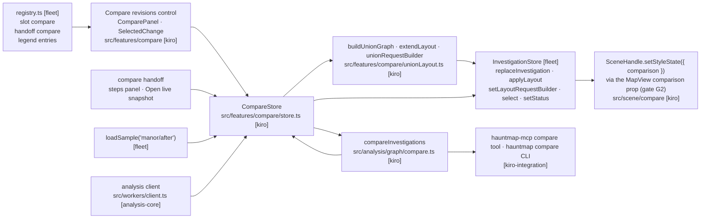

# Design Document

## Overview

This spec adds the comparison feature to HauntMap on top of the `analysis-core` contracts and the `investigation-ui` screen: `src/analysis/graph/compare.ts` turns two `Investigation`s into the plan's `ComparisonResult` (relation-ID set differences, module additions and removals, changed source hashes, cycle counts under `static-value`) plus a `ComparisonDetail` used only by the UI; `src/features/compare/` acquires the newer snapshot (the bundled `manor/after`, or the live snapshot through the `compare` handoff), builds the union graph, extends the current layout so common rooms keep their coordinates, drives the fleet store through `replaceInvestigation` and `applyLayout`, and renders the Comparison panel; `src/scene/compare/` draws the three comparison states and the closing-corridor transition. The export feature (`src/features/export/`: the dialog and the HTML, Markdown and JSON reports) is not built under the revision of 16 November 2026, and the `intake` spec is not built, so nothing here depends on either.

Owner: Kiro, alone in the main checkout on the branch `snapshot-comparison`, under `.kiro/steering/revision-2026-11-16.md` (tasks 1a to 4b, 8 to 12, 14 and 15; tasks 5, 6, 7 and 13 not done; no worktree, no integrator, no Crew renderer agent, no reviewer agent). Figures in this document (600 ms, 100 ms, 500 ms) are targets until a test run on the named laptop records them; recording needs a person and is left for the owner, and the tests print the figures and assert only the regression ceilings.

Folders of this spec: `src/analysis/graph/compare.ts`, `src/features/compare/`, `src/scene/compare/` and `tests/compare/` (unit tests, fixtures and browser specs; `analysis-core` owns `tests/fixtures/`, `investigation-ui` owns `tests/ui/` and `tests/e2e/`). `.kiro/steering/ownership.md` lists them. Changes in other specs' files (gates G1 to G4 of `tasks.md`: the Playwright configuration, `App.tsx` and `MapView.tsx`, three scene and style files, and possibly `Inspector.tsx`) run only under an exception that the owner adds there.

Preconditions on `main` before task 2 starts (all built by `analysis-core`, `kiro-integration` 1a to 8 and `investigation-ui` 1a to 13 and 15): `src/contracts/` with the plan's types; `src/analysis/index.ts` (`relationId`, `occurrenceId`, `selectSources`, `analyze`, `DEFAULT_ANALYSIS_OPTIONS`) and `src/analysis/graph/{cycles,presets}.ts` (`findCycles`, `presetRelations`, `includesRelation`); `src/workers/client.ts` (the analysis client); `src/features/investigation/{store,registry,analysisApi,layoutClient,handoffs}.ts`; `src/features/samples/loadSample.ts`; `src/scene/layout/{types,engine,doorsPlacement,key}.ts` with the dagre engine; `public/demo/manor/{before,after}/` with `expected.json` and `sources.json`. Requests R1 and R2 below are already part of the `investigation-ui` store contract; there is no wait on other writers. Downstream: `kiro-integration` task 11 (the live-snapshot browser journey) starts only after this spec's task 10 has `registerCompare` on `main`; its task 10 builds the live control against the registry alone and does not wait.

## Architecture



Comparison start from the panel (Requirements 1, 3, 4, 6):

```mermaid
sequenceDiagram
  participant P as ComparePanel
  participant C as CompareStore
  participant L as loadSample + analysis client
  participant K as compare.ts
  participant S as InvestigationStore
  participant SC as SceneHandle
  P->>C: compareWithSample("manor/after")
  C->>S: setStatus("Comparing manor/before with manor/after…")
  C->>L: loadSample("manor/after", base) → SourceSet; analysisClient.analyze({ files, rootLabel, options: before.options })
  L-->>C: Investigation (newer); source map built from sourceSet.files
  C->>K: compareInvestigations(before, after)
  K-->>C: { ok: true, result, detail }
  C->>C: union = buildUnionGraph(before, after, preset, analysisApi)
  alt S.layout exists, layoutStatus idle, layoutKey matches
    C->>C: extendLayout(S.layout, union, request, place, key) → rooms unchanged
  else
    C->>S: setLayoutRequestBuilder(unionBuilder); retryLayout() → one union request through the fleet's layout client
    C->>S: setStatus appended: "The map was laid out again for the comparison; rooms may have moved."
  end
  C->>S: setLayoutRequestBuilder(unionBuilder); applyLayout(layout)   (extended path)
  C->>S: replaceInvestigation(after.investigation, after.sourceText, { keepLayout: true })
  S-->>SC: setStyleState({ selection, routeFilter: null, comparison: style })
  Note over SC: closing-corridor transition when the dropped witness held a removed relation
  C->>S: setStatus("Comparison ready: 1 removed, 1 added, 2 changed modules; loops 1 → 0. Showing the newer snapshot.")
```

### File layout for this spec

| Path | Role | Writer |
| --- | --- | --- |
| `src/analysis/graph/compare.ts` | `compareInvestigations`, `relationIndex`, `distinctRelationCount`, `codeUnitCompare`, `ComparisonDetail` | kiro |
| `src/features/compare/store.ts` | `createCompareStore`: state machine, acquisition, comparison, layout path, toggle, end, reset | kiro |
| `src/features/compare/sources.ts` | `acquireSnapshot` for sample, investigation and intake sources | kiro |
| `src/features/compare/unionLayout.ts` | `buildUnionGraph`, `buildUnionRequest`, `extendLayout`, `unionLayoutKey`, `unionRequestBuilder` | kiro |
| `src/features/compare/placement.ts` | `DoorPlacement` adapter over `src/scene/layout/doorsPlacement.ts` (export name `placeDoors`, read in task 1a) | kiro |
| `src/features/compare/legend.ts` | `LEGEND_ENTRIES` (the three legend concepts of 5.3) | Kiro |
| `src/features/compare/register.ts` | registers the `compare` control, the `compare` handoff and the legend provider | Kiro |
| `src/features/compare/CompareControl.tsx`, `ComparePanel.tsx`, `SelectedChange.tsx`, `Notes.tsx` | the toolbar control and the panel | kiro |
| `src/scene/compare/index.ts`, `states.ts`, `transition.ts` | `ComparisonStyle`, `comparisonStateOf`, `applyComparison`, `CLOSING_MS` | Kiro |
| `src/scene/styles.ts` (three tokens, `outlineStyle`, the three `comparison-*` entries), `src/scene/adapter.ts` (comparison hook, `states` debug map, hidden elements not hit-tested), `src/styles/tokens.css` (three tokens) | comparison states and tokens; files of `investigation-ui`, changed only under gate G3 | Kiro, after the owner's exception |
| `src/features/investigation/store.ts`, `registry.ts`, `Inspector.tsx` | R1 and R2 are already in the store; `Inspector.tsx` only under gate G4 | `investigation-ui` |
| `src/components/App.tsx`, `src/components/MapView.tsx` | `registerCompare` at start, the `comparison` prop of `MapView`, the development-hook additions; files of `investigation-ui`, changed only under gate G2 | Kiro, after the owner's exception |
| `tests/compare/**` | unit, property and fixture tests, generators, store harness, helpers, `e2e/compare.spec.ts` | Kiro |
| `tests/compare/fixtures/<name>/{before,after}.json`, `expected.json`, `src/**` | hand-authored `Investigation` pairs, expected results, source folders | Kiro |
| `docs/kiro-log.md`, `docs/acceptance/2026-11-24-gate.md`, `docs/limitations.md`, `docs/ui-integration.md` (one section) | rows, evidence, reduced scope | Kiro |

### Requests to other owners (read in task 1a, no log request is filed: Kiro writes both sides)

| Id | Owner | Change | State |
| --- | --- | --- | --- |
| R1 | `investigation-ui` store | `store.actions.replaceInvestigation(inv, sourceText, { keepLayout: true })` with the rule list of its design (keeps `layout`, `layoutRevision`, `layoutStatus`, `camera`, `expandedWings`, `preset`, `activeView`, `selection`; drops a route filter holding an absent ID; recomputes an open panel; sends no request) | already in the `investigation-ui` contract (its task 2a); task 1a confirms the built signature |
| R2 | `investigation-ui` store | `store.actions.setLayoutRequestBuilder(builder: ((state: ViewState) => LayoutRequest \| null) \| null)` and `applyLayout(result)` (sets `layout`, `layoutStatus: "idle"`, increments `layoutRevision`, keeps the camera center) | already in the contract; task 1a confirms. The builder receives only `ViewState`, so it cannot receive `bring` (see `buildUnionRequest`) |
| R3 | `intake` | `registerHandoff("intake", …)` | withdrawn: the `intake` spec is not built and the fleet registry has no `intake` handoff |
| R4 | `investigation-ui` registry, `Inspector.tsx`, `Tooltip.tsx` | `registry.registerAnnotations` and the tooltip and inspector lines | withdrawn: the fleet registry has no such method and none is planned; the Comparison panel is the text equivalent. The one thing kept is that a selection whose ID is absent from the shown snapshot must not make the inspector throw (gate G4, tested by `ghost-selection.test.tsx`) |
| R5 | `investigation-ui` scene and styles | the three tokens in `TOKENS` and `tokens.css` together, `outlineStyle`, the completed `comparison-*` entries, the `comparison` hook in `setStyleState`, `states` in `SceneDebug`, hidden elements not hit-tested; plus the `comparison` prop of `MapView` and the wiring in `App.tsx` | gates G2 and G3 of `tasks.md`: not in the `investigation-ui` contract, so they need the owner's exception |

## Components and Interfaces

### Consumed contracts (verbatim from the plan; defined in `src/contracts/`, never redefined here)

```ts
type SyntaxKind = "import" | "re-export" | "dynamic-literal";
type DependencyKind = "value" | "type" | "mixed";
type Preset = "static-value" | "type-inclusive" | "dynamic-inclusive";
interface SourceFile { path: string; text: string; bytes: number }
interface SourceSet { rootLabel: string; files: SourceFile[]; skipped: { path: string; reason: "excluded-dir" | "extension" | "oversized" | "secret-pattern" | "binary" }[] }
interface AnalysisOptions { preset: Preset; includeExtensions: string[]; excludeDirectories: string[]; excludeFilePatterns: string[]; maxFiles: number; maxFileBytes: number; maxTotalBytes: number; jsToTsFallback: true }
interface ModuleRecord { id: string; sourceHash: string; language: "js" | "jsx" | "ts" | "tsx"; parseStatus: "ok" | "partial" | "failed" }
interface ImportRecord {
  occurrenceId: string; relationId: string;            // JSON.stringify([from, line, column, specifier]) / JSON.stringify([from, targetKey, syntaxKind, dependencyKind])
  from: string; to: string | null; specifier: string;
  syntaxKind: SyntaxKind; dependencyKind: DependencyKind;
  resolution: "local" | "external" | "unresolved" | "unsupported";
  line: number; column: number;
  reason?: "absent-file" | "alias-not-configured" | "nonliteral-dynamic" | "unsupported-construct" | "ambiguous-candidate";
}
interface Diagnostic { code: "parse-failed" | "unresolved" | "unsupported" | "case-collision" | "duplicate-path" | "oversized" | "cap-reached"; module?: string; line?: number; column?: number; specifier?: string; message: string }
interface Investigation { schemaVersion: 1; resolverMode: "documented-source-subset"; sourceLabel: string; modules: ModuleRecord[]; imports: ImportRecord[]; diagnostics: Diagnostic[]; options: AnalysisOptions }
interface CyclicComponent { members: string[]; witness: { modules: string[]; relationIds: string[] } }
interface CycleReport { preset: Preset; components: CyclicComponent[] }
interface RelationRef { relationId: string; from: string; to: string | null; specifier: string; syntaxKind: SyntaxKind; dependencyKind: DependencyKind; resolution: ImportRecord["resolution"] }
interface ComparisonResult {
  schemaVersion: 1; preset: "static-value";
  before: { label: string; moduleCount: number; relationCount: number }; after: { label: string; moduleCount: number; relationCount: number };
  addedModules: string[]; removedModules: string[]; changedModules: string[];    // sorted
  addedRelations: RelationRef[]; removedRelations: RelationRef[];              // sorted by relationId
  cyclicComponentsBefore: number; cyclicComponentsAfter: number;
}
```

`targetKey` is `["local", to]` for a resolved local edge and `[resolution, specifier]` for a boundary. `ComparisonResult.preset` stays the literal `"static-value"`: the plan's open-decisions table (revision 3) records that the MCP `compare` tool takes no preset argument.

Consumed from the `investigation-ui` design, unchanged: `LayoutRequest`, `LayoutResult`, `WingBox`, `RoomBox`, `GroupedRoomBox`, `DoorBox`, `SealedBox`, `CorridorBox`, `Rect`, `Point` (`src/scene/layout/types.ts`); `ViewState`, `Selection`, `RouteFilter`, `InvestigationStore` (`src/features/investigation/store.ts`); `Registry`, `LegendEntry`, `CompareArgs = { before: Investigation; after: Investigation | { sample: "manor/after" }; layoutKey: string | null }` (`registry.ts`); `AnalysisApi` with `cycles`, `inPreset` (`analysisApi.ts`); `SceneHandle.setStyleState(state: StyleState)` where `StyleState.comparison?: unknown` is filled with this spec's `ComparisonStyle`; `STATE_STYLES` and `TOKENS` (`src/scene/styles.ts`); `loadSample(id, base)` (`src/features/samples/loadSample.ts`); the development hook `window.__hauntmap`. The analysis client of `src/workers/client.ts` is used as `analysisClient.analyze(request: { files: SourceFile[]; rootLabel: string; options: AnalysisOptions }, onProgress?): Promise<Investigation>` (it rejects with `AnalysisFailed` or `AnalysisCancelled`; the source map is built here from `sourceSet.files`, never taken from the client; the client is the app's one instance, so a new `analyze` call cancels a running one). This spec never calls the layout client: a union layout that cannot be extended goes through the fleet store (`setLayoutRequestBuilder` and `retryLayout()`), so the store's revision guard, 10,000 ms timeout and failure handling apply. `loadSample(id, base)` returns `{ ok: true, sourceSet } | { ok: false, message }` with no status field. The cycle function that `compare.ts` imports as a sibling is `findCycles(investigation, preset): CycleReport` of `src/analysis/graph/cycles.ts`; `src/analysis/index.ts` does not export `compareInvestigations` (`tests/analysis-boundary.test.ts` asserts its key list), so consumers import it from `src/analysis/graph/compare`. Nothing in `src/features/compare/**` defines an identifier named `cycles`, `trace` or `inPreset` (the fleet's boundary test, I9, fails on it). Which `src/features/investigation/**` and `src/components/**` imports `tests/ui/feature-boundary.test.ts` allows is read in task 1a; whatever it does not allow is taken through `CompareDeps` as a structural type.

### `src/analysis/graph/compare.ts`

```ts
export interface ComparisonDetail {
  detailVersion: 1;
  common: string[];                                                       // sorted IDs present in both snapshots
  occurrenceCounts: Record<string, { before: number; after: number }>;   // one entry per module in changedModules: its ImportRecord count on each side
  relationChangesByModule: Record<string, { removed: number; added: number }>;   // keyed by `from`; only entries with a non-zero count
  optionsDiffer: (keyof AnalysisOptions)[];                               // fields whose JSON differs, in key order of AnalysisOptions
  parseFailed: { id: string; side: "before" | "after" }[];                // modules in both with parseStatus "failed" on exactly that side
  identical: boolean;                                                     // every list empty
}
export type CompareError = { code: "incompatible-schema" | "incompatible-resolver"; message: string };
export type CompareOutcome =
  | { ok: true; result: ComparisonResult; detail: ComparisonDetail }
  | { ok: false; error: CompareError };

export const codeUnitCompare = (a: string, b: string): number => (a < b ? -1 : a > b ? 1 : 0);
export function relationIndex(inv: Investigation): Map<string, ImportRecord[]>;   // relationId → occurrences sorted by (line, column); insertion order = sorted relationId
export function distinctRelationCount(inv: Investigation): number;
export function compareInvestigations(before: Investigation, after: Investigation): CompareOutcome;
```

Algorithm of `compareInvestigations` (pure, no I/O, no hashing):

1. Validate `schemaVersion === 1` on both (else `incompatible-schema` with `schema version <v> is not 1`, the earlier snapshot checked first) and `resolverMode === "documented-source-subset"` (else `incompatible-resolver`).
2. Build `Map<id, ModuleRecord>` for both; `addedModules`, `removedModules`, `common` by set difference and intersection; `changedModules` = `common` filtered by `before.sourceHash !== after.sourceHash`; sort all four with `codeUnitCompare`.
3. Build `relationIndex` for both; `removedRelations` = keys only in the earlier index, `addedRelations` = keys only in the newer, each mapped to a `RelationRef` copied from `occurrences[0]` (the lowest line, then column); sort by `relationId` with `codeUnitCompare`.
4. `relationCount` = index size; `moduleCount` = `modules.length`; `label` = `sourceLabel`.
5. `cyclicComponentsBefore/After` = `findCycles(inv, "static-value").components.length`.
6. `detail.occurrenceCounts[id]` for each changed module = the number of `ImportRecord`s with `from === id` on each side; `relationChangesByModule[from]` from the two ref lists; `optionsDiffer` by comparing `JSON.stringify(before.options[k])` with the newer value for each key of `AnalysisOptions` in declaration order (the keys are `preset`, `includeExtensions`, `excludeDirectories`, `excludeFilePatterns`, `maxFiles`, `maxFileBytes`, `maxTotalBytes`, `jsToTsFallback`); `parseFailed` from the two module maps; `identical` = all five lists empty.

Complexity O(m + r) with maps; the 1,000-module, 3,000-relation pair is a 500 ms target (3.9), not a measured figure. The function never reads `occurrenceId` for matching and never touches source text (2.1, 2.6). The MCP `compare` tool and the CLI call this function and map `{ ok: false }` to a tool error (kiro-integration).

### `src/features/compare/unionLayout.ts`

```ts
export type Membership = "both" | "before" | "after";
export interface UnionGraph {
  modules: { id: string; wing: string; membership: Membership }[];                       // sorted by id
  drawn: { relationId: string; from: string; to: string; membership: Membership }[];     // local, in the preset on the side(s) where it exists; sorted by relationId
  boundaries: { relationId: string; from: string; membership: Membership }[];            // external | unresolved | unsupported; sorted
}
export function buildUnionGraph(before: Investigation, after: Investigation, preset: Preset, api: Pick<AnalysisApi, "inPreset">): UnionGraph;
export function buildUnionRequest(union: UnionGraph, expandedWings: string[], keep: ReadonlyMap<string, string[]>, preset: Preset, engine: "dagre" | "elk"): LayoutRequest;
  // modules/relations/boundaries from the union; expandedWings with shownIds and hiddenCount: a wing present in `keep` (the shownIds of the current layout) keeps them (dropped modules removed, added modules appended while fewer than 80), any other expanded wing shows its 80 lexically smallest union modules or all of them; no `bring` swap, because the fleet's builder receives only ViewState

export interface DoorPlacement {   // adapter in placement.ts over src/scene/layout/doorsPlacement.ts (export `placeDoors({ rooms: ReadonlyMap<string, Rect>, relations, boundaries })`, read in task 1a)
  (rooms: RoomBox[], relations: { relationId: string; from: string; to: string }[], boundaries: { relationId: string; from: string }[]): { doors: DoorBox[]; sealed: SealedBox[] };
}
export interface ExtendOutcome { layout: LayoutResult; addedRoomIds: string[]; droppedRoomIds: string[]; movedRoomIds: string[] }
export function extendLayout(current: LayoutResult, union: UnionGraph, request: LayoutRequest, place: DoorPlacement, layoutKey: string): ExtendOutcome;
export function unionLayoutKey(base: string | null, request: LayoutRequest, engine: { name: string; version: string }, sha256Hex: (s: string) => Promise<string>): Promise<string>;
  // SHA-256 hex of JSON.stringify({ base, modules: sorted ids, relations: sorted relationIds, expandedWings: sorted, preset, engine })
export function unionRequestBuilder(read: () => { union: UnionGraph; engine: "dagre" | "elk" } | null): (state: ViewState) => LayoutRequest | null;
  // returns null when no comparison is active (the store then builds its own request); takes `keep` from state.layout.wings[].shownIds
```

`extendLayout` (pure, synchronous, deterministic; `tests/compare/union-layout.test.ts`):

1. Copy `wings`, `rooms`, `grouped` from `current`; drop rooms whose module is in no snapshot (`droppedRoomIds`; remove them from their wing's `shownIds` and lower `moduleCount`); never change `x`, `y`, `w`, `h` of a kept box. `request` supplies only the engine, the preset and the expanded-wing list; the drawn set is `current.wings[].shownIds`.
2. For each union module with `membership: "after"` that has no room, in sorted ID order: wing expanded and `rooms in wing < 80` → append a room at the next slot of the rows below the wing's lowest room (`x = wing.x + 24 + k × 112`, `y = lowestBottom + 16`, next row when `x + 96 > wing.x + wing.w − 24`), `label` = file name clipped at 18 characters with `…`, append the module ID to that wing's `shownIds` and grow `wing.h` so that `wing.y + wing.h ≥ newRowBottom + 24` (80 units per new row when the bottom padding was 24); wing expanded with 80 rooms → `hiddenCount + 1`, grouped label `+<n> more modules`; wing collapsed → `moduleCount + 1`; wing absent → new `WingBox { w: 144, h: 120, x: bounds.x + bounds.w + 48, y: bounds.y + 32 + 168 × j, rank: maxRank + 1 + j, expanded: false, shownIds: [], hiddenCount: 0, moduleCount: 1 }` for the j-th new wing.
3. Resolve overlaps caused by growth in one deterministic pass: for each grown wing in ascending `rank` order (ties by wing name in code-unit order), every wing whose `y ≥ grownWing.originalBottom` and whose `[x, x + w)` overlaps the grown wing's `[x, x + w)` is translated down by that wing's growth amount together with its rooms and grouped room; a wing hit by several grown wings accumulates the translations and may therefore move more than once; after the pass, `tests/compare/union-layout.test.ts` asserts that no two wing boxes intersect (a remaining intersection is a defect in the placement of step 2, not a reason for a second pass); the moved rooms are `movedRoomIds`.
4. Doors and sealed doorways: `place(rooms, drawnWithBothRoomsDrawn, boundariesWithImporterDrawn)`; only room geometry enters, so a room's doors are re-spread when a door is added or removed (4.8 allows door movement on `src/notifications/receipt.ts` only).
5. Corridors: one per ordered wing pair with at least one union drawn relation (in-preset, local, one per relation ID; the end rooms need not be drawn, as in the fleet's `two-wings.json`) between different wings, `count` = distinct relation IDs, `path` between the nearest boundary points of the two wing boxes (the fleet's rule).
6. `bounds` = union of wing boxes with 32 padding; `layoutKey` = the given key; `engine` = `current.engine`; `revisionEcho` omitted; `stats = { ms: performance.now() delta, nodeCount: rooms.length + wings.length, edgeCount: doors.length }`.

### `src/features/compare/store.ts`

```ts
export interface Snapshot { label: string; investigation: Investigation; sourceText: ReadonlyMap<string, string> | null }
export type Side = "before" | "after";
export type CompareStatus = "idle" | "acquiring" | "comparing" | "laying-out" | "active";
export interface CompareState {
  compareStateVersion: 1;
  status: CompareStatus;
  panelOpen: boolean;
  before: Snapshot | null; after: Snapshot | null;
  result: ComparisonResult | null; detail: ComparisonDetail | null;
  shown: Side;
  union: UnionGraph | null;
  layoutPath: "extended" | "fresh" | "pending" | null;
  unionLayoutKey: string | null;
  closingRelationIds: string[];            // removed relation IDs that the dropped witness held, computed at activation and at each show(); the scene plays the transition when this set differs from the last one it applied (6.3)
  error: string | null;                    // the last failure message, also written to the status region
}
export type AfterSource =
  | { kind: "sample"; id: "manor/after" }
  | { kind: "investigation"; snapshot: Snapshot };
export interface CompareStore {
  getState(): CompareState;
  subscribe(listener: () => void): () => void;
  actions: {
    openPanel(): void; closePanel(): void;
    compareWithSample(): Promise<void>;                          // 1.2
    compareWithPair(): Promise<void>;                            // 1.3
    compareWith(after: AfterSource, layoutKey: string | null): Promise<void>;   // the handoff path (1.4) and the two above
    show(side: Side): void;                                      // 6.2
    selectChange(item: { kind: "relation" | "module"; id: string }): void;      // 7.3
    end(): void;                                                 // 6.6
    reset(): void;                                               // 6.7
  };
}
export interface CompareDeps {
  store: InvestigationStore; registry: Registry; analysisApi: AnalysisApi;
  analysisClient: Pick<AnalysisClient, "analyze">;   // src/workers/client.ts: analyze({ files, rootLabel, options }, onProgress?) → Promise<Investigation>
  loadSample: typeof loadSample; base: string;
  place: DoorPlacement;
  now?: () => number;
}
export function createCompareStore(deps: CompareDeps): CompareStore;
```

There is no scene handle and no layout client in `CompareDeps`: the comparison style reaches the scene through the `comparison` prop of `MapView` (gate G2), which reads `styleOf(compareStore.getState())` and subscribes to the compare store; the camera follows a selection through the fleet's own `select(…, { from: "dom" })` rule; a fresh union layout goes through the fleet store.

Rules the store enforces (`tests/compare/store.test.ts`): `compareWith` is ignored while `status` is not `idle` or `active` (1.7); during `acquiring`/`comparing`/`laying-out` the fleet store is touched only through `setStatus` (1.7, 10.x); the before snapshot is `{ label: state.investigation.sourceLabel, investigation: state.investigation, sourceText: state.sourceText }` taken at call time, except for `compareWithPair`, which loads and analyzes `manor/before`, opens it with `openInvestigation(investigation, sourceText, { expandWing: "src/orders", demo: false })` and awaits `layoutStatus === "idle"` (a `failed` layout stops the comparison, 1.3); the layout path is `extended` when `state.layout && state.layoutStatus === "idle" && state.layout.layoutKey === layoutKey` (for the panel buttons `layoutKey = state.layout?.layoutKey ?? null`), otherwise `fresh`, which sets the union builder and calls `retryLayout()` so that the fleet store sends one union request (its revision guard discards any request in flight), then awaits `layoutStatus` `idle` or `failed`; `unionLayoutKey` hashes with `crypto.subtle` (Web Crypto, also in Node 24); on the extended path `applyLayout` is called before `replaceInvestigation`; the compare state (`shown`, `result`, `closingRelationIds`) is updated before `replaceInvestigation`, so that every style update the scene receives is consistent; `show(side)` calls `replaceInvestigation` and never `applyLayout` or `setLayout` (4.7); `end()` calls `replaceInvestigation(before)`, clears the comparison (so `comparison` becomes `null` in the next style update), `setLayoutRequestBuilder(null)`, `retryLayout()`, then clears `after`, `result`, `detail`, `union`; `reset()` returns to the initial state without touching the fleet store and runs when the fleet store reports `investigation === null` and `screen === "landing"`; `selectChange` calls `store.actions.select(…, { from: "dom" })` and nothing else; a failure sets `error`, writes the status, returns the status to the previous value (`idle` or `active`) and leaves the fleet store deep-equal (10.1–10.4).

`ComparisonStyle` for the scene is derived from state by `styleOf(state): ComparisonStyle | null` (pure, exported for tests):

```ts
// src/scene/compare/index.ts
export interface ComparisonStyle {
  comparisonStyleVersion: 1;
  shown: Side;
  changedModules: string[]; removedModules: string[]; addedModules: string[];
  removedRelationIds: string[]; addedRelationIds: string[];
  closingRelationIds: string[];
  earlierLabel: string; newerLabel: string;
}
export type ComparisonState = "default" | "comparison-changed" | "comparison-removed" | "comparison-added" | "hidden";
export function comparisonStateOf(style: ComparisonStyle | null, target: { kind: "room" | "door" | "sealed"; id: string }): ComparisonState;
  // null → default. room: changed → comparison-changed (both views); removedModules → after view comparison-removed, before view default;
  // addedModules → after view comparison-added, before view hidden. door/sealed: removedRelationIds → after view comparison-removed, before view default;
  // addedRelationIds → after view comparison-added, before view hidden; else default. Labels are never read (5.8).
export function applyComparison(internals: SceneInternals, style: ComparisonStyle | null, reducedMotion: boolean): void;
  // sets each room/door/sealed display object's state texture from comparisonStateOf (selected/subdued/witness states of the fleet take precedence for
  // outline and halo; the comparison glyph and label are drawn on top); hidden → visible = false and excluded from hitTest; a non-empty closingRelationIds that differs from the last applied set → transition.ts
  // called from SceneHandle.setStyleState when state.comparison is present (gate G3); an absent key keeps the last style, null clears it
export const CLOSING_MS = 600;
```

`transition.ts`: `closeCorridor(segments, doors, reducedMotion)` tweens the alpha of the witness corridor segments and step-number labels that are still drawn from 1 to 0 over `CLOSING_MS` through the fleet's `animation.ts` (so `activeTweens` counts them), then removes them; it plays when a style arrives with a non-empty `closingRelationIds` that differs from the last applied set, although the same update already carries `routeFilter: null`; the door's texture switches to `comparison-removed` at the start; under reduced motion everything happens in the same frame. No tween ever targets a room position.

`src/scene/styles.ts` additions (gate G3; `investigation-ui` task 5 already created the three `comparison-*` entries of `STATE_STYLES` and counts their textures in the 24-texture budget, so task 1a reads them and this task completes them): `TOKENS.changed = "#f0b429"`, `TOKENS.removed = "#9a93a8"`, `TOKENS.added = "#5ad48a"`; `STATE_STYLES["comparison-changed"] = { fill: TOKENS.room, outlineWidth: 0, glyph: "lamp", label: "changed" }`, `STATE_STYLES["comparison-removed"] = { fill: "none", outlineWidth: 2, glyph: null, label: "removed" }` with `outlineStyle: "dashed"` (the fleet record gains this optional field, default `"solid"`), `STATE_STYLES["comparison-added"] = { fill: TOKENS.added, outlineWidth: 2, glyph: "+", label: "added" }`; the lamp glyph is a 12 × 12 sprite at the room's north edge. The contrast ratios, computed by hand with the WCAG relative-luminance formula on 2026-11-16 (a review aid, not a recorded check; `tests/compare/styles.test.ts` is the authority): `--changed` 10.1 on `floor` and 6.5 on `room`, `--removed` 6.4 and 4.1, `--added` 10.0 and 6.5, all at or above 3:1.

### `src/features/compare/sources.ts`

```ts
export type AcquireResult = { ok: true; snapshot: Snapshot } | { ok: false; message: string };
export async function acquireSnapshot(source: AfterSource, deps: Pick<CompareDeps, "analysisClient" | "loadSample" | "base" | "store">): Promise<AcquireResult>;
// sample: loadSample("manor/after", base) → { ok:false, message } → `The revised manor sample could not be loaded (${first parenthesized text of message, or "unknown error"}). The current investigation is unchanged.`;
//   then analysisClient.analyze({ files: sourceSet.files, rootLabel: sourceSet.rootLabel, options: <the earlier snapshot's options, unchanged> }); AnalysisFailed or AnalysisCancelled → `The newer snapshot could not be analyzed (${message}). The current investigation is unchanged.`;
//   the options are the earlier snapshot's, never `{ …, preset: store.preset }`: the toolbar preset is a view setting, and a different `preset` field would raise a false options note;
//   sourceText = new Map(sourceSet.files.map(f => [f.path, f.text])); label = sourceSet.rootLabel ("manor/after")
// investigation: returns the snapshot as given (label = investigation.sourceLabel; sourceText as given, null for live:)
```

### `src/features/compare/legend.ts` and `register.ts`

```ts
export const LEGEND_ENTRIES: LegendEntry[] = [
  { concept: "Changed source", costume: "amber lamp" },
  { concept: "Removed in the newer snapshot", costume: "ghost outline" },
  { concept: "Added in the newer snapshot", costume: "green doorway" },
];
export function registerCompare(registry: Registry, compareStore: CompareStore): void;
// registry.registerControl("compare", CompareControl); registry.registerHandoff("compare", (args) => compareStore.actions.compareWith(toSource(args.after), args.layoutKey));
// registry.registerLegendEntries(() => compareStore.getState().status === "active" ? LEGEND_ENTRIES : []);
// toSource: { sample: "manor/after" } → { kind: "sample", id: "manor/after" }; an Investigation → { kind: "investigation", snapshot: { label: inv.sourceLabel, investigation: inv, sourceText: null } }
```

There is no annotation provider: the fleet registry has no `registerAnnotations` (request R4 is withdrawn), so tooltips and the inspector show the fleet's own lines and the Comparison panel carries the text equivalent.

The handoff promise resolves when `status` becomes `active` and rejects with `new Error(state.error)` after the failure message is shown (1.4, 10.6).

### Components (`src/features/compare/`)

```ts
// CompareControl.tsx — <button aria-expanded={panelOpen}>Compare revisions</button> followed, inside the same slot component, by <ComparePanel/> as a popover when open (the registry has no panel slot, and this keeps the Tab order button → panel → next control); props { store: InvestigationStore } (the registry's control signature); reads the compare store through a module-level accessor set by registerCompare
// ComparePanel.tsx — <section role="region" aria-labelledby="compare-heading"> with <h2 id="compare-heading">Compare revisions</h2>;
//   idle: the sentence and the one button of 1.1 (sample or pair by sourceLabel; aria-disabled while busy);
//   active: the lines of 7.1, the Show radiogroup (6.2), the five lists (7.1, 7.2), <SelectedChange/>, <Notes/>, button End comparison (7.5);
//   Escape inside the panel → closePanel() and focus to the control (7.5); every string a text node (7.7)
// SelectedChange.tsx — <section aria-label="Selected change"> with the cards of 7.3; occurrence buttons show the excerpt from the right snapshot's source map (two lines before and after, one-based) or the no-source sentence
// Notes.tsx — <h3>Notes</h3> and the sentences of 7.4 in this order: rename, options, parse failures (sorted by id), the fixed limits sentence
export const RENAME_NOTE = "Renames are shown as a removal and an addition; HauntMap does not infer renames.";
export const LIMITS_NOTE = "A removed or added door is a change in the import graph found in the source. It is not a claim about runtime behaviour.";
export const NO_SOURCE_NOTE = "Source not included in this snapshot; evidence is path, line and specifier.";
```

Item wording (7.2) is produced by `itemLabel(ref | moduleId, detail)` in `labels.ts`: relation `${from} imports ${to} · ${syntaxKind} · ${dependencyKind}`; boundary `${from} → "${specifier}" · ${resolution}`; changed module `${id} · import statements ${before} → ${after}` plus ` · ${k} relations removed, ${m} added` when either is non-zero; other modules `${id}`.

### Export (not built)

`src/features/export/` is not built under the revision of 16 November 2026: no `ExportModel`, no serializers, no dialog, no `registerExport`. The `export` slot of the fleet registry stays empty. Nothing in `src/features/compare/**` imports from `src/features/export`.

### Development hook additions (`window.__hauntmap`, development builds only)

```ts
interface DevHookCompare { compareStore: CompareStore; compareWith(after: Investigation, layoutKey?: string | null): Promise<void> }
```

`compareWith` calls the registered `compare` handoff with `{ before: store.getState().investigation, after, layoutKey: layoutKey ?? store.getState().layout?.layoutKey ?? null }`. `kiro-integration` reads `compareStore.getState().result` through this object (its requirement 4.4 and task 12). Installed by `App.tsx` under `window.__hauntmap` when it exists (gate G2); absent from release builds.

## Data Models

| Record | Where | Identity and version | Content and invariants |
| --- | --- | --- | --- |
| `Snapshot` | compare store (memory) | `label` (= `sourceLabel`) | `investigation` (`schemaVersion: 1`), `sourceText` map or `null`; never persisted; dropped by `end()` and `reset()` (1.8) |
| `ComparisonResult` | compare store, MCP, CLI | `schemaVersion: 1`, `preset: "static-value"` | the plan's record; lists sorted (3.2); `removedRelations[i].relationId` ∈ earlier, ∉ newer (P7); `relationCount` = distinct IDs (P8) |
| `ComparisonDetail` | compare store, panel | `detailVersion: 1` | `occurrenceCounts` keyed by every changed module; `relationChangesByModule` only non-zero; `optionsDiffer` in key order; `identical` ⇔ the five lists empty |
| `CompareState` | compare store (memory) | `compareStateVersion: 1`; one instance | `status` transitions `idle → acquiring → comparing → laying-out → active → idle`, with any failure returning to the previous `idle`/`active`; `shown` defaults to `after`; `before`/`after`/`result`/`detail`/`union` are non-null exactly while `active` |
| `UnionGraph` | compare store (memory), derived | — | `modules` ∪ membership partition the union (P1); `drawn` ⊆ relations with `resolution: "local"` in the preset on at least one side |
| `LayoutRequest` / `LayoutResult` (union) | fleet store `layout` | `layoutVersion: 1`, `layoutKey` = `unionLayoutKey` | extended layout keeps every kept box's geometry (P9); `rooms` = drawn union modules; `stats.ms` the only timing |
| `ComparisonStyle` | scene style state | `comparisonStyleVersion: 1` | derived by `styleOf(state)`; `closingRelationIds` computed at activation and at each `show`, and the scene plays the transition only when it differs from the last set it applied; labels present for the panel, never read by `comparisonStateOf` (P10) |
| Fixture `expected.json` | `tests/compare/fixtures/<name>/expected.json` | `expectedVersion: 1` | hand-authored: the five lists (relations as `{ from, to, specifier, syntaxKind, dependencyKind, resolution }`), `moduleCount`, `relationCount`, `cyclicComponents`, `occurrenceCounts`, `optionsDiffer`; never generated by `compare.ts` (11.5) |
| Kiro log row | `docs/kiro-log.md` | date + `snapshot-comparison/<n>` | the seven-column table already in the file; no commit trailer (Kiro runs no `git commit` unless the owner asks) |

Invariants (checked by the tests named in Testing Strategy):

- I1 Matching uses only `ModuleRecord.id` and `ImportRecord.relationId` (2.1, P4, P5).
- I2 `addedModules ∪ removedModules ∪ common` = the union of IDs, pairwise disjoint; the same for relation IDs (3.1, P1).
- I3 Every list of `ComparisonResult` is sorted by `codeUnitCompare`; the result is independent of input order (3.2, P6).
- I4 `compare.ts` imports only `src/contracts/**` and `src/analysis/graph/*` (2.6, `tests/compare/boundary.test.ts`).
- I5 The union layout is computed once per comparison start, extension or store-originated request; a toggle never changes `layout` (4.7, P9, P10).
- I6 Every kept box of the current layout keeps its geometry across `extendLayout` unless it is in `movedRoomIds`, which is empty when no wing grew into another (4.1, 4.3, P9).
- I7 `comparisonStateOf` depends only on `shown`, the five ID lists and the target; never on labels (5.8, P10).
- I8 Every comparison state differs from `default` by a glyph, an outline or a label; the three tokens pass 3:1 on `floor` and `room` (5.4).
- I9 The comparison style depends only on `shown`, the five ID lists and the target, and the status region is written only through `setStatus` (5.8, 10.7).
- I10 `src/features/compare/**`, `src/scene/compare/**` and `src/analysis/graph/compare.ts` import nothing from `src/features/export` and nothing from the `intake` spec (11.4).
- I11 A failure leaves the fleet store deep-equal and returns the compare status to its previous value (10.1–10.4).

## Error Handling

Every failure is a typed value or a caught rejection; components never throw for a domain condition and never retry on their own. Messages are written once through `store.actions.setStatus`; a segment wrapped in backticks is rendered as `<code>` by the fleet's status region.

| Situation | Where | Exact user-visible text | Preserved | Focus / state |
| --- | --- | --- | --- | --- |
| `loadSample("manor/after")` fails (10.1) | status region; panel stays open | `The revised manor sample could not be loaded (<status or error name>). The current investigation is unchanged.` | investigation, selection, route filter, camera, expanded wings, layout | focus on the activated button; compare status back to `idle` |
| Analysis worker rejects, times out or is terminated for the newer snapshot (10.2) | status region | `The newer snapshot could not be analyzed (<message>). The current investigation is unchanged.` | same | same |
| `compareInvestigations` returns `incompatible-schema` / `incompatible-resolver` (2.2, 10.4) | status region | `The snapshots cannot be compared: schema version <v> is not 1. The current investigation is unchanged.` / `The snapshots cannot be compared: resolver mode "<m>" is not "documented-source-subset". The current investigation is unchanged.` | same | same |
| Options differ (2.3) | panel `Notes` | `The snapshots were analyzed with different options (<field>, <field>); some differences may come from the options.` | comparison runs | — |
| Parse failure on one side (2.4) | panel `Notes` | `<id> could not be parsed in the <earlier\|newer> snapshot; its relations there are unknown and appear as <added\|removed>.` | — | — |
| No differences (2.5) | panel and status region | `No differences: the snapshots have the same modules, relations and source hashes.` | — | comparison active |
| Current layout missing, pending or key mismatch (4.5) | appended to the ready message of 6.1 | `The map was laid out again for the comparison; rooms may have moved.` | selection, camera, expanded wings | layout path `fresh` |
| Grown wing pushed others (4.3) | appended to the ready message of 6.1 | `<n> rooms moved to make room for <k> added modules.` | every other room | — |
| Union layout request fails or times out (10.5) | fleet 3.7 text with `Retry layout` | `The map layout did not finish (<reason>). The Evidence view has the full investigation.` | comparison active; lists, toggle, cards and notes work | style applied when a layout arrives |
| Handoff called while busy (1.7) | — | nothing; the call returns the pending promise of the running comparison | everything | — |
| Toggle (6.2) | status region | `Showing the earlier snapshot (<label>).` / `Showing the newer snapshot (<label>).` | layout, camera | — |
| End comparison (6.6) | status region | `Comparison ended. Showing <earlier label>.` | selection when its ID exists in the earlier snapshot | focus on `Compare revisions` |
| Occurrence line beyond the source text (7.3) | `Selected change` card | `Line <line> is not in the current source text.` | — | — |
| Source map absent for the snapshot of an occurrence (7.3) | `Selected change` card | `Source not included in this snapshot; evidence is path, line and specifier.` | — | — |
| Relation has no door under the preset (7.3) | `Selected change` card | `Not drawn under <preset>` | — | camera on the importer's room |
| Renderer unavailable (7.8) | — | nothing from this spec; the fleet banner | panel works; `focusOn` skipped | — |
| Handoff promise rejects (10.6) | — | no second message | caller's state | — |

What the user sees on the paths that matter most: a judge whose sample request fails reads one sentence, keeps the manor on screen and can try again; a developer who compares a live snapshot analyzed with different options sees the differences and a note saying why some of them may be artifacts; an agent whose live snapshot has the wrong schema is told the version and nothing moves; a reader of the panel sees `./` as text.

## Testing Strategy

Commands. `pnpm verify` runs the typecheck and the Vitest suites (Vitest 5.1.0 on `main`) including `tests/compare/**/*.test.ts(x)`: `compare`, `union-layout`, `store`, `comparison-states`, `styles`, `legend`, `manor-pair` and `properties` run in the node project; `panel`, `ghost-selection` and `toggle` are `.test.tsx` files that run in the jsdom project that `investigation-ui` task 1c defines (React Testing Library and the fleet's `tests/ui/fakeScene.ts`), so no Vitest configuration changes; property tests use fast-check 4.10.2 with 200 runs per property and the seed printed on failure. `pnpm verify:e2e -- tests/compare/e2e/compare.spec.ts` runs Playwright in the `dev` project defined by `investigation-ui` task 1c (the production build of Vite mode `devhook`, where `window.__hauntmap` exists; the spec loads fixtures and reads state through it), headless Chromium, 1,280 × 720, one fresh context per test, with the fleet's helpers from `tests/e2e/helpers.ts` (`openManor`, `tabTo`, `readStatus`, `sceneDebug`, `assertFocusVisibleAndUnobscured`, `inspectorHeading`, `shot`) and this spec's `tests/compare/e2e/helpers.ts` (`openComparePanel`, `compareWithSample`, `waitForStatus(text)`, `roomRects(ids)`, `wingRects`, `expandAllWings`). Cases that need WebGL are skipped with the printed reason `no WebGL in headless Chromium` when headless Chromium has none. The Playwright `testMatch` for `tests/compare/e2e/**` is gate G1.

Fixtures (`tests/compare/fixtures/<name>/`): `before.json` and `after.json` are hand-authored `Investigation`s (`schemaVersion: 1`, `resolverMode: "documented-source-subset"`, the plan's default `AnalysisOptions`, IDs built by `tests/compare/ids.ts` from `relationId` and `occurrenceId` of `src/analysis/index.ts`), `expected.json` is the hand-authored expected result, and `src/` holds the source folders for the from-source tests where listed. Hashes are the SHA-256 of the listed texts (computed November 3, 2026); `\n` marks a newline and every file ends with one.

| Fixture | Content | Expected |
| --- | --- | --- |
| `comment-shift` (row 23; from-source) | earlier `src/a.ts` = `import { b } from "./b";\nexport const a = b;\n` (hash `ebf78fc7fae8b7f83c2ffd57b69b2f89f5321c3dd0713dd04544462720f9d6b0`), `src/b.ts` = `export const b = 1;\n` (`4d6c305aa3866c1d56beb6a3b2394fe9dc4b3ce5f3756a2357139efefbd969d0`); newer `src/a.ts` = `// moved down\n// by two comment lines\nimport { b } from "./b";\nexport const a = b;\n` (`f6991c23841a2ae5b79ca756c263379ffc9245d5abb40018d04d6674e5718058`); the import `import`/`value`/`local`, specifier `./b`, line 1 (earlier) and 3 (newer), relation ID `["src/a.ts",["local","src/b.ts"],"import","value"]` | `changedModules: ["src/a.ts"]`, every other list empty, counts 2/2 modules and 1/1 relations, cycles 0/0, `occurrenceCounts: { "src/a.ts": { before: 1, after: 1 } }`; occurrence IDs differ; room `src/a.ts` `comparison-changed`, door `default` |
| `duplicate-occurrence` (row 24; from-source) | earlier `src/a.ts` = `import { x } from "./b";\nimport { y } from "./b";\nexport const a = x + y;\n` (`ed01911bf39910668204a57f39e0d5e6dbccdcd247be34668096769551e3ccce`), `src/b.ts` = `export const x = 1;\nexport const y = 2;\n` (`ce762e375989b96dce8b33cdbb9abe355a86b018515fcfc770f9416b19712a24`); newer `src/a.ts` = `import { x } from "./b";\nexport const a = x;\n` (`1ce2854c1718177a79b04336be4fc29bb52fa860d5ed92a6842a2e4995c009de`); both statements share one relation ID | `removedRelations: []`, `changedModules: ["src/a.ts"]`, `occurrenceCounts: { "src/a.ts": { before: 2, after: 1 } }`, relation counts 1/1; panel item `src/a.ts · import statements 2 → 1`; door `default` |
| `rename` (from-source) | earlier `src/app.ts` = `import { format } from "./util/format";\nexport const app = format(1);\n` (`1984e12f78e75c4f6d76dd8a0cbe102d238fa4890492c36f7e55bc01aa9a97cb`), `src/util/format.ts` = `export function format(n: number): string {\n  return String(n);\n}\n` (`40483aaf98549a7d523cf046595dfa937b38a931996d5e3ad3f37c110f698df7`); newer `src/app.ts` = `import { format } from "./util/formatMoney";\nexport const app = format(1);\n` (`7b6050c79fd136330e8bb663edd569fd451127cb1ae00d698a1f8cedb243a29e`), `src/util/formatMoney.ts` with the same text as `format.ts` | `removedModules: ["src/util/format.ts"]`, `addedModules: ["src/util/formatMoney.ts"]`, `removedRelations: [app → util/format]`, `addedRelations: [app → util/formatMoney]`, `changedModules: ["src/app.ts"]`; `RENAME_NOTE` shown; no rename link |
| `cycle-closes` | earlier `src/x.ts` imports `./y`, `src/y.ts` imports `./x` (hashes `"1".repeat(64)` and `"2".repeat(64)`, placeholders; no source folder); newer without `y → x` (`src/y.ts` hash `"3".repeat(64)`) | cycles 1 → 0; `removedRelations` exactly `y → x`; `changedModules: ["src/y.ts"]`; e2e: closing-corridor transition after choosing the loop, then comparing through the hook |
| `boundary-change` | earlier `src/app.ts` imports `zod` (`external`, `to: null`) and `./ghosts/missing` (`unresolved`, `absent-file`, `to: null`), diagnostics `unresolved`; newer `src/app.ts` imports `zod` and `./ghosts/present` → `src/ghosts/present.ts` (new module); placeholder hashes | `addedModules: ["src/ghosts/present.ts"]`, `removedRelations` = the one unresolved ref of 3.3, `addedRelations` = `app → ghosts/present`, `changedModules: ["src/app.ts"]`; panel item `src/app.ts → "./ghosts/missing" · unresolved` |
| `identical` | `comment-shift/before.json` twice with `sourceLabel` `local:manor-before` and `local:manor-after` | every list empty, `identical: true`, `No differences…` in panel and status region |
| `options-mismatch` | `comment-shift/before.json` and a copy whose `options.includeExtensions` is `[".ts"]` instead of the default | `optionsDiffer: ["includeExtensions"]`; the options note |
| `parse-failure` | `comment-shift/before.json` and a copy where `src/a.ts` has `parseStatus: "failed"`, no imports, the same `sourceHash` and a `parse-failed` diagnostic | `removedRelations` = `a → b`; `changedModules: []`; `parseFailed: [{ id: "src/a.ts", side: "after" }]`; note `src/a.ts could not be parsed in the newer snapshot; its relations there are unknown and appear as removed.` |
| `escaped` (row 11 export portion, row 25; from-source) | one module `src/a&b.ts` = `import "./";\nexport const sentinel = "SENTINEL-SOURCE-7f3a9c";\n// <script>alert(1)</script>\n` (`72a7c49136b9ba81c623ba537f3194fab23d06ac76fc9ba6ed365749c27bdc56`, 120 bytes); import `import`/`value`/`unresolved`/`absent-file`, specifier `./`; `sourceText` map holds the text; label `local:escaped` | default export in every format: no sentinel, contains `src/a&b.ts` and the specifier; HTML parsed: no `img`/`script`, text verbatim; source-inclusive: sentinel once inside the source section |
| `manor-pair` (row 16; from-source) | the committed `public/demo/manor/before/sources.json` and `public/demo/manor/after/sources.json` (the files the app fetches; `pnpm pack:samples --check` keeps them equal to the folders), each entry a `SourceFile` with `bytes` the UTF-8 length, classified by `selectSources` and analyzed with `analyze(sourceSet, DEFAULT_ANALYSIS_OPTIONS, nodeSha256)` | 3.6; `fixtures/manor-pair/expected.json` (`expectedVersion: 1`, hand-authored): 40 and 40 modules, 72 and 72 relations (see below), removed `src/notifications/receipt.ts → src/orders/checkout.ts` (`../orders/checkout`), added `src/notifications/receipt.ts → src/orders/summary.ts` (`../orders/summary`), both `import`, `value`, `local`; `changedModules` the receipt and checkout IDs; `occurrenceCounts` receipt 4 → 4, checkout 6 → 6; `relationChangesByModule` receipt `{ removed: 1, added: 1 }`; cycles 1 → 0; panel items `src/notifications/receipt.ts · import statements 4 → 4 · 1 relations removed, 1 added` and `src/orders/checkout.ts · import statements 6 → 6` |
| `tests/compare/generators.ts` | `makeInvestigation({ modules, wings, relationsPerModule, boundaryShare, seed })` with a mulberry32 PRNG; `mutate(inv, mutations)` for `removeRelation`, `addRelation`, `changeHash`, `shiftLines`, `duplicateOccurrence`, `dropDuplicate`, `removeModule`, `addModule`, `renameModule`; `expectedDiff(inv, mutations)` derived from the mutation list only; `arbitraryPair()` and `arbitraryOccurrenceOnlyPair()` as fast-check arbitraries; `perf1000` = 1,000 modules in 40 wings, 3,000 relations | feed `properties.test.ts` and the 3.9 and 4.9 timing guards |
| Layouts for `union-layout.test.ts` | current layouts produced by the fleet's `layoutInvestigation` (`src/scene/layout/engine.ts`) for the earlier snapshot of each pair, with `src/orders`-style wings expanded | `extendLayout` keeps every kept box; added rooms placed per 4.2; overlap resolution per 4.3; doors re-spread only on rooms whose door set changed |

Counts for `fixtures.test.ts` and `expected.json` (modules before/after, relations before/after, cyclic components before/after; each counted by hand from the table): `comment-shift` 2/2, 1/1, 0/0; `duplicate-occurrence` 2/2, 1/1 (two statements, one relation ID), 0/0; `rename` 2/2, 1/1, 0/0; `cycle-closes` 2/2, 2/1, 1/0; `boundary-change` 1/2, 2/2, 0/0; `identical` and `options-mismatch` as `comment-shift`; `parse-failure` 2/2, 1/0, 0/0; `escaped` (the pair of the hook case 7.7: `before.json` holds `src/a&b.ts` with no imports and the placeholder hash `"4"` repeated 64 times, `after.json` the module of the table) 1/1, 0/1, 0/0, with `changedModules: ["src/a&b.ts"]` and the unresolved relation as the one added relation. The manor pair: 40/40, 72/72, 1/0, counted from the two `expected.json` files by group (catalog 16, config 5, notifications 10, orders 22, payments 15, shared 4 import records, 72 in all; the added and removed relation replace each other).

Unit, component and property test files (`pnpm verify`):

| File | Cases |
| --- | --- |
| `tests/compare/compare.test.ts` | 3.1 every field on every fixture against `expected.json`; 3.2 shuffled inputs deep-equal and sorted; 3.3 ref from the first occurrence, boundary ref; 3.4, 3.5, 3.7, 3.8 the named fixtures; 2.1 `identical`; 2.2 schema and resolver errors with the exact messages; 2.3 `options-mismatch`; 2.4 `parse-failure`; 2.5 `identical: true`; 3.9 timing on `perf1000` pairs (figure printed; 5,000 ms ceiling always; 500 ms target only with `HAUNTMAP_PERF_DEVICE`) |
| `tests/compare/boundary.test.ts` | 2.6 import list of `compare.ts` (I4) |
| `tests/compare/union-layout.test.ts` | 4.1 kept boxes unchanged on every fixture; 4.2 placement of added rooms (expanded, full wing, collapsed, absent wing); 4.3 the single-pass cascade on generated cases: rank order, accumulated translations, no two wing boxes intersect afterwards, the moved-room list and status count; 4.4 doors, sealed, corridors, bounds, key; 4.9 timing (figure printed; 1,000 ms ceiling always; 100 ms target only with `HAUNTMAP_PERF_DEVICE`); 6.8 dropped rooms; P9 |
| `tests/compare/store.test.ts` | 1.2–1.4 acquisition paths against the real fleet store with injected `loadSample` and analysis client (the analysis `options` are the earlier snapshot's); 1.3 the pair path: `manor/after` failing after `manor/before` opened leaves `manor/before` open with the `manor/before stays open.` message, a failing `loadSample("manor/before")` or its rejected analysis shows the `investigation-ui` 1.6 or 1.10 message and keeps the previous investigation, a `failed` layout stops the comparison; 1.7 busy guard and untouched fleet store; 1.8 memory only; 4.5 fresh path through the builder and `retryLayout()`, one union request, the appended message; 4.6 builder installed and removed; 4.7 twenty toggles → zero requests; 6.1, 6.2, 6.6, 6.7 (reset when the fleet store returns to the landing screen), 6.8; 10.1–10.4, 10.7 (console spy sees no label, path or hash), 10.8; I11 |
| `tests/compare/toggle.test.tsx` | 4.7 with the real `MapView`, the fake scene and the `comparison` prop (gate G2): zero `setLayout`, same `layout` reference, `setStyleState` called with the right `shown` and a `comparison` value on every call |
| `tests/compare/comparison-states.test.ts` | 5.1, 5.2 `comparisonStateOf` tables for both views; 5.7 on `comment-shift` and `duplicate-occurrence`; 5.8 label independence (P10); 6.3 `styleOf` computes `closingRelationIds` at activation and at each `show` |
| `tests/compare/styles.test.ts` | 5.4 the three states differ from `default` by glyph, outline or label; contrast of the three tokens on `floor` and `room` ≥ 3:1 with the WCAG formula; `tokens.css` carries the same hex values (R5) |
| `tests/compare/legend.test.ts` | 5.3 legend entries only while active; the handoff promise resolves on `active` and rejects with the shown message without a second status write (10.6) |
| `tests/compare/panel.test.tsx` | 1.1 idle button by label; 7.1 lines and lists on every fixture; 7.2 item wording on every fixture and the manor pair; 7.3 cards (`Not drawn under`, the no-source sentence); 7.4 notes order; 7.5 Escape and `aria-expanded`; 7.7 `escaped` verbatim, no `img`; 7.8 with the scene stubbed |
| `tests/compare/ghost-selection.test.tsx` | 5.6 hit targets of ghosts present in `buildHitTargets(unionLayout)`; hidden elements absent from the scene's hit test; the fleet inspector with an absent ID does not throw (gate G4 if it does) |
| `tests/compare/no-html-injection.test.ts`, `vocabulary.test.ts` | 7.7 and 5.9 greps over `src/features/compare/**` and `src/scene/compare/**` |
| `tests/compare/manor-pair.test.ts` | 3.6 from the two `sources.json` files; every field of `fixtures/manor-pair/expected.json` |
| `tests/compare/properties.test.ts` | P1–P10 with fast-check, 200 runs, fixed seed on failure |

Browser spec file (`pnpm verify:e2e`; there is no export spec):

| File | Cases |
| --- | --- |
| `tests/compare/e2e/compare.spec.ts` | 1.1 panel and the one button on the manor (and the pair button on the annex); 1.2 one `sources.json` request and no other fetch after it; 1.3 `Bundled manor pair` from the annex; 4.8 room and wing rectangles equal before, while newer shown and while earlier shown, in two cases (every wing expanded through the hook: all 40 rooms plus every wing, `null` failing; only `src/orders` expanded: its drawn rooms plus every wing); 5.1 states observed through `sceneDebug().states` (a debug map `id → state`, added for development builds by task 9); 5.3 legend entries present only during the comparison; 6.1 the ready status text; 6.2 `1 loops` / `0 loops` across the toggle; 6.3 choose the manor loop, compare, `activeTweens` back to 0 within 700 ms and rooms unmoved; 6.4 the same with reduced motion emulated and with the `Motion` toggle; 6.6 end and status; 6.8 a second `compareWith` through the hook with a hand-built `live:` snapshot (no source) keeps rooms and ghosts the removed door (this spec's share of row 28); 7.6 the keyboard journey; 7.7 `escaped` through the hook; 10.1 routed 500 with deep-equal state; 10.2 a stubbed analysis rejection |

Human and owner checks (left for the owner, never assumed): the by-eye confirmation on the named laptop that no room moves during the manor comparison and that the corridor closes, and any figure under `HAUNTMAP_PERF_DEVICE`. Under the revision there is no reviewer agent: Kiro runs `pnpm verify` and `pnpm verify:e2e` headless, repeats the keyboard journey in the Playwright spec, and the screenshots `docs/acceptance/img/compare-newer.png` and `compare-earlier.png` are files that a headless run writes with `HAUNTMAP_SHOTS=1`, not a person's observation. `kiro-integration`'s recorded session (task 12) exercises 1.4 and 6.8 with the real `live.json`.

## Correctness Properties

Generators: `arbitraryPair()` (a base investigation of 2–200 modules in 1–8 wings with 0–4 relations per module, 10 % boundaries, arbitrary strings with `<`, `>`, `&`, `"`, `'` and backticks for IDs, specifiers and labels, plus 0–12 mutations) and `arbitraryOccurrenceOnlyPair()` (mutations restricted to `shiftLines`, `duplicateOccurrence`, `dropDuplicate`, `changeHash`); 200 runs each; the seed is printed on failure.

- P1 Partition (3.1, I2): for any pair, `addedModules`, `removedModules` and `detail.common` partition the union of module IDs; `addedRelations`, `removedRelations` and the common relation IDs partition the union of relation IDs.
- P2 Antisymmetry (3.1): `compare(a, b).addedModules` equals `compare(b, a).removedModules`, likewise for relations (by `relationId`), `changedModules` is equal in both directions, and `cyclicComponentsBefore/After` swap.
- P3 Reflexivity (2.5): `compare(a, a)` has every list empty, equal counts, `identical: true`.
- P4 Occurrence invariance (3.4, 3.5, 5.7): for any occurrence-only pair, `addedRelations` and `removedRelations` are empty and `changedModules` equals exactly the set of modules whose hash was changed.
- P5 Hash fidelity (3.1): `changedModules` equals the set of common IDs whose `sourceHash` values differ, for any pair.
- P6 Order independence (3.2): permuting `modules` and `imports` of either input leaves the result deep-equal, and every list is sorted by `codeUnitCompare`.
- P7 Reference provenance (3.3): every removed ref's `relationId` is in the earlier index and not in the newer one, and its fields equal the earlier first occurrence; the mirror for added refs.
- P8 Counts (3.1): `relationCount` equals the number of distinct relation IDs and `moduleCount` equals `modules.length` on each side; `expectedDiff` of the mutation list equals the result's lists.
- P9 Layout extension (4.1, 4.3, 4.4): for any pair and current layout, every kept box of the current layout has identical geometry unless listed in `movedRoomIds`; `movedRoomIds` is empty when no wing grew into another and otherwise lists exactly the rooms of the wings the single cascade pass translated; after the pass no two wing boxes intersect; every drawn union module (a module listed in `layout.wings[].shownIds` of the extended layout) has exactly one room inside its wing box; no two rooms of one wing overlap; every drawn union relation with both rooms drawn has exactly one door; `rooms` contains no module outside the union.
- P10 Toggle and label independence (4.7, 5.8): (a) for any active state, calling `show(side)` leaves `store.getState().layout` the same object and sends no layout request (`tests/compare/toggle.test.tsx`); (b) for any active state and any target, `comparisonStateOf(styleOf(state), t)` and `comparisonStateOf(styleOf(flipped), t)` differ only between `hidden`/`default` and `comparison-*` as tabulated in 5.1–5.2, and changing both labels of the state changes no `comparisonStateOf` answer (`tests/compare/comparison-states.test.ts`).

## Decisions and Alternatives

- **Compare by relation ID over every relation, cycle counts under `static-value`.** The plan's rule; the ID carries syntax and dependency kinds, so a type-only re-export that appears or disappears is reported without a preset switch, while the headline cycle count stays comparable with the MCP tool. Rejected: comparing only the active preset's relations (hides changes the Evidence view lists); comparing occurrence IDs (rows 23 and 24 would fail).
- **`ComparisonDetail` beside `ComparisonResult`, never inside it.** The plan's record is shared with the MCP server and the CLI and is asserted deep-equal by `mcp-agreement`; occurrence counts, options differences and parse-failure notes are UI facts. Rejected: extending `ComparisonResult` (a contract change through the integrator for a UI need).
- **Extend the current layout instead of a fresh union run.** dagre cannot pin nodes, and a fresh run on the union would move rooms when an edge disappears; the demo's promise is "every common room at its previous coordinates", so added rooms are appended below their wing and nothing else moves. The fresh run remains the fallback when no idle layout matches. Rejected: pinning through engine options (*not available* in dagre; ELK's interactive layout would bind the spec to the engine decision); a fresh run always (rooms would jump exactly when the judge is watching).
- **One union layout, toggle by style only.** Elements only in the newer snapshot are hidden in the earlier view rather than drawn as ghosts, so the visual-language table stays exact: ghost means "existed only in the earlier snapshot". Rejected: a second layout for the earlier view (rooms would move on toggle); ghosts in both views (contradicts the legend).
- **`replaceInvestigation` and a request builder on the fleet store (R1, R2).** The fleet's `openInvestigation` always sends a layout request and resets expansion; the toggle must send none, and expansions during a comparison must lay out the union. Two small store actions keep the fleet's revision guard as the only layout gate. Rejected: a second store holding a parallel investigation (the inspector and Evidence view read one store); re-requesting after the fleet's own request (a visible jump).
- **Ghost selection through the fleet's single `Selection`, facts in the Comparison panel.** The scene emits selections for ghost boxes because they stay in the layout; the panel's `Selected change` card carries the facts from the snapshot where the element exists, and the fleet inspector only needs to tolerate an absent ID (gate G4, only if the test finds a throw). Rejected: a second selection object owned here (breaks the fleet's I1); mutating the shown investigation to include ghosts (breaks loops and traces).
- **Text equivalents in the panel only.** The panel is complete and keyboard-reachable; the fleet registry has no annotation method, so tooltips and the inspector keep the fleet's lines. Rejected: relying on tooltips (not reachable without a pointer or a focusable item); asking `investigation-ui` for `registerAnnotations` (a new registry method for a convenience).
- **The union layout goes through the fleet store, never around it.** The fresh path installs the builder and calls `retryLayout()`, so the store's revision guard, 10,000 ms timeout and failure handling apply and a second client call can never supersede a store request and make the store report a failure. Rejected: calling the layout client from the compare store (a superseded store request would surface as `The map layout did not finish`).
- **The comparison style reaches the scene through a `MapView` prop.** `setStyleState` replaces the whole style, so a second writer would be overwritten by the next selection; one writer (`MapView`) reads `selection`, `routeFilter` and `comparison` together. Rejected: the compare store calling `setStyleState` itself (races with `MapView`); a scene handle exposed outside `MapView` (the fleet design has none).
- **`tests/compare/` as this spec's test and fixture folder.** `tests/fixtures/` belongs to `analysis-core` and `tests/e2e/` to `investigation-ui`; the ownership rule forbids writing there. Rejected: placing fixtures under `tests/fixtures/compare/` (a cross-folder write for every change).
- **`expected.json` written by hand, from-source tests on the committed sources.** Keeps the plan's rule that expected facts are never generated by the analyzer under test, while the from-source tests prove the comparison recomputes both graphs from source. Rejected: snapshot tests of `compare.ts` output (would pass by construction).
- **Timing targets gated by `HAUNTMAP_PERF_DEVICE`, with a generous ceiling always on.** `compare` and `extendLayout` are pure functions whose cost is measured in a test, but `pnpm verify` runs on every agent stop on whatever machine the session is on; a hard 500 ms or 100 ms assertion there would turn `verify-on-stop` red on a loaded machine for no code defect. So the tests always print the figure and assert only the regression ceilings (5,000 ms and 1,000 ms); the 500 ms and 100 ms targets are asserted only when the owner sets `HAUNTMAP_PERF_DEVICE` on the named laptop, and the figures stay targets until then. Rejected: hard limits inside `pnpm verify` (a performance claim without named hardware, contrary to the claims policy).
- **No flag for second-folder comparison.** The revision removes that comparison, so there is no button, flag or handoff to hide. Rejected: a disabled button with `Not available in this build` (it advertises a feature that has no code).

## Out of Scope

- Rename inference, move detection, similarity scores or any pairing of a removed and an added module (3.7); per-corridor before/after counts (corridors show union counts).
- The analysis module, hashing, path normalization and parsing (`analysis-core`): this spec consumes `ModuleRecord.sourceHash` and `ImportRecord.relationId` and never computes them.
- The `Open live snapshot` loader, its fetch, validation and the messages of matrix row 28, the MCP server, the CLI, the hooks and the recorded session (`kiro-integration`): this spec provides the `compare` handoff they call and the `compareStore` and `compareWith` members of the development hook that `kiro-integration` reads.
- The intake dialogs and every comparison of a folder or a repository chosen by the user (the `intake` spec, not built): this spec has no button, handoff call or flag for them.
- The export feature: the dialog, the preview, the HTML, Markdown and JSON reports, the source-inclusive checkbox and matrix rows 11 (export portion), 25 and 27 (export agreement), not built under the revision.
- The inspector, tooltip and legend components themselves (fleet): this spec registers legend entries only; it adds no tooltip or inspector annotation.
- Three-way or multi-snapshot comparison; comparing presets of one snapshot; a diff of source text (only hashes are compared; the card shows one excerpt per occurrence).
- Persisting a comparison locally; "Save investigation on this device" is the `intake` spec's and never includes the newer snapshot.
- PDF export, printing styles, email or sharing links.
- Art-kit textures for the lamp, ghost and green doorway beyond the code-drawn kit (H6, the art brief); sound; touch gestures; viewports narrower than 640 CSS px; any accessibility conformance claim; any telemetry.
