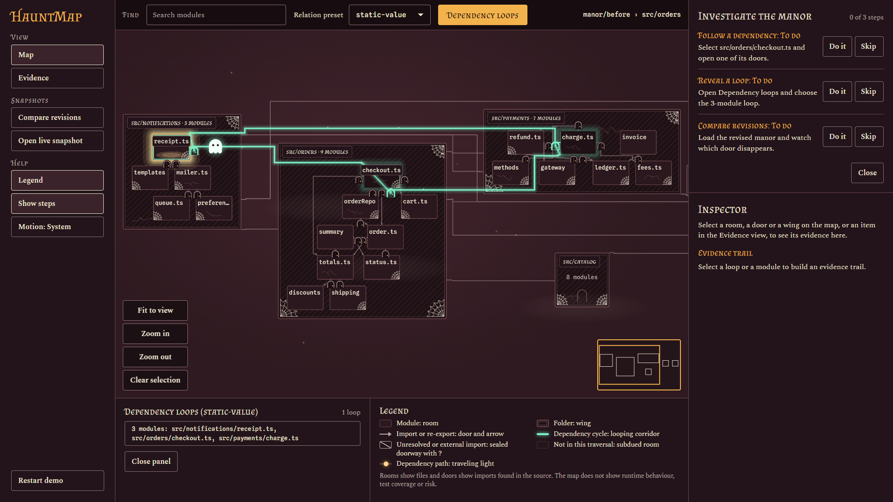

# HauntMap



Live app: https://hauntmap.midknight-ent-llc.workers.dev (no account, no install). Demo film, 2 minutes: https://youtu.be/7Larlko9x4M

HauntMap is our Costume Contest entry: a haunting user interface that is polished and unforgettable, where the spooky design elements enhance the app's function. It turns the imports of a TypeScript or JavaScript project into a haunted manor you can walk through. Folders are wings, files are rooms, imports are doors, and a dependency loop is a glowing corridor that a ghost walks round and round. Kiro built it with spec driven development: nine specs, each with requirements, design and tasks, carried out in the Kiro CLI, the Kiro IDE and Kiro Web, plus a Kiro Crew app and a custom agent. It reads source text only and never runs it.

Category: Costume Contest.

## Judging criteria at a glance

**Potential Impact.** Circular imports and tangled modules are a daily problem in JavaScript and TypeScript projects, and they are hard to see in a file tree. HauntMap finds every dependency loop and shows the exact import line behind each door, with the source excerpt. Compare two versions and it shows which import was removed or added and whether the loop closed, while every room stays where it was. Everything on the map is also in the Evidence view as plain lists, the whole journey runs with the keyboard alone (`tests/e2e/keyboard-journey.spec.ts`), and it follows reduced motion (`tests/e2e/reduced-motion.spec.ts`). No account and no server. Local folder analysis sends nothing anywhere; the GitHub route sends the repository name, the ref and the file paths to the jsDelivr CDN (see `docs/limitations.md`). The problem is common: dpdm and circular-dependency-plugin, two npm packages that exist only to find circular dependencies, were downloaded 1,647,935 times from 13 to 19 November 2026 (api.npmjs.org, read on 20 November 2026). An automated axe scan of 32 screens found 29 serious violations; after the fixes it finds none (`docs/acceptance/accessibility/`).

**Technological Implementation.** Kiro wrote the code from nine specs (`.kiro/specs`): five large ones (56 requirements, 81 done tasks), each reviewed by Kiro before any code, and four small ones for the power and the agent, a resolver fix, an accessibility scan and a second resolver fix. Six steering files hold the rules. We used four Kiro surfaces. The Kiro CLI wrote most of the code. The Kiro IDE ran a spec task from its `Start task` link and showed the hook files (`docs/acceptance/ide-session/`). Kiro Web made a pull request that we merged (`docs/acceptance/kiro-web/`). Kiro Crew runs our app `hauntmap-crew` (https://github.com/Midknight56/hauntmap-crew), whose agent reports new and closed loops between two commits; a real run is in its README. HauntMap ships its own MCP server with four tools (`analyze`, `cycles`, `who_imports`, `compare`), and Kiro calls them while it edits: in a recorded session Kiro called `cycles`, removed one import, called `compare`, and reported 1 removed relation and loops 1 to 0. A `Stop` hook then wrote a live snapshot that the app opens. Kiro also built a power (`power/hauntmap`, `docs/acceptance/power-session/`) and a custom agent that reviews loops with read and HauntMap tools only (`.kiro/agents/haunt-reviewer.json`, `docs/acceptance/haunt-reviewer-session/`). Experiments: the same small feature built from a one sentence prompt and from a spec (`docs/acceptance/vibe-vs-spec/`), and the same spec built by three models (`docs/acceptance/model-test/`). The `Stop` hooks and `typecheck-on-save` were seen to run (`docs/acceptance/hook-verify-on-stop.md`, `docs/acceptance/ide-session/`). 61 `fc.assert` property checks run with fast check. 132 rows in `docs/kiro-log.md`, one for each task or pass.

**Design.** A complete product, not a proof of concept: a guided three step tour, search, a loop panel, an inspector with the source line, an Evidence view, a minimap, a comparison of two versions and a live snapshot. The look serves the function: the loop glows and a ghost walks it in step order, a removed door becomes a dashed ghost passage and an added door a green arch. It fits a 360 by 640 phone and a 1920 by 1080 screen, checked by a browser test that fails on any control under 44 px, any overlap and any clipped text. Every text is at least 12 px on screen. The ghost walks, the glow breathes and the doors swing, and with reduced motion all of it stops.

**Innovation/Idea.** The manor is not decoration: it is the data model. A file is a room you can enter, an import is a door with its line number, and a cycle is a corridor that returns to where it began. Rooms keep their place across two versions, so a change reads as one door closing. The same analysis runs in the browser and in the MCP server, so the agent that edits the code and the person who reads the map see the same facts.

**Presentation.** The demo video (under three minutes, https://youtu.be/7Larlko9x4M) shows the whole journey in the release build: the tour, the loop and its ghost, the evidence behind a door, search, the Evidence view, the comparison and the live snapshot. The live app opens with no account and no install. This README and `docs/write-up.md` give a source for each figure.

## Try it

Open the live app and choose `Explore the manor`. Then:

1. `Dependency loops`, then choose the loop. The corridor glows and the ghost walks it.
2. Choose a step in the evidence trail to see the import line in the source.
3. `Compare revisions`, then `Revised manor`. One door closes and the loop is gone.
4. `Open live snapshot` opens the file the Kiro hook wrote after the recorded session.
5. `Analyze a local folder` opens a dialog that lists what will be read before it reads anything, then analyzes the folder in your browser. `Load a GitHub repository` takes the address of a public repository (`https://github.com/owner/repo`, optionally with `/tree/<branch or tag>`) and fetches its files through jsDelivr. In `Compare revisions`, `Local folder as the newer snapshot` and `GitHub repository as the newer snapshot` use the same dialogs to supply the newer side.

## Run it on your machine

Needs Node 24 and pnpm 12.

```bash
pnpm install --frozen-lockfile
pnpm dev
```

The checks:

```bash
pnpm verify
pnpm verify:e2e
```

| Suite | Count | Result |
| --- | --- | --- |
| unit, component and property tests (`pnpm verify`) | 1,738 in 143 files | pass |
| browser tests, headless Chromium (`pnpm verify:e2e`) | 244 (1 more is skipped unless `HAUNTMAP_LIVE_NETWORK=1`) | pass |

Both totals are from the runs of 20 November 2026 on one Windows PC (`docs/acceptance/gate-2026-11-20.md`).

The MCP server and the command line tool:

```bash
pnpm build:mcp
pnpm hauntmap analyze haunts/manor --out public/demo/live.json
```

`.kiro/settings/mcp.json` registers the server for Kiro. `docs/DEPLOY.md` says how to host the static build.

## How Kiro was used

`docs/write-up.md` has the full account with a source for every figure. In short:

### Kiro IDE, CLI, Web, Crew

Kiro CLI: version 3.3.0 on 16 November 2026, 3.4.0 on 17 November, 3.5.0 on 19 and 20 November, model `auto` unless a row says another model, one written prompt per batch of tasks. Every task is a row in `docs/kiro-log.md`.

Kiro IDE (20 November): the IDE opened this folder in Restricted Mode until we trusted it. A spec task ran from its `Start task` link in `tasks.md`, and Kiro asked before each shell command. The Agent Hooks panel listed our three hook files with their trigger, command and matcher, and showed them switched off until enabled. `typecheck-on-save` ran when the agent saved a file in a new chat session. Screenshots and the process log: `docs/acceptance/ide-session/`.

Kiro Web (20 November): one task made a commit on a branch, and a second made pull request 1, which we reviewed and merged: https://github.com/Midknight56/hauntmap/pull/1 (`docs/acceptance/kiro-web/`).

Kiro Crew (20 November): the app `hauntmap-crew`, https://github.com/Midknight56/hauntmap-crew, with an agent, a skill, the HauntMap tools as its tool door and a nightly job that ships switched off. Kiro CLI wrote it with 82 tests. The README of the app has one real run on Kiro Crew 0.12.2.

How they differ, from what we saw: the CLI runs headless with every tool trusted and asks nothing; the IDE asks before each command and shows hooks as rows in the chat; Web works on a GitHub branch and answers in under a minute; Crew runs an agent as an app with its own tools and jobs, and held the first run until a dashboard was open to approve it.

### Custom agents

The custom agent `.kiro/agents/haunt-reviewer.json` reviews a change for new or closed dependency loops. Its tool list is file reads and HauntMap's four MCP tools, and nothing else: it has no write tool and no shell tool. Its prompt tells it to call `cycles` on the before folder and the after folder, then `compare`, and to report each loop change with the import line. `kiro-cli agent validate --path .kiro/agents/haunt-reviewer.json` accepts the file. In one headless run on `public/demo/manor/before` and `public/demo/manor/after` it called `cycles` twice and `compare` once, reported the removed relation from `receipt.ts` to `checkout.ts` with its import line, and reported loops 1 to 0. In a second run, with every tool trusted, it refused to write a file or run a shell command, and the file was not created. Proof and limits: `docs/acceptance/haunt-reviewer-session/`. The test `tests/kiro/extensions.test.ts` checks that the file parses, that every tool it names exists in `packages/hauntmap-mcp`, and that no write or shell tool is listed.

A second agent, `hauntmap-loop-watch`, lives in the Kiro Crew app `hauntmap-crew`. It uses the same HauntMap tools through a launcher that exports two git commits into a work folder, and reports the closed and the new loops with the file, line and import text. In its real run on a repository with three commits it reported the loop of `src/orders.ts` and `src/payments.ts` as closed and the loop of `src/notices.ts` and `src/receipts.ts` as new (https://github.com/Midknight56/hauntmap-crew).

### Agent hooks

Three hook files sit in `.kiro/hooks`. Two of them were seen to run in headless Kiro CLI sessions, and the third in the Kiro IDE. The `Stop` hook `analyze-live` runs `pnpm demo:live`, which writes the live snapshot `public/demo/live.json` that the app opens with `Open live snapshot`: the file did not exist before the session and existed after it (`docs/acceptance/hook-analyze-live.md`). The `Stop` hook `verify-on-stop` runs `pnpm verify`: in a headless session that only answered one word, `pnpm verify` started 3.6 seconds after the session did and its output came back to the session (`docs/acceptance/hook-verify-on-stop.md`). That run of the hook failed, because the tests of this work were still red; the proof file shows it, and says what it does not show. The `typecheck-on-save` hook has the trigger `PostFileSave`. In the Kiro IDE, a save by the agent in a new chat session ran `typecheck-on-save`, and the chat showed `1 hook triggered`. A Ctrl+S in the editor did not start it in the 25 seconds watched. This is one window and one run. The proof is in `docs/acceptance/ide-session/`.

### Spec driven development

Five specs in `.kiro/specs`, all built: `analysis-core`, `kiro-integration`, `investigation-ui`, `snapshot-comparison` and `intake`, with 56 requirements and 81 done tasks (counted from the headings and the ticked boxes on 19 November 2026; a few tasks of the first four were dropped by the revision of 16 November and stay open). Each spec has `requirements.md` (numbered acceptance criteria), `design.md` (contracts, data shapes, the tests that prove each criterion) and `tasks.md` (small steps, each naming the requirements it covers and the check that must pass). Kiro reviewed each spec before any code, and every task wrote its test first, saw it fail, then wrote the code. Four small specs were written on 20 November 2026: `kiro-extensions` (the power, the custom agent and the hook proof), `node-builtins` (made in the IDE), `url-imports` and `accessibility-scan`. Compared with vibe coding, the review is where it paid off: Kiro's review of `kiro-integration` found functions and files the spec named that did not exist in the code, and fixed the spec before a line was written.

We also built one real feature twice from the same sentence, "treat URL imports as external dependencies": once from that sentence alone and once from a spec Kiro wrote from it. Both builds passed 20 of the 22 cases of a separate acceptance file. The loose prompt cost 0.72 credits and 4.0 minutes. The spec cost 7.58 credits and 12.9 minutes, and it also left an end to end test, a limitations line, and a list of three documents that now disagree with the code. The spec was kept. Then the same spec was built by Auto (4.38 credits), Claude Opus 5.5 (11.61 credits) and Claude Haiku 5.5 (0.50 credits): all three passed the same 20 cases and wrote the same line of code. Numbers and method: `docs/acceptance/vibe-vs-spec/`, `docs/acceptance/model-test/`.

### Steering docs

Six files in `.kiro/steering`: the analysis rules, accessibility and motion (contrast, text size, reduced motion), the claims policy, folder ownership, the revision note of 16 November 2026, and a refactoring rule that makes Kiro call the `cycles` tool before an import change and `compare` after. In one headless session Kiro made the calls in that order (`docs/acceptance/steering-observation.md`).

### MCP

Our own MCP server, `packages/hauntmap-mcp`, gives Kiro four tools over stdio: `analyze`, `cycles`, `who_imports` and `compare`. In a recorded session Kiro called `cycles`, removed one import, called `compare`, and reported 1 removed relation and loops 1 to 0 (`docs/acceptance/h9-session/`). The same analysis code runs in the browser, so the agent and the person see the same facts.

### Property based testing (PBT)

61 `fc.assert` calls in 10 files (counted on 19 November 2026). The Kiro CLI has no button that derives properties from a spec, so the analysis properties were written from the acceptance criteria. One property found a real bug: it generated the Windows path `link/C:`, which the MCP loader read wrongly, and the fix went into the loader with that path kept as a fixed example.

### Kiro powers

We built a power: `power/hauntmap`, in the Agent Plugins format (`plugin.json`, `mcp.json` and the skill `skills/refactor-loops`). It gives any Kiro user HauntMap's four MCP tools and the refactor rule of `.kiro/steering/refactoring.md`. `power/hauntmap/README.md` says how to install it with `kiro-cli powers install power/hauntmap`, and what it needs: Node 24, `pnpm install`, `pnpm build:mcp`, and two environment variables that name the built server file and your workspace (Kiro copies an installed power, so it cannot find them itself). In one headless session in a throwaway copy of `haunts/manor`, with a plain prompt that named no tool, Kiro loaded the power, called its `cycles` tool and listed the loop of three files. The power was then uninstalled with `kiro-cli powers uninstall hauntmap`, so it is not loaded into other sessions on that machine. Proof and limits: `docs/acceptance/power-session/`.
## What it does not do

It reads a documented subset of the import rules of Node and TypeScript, not all of them. It shows the shape of static imports, not runtime behaviour, correctness, risk or test coverage. Comparison takes the open investigation as the earlier side and the bundled revised manor, the live snapshot, a local folder or a public GitHub repository as the newer side; a repository is loaded whole, so subfolders and private repositories are not supported. Folders are limited to 1,000 files and 25 MiB, and GitHub repositories to 400 files. The local route sends nothing (`tests/intake/e2e/local.spec.ts`, `docs/acceptance/intake/local-requests.json`); the GitHub route sends the repository name, the ref and the file paths to jsDelivr. One real load of `reduxjs/redux@5.0.1` (197 included files) took 25,307 ms on this PC, above the target of 10,000 ms (`docs/performance.md`). More in `docs/limitations.md`.

## Licence

MIT, see `LICENSE`. Third party notices: `docs/third-party-notices.md`.
